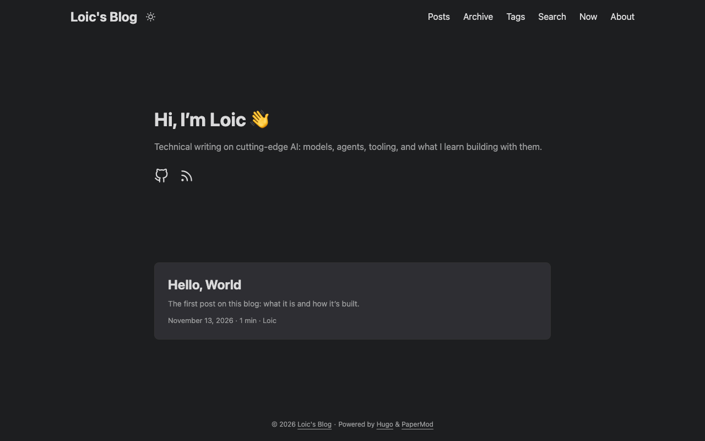
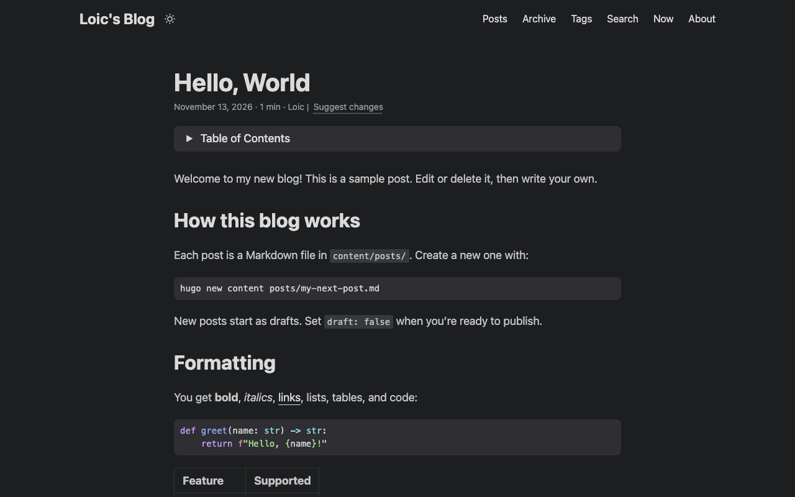

*What I'm focused on at the moment. Last updated November 13, 2026.*

## This blog

A home for technical writing on cutting-edge AI: models, agents, tooling, and what I learn building with them.

- **Source:** [github.com/coolloic/blog](https://github.com/coolloic/blog)
- **Built with:** [Hugo](https://gohugo.io) and the [PaperMod](https://github.com/adityatelange/hugo-PaperMod) theme, deployed to GitHub Pages with GitHub Actions
- **Status:** just launched 🚀

