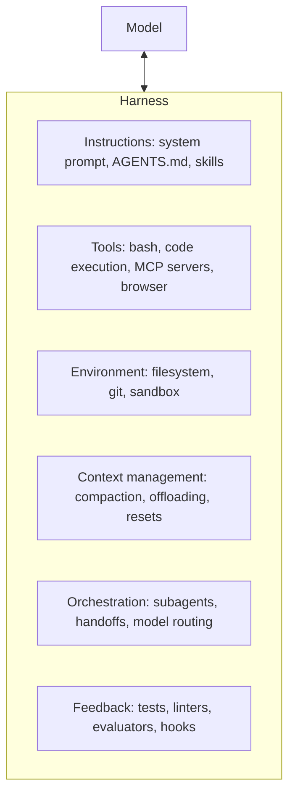
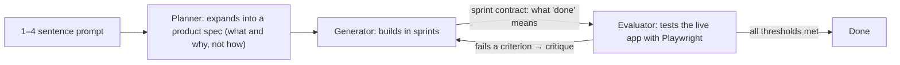

In my [last post](anatomy-of-an-ai-agent.md) I argued that an agent is a loop, some tools and a lot of careful context management, and that the gap between a demo and a reliable system lives in everything around the model. In 2026 that "everything around" got a name: **harness engineering**.

The cleanest definition I've found is LangChain's: **Agent = Model + Harness**, where the harness is all the code, configuration and execution logic that isn't the model itself ([LangChain, Mar 2026](https://www.langchain.com/blog/the-anatomy-of-an-agent-harness)). The model is the part you rent. The harness is the part you build, and increasingly it is where the engineering lives.

## Where the term came from

The phrase took off with an OpenAI engineering post in February 2026, "Harness engineering: leveraging Codex in an agent-first world", by Ryan Lopopolo. It describes a team shipping an internal product of roughly a million lines with Codex agents writing essentially all of the code. The headline lesson was not about the model. The engineers' job moved from writing code to **designing the environment, specifying intent and building feedback loops**. Early progress was slow because the environment was underspecified, not because the agent couldn't code.

Some practices from that write-up, as widely reported:

- **AGENTS.md is a map, not an encyclopedia.** It's a short table of contents that points into a structured `docs/` folder (architecture, design docs, execution plans), not one giant instruction file that rots and bloats context.
- **Architecture is enforced mechanically.** Layering rules and conventions are checked by linters and structural tests the agent can run itself. The failure messages are written as instructions for the fix.
- **The agent can see the product.** The team wired the Chrome DevTools Protocol into the agent runtime, with skills for DOM snapshots, screenshots and navigation.
- **Garbage collection is automated.** Recurring "doc-gardening" agents look for stale documentation and open fix-up PRs, so entropy is cleaned up continuously instead of in a weekly human sweep.

*(OpenAI's page blocked my fetcher, so this section relies on the details that several independent write-ups agree on. Read [the original](https://openai.com/index/harness-engineering/) for the exact claims.)*

## What's in a harness

Taking LangChain's anatomy and filling in from practice, a modern harness has roughly these layers:

A few of these do more work than they look like they should:

- **The filesystem is the foundation.** It's the agent's workspace, its overflow for context and the surface where agents (and humans) collaborate. Add git and you get versioning, rollback and branching for free. LangChain calls it the most foundational primitive.
- **Bash beats a hundred bespoke tools.** A general code-execution tool lets the agent build the tool it needs instead of waiting for you to ship one.
- **Sandboxes make autonomy affordable.** Isolated environments with allow-listed commands and network rules can be created per task, fanned out and torn down. They come preloaded with runtimes, test CLIs and a browser so the agent can verify its own work.
- **Hooks make some behaviour deterministic.** Don't *ask* the model to run the linter. Have the harness run it after every edit and feed the errors back.

## Lesson 1: Sessions end, so the state has to live outside the model

Anthropic's ["Effective harnesses for long-running agents"](https://www.anthropic.com/engineering/effective-harnesses-for-long-running-agents) (Justin Young, Nov 2025) starts from a blunt observation. Long tasks span many context windows, and each new session starts with amnesia, like an engineer arriving for a shift with no handover. Compaction alone wasn't enough. Given only "build a clone of claude.ai", Opus 4.5 fell into two failure modes:

1. **Trying to one-shot it:** running out of context mid-feature and leaving half-built, undocumented work.
2. **Declaring victory early:** a later session sees progress and decides the job is done.

The fix was a harness, not a better prompt:

- An **initializer agent** runs once. It writes an `init.sh`, a progress log and an initial commit, plus a feature list of over 200 items, all marked failing.
- A **coding agent** runs every later session and does **one feature per session**. It commits with descriptive messages and updates the progress log.
- The feature list is **JSON, not Markdown**, and the agent may only flip a `passes` flag. Their finding was that the model is less likely to inappropriately rewrite JSON.
- Every session starts the same way: check the directory, read the git log and progress file, pick the highest-priority failing feature, start the app, and run a basic end-to-end check *before* new work.
- **Test like a user.** Left alone, the agent marked features done after unit tests or curl. Giving it browser automation (Puppeteer via MCP) and telling it to test as a human would "dramatically improved" results.

None of this is exotic. It's what a good engineering team does: clear docs, small increments, verified completion, clean handoffs. The harness turns those habits into structure the model can't forget.

## Lesson 2: Don't let the generator grade its own homework

The follow-up, ["Harness design for long-running application development"](https://www.anthropic.com/engineering/harness-design-long-running-apps) (Prithvi Rajasekaran, Mar 2026), goes further. Models confidently praise their own work, especially on subjective tasks like design. It turned out to be **far easier to tune a separate, skeptical evaluator than to make a generator self-critical.**

The resulting harness has three roles:

The details are what make it work:

- **Gradeable criteria.** For frontend work: design quality, originality, craft and functionality, with explicit penalties for generic "AI slop". The evaluator was calibrated with few-shot examples that show detailed score breakdowns.
- **Sprint contracts.** Before each sprint, generator and evaluator agree in files on what done means and how it will be checked. One sprint had 27 criteria. Any criterion below its threshold fails the sprint.
- **Context resets over compaction.** Models degrade as context fills, and some show "context anxiety", wrapping up early as they think they're nearing the limit. A fresh agent with a structured handoff fixes both. Compaction keeps continuity but not a clean slate.

It's not cheap. On the same retro game maker prompt, a solo run took **20 minutes and $9 and produced a broken game**. The full harness took **6 hours and $200 and produced a working one**. That's more than 20x the cost for the difference between broken and shipped.

## Lesson 3: The harness changes as the model changes

The most interesting part of that post is what happened next. With Opus 4.6, the author **removed the sprint structure** and moved the evaluator to a single pass at the end, because the new model could hold a coherent build on its own. A digital audio workstation build then ran in about 3 hours 50 minutes for roughly $125, mostly spent building with short QA rounds between.

The rule of thumb they landed on: **an evaluator is worth its cost only when the task sits beyond what the model does reliably alone.** Every harness component is a bet about a specific model weakness. When the model improves, some bets stop paying, and new tasks at the frontier need new ones. The author's conclusion was that the space of useful harness designs *moves* as models improve. It doesn't shrink.

There's a coupling in the other direction too. Products like Claude Code and Codex are post-trained with their harnesses in the loop, so models can overfit to a particular harness's tools. LangChain points to Terminal-Bench 2.0, where the same model scores very differently depending on the harness around it. They also report moving their own coding agent from outside the top 30 to the top 5 by changing only the harness. Benchmarks measure model *plus* harness, whether they say so or not.

## Principles I'm taking away

1. **Treat agent failures as harness bugs first.** When the agent does something dumb, ask what it couldn't see, couldn't check or wasn't stopped from doing. Then fix the environment, not just the prompt. Run it, watch it fail, classify, patch the harness, repeat.
2. **Put state in files, not in the context window.** Progress logs, feature lists, plans and git history survive resets. Conversation history doesn't.
3. **Make feedback mechanical.** Tests, linters, type checkers and structural rules the agent can run, with error messages written as instructions. The cheapest reviewer is a deterministic one.
4. **Let the agent see what the user sees.** Browser automation, screenshots, logs. "It compiles" is not "it works".
5. **Separate making from judging.** A skeptical evaluator with explicit, calibrated criteria beats asking the generator to reflect.
6. **Keep instructions small and navigable.** A short map that points to deeper docs beats one huge file the model half-reads.
7. **Schedule the cleanup.** Agents generate entropy as fast as they generate code. Recurring cleanup agents keep the codebase legible for the next session.
8. **Re-justify every component on each model upgrade.** Scaffolding that was essential last quarter may now be overhead. Delete it, and spend the budget on the next frontier task.

This connects back to the wiki: the [agent loop](../wiki/concepts/agent-loop.md) is the core, [context engineering](../wiki/concepts/context-engineering.md) and [verification](../wiki/concepts/verification-and-evals.md) are harness layers, and the [agent design patterns](../wiki/concepts/agent-design-patterns.md) page covers the generator–critic loop in general form. Harness engineering is what you call it when you do all of them deliberately, against a specific model, on real work.

## Sources

- Vivek Trivedy, [The Anatomy of an Agent Harness](https://www.langchain.com/blog/the-anatomy-of-an-agent-harness), LangChain, March 2026.
- Justin Young, [Effective harnesses for long-running agents](https://www.anthropic.com/engineering/effective-harnesses-for-long-running-agents), Anthropic, November 2025.
- Prithvi Rajasekaran, [Harness design for long-running application development](https://www.anthropic.com/engineering/harness-design-long-running-apps), Anthropic, March 2026.
- Ryan Lopopolo, [Harness engineering: leveraging Codex in an agent-first world](https://openai.com/index/harness-engineering/), OpenAI, February 2026.
