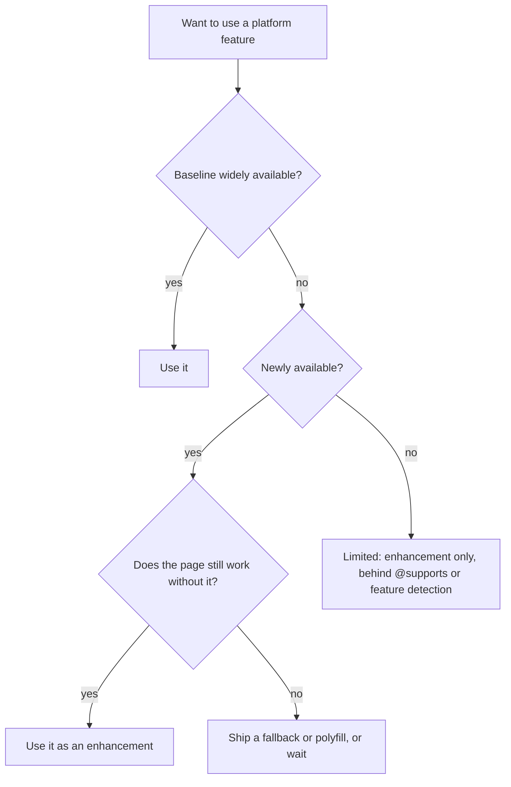

My last two posts were about AI agents. This one goes back to the web, where I've spent most of my career. Every few months I'm asked some version of "what should a new site do now?", and the answer has changed a lot in two years. Things that needed a framework or a polyfill are now one HTML attribute. The browsers agree on more than they ever have. Laws have caught up with accessibility, and Chrome now warns before loading a plain-HTTP site.

These are the guidelines I'd hand a team starting a site today, with the numbers and sources behind them.

## 1. Decide what "supported" means with Baseline

The old question was "does it work in IE?". The modern answer is **Baseline**, a shared definition maintained by the W3C WebDX Community Group and shown on MDN, caniuse and web.dev ([web.dev](https://web.dev/baseline)).

- **Limited availability:** the feature isn't in all core browsers yet.
- **Newly available:** it works in the current version of every core browser: Chrome and Edge, Firefox, and Safari, on desktop and mobile.
- **Widely available:** 30 months after it became newly available, long enough that most users' browsers have caught up.

There are also year labels: "Baseline 2025" means everything that became newly available during 2025. Pick a target, such as "Widely available, plus newly available behind progressive enhancement", and write it down. Then let tools enforce it: Browserslist has Baseline queries, ESLint can lint for Baseline, and Lighthouse and Chrome DevTools show Baseline status.



*Synthesis: this is how I apply Baseline, not an official process.*

Baseline status can also go backwards. Top-level `await` dropped out of Baseline in late 2025 after a Safari regression, then came back once Safari fixed it ([Baseline digest, Dec 2025](https://web.dev/blog/baseline-digest-dec-2025)). Treat the data as live, not a one-time lookup.

## 2. Hit the Core Web Vitals, measured on real users

Google's three Core Web Vitals are still the best short definition of "fast" ([web.dev](https://web.dev/articles/vitals)):

| Metric | Measures | Good | Poor |
|---|---|---|---|
| **LCP** (Largest Contentful Paint) | Loading: when the main content appears | ≤ 2.5 s | > 4 s |
| **INP** (Interaction to Next Paint) | Responsiveness: delay from a tap or key to the next frame | ≤ 200 ms | > 500 ms |
| **CLS** (Cumulative Layout Shift) | Visual stability: how much things jump around | ≤ 0.1 | > 0.25 |

Each is judged at the **75th percentile** of real visits, separately for mobile and desktop. INP replaced First Input Delay in March 2024 ([web.dev](https://web.dev/blog/inp-cwv-march-12)). FID only measured the *first* interaction's input delay, while INP covers every interaction through to the next paint, so sites that passed FID easily often fail INP.

**Measure in the field, debug in the lab.** Field data comes from CrUX (via PageSpeed Insights or Search Console) or the `web-vitals` library in your own analytics. Lighthouse is a lab tool. It can't measure INP, since nobody is clicking, so it uses Total Blocking Time as a stand-in.

**New in 2026, for single-page apps:** CrUX now publishes experimental soft-navigation versions of LCP, INP and CLS. A route change in an SPA is measured like a new page instead of disappearing into the first load ([web.dev, Oct 2026](https://web.dev/blog/crux-experimental-soft-navs)). Google is aiming to make them stable around May 2027, after which Search Console switches to them. If you run an SPA, look at these numbers now. Chrome 152's DevTools already shows them ([Chrome](https://developer.chrome.com/blog/new-in-devtools-152)).

What actually moves the numbers:

- **LCP:** make the hero image discoverable in the HTML (not injected by JavaScript), give it `fetchpriority="high"`, and serve AVIF or WebP at the right size. Never `loading="lazy"` the LCP image; lazy-load everything below the fold instead. All of these are now Baseline.
- **INP:** keep long tasks off the main thread. Break up work so the browser can paint between chunks. `scheduler.yield()` is the clean way to do it, but it isn't in Safari yet, so wrap it in a `setTimeout` fallback. `content-visibility: auto` (Baseline since Safari 26) skips rendering for off-screen sections.
- **CLS:** give images and embeds explicit dimensions or an `aspect-ratio`, and reserve space for anything that loads late.
- **Instant navigations:** the Speculation Rules API lets you prefetch or prerender likely next pages. It's Chromium-only for now; Firefox has early prefetch support behind a pref and Safari has it behind a flag ([Chrome docs](https://developer.chrome.com/docs/web-platform/prerender-pages)). It does nothing in other browsers, which makes it a safe enhancement.

One LCP failure I worked on is a case study on [my CV](https://coolloic.github.io/): deeply nested components making the browser do far too much layout work. The general lesson is to **profile before you optimise**. Payload size is the usual suspect, but it wasn't the cause there.

## 3. Build to WCAG 2.2 AA, because it's now the law in more places

**WCAG 2.2** became a W3C Recommendation in October 2023 and is the current target ([W3C](https://www.w3.org/WAI/standards-guidelines/wcag/new-in-22/)). It added nine success criteria. These are the ones at level A and AA that most sites need:

- **Target Size (Minimum), 2.5.8:** interactive targets at least **24×24 CSS pixels**, or enough spacing around them.
- **Focus Not Obscured, 2.4.11:** a sticky header or cookie banner mustn't hide the focused element.
- **Dragging Movements, 2.5.7:** anything done by dragging also needs a single-pointer alternative.
- **Accessible Authentication, 3.3.8:** no cognitive tests to log in. Allow paste and password managers, so no "retype your password from memory".
- **Consistent Help, 3.2.6, and Redundant Entry, 3.3.7:** help in the same place on every page, and don't make people re-enter information they already gave you.

It also removed 4.1.1 Parsing as obsolete.

WCAG 3 is still a working draft. A new draft appeared in September 2026, and the W3C says it won't be a finished standard "for a few more years" ([W3C](https://www.w3.org/WAI/standards-guidelines/wcag/wcag3-intro/)). Don't wait for it.

The law has caught up:

- **EU:** the **European Accessibility Act** has applied since **28 June 2025** to in-scope products and services marketed in the EU, including e-commerce, banking, e-books, communications and transport services ([EU AccessibleEU](https://accessible-eu-centre.ec.europa.eu/content-corner/news/new-era-inclusion-begins-eaa-enters-force-2025-06-27_en)). Micro-enterprises providing services are exempt.
- **US public sector:** the DOJ's ADA Title II rule requires WCAG 2.1 AA from state and local governments. An April 2026 interim rule pushed the deadlines back a year, to **26 April 2027** for large entities and **26 April 2028** for smaller ones ([Federal Register](https://www.federalregister.gov/documents/2026/04/20/2026-07663/extension-of-compliance-dates-for-nondiscrimination-on-the-basis-of-disability-accessibility-of-web)).

The practical rule hasn't changed: **use native HTML elements first.** A real `<button>` comes with focus, keyboard support and a role for free. Run axe or Lighthouse in CI to catch regressions, and test with a keyboard and a screen reader yourself, because automated tools find only part of the problems.

## 4. Use the platform: less JavaScript for common UI

The biggest change of the last two years is how much UI the browser now does natively. Each of these replaces a library or a few hundred lines of script.

**Safe to use everywhere (Baseline widely available):**

- `<dialog>` for modals, with focus handling and Escape built in.
- CSS **nesting**, **`:has()`** (a "parent selector"), **size container queries**, **cascade layers** and **subgrid**.
- **Import maps**, so bare module names work without a bundler.
- `light-dark()` and `text-wrap: balance`, which reach widely available this month by the 30-month rule.

**Newly available, so use them with a fallback:**

- **Popover API** (`popover` attribute): menus, tooltips and toasts in the top layer with light-dismiss, no z-index fights.
- **Invoker commands** (`commandfor` and `command`): a button can open a dialog or popover with no JavaScript.

  ```html
  <button commandfor="settings" command="show-modal">Settings</button>
  <dialog id="settings">…</dialog>
  ```

- **Same-document view transitions** for animated state changes; Firefox 144 completed support.
- **`@scope`**, **container style queries**, **`field-sizing: content`** (auto-growing text areas), **`contrast-color()`** and the **Navigation API**.
- **Scroll-driven animations**, which became Baseline only in late October 2026.

**Not Baseline yet, so treat them as enhancements:** customizable `<select>` (`appearance: base-select`), cross-document view transitions, anchor positioning, `text-wrap: pretty`, `interpolate-size`, and the `Temporal` date API, which isn't in stable Safari yet.

Several of these are focus areas of **Interop 2026**, the yearly effort where Apple, Google, Microsoft, Mozilla and others agree to fix the same things together ([web.dev](https://web.dev/blog/interop-2026)). It covers anchor positioning, cross-document view transitions, container style queries, scroll-driven animations and dialog/popover additions. Interop 2025 ended with every browser above 98% on its tests ([WebKit](https://webkit.org/blog/17808/interop-2025-review/)), so features on the list tend to become dependable quickly.

## 5. Security defaults

The basics are short, and most of them are headers you set once.

- **HTTPS only, with HSTS.** From Chrome 154, released in autumn 2026, "Always use secure connections" is on by default: Chrome warns users before it loads a public site over plain HTTP ([Google Security Blog](https://security.googleblog.com/2025/10/https-by-default.html)). An HTTP-only site now looks broken.
- **A strict Content Security Policy** using nonces and `'strict-dynamic'` rather than allow-lists of domains, which are easy to bypass ([web.dev](https://web.dev/articles/strict-csp)).
- **Trusted Types** became Baseline in February 2026, when Firefox and Safari shipped it. Adding `require-trusted-types-for 'script'` to your CSP stops DOM-based XSS by making dangerous sinks like `innerHTML` accept only vetted values. Until 2026 this protected Chrome users only. Now it protects everyone.
- **Cookies:** `Secure`, `HttpOnly`, and an explicit `SameSite`. Don't rely on browser defaults, which differ. The `__Host-` prefix locks a cookie to your exact host ([MDN](https://developer.mozilla.org/en-US/docs/Web/HTTP/Reference/Headers/Set-Cookie)).
- **The rest of the usual set:** `X-Content-Type-Options: nosniff`, `frame-ancestors` in CSP to prevent clickjacking, and a `Referrer-Policy`. Chrome's default is already `strict-origin-when-cross-origin`.
- **Passkeys** for sign-in. WebAuthn has been Baseline widely available since 2024. The FIDO Alliance's 2026 index reports passkeys used for 36% of sign-ins at participating services, with higher success rates than traditional MFA ([FIDO Alliance](https://fidoalliance.org/passkey-index-2026/)). That's an industry figure, but the direction is clear. Passkeys also help with WCAG's accessible authentication criterion.

For the application layer, the **OWASP Top 10:2025** is the current list ([OWASP](https://top10.owasp.org/2025)). Two entries are new: **A03 Software Supply Chain Failures**, which covers your npm dependency tree, and **A10 Mishandling of Exceptional Conditions**. SSRF is now folded into A01 Broken Access Control. For a typical frontend team, A03 is the one to act on: lock files, dependency review and fewer dependencies. The platform features in section 4 help here too, since every library you delete is one less supply-chain risk.

## 6. Privacy: assume less tracking, not more

The third-party-cookie story ended differently than expected:

- In April 2025 Google dropped its plan to remove third-party cookies from Chrome. They stay on by default, under user control ([Privacy Sandbox](https://privacysandbox.google.com/blog/privacy-sandbox-next-steps)).
- In October 2025 Google announced it was **retiring most of the Privacy Sandbox APIs**: Topics, Protected Audience, Attribution Reporting and others. Only CHIPS (partitioned cookies) and FedCM survive ([Privacy Sandbox](https://privacysandbox.google.com/blog/update-on-plans-for-privacy-sandbox-technologies)).
- Safari has blocked third-party cookies by default for years ([WebKit](https://webkit.org/tracking-prevention/)). Safari 26 also limits fingerprinting scripts' access to APIs like screen size and canvas ([WebKit](https://webkit.org/blog/17333/webkit-features-in-safari-26-0/)). Firefox isolates cookies per site.

So the guideline isn't "third-party cookies are gone". It's that **you can't count on them in a large share of browsers.** Use first-party data, keep cross-site embeds working without third-party cookies, and collect only what you need.

## 7. Weight is a cost: sustainability

The W3C's **Web Sustainability Guidelines** are still a draft note, not a standard; the latest draft is from October 2026 ([W3C](https://www.w3.org/TR/web-sustainability-guidelines/)). You don't need them to justify the advice, though. Fewer bytes, fewer requests, less JavaScript and less third-party script make a site faster, cheaper to run and lighter on users' data plans and batteries. The performance work in section 2 is also the sustainability work.

## The checklist

1. **Support:** pick a Baseline target, write it down and enforce it with Browserslist and linting.
2. **Speed:** LCP ≤ 2.5 s, INP ≤ 200 ms and CLS ≤ 0.1 at p75 on real users. SPAs should start watching soft-navigation metrics.
3. **Accessibility:** WCAG 2.2 AA, native elements first, automated checks in CI plus manual keyboard and screen-reader testing.
4. **Platform first:** use `<dialog>`, popover, invoker commands, `:has()` and container queries before adding a library.
5. **Security:** HTTPS with HSTS, strict CSP with Trusted Types, explicit cookie attributes, passkeys, and a short, reviewed dependency tree.
6. **Privacy:** don't build on third-party cookies.
7. **Weight:** every byte and script has to earn its place.

None of this is new in spirit. It's what good web engineers have always argued for. What changed in 2025–2026 is that the browsers caught up, so doing it right is now usually also the least work.

## Sources

- web.dev, [Baseline](https://web.dev/baseline) and [Baseline digest, December 2025](https://web.dev/blog/baseline-digest-dec-2025); feature status from the WebDX `web-features` data (v3.46, November 2026).
- web.dev, [Web Vitals](https://web.dev/articles/vitals), [INP becomes a Core Web Vital](https://web.dev/blog/inp-cwv-march-12), [Experimental soft-navigation metrics in CrUX](https://web.dev/blog/crux-experimental-soft-navs) (October 2026), [Strict CSP](https://web.dev/articles/strict-csp), [Interop 2026](https://web.dev/blog/interop-2026).
- Chrome for Developers, [Prerender pages](https://developer.chrome.com/docs/web-platform/prerender-pages), [What's new in DevTools 152](https://developer.chrome.com/blog/new-in-devtools-152).
- W3C, [What's new in WCAG 2.2](https://www.w3.org/WAI/standards-guidelines/wcag/new-in-22/), [WCAG 3 introduction](https://www.w3.org/WAI/standards-guidelines/wcag/wcag3-intro/), [Web Sustainability Guidelines](https://www.w3.org/TR/web-sustainability-guidelines/).
- European Commission AccessibleEU, [the European Accessibility Act enters into force](https://accessible-eu-centre.ec.europa.eu/content-corner/news/new-era-inclusion-begins-eaa-enters-force-2025-06-27_en); [Directive (EU) 2019/882](https://eur-lex.europa.eu/eli/dir/2019/882/oj/eng).
- US Federal Register, [Extension of compliance dates for the ADA Title II web rule](https://www.federalregister.gov/documents/2026/04/20/2026-07663/extension-of-compliance-dates-for-nondiscrimination-on-the-basis-of-disability-accessibility-of-web) (April 2026).
- Google Security Blog, [HTTPS by default](https://security.googleblog.com/2025/10/https-by-default.html).
- MDN, [Set-Cookie](https://developer.mozilla.org/en-US/docs/Web/HTTP/Reference/Headers/Set-Cookie).
- OWASP, [Top 10:2025](https://top10.owasp.org/2025).
- FIDO Alliance, [Passkey Index 2026](https://fidoalliance.org/passkey-index-2026/).
- Google Privacy Sandbox, [Next steps](https://privacysandbox.google.com/blog/privacy-sandbox-next-steps) (April 2025) and [Update on plans for Privacy Sandbox technologies](https://privacysandbox.google.com/blog/update-on-plans-for-privacy-sandbox-technologies) (October 2025).
- WebKit, [Tracking prevention](https://webkit.org/tracking-prevention/), [WebKit features in Safari 26.0](https://webkit.org/blog/17333/webkit-features-in-safari-26-0/), [Interop 2025 review](https://webkit.org/blog/17808/interop-2025-review/).
