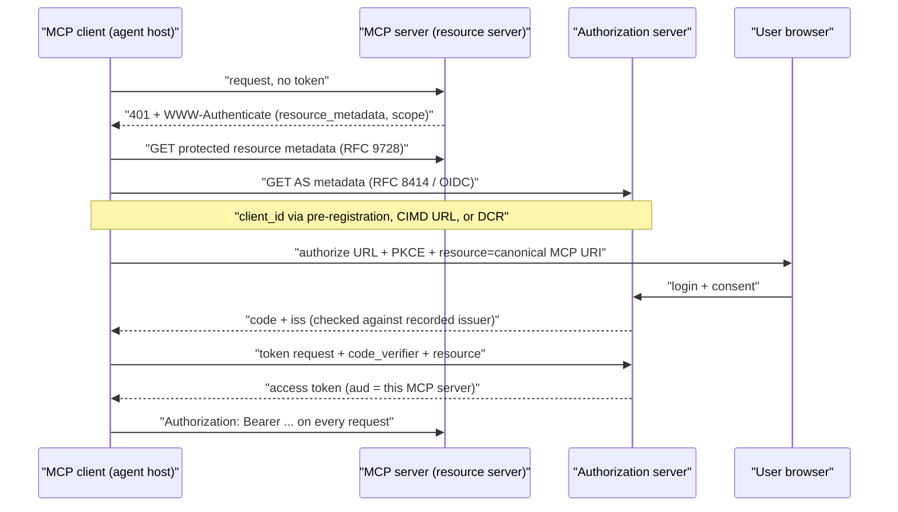
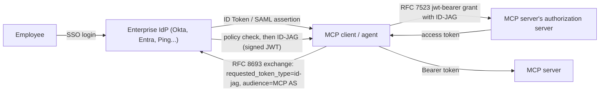

**Agent authentication and authorization** is the set of mechanisms that decide *who* an agent is, *on whose behalf* it is acting, and *which* resources it may touch with *which* rights, at every hop from the user to the agent, to its [tools](tools.md) or [MCP](model-context-protocol.md) servers, to the downstream SaaS APIs. The current consensus, across the MCP spec, IETF drafts and the credential-broker vendors, is to reuse OAuth rather than invent anything new: an agent is a workload with its own identity, user authority reaches it through short-lived, audience-bound, minimally scoped tokens, and the model itself never sees a credential ([IETF agent-auth draft](../sources/ietf-aiagent-auth-draft.md), [MCP authorization](../sources/mcp-authorization-spec.md)). The IETF agent-auth text cited here is an individual Internet-Draft (-03, July 2026), since replaced by the WIMSE working-group draft `draft-ietf-wimse-aims`. It is best practice, not a standard ([agent-auth draft](../sources/ietf-aiagent-auth-draft.md)).

## Two identities in every call

An agent request usually carries two principals: the **agent** (a client or workload) and the **subject** (the user, or nobody).

| Mode | Whose authority | OAuth shape | Typical use |
|---|---|---|---|
| Delegated (on-behalf-of) | The user's, narrowed by consent and scopes | Authorization code + PKCE (3-legged); token has user in `sub`, agent in `client_id` | Read my mail, open a PR as me |
| Agent / service identity | The agent's own | Client credentials or JWT grant (2-legged) | Tenant-wide jobs, background sync |
| Impersonation | User's, with the actor invisible | RFC 8693 token exchange without actor | Legacy APIs; avoid when audit matters |
| Delegation with actor | User's, actor recorded | RFC 8693 with `actor_token`; `act` claim | Multi-hop agents that must be auditable |

The IETF draft puts the agent in `client_id` and the delegating user in `sub` ([agent-auth draft](../sources/ietf-aiagent-auth-draft.md)). RFC 8693 separates *impersonation* (the holder is treated as the subject) from *delegation* (the actor keeps its identity, recorded in a possibly nested `act` claim; only the current actor counts for access decisions) ([RFC 8693](../sources/rfc-8693-token-exchange.md)). Vercel Connect exposes the same split as `{type:'app'}` vs `{type:'user', id}` subjects ([Vercel Connect](../sources/vercel-connect-guide.md)), and MCP lets `client_credentials` clients skip step-up and simply fail ([MCP authorization](../sources/mcp-authorization-spec.md)).

Synthesis: pick delegated identity whenever the action is visible to, or reversible by, a specific human. Then the downstream system's own ACLs keep applying, and audit logs name the person. Service identity is for work no single user owns. It needs its own tight scopes, because nothing else narrows it.

## OAuth 2.1 in MCP

A remote (HTTP) MCP server that needs auth is an OAuth 2.1 **resource server**. The client is an OAuth 2.1 client, and a separate or co-hosted **authorization server** (AS) issues tokens. stdio servers should take credentials from the environment instead ([MCP authorization](../sources/mcp-authorization-spec.md)).

Mechanics that matter in practice ([MCP authorization](../sources/mcp-authorization-spec.md)):

- **Discovery.** Servers MUST publish Protected Resource Metadata. Clients MUST support both RFC 8414 and OIDC discovery for the AS.
- **Audience binding.** Clients MUST send `resource` (RFC 8707, the canonical server URI such as `https://mcp.example.com/mcp`) in both the authorization and the token request. Servers MUST reject tokens not issued for them and MUST NOT pass any other token through.
- **Mix-up defence.** The client records the AS `issuer` before the redirect and compares the returned `iss` (RFC 9207) using simple string comparison, with no normalization. Caveat: AS inclusion of `iss` is still only a SHOULD, so a client rejects a response without `iss` only when the AS advertises `authorization_response_iss_parameter_supported` ([MCP authorization](../sources/mcp-authorization-spec.md)). PKCE alone does not stop mix-up ([best practices](../sources/mcp-security-best-practices.md)).
- **Token transport.** Tokens travel only in the `Authorization` header on every request, never in the query string. Refresh tokens are optional, at the AS's discretion. Servers should not demand `offline_access`.
- **Scopes and step-up.** Initial scopes come from the 401 challenge's `scope`, otherwise from `scopes_supported`, which should be the *minimal* set. At runtime a `403 insufficient_scope` names every scope the operation needs. The client re-authorizes with the union of old and new scopes and retries a bounded number of times.

**Client registration** is where agents differ most from classic OAuth, because a client and server usually have never met ([client registration](../sources/mcp-client-registration-spec.md)):

| Mechanism | How | Status (2026-07-28 spec) | Trade-off |
|---|---|---|---|
| Pre-registration | Static `client_id` (and secret) per AS | Tried first if available | Best control; doesn't scale to arbitrary servers |
| Client ID Metadata Document (CIMD) | `client_id` *is* an HTTPS URL to a JSON doc (`client_id`, `client_name`, `redirect_uris`); AS fetches and validates | SHOULD; preferred for unknown servers | Portable across ASes; AS must defend against SSRF and spoofed localhost redirects |
| Dynamic Client Registration (RFC 7591) | `POST /register` returns credentials | Deprecated, kept for compatibility | Unbounded client sprawl; needs correct `application_type` (`native` vs `web`) |

Credentials from pre-registration or DCR are bound to the issuing AS's `issuer`. If the server's metadata later points to a different AS, the client must re-register ([client registration](../sources/mcp-client-registration-spec.md)).

**The "third-party token" problem.** An MCP server that wraps GitHub needs a *GitHub* token, not the MCP token. The spec forbids token passthrough: the server must not accept a GitHub token from the client, and it must not forward the MCP token upstream. It has to act as its own OAuth client to GitHub. A proxy that uses one static client ID upstream, plus consent cookies, creates the **confused deputy** attack. The fix is per-client consent stored server-side, exact redirect-URI matching and single-use `state` ([best practices](../sources/mcp-security-best-practices.md)). The IETF draft generalizes the rule: tools must not forward the tokens they receive, and should use token exchange or transaction tokens downstream ([agent-auth draft](../sources/ietf-aiagent-auth-draft.md)). This upstream half is exactly what credential brokers sell.

## Enterprise SSO: token exchange and ID-JAG

Per-user, per-server consent screens do not survive an enterprise rollout. Security teams want one place to grant and revoke access. The MCP **Enterprise-Managed Authorization** extension (`io.modelcontextprotocol/enterprise-managed-authorization`) makes the corporate IdP the decision-maker ([MCP EMA](../sources/mcp-enterprise-managed-authorization.md)):

The **ID-JAG** (Identity Assertion JWT Authorization Grant) is an IETF OAuth WG draft (revision -06, 2026-10-31). It is a JWT with header `typ: oauth-id-jag+jwt` and required `iss`, `sub`, `aud` (the resource AS), `client_id`, `jti`, `exp` and `iat`, plus optional `scope`, `resource` and `act`. The resource AS must verify signature, issuer trust, audience and that `client_id` matches the authenticated client ([ID-JAG draft](../sources/ietf-id-jag-draft.md)). The IdP applies group, role and conditional-access policy before issuing it, and revocation at the IdP applies across every client. The MCP AS links accounts by `sub`, falling back to `email` ([MCP EMA](../sources/mcp-enterprise-managed-authorization.md)). Okta markets this as Cross App Access (XAA). Issuing is included in Okta SSO for Identity Engine orgs but capped at 250 ID-JAGs per user per resource app per month; higher volume needs Okta for AI Agents. Auth0, WorkOS and Scalekit accept ID-JAGs in early access, and Keycloak only experimentally (status as of 2026-11). Implementations also track different draft revisions (Keycloak's guide targets -01, Janssen -04), so check which revision each side speaks before assuming interop ([MCP EMA](../sources/mcp-enterprise-managed-authorization.md)). Vercel Connect added EMA in public beta on 2026-10-15 ([Vercel Connect](../sources/vercel-connect-guide.md)).

FDE checklist (Synthesis): before building, find out which IdP the customer uses and whether it can issue ID-JAGs. Check whether the target SaaS or MCP servers accept them, and whether your client is allowed to hold users' ID tokens. If either side is missing, fall back to per-user consent through a broker, and expect the security review to ask how offboarding revokes agent access.

## Per-user credential brokers

A broker stores each user's third-party refresh tokens, runs the consent flows, refreshes tokens, and injects a short-lived access token at tool-execution time. The agent's code, and above all the LLM, never holds long-lived secrets.

| Broker | Identity key | How the agent gets access | Notable controls |
|---|---|---|---|
| Arcade | your `user_id` | `tools.authorize` → URL → `wait_for_completion` → `tools.execute`; token injected via tool `Context` | Per-tool scopes; separate MCP front-door auth; **user verifier** confirms the consenting person is the initiator ([Arcade](../sources/arcade-auth-docs.md)) |
| Composio | your `user_id` → connected accounts | Sessions with a `COMPOSIO_MANAGE_CONNECTIONS` meta-tool that returns a hosted Connect Link | Credentials redacted from APIs, injected server-side; `EXPIRED` webhook; scoped API keys; self-host/CMK options ([Composio](../sources/composio-authentication-docs.md)) |
| Vercel Connect | Vercel OIDC + subject (`app`/`user`/`jwt-bearer`) | `getToken(connector, {subject, scopes})` returns a short-lived token | Refresh tokens stay on Vercel; project/environment links; audit events; EMA beta ([Vercel Connect](../sources/vercel-connect-guide.md)) |
| Auth0 Token Vault | Auth0 user's connected accounts | Exchange Auth0 refresh/access token (or privileged-worker JWT, early access/beta) for provider token | Same IdP as login; per-member accounts in Organizations ([Auth0](../sources/auth0-token-vault-docs.md)) |
| AWS AgentCore Identity | agent workload identity (ARN) + user | `@requires_access_token` decorator; 2LO/3LO credential providers | KMS-encrypted vault; every retrieval re-validated; Cognito/Okta/Entra/Auth0 inbound ([AgentCore](../sources/aws-agentcore-identity-docs.md)) |

Failure modes that the docs call out:

- **Wrong `user_id`.** A shared or default ID (Composio warns against `default`) pools everyone's tokens. Take the ID from your authenticated session, never from model output or request input ([Composio](../sources/composio-authentication-docs.md), [Arcade](../sources/arcade-auth-docs.md)).
- **Consent-link phishing.** An attacker starts a flow under their own ID and gets the victim to finish it, which binds the victim's account to the attacker's ID. Arcade's custom verifier returns `user_mismatch` in that case ([Arcade](../sources/arcade-auth-docs.md)).
- **"Link opened" is not "connected".** Re-check status before resuming. Handle expired refresh tokens with a re-consent prompt ([Composio](../sources/composio-authentication-docs.md)).
- **Revocation gaps.** Without a provider revocation endpoint, a "revoked" token may keep working until it expires. Project links limit who may *request* tokens, not what the tokens can do ([Vercel Connect](../sources/vercel-connect-guide.md)).
- **Dev-grade OAuth apps in production.** The vendor-managed OAuth apps are for prototypes. Use your own client for multi-user production and white-labelled consent ([Arcade](../sources/arcade-auth-docs.md), [Composio](../sources/composio-authentication-docs.md)).

## Least privilege and secret handling

OWASP LLM06 *Excessive Agency* traces damage to three causes: excessive functionality, permissions and autonomy. Its mitigations are to minimise tools, avoid open-ended ones like an arbitrary shell, act in the user's security context with minimal OAuth scopes, enforce authorization downstream rather than in the LLM, require human approval for high-impact actions, and log and rate-limit ([OWASP 2025](../sources/owasp-llm-top-10-2025.md)). LLM07 adds that a system prompt is not a secret store and not an access control ([OWASP 2025](../sources/owasp-llm-top-10-2025.md)). Concretely:

- **Keep credentials out of the model.** The model must not have access to agent or tool credentials ([agent-auth draft](../sources/ietf-aiagent-auth-draft.md)). Brokers inject them server-side and return only results ([Composio](../sources/composio-authentication-docs.md)). This limits what [prompt injection](prompt-injection.md) can steal.
- **Prefer bound, short-lived credentials.** Static API keys are an antipattern. Prefer SPIFFE/WIMSE workload credentials, mTLS or proof-of-possession, auto-rotated ([agent-auth draft](../sources/ietf-aiagent-auth-draft.md)).
- **Narrow scopes and audiences per tool.** Arcade declares scopes per tool. MCP wants minimal `scopes_supported`, no wildcard scopes, and step-up on demand ([Arcade](../sources/arcade-auth-docs.md), [best practices](../sources/mcp-security-best-practices.md)). Token exchange can narrow `audience`, `resource` and `scope` at each hop ([RFC 8693](../sources/rfc-8693-token-exchange.md)).
- **Gate tool calls in the harness too.** OAuth scopes are coarse ("repo" covers deleting a repo), so add per-call permission rules. In the Claude Agent SDK, deny rules win even in `bypassPermissions`, and a locked-down headless setup uses an explicit `allowedTools` list plus `dontAsk` ([Agent SDK permissions](../sources/claude-agent-sdk-permissions-docs.md)). Meta's Rule of Two caps a session at two of: untrusted input, sensitive data, state change or external communication. Anything beyond that needs a human ([Rule of Two](../sources/meta-2025-agents-rule-of-two.md)). See [agent guardrails](agent-guardrails.md) and [human-in-the-loop](human-in-the-loop.md).
- **Make approval verifiable.** A local "Approve" click is not an authorization event. Out-of-band approval (CIBA) gives one, though it fits mid-task confirmation poorly ([agent-auth draft](../sources/ietf-aiagent-auth-draft.md)).

The owner's notebook gives the same principle as one rule: assume the prompt will be hijacked, and make that harmless through least-privilege tools, scoped credentials and a human gate on dangerous actions ([notebook](../sources/notebook-web-ai-security.md)).

## Audit trails

An audit record should let you reconstruct the whole chain. The IETF draft calls for tamper-evident logs with agent ID, delegated subject, resource, decision, timestamp, correlation ID, risk state and remediation events, and it says never to log full tokens ([agent-auth draft](../sources/ietf-aiagent-auth-draft.md)). Token passthrough is banned partly because it breaks audit attribution ([best practices](../sources/mcp-security-best-practices.md)). Brokers produce part of this record: Vercel Connect logs token requests, authorizations and revocations with correlation IDs and can drain them to a SIEM, with retention depending on plan ([Vercel Connect](../sources/vercel-connect-guide.md)). For revocation, the draft recommends Shared Signals (CAEP/RISC), so access drops promptly when the IdP flags risk ([agent-auth draft](../sources/ietf-aiagent-auth-draft.md)). Synthesis: join broker logs to your [LLM observability](llm-observability.md) traces on a shared correlation ID, so that a tool call, the token that authorized it and the prompt that triggered it can be read together.

## When to use what

- **Local, single-user agent (stdio MCP, CLI):** use environment credentials and do not run OAuth. Keep the keys out of prompts and transcripts ([MCP authorization](../sources/mcp-authorization-spec.md)).
- **Remote MCP server you publish:** follow the full OAuth 2.1 profile, accept CIMD, and keep DCR only for older clients. Validate audience, and become your own OAuth client upstream.
- **Multi-user SaaS agent touching users' Google/Slack/GitHub:** use a broker, or build a vault with the same properties. Delegated tokens, per-tool scopes and user verification are the requirements.
- **Enterprise customer with a modern IdP:** use EMA/ID-JAG where both IdP and servers support it. Otherwise use a broker federated to their SSO (Auth0, AgentCore, Vercel `jwt-bearer` subjects).
- **Background jobs without a user:** use service identity with client credentials, or a privileged-worker exchange. Scope to the job, never to "admin".

Synthesis: do not let the LLM decide authorization (OWASP LLM06). Policy belongs in tokens, servers and the harness. The model only chooses among the actions those layers already allow.

Related: [MCP in practice](mcp-in-practice.md), [LLM security risks](llm-security-risks.md), [enterprise LLM deployment](enterprise-llm-deployment.md), [forward-deployed engineering](forward-deployed-engineering.md), [PII and data privacy](pii-and-data-privacy.md).

## Sources

- [MCP Authorization Specification](../sources/mcp-authorization-spec.md)
- [MCP Client Registration](../sources/mcp-client-registration-spec.md)
- [MCP Security Best Practices](../sources/mcp-security-best-practices.md)
- [MCP Enterprise-Managed Authorization](../sources/mcp-enterprise-managed-authorization.md)
- [Identity Assertion JWT Authorization Grant draft](../sources/ietf-id-jag-draft.md)
- [RFC 8693 Token Exchange](../sources/rfc-8693-token-exchange.md)
- [AI Agent Authentication and Authorization draft](../sources/ietf-aiagent-auth-draft.md)
- [Vercel Connect guide and EMA changelog](../sources/vercel-connect-guide.md)
- [Arcade authorization docs](../sources/arcade-auth-docs.md)
- [Composio authentication docs](../sources/composio-authentication-docs.md)
- [Auth0 Token Vault docs](../sources/auth0-token-vault-docs.md)
- [AWS AgentCore Identity docs](../sources/aws-agentcore-identity-docs.md)
- [OWASP Top 10 for LLM Applications 2025](../sources/owasp-llm-top-10-2025.md)
- [Claude Agent SDK permissions](../sources/claude-agent-sdk-permissions-docs.md)
- [Agents Rule of Two (Meta)](../sources/meta-2025-agents-rule-of-two.md)
- [Notebook: Web, API & AI Security](../sources/notebook-web-ai-security.md)
