**Agent design patterns** are reusable architectures for organising an agentic system: how many agents there are, what each does, and **who decides what happens next**. That last point is the most useful way to tell them apart. In some patterns, code you wrote fixes the order of steps. In others, a model decides at runtime. Model-decided patterns adapt better but cost more calls, tokens and [latency](cost-and-latency-optimization.md).

## Choosing a pattern

Start from the requirements, not the pattern:

1. **Task shape.** Are the steps known in advance, or open-ended? Does a model need to direct the work?
2. **Latency.** Is a fast, interactive response needed, or is a slower, more thorough result acceptable?
3. **Cost.** Can the budget support several model calls per request?
4. **Human judgment.** Are some decisions high-stakes, safety-critical or subjective?

If the task is predictable or fits in a single model call (summarising, translating, classifying), **don't use an agent at all**. Otherwise, **start with a single agent** and add structure only when a requirement forces it. Revisit the choice as the workload changes.

Synthesis: the guide gives criteria, not a flowchart. This is one way to read them as a decision path:

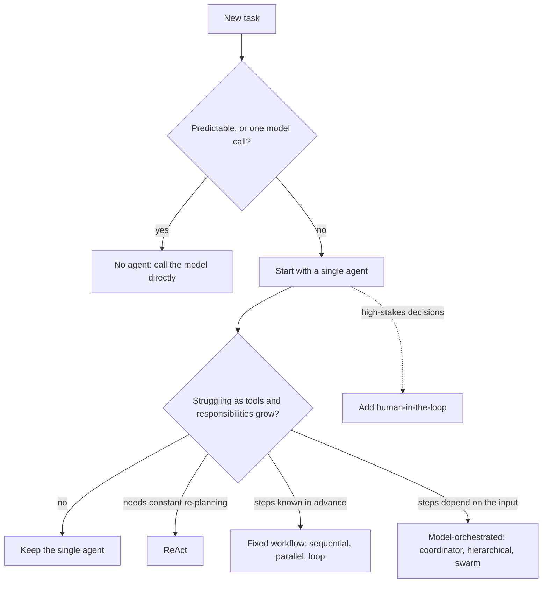

## The patterns

### Single agent

One model with a set of [tools](tools.md) and a detailed [system prompt](system-prompts.md). It plans and picks tools itself: the plain [agent loop](agent-loop.md).
- **Use for:** multi-step tasks needing external data, and as the first version of any agent.
- **Watch for:** quality drops (wrong tool choice, failures, latency) as tools and responsibilities grow. That's the signal to move to ReAct or multi-agent.

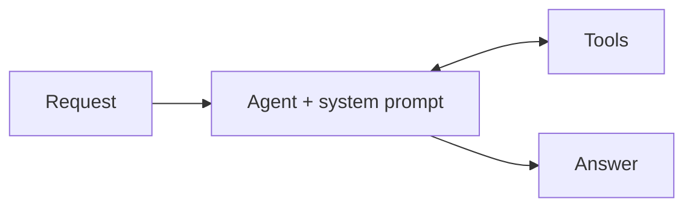

### ReAct (reason and act)

A single agent that cycles explicitly through **Thought** (reason about the next step), **Action** (call a tool or answer) and **Observation** (record the result), until it reaches an answer, an iteration limit or an error.
- **Use for:** dynamic tasks that need continual re-planning.
- **Trade-off:** cheaper than multi-agent, and the reasoning trace helps debugging. But the loop adds latency, quality depends on the model's reasoning, and one bad tool result can mislead the final answer.

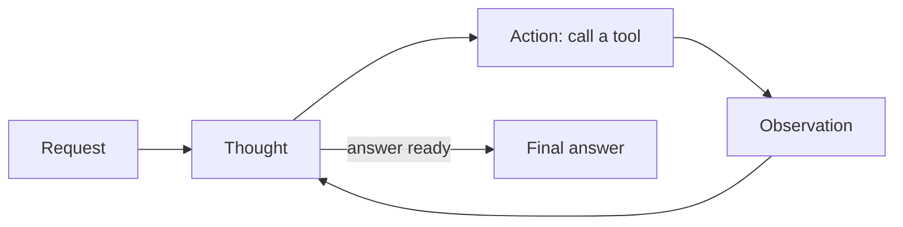

### Fixed workflows (code decides the order)

These [subagent](subagents.md) arrangements use predefined control flow with no model orchestration. They're cheaper, faster and predictable, but rigid.

| Pattern | Shape | Use for | Watch for |
|---|---|---|---|
| **Sequential** | A → B → C; each output feeds the next | Structured, repeatable pipelines (extract → clean → load) | Can't skip unneeded steps |
| **Parallel** | Fan out to agents running at once, then merge | Independent sub-tasks, or gathering several views quickly | Higher burst cost; merging conflicting results is hard |
| **Loop** | Repeat a sequence until an exit condition | Polling, self-correction | A bad exit condition means runaway cost |

**Sequential**

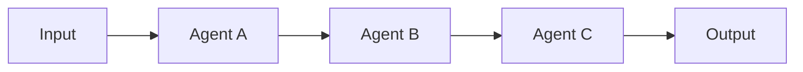

**Parallel**

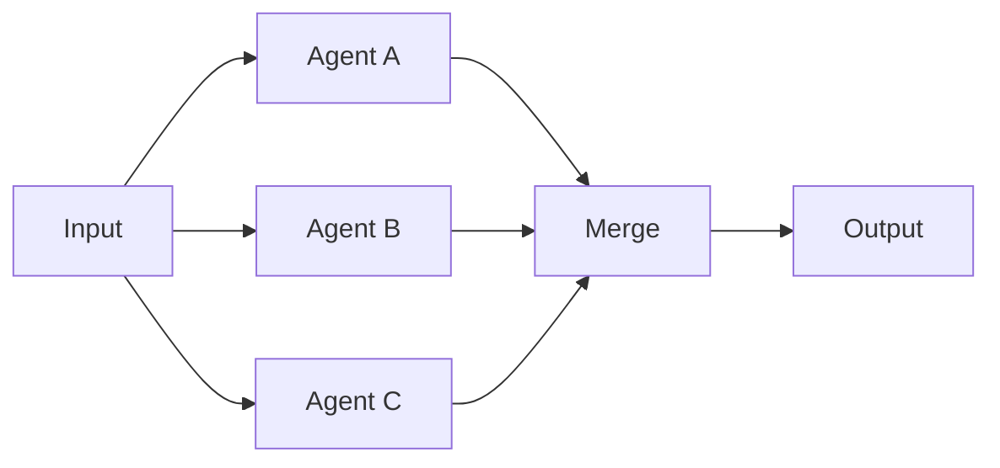

**Loop**

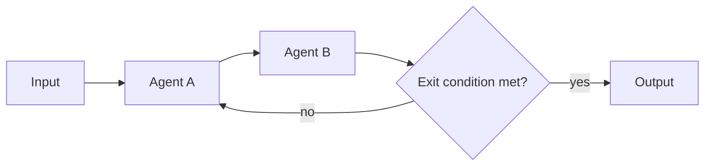

Two loop variants focus on output quality:
- **Review and critique (generator–critic):** a generator drafts and a critic checks the draft against criteria (accuracy, format, safety), then approves it or sends it back. An example is a [code generator](coding-agents.md) paired with a security-auditor critic that runs tests. This is [verification](verification-and-evals.md) built into the architecture.
- **Iterative refinement:** one or more agents improve a shared result over several passes until it meets a quality bar or hits an iteration limit. Good for drafting, planning and debugging code.

**Review and critique**

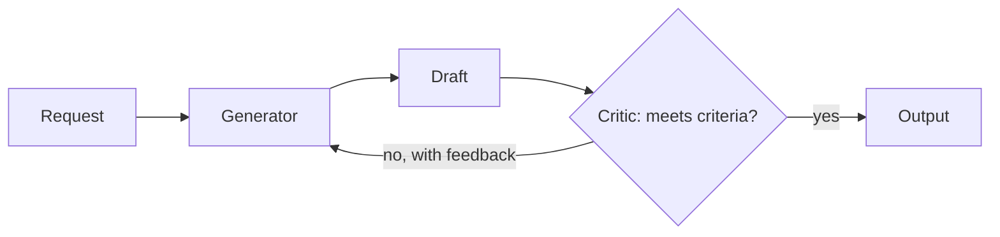

### Dynamic orchestration (a model decides)

| Pattern | Shape | Use for | Watch for |
|---|---|---|---|
| **Coordinator** | A model routes each request to specialist agents | Varied inputs to a structured process (e.g. support: status, return, or refund) | Extra calls for every routing decision |
| **Hierarchical decomposition** | A root agent splits the task, sub-agents split further, workers execute | Ambiguous, open-ended work ([research](deep-research-agents.md), planning) | Hard to design and debug; nested calls make it slow and costly |
| **Swarm** | Agents talk all-to-all, critique and hand off, with no central supervisor | Very complex problems that benefit from debate | The most complex and costly pattern; needs exit conditions to converge |

**Coordinator**

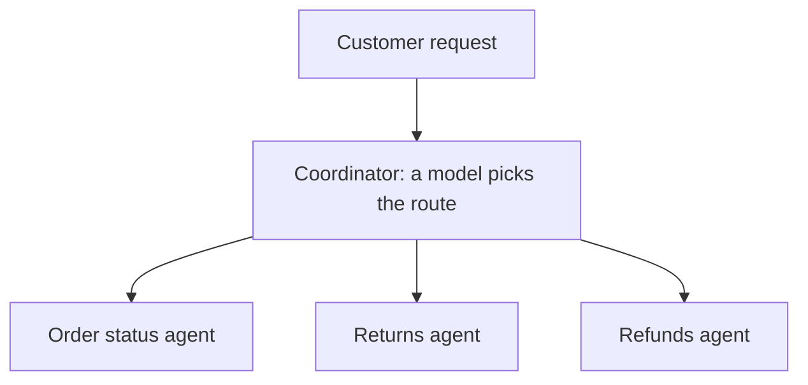

**Hierarchical decomposition**

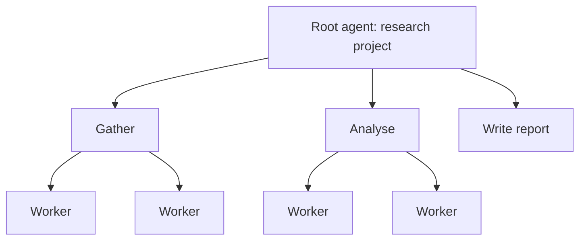

**Swarm**

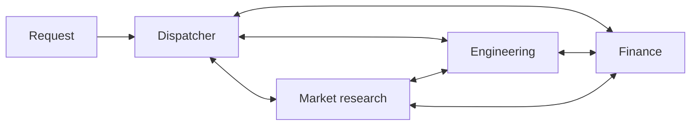

### Special requirements

- **[Human-in-the-loop](human-in-the-loop.md):** the agent pauses at set checkpoints for a person to approve, correct or add input. An example is a compliance officer approving a redacted dataset before release. It's one of the strongest [guardrails](agent-guardrails.md), at the cost of building the review system.

> **Contradiction:** this page, following [Google Cloud's pattern guide](../sources/google-cloud-choose-agentic-design-pattern.md), calls human-in-the-loop one of the strongest guardrails. [Human-in-the-loop](human-in-the-loop.md) cites [Meta's Rule of Two](../sources/meta-2025-agents-rule-of-two.md) ("blindly approved" confirmations still fail; HITL does not replace sandboxing or least privilege) and [Anthropic's autonomy study](../sources/anthropic-2026-measuring-agent-autonomy.md), which recommends designing for visibility and easy intervention rather than approving every action. HITL is strong only when gates are few and reviewers actually read them.
- **Custom logic:** your own code branches between other patterns. For example, a refund agent runs parallel checks, then branches to either a refund or a sequential store-credit flow. This is the most flexible option, but also the most work to build and maintain.

**Human-in-the-loop**

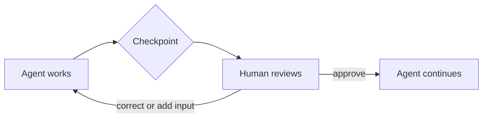

**Custom logic** (the refund example)

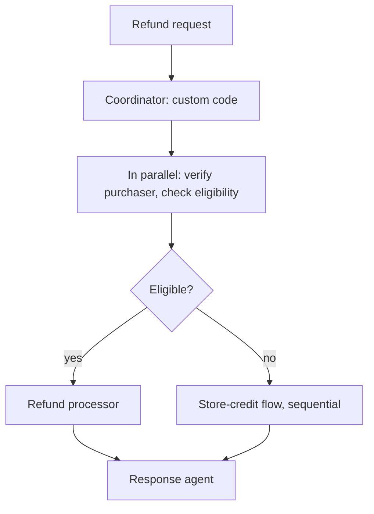

## Cross-cutting concerns

- **Cost and latency grow with every added agent, loop or cycle.** Most patterns trade extra model calls for quality.
- **Exit conditions are mandatory** for loop, refinement and swarm patterns: an iteration cap, a time limit or a goal.
- **Context per agent.** Isolate it, persist what later steps need, and compress large data. See [context engineering](context-engineering.md).
- **Synthesis:** the patterns compose. Real systems often nest them, for example a coordinator whose specialists run sequential or generator–critic loops. The custom-logic pattern is the general case of that.

## Going deeper

- [Deep research agents](deep-research-agents.md): the reference orchestrator-worker (hierarchical) system, with token-cost data.
- [Google ADK](google-adk.md): workflow agents (sequential, parallel, loop) and graph-based orchestration as code.
- [CrewAI](crewai.md): sequential and hierarchical processes, and when a single agent is better.
- [AutoGen and Microsoft Agent Framework](autogen.md): sequential, concurrent, handoff, group-chat and Magentic orchestrations.
- [OpenAI Agents SDK](openai-agents-sdk.md): handoffs vs agents-as-tools, two ways to implement the coordinator pattern.
- [LangGraph](langgraph.md): fixed workflows and dynamic routing as explicit state graphs.
- [Agent2Agent protocol](agent2agent-protocol.md): delegating to agents across team, vendor or organisation boundaries.
- [Durable agent execution](durable-agent-execution.md): pausing and resuming long workflows and human checkpoints.
- [Agent evaluation](agent-evaluation.md): how to measure whether a more complex pattern actually pays off.
- [Model selection](model-selection.md): the model-tier side of the cost and latency trade-off.

## Sources

- [Choose a design pattern for your agentic AI system (Google Cloud)](../sources/google-cloud-choose-agentic-design-pattern.md): all 12 patterns, selection criteria and trade-offs
- [The Anatomy of a Modern AI Agent](../sources/anatomy-of-a-modern-ai-agent.md): the single agent loop and subagent trade-offs
