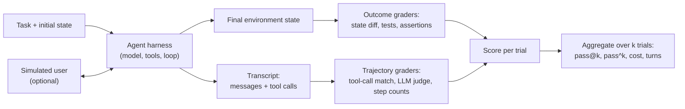

**Agent evaluation** measures whether an [agent](agent-loop.md) completes a task across many model calls, tool calls and (often) conversation turns, in an environment whose state it changes. It differs from grading one completion in three ways: the unit of evaluation is a whole **trial** (one attempt, producing a transcript and a final environment state), success is judged on what the agent *did* rather than what it *said*, and because each trial is long, stochastic and expensive, reliability and cost become first-class metrics ([Anthropic](../sources/anthropic-demystifying-evals-for-ai-agents.md)). General eval mechanics (graders, datasets, statistics) live on [LLM evaluation](llm-evaluation.md); this page covers what changes for agents.

## Vocabulary

Anthropic's terms, now widely used ([source](../sources/anthropic-demystifying-evals-for-ai-agents.md)):

| Term | Meaning |
|---|---|
| Task | Inputs plus success criteria |
| Trial | One attempt at a task; run several because outputs vary |
| Transcript / trace | Every message, tool call and result in the trial |
| Outcome | Final environment state, which can differ from what the agent claims |
| Grader | Logic that scores one aspect (code, model or human) |
| Eval harness | Runs tasks, isolates environments, records and grades; distinct from the agent harness |

## Outcome vs trajectory grading

**Outcome grading** checks the end state: the database after a τ-bench conversation equals an annotated goal state ([Yao et al.](../sources/yao-2024-tau-bench.md)); a SWE-bench patch makes the issue's failing tests pass without breaking others ([harness](../sources/swe-bench-harness-docs.md)). It is objective and tolerant of any valid path, which is why Anthropic advises grading outcomes rather than exact paths ([source](../sources/anthropic-demystifying-evals-for-ai-agents.md)).

**Trajectory grading** inspects the path: which tools were called, with what arguments, in what order, and how efficiently. It catches things outcomes miss. τ-bench itself notes that a reward of 1 is necessary but not sufficient, since an agent can reach the right state while skipping a required user confirmation ([Yao et al.](../sources/yao-2024-tau-bench.md)). It also localises failures: Husain and Shankar recommend grading end-to-end success first, then running step-level diagnostics (tool choice, parameter extraction, error handling, context retention, efficiency) on the workflows that fail most ([FAQ](../sources/husain-shankar-2026-ai-evals-faq.md)).

The trade-off: strict trajectory matching penalises valid alternative paths, correct error recovery and harmless redundant calls ([BFCL V3](../sources/bfcl-v3-multi-turn.md)). Practical trajectory checks are therefore *relaxed*:

| Matcher | What passes | Tooling |
|---|---|---|
| Strict | Same tool calls, same order | `agentevals` `strict`; ADK `tool_trajectory_avg_score` with its default `EXACT` match type (default threshold 1.0) |
| Unordered | Same calls, any order | `agentevals` `unordered` |
| Superset | Required calls present; extras allowed | `agentevals` `superset`; ADK `tool_trajectory_avg_score` with `match_type` `ANY_ORDER` (or `IN_ORDER` to also keep the expected order); BFCL "minimal viable execution path" |
| Subset | No calls outside an allow-list | `agentevals` `subset` |
| LLM judge | Rubric over the whole trajectory | `create_trajectory_llm_as_judge`; ADK `rubric_based_tool_use_quality_v1` |

Sources: [agentevals](../sources/langchain-agentevals.md), [ADK](../sources/google-adk-evaluation-docs.md), [BFCL](../sources/bfcl-v3-multi-turn.md). Promptfoo offers similar `trajectory:tool-used`, `trajectory:tool-sequence`, `trajectory:step-count` and `tool-call-f1` assertions ([source](../sources/promptfoo-assertions-docs.md)). `agentevals` also lets argument matching be set per tool (`exact`, `ignore`, a field list, or a custom comparator), which is how you tolerate e.g. case differences in a `city` argument ([source](../sources/langchain-agentevals.md)).

Synthesis: grade the outcome as the pass/fail signal, and use relaxed trajectory checks (superset of required calls, forbidden calls, step caps) as additional binary assertions, not as the primary score.

## Tool-call correctness

A tool call can fail at several independent layers, so check them separately ([FAQ](../sources/husain-shankar-2026-ai-evals-faq.md)): **selection** (right tool, or correctly no tool), **arguments** (extracted correctly, not guessed), **result handling** (empty results, API errors), **resulting state**, and **authorisation and preconditions**, since a syntactically valid call can still be the wrong action. OpenAI's guidance likewise adds tool-selection and argument-precision evals for agents and handoff accuracy for multi-agent systems ([source](../sources/openai-evaluation-best-practices.md)).

BFCL shows how to grade this at scale ([source](../sources/bfcl-v3-multi-turn.md)): V1 parsed single calls into an AST and matched parameter values against acceptable answers; V3's multi-turn tasks combine a **state check** after every turn (verifies writes) with a **subset-matched response check** (the required read calls must appear, which catches the model guessing facts it should have looked up). Its categories double as a checklist of behaviours to test: missing parameters (should ask), missing functions (should say it cannot), long context, and composites.

## Environment and simulation-based evals

Agents need an environment to act on. Three common patterns:

- **Simulated user + stateful tools (τ-bench).** An LLM plays the customer from a hidden instruction; the agent gets a policy document and Python tools over JSON databases. The original setup ran the user at temperature 1.0, the agent at 0.0, capped trials at 30 agent actions, and used 115 retail and 50 airline tasks; reward requires both the correct final database and required information in the agent's replies ([Yao et al.](../sources/yao-2024-tau-bench.md)). τ²-bench adds **dual control**: the user also has tools (toggling phone settings in a telecom domain), and success criteria widen to state assertions, natural-language assertions and action matching. Agents score markedly lower in dual control than when they act alone ([Barres et al.](../sources/barres-2025-tau2-bench.md)).
- **Containerised repositories (SWE-bench, Terminal-Bench).** Each task ships an environment and tests. SWE-bench marks an instance resolved only if the patch applies and all FAIL_TO_PASS and PASS_TO_PASS tests pass, run in per-instance Docker images ([harness](../sources/swe-bench-harness-docs.md), [paper](../sources/jimenez-2023-swe-bench.md)); Terminal-Bench 2.0 gives each of 89 tasks its own environment, reference solution and tests, run through the Harbor harness ([source](../sources/terminal-bench-2026.md)).
- **Framework-native simulation.** ADK evalsets can define a scenario for an LLM user simulator; in that mode the reference trajectory and response-match metrics are unavailable, because the conversation is not fixed ([ADK](../sources/google-adk-evaluation-docs.md)).

Simulators are themselves a source of error. τ²-bench audited its user simulator and found critical (outcome-affecting) errors in roughly 6-13% of conversations depending on domain ([Barres et al.](../sources/barres-2025-tau2-bench.md)); the original τ-bench traced 4 of 40 sampled gpt-4o retail failures to typos or ambiguity in the user instructions (a task bug, then fixed) rather than to the agent ([Yao et al.](../sources/yao-2024-tau-bench.md)). Start every trial from a clean environment to avoid correlated failures and leakage between trials ([Anthropic](../sources/anthropic-demystifying-evals-for-ai-agents.md)).

## pass@k vs pass^k

Both are estimated from n trials per task with c successes ([Chen et al.](../sources/chen-2021-codex-humaneval.md), [Yao et al.](../sources/yao-2024-tau-bench.md)):

| Metric | Question | Unbiased estimator (per task, averaged) | Behaviour as k grows |
|---|---|---|---|
| pass@k | Does at least one of k attempts succeed? | 1 − C(n−c, k) / C(n, k) | Rises |
| pass^k | Do all k attempts succeed? | C(c, k) / C(n, k) | Falls |

pass@k fits settings with a cheap verifier and retries (generate several patches, keep one that passes tests). pass^k fits customer-facing agents that must work every time: at 75% per-trial success, pass^3 is about 42% ([Anthropic](../sources/anthropic-demystifying-evals-for-ai-agents.md)); gpt-4o's τ-retail pass^1 of 61.2% fell below 25% at pass^8 ([Yao et al.](../sources/yao-2024-tau-bench.md)). Use the combinatorial estimators, not 1 − (1 − p̂)^k, which is biased, and draw n ≥ k samples ([Chen et al.](../sources/chen-2021-codex-humaneval.md)). For pass@k, higher temperature helps large k ([Chen et al.](../sources/chen-2021-codex-humaneval.md)); do not lower temperature just to reduce variance, since it can shift the expected score ([Miller](../sources/miller-2024-adding-error-bars-to-evals.md)). Synthesis: if per-trial outcomes were independent with rate p, pass^k would be p^k; real failures cluster on hard tasks, so measure pass^k directly rather than extrapolating.

## Cost, turn and time budgets

Accuracy alone rewards waste. On HumanEval, a retry-with-rising-temperature baseline matched complex agents: 93.2% for $2.45 versus LATS at 88.0% for $134.50 ([Kapoor et al. 2024](../sources/kapoor-2024-ai-agents-that-matter.md)). Report dollar cost plus token counts (so others can reprice), plot accuracy against cost, and compare on the Pareto frontier. Budgets also shape scores directly: BFCL force-fails turns over 20 steps ([source](../sources/bfcl-v3-multi-turn.md)), τ-bench caps 30 actions ([source](../sources/yao-2024-tau-bench.md)), and ADK reports tool calls, inference calls, tokens and duration as non-gating metrics ([source](../sources/google-adk-evaluation-docs.md)). More thinking is not free accuracy: HAL found higher reasoning effort reduced accuracy in most of its runs ([Kapoor et al. 2025](../sources/kapoor-2025-holistic-agent-leaderboard.md)), while on τ-bench airline a prompted think tool raised pass^1 from 0.370 to 0.570 ([Anthropic](../sources/anthropic-think-tool.md)). Expense limits rigour too: at SWE-agent's $4/task cap, one run over the 2,000+ SWE-bench tasks could cost over $8,000, which discourages repeated trials and error bars ([Kapoor et al. 2024](../sources/kapoor-2024-ai-agents-that-matter.md)).

## Failure modes of agent evals

- **Broken tasks and graders.** A 0% pass rate across many trials usually means a broken task; grading fixes plus a less constrained scaffold moved Opus 4.5 from 42% to 95% on CORE-Bench ([Anthropic](../sources/anthropic-demystifying-evals-for-ai-agents.md)). OpenAI's audit found 59.4% of hard SWE-bench Verified problems had flawed tests or descriptions ([source](../sources/openai-swe-bench-verified-retired.md)).
- **Contamination and saturation.** Frontier models could reproduce SWE-bench Verified gold patches, and OpenAI stopped reporting it in 2026 ([source](../sources/openai-swe-bench-verified-retired.md)).
- **Shortcuts and missing holdouts.** Agents hard-coded site-specific policies on WebArena; most of 17 surveyed agent benchmarks lacked suitable holdouts ([Kapoor et al. 2024](../sources/kapoor-2024-ai-agents-that-matter.md)).
- **Reward hacking visible only in logs.** HAL found an agent searching for the benchmark on Hugging Face and agents misusing credit cards while booking flights ([Kapoor et al. 2025](../sources/kapoor-2025-holistic-agent-leaderboard.md)). Read transcripts, not only scores.
- **Harness state bugs.** SWE-bench caches results by `run_id` and instance, so re-running a changed patch under the same id silently reuses the old result ([harness](../sources/swe-bench-harness-docs.md)).
- **Compounding errors.** In SWE-agent, success probability fell from 90.5% to 57.2% after one failed edit ([Yang et al.](../sources/swe-agent-yang-2024.md)); annotate the first upstream failure ([FAQ](../sources/husain-shankar-2026-ai-evals-faq.md)).
- **Multi-agent specific failures.** Step repetition (15.7%), reasoning-action mismatch (13.2%), unawareness of termination conditions (12.4%) and incorrect or missing verification are among the most common in MAST's 1,642 labelled traces ([MAST](../sources/cemri-2025-mast-multi-agent-failures.md)).

## Practical guidance

- Derive tasks from real failures via [error analysis](error-analysis.md); 20-50 tasks are enough to start, because early changes have large effects ([Anthropic](../sources/anthropic-demystifying-evals-for-ai-agents.md)).
- Make each task unambiguous: two experts should agree on the verdict. Include negative cases (should not act / should ask) ([Anthropic](../sources/anthropic-demystifying-evals-for-ai-agents.md); [BFCL](../sources/bfcl-v3-multi-turn.md)).
- Reproduce failures in the simplest form; use multi-turn or simulated-user tests only when the failure depends on conversation context; replay real conversation prefixes ("N-1 testing") ([FAQ](../sources/husain-shankar-2026-ai-evals-faq.md)).
- Keep capability evals (low pass rate, hill-climbing) separate from regression evals (near 100%, run on every change); graduate saturated tasks ([Anthropic](../sources/anthropic-demystifying-evals-for-ai-agents.md)).
- Run several trials per task, report pass^k for user-facing agents, with standard errors and paired comparisons ([Miller](../sources/miller-2024-adding-error-bars-to-evals.md)).
- Track cost, turns and latency next to success; gate on success, budget-alert on the rest ([Kapoor et al. 2024](../sources/kapoor-2024-ai-agents-that-matter.md)).
- Prefer deterministic graders (state diffs, tests, call assertions) in CI; use calibrated [LLM judges](llm-as-judge.md) for trajectory quality and on sampled production traces ([FAQ](../sources/husain-shankar-2026-ai-evals-faq.md)).

When not to build a bespoke agent environment: if the agent is effectively a fixed [workflow](agent-design-patterns.md), test each step like a single completion. Public [benchmarks](benchmarks.md) are useful for [model selection](model-selection.md) but do not replace task suites built from your own traces. See also [LLM observability](llm-observability.md), [coding agents](coding-agents.md), [verification and evals](verification-and-evals.md).

## Sources

- [Demystifying evals for AI agents (Anthropic)](../sources/anthropic-demystifying-evals-for-ai-agents.md)
- [AI Evals FAQ (Husain and Shankar)](../sources/husain-shankar-2026-ai-evals-faq.md)
- [τ-bench (Yao et al.)](../sources/yao-2024-tau-bench.md) · [τ²-bench (Barres et al.)](../sources/barres-2025-tau2-bench.md)
- [Codex / HumanEval and pass@k (Chen et al.)](../sources/chen-2021-codex-humaneval.md)
- [SWE-bench harness docs](../sources/swe-bench-harness-docs.md) · [SWE-bench paper](../sources/jimenez-2023-swe-bench.md) · [SWE-bench Verified retired (OpenAI)](../sources/openai-swe-bench-verified-retired.md) · [Terminal-Bench](../sources/terminal-bench-2026.md) · [SWE-agent](../sources/swe-agent-yang-2024.md)
- [BFCL V3](../sources/bfcl-v3-multi-turn.md) · [agentevals](../sources/langchain-agentevals.md) · [ADK evaluation](../sources/google-adk-evaluation-docs.md) · [Promptfoo assertions](../sources/promptfoo-assertions-docs.md)
- [AI Agents That Matter](../sources/kapoor-2024-ai-agents-that-matter.md) · [Holistic Agent Leaderboard](../sources/kapoor-2025-holistic-agent-leaderboard.md)
- [MAST (Cemri et al.)](../sources/cemri-2025-mast-multi-agent-failures.md) · [Think tool (Anthropic)](../sources/anthropic-think-tool.md)
- [Adding error bars to evals (Miller)](../sources/miller-2024-adding-error-bars-to-evals.md) · [OpenAI evaluation best practices](../sources/openai-evaluation-best-practices.md)
