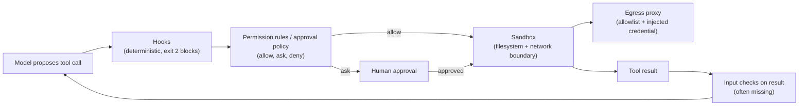

**Agent guardrails** are the limits on what an agent is allowed to do. The more capable an agent is, the more they matter. Good guardrails are what let autonomy increase over time instead of requiring step-by-step supervision. They are enforced by the harness around the model, not by the model: a model's trained preference for its system prompt over the text it reads is a tendency, not a security boundary ([Wallace et al.](../sources/wallace-2024-instruction-hierarchy.md); see [system prompts](system-prompts.md)). Text-level checks on inputs and outputs are a separate layer, covered in [guardrail tooling](guardrail-tooling.md).

## Layers

- **Sandboxing.** Run code in isolated environments ([containers, microVMs](code-execution-sandboxes.md)) so mistakes stay contained.
- **Permissions.** Read-only actions run freely. Writes, deletions and anything public-facing need approval or an explicit policy. See [tools](tools.md).
- **Treating inputs as data.** Web pages, emails, tool results and [MCP](model-context-protocol.md) responses can contain text that looks like instructions. An agent that obeys what it reads is open to **[prompt injection](prompt-injection.md)**. Fetched content should inform the agent, never command it.

Synthesis: the diagram places the layers on this page along one tool call.

### Sandbox vs approval policy

Codex separates two questions: *what commands can technically do* (the sandbox: `read-only`, `workspace-write`, `danger-full-access`) and *when the agent must stop and ask* (the approval policy: `on-request` asks before leaving the sandbox, using the network or running untrusted commands; `never` is for CI and only alongside a sandbox). Network is off by default and writes are confined to the workspace ([Codex](../sources/openai-codex-sandbox-approvals.md)). Anthropic makes the same split in Claude Code: an OS-level sandbox (bubblewrap on Linux, Seatbelt on macOS) lets the agent act freely inside a pre-defined boundary, which cut permission prompts by 84% internally and reduces approval fatigue ([Claude Code sandboxing](../sources/anthropic-claude-code-sandboxing.md)). Both layers are needed: without network isolation a compromised agent exfiltrates keys, and without filesystem isolation it can escape the sandbox and reach the network ([Claude Code sandboxing](../sources/anthropic-claude-code-sandboxing.md)). See [human-in-the-loop](human-in-the-loop.md) for the approval side.

### The lethal trifecta and the Rule of Two

The design rule for injection is architectural. Willison's **[lethal trifecta](lethal-trifecta.md)**: an agent with access to private data, exposure to untrusted content and a way to communicate externally can be made to steal that data ([Willison](../sources/willison-2025-lethal-trifecta.md)). Meta's **Agents Rule of Two** turns it into a per-session limit: at most two of untrustworthy input, sensitive data or systems, and state change or external communication. If all three are needed, the agent must not run autonomously ([Meta](../sources/meta-2025-agents-rule-of-two.md)). Classifiers do not substitute for this: a detector catching 95% fails in application security because attackers retry ([Willison](../sources/willison-2025-lethal-trifecta.md)), and Anthropic's hardened browser agent still showed 1.4% attack success against an adaptive attacker ([Anthropic](../sources/anthropic-2025-prompt-injection-defenses-browser.md)). OWASP moved Excessive Agency up to LLM03 in its 2026 list, reflecting agent deployments ([OWASP 2026](../sources/owasp-llm-top-10-2026.md); see [OWASP Top 10 for LLM](owasp-top-10-for-llm.md), [LLM security risks](llm-security-risks.md)).

### Scoped credentials and egress control

A sandbox removes the exfiltration leg only if it controls the network. Use default-deny egress with domain or CIDR allowlists, and time-varying policy: allow the package registry during setup, then cut it before untrusted code runs ([Vercel](../sources/vercel-2026-sandbox-network-boundary.md), [Codex](../sources/openai-codex-sandbox-approvals.md)). Keep secrets out of the sandbox and out of the model: a proxy outside the sandbox attaches the real credential only on requests to the approved destination, as Claude Code on the web does with its git proxy ([Claude Code sandboxing](../sources/anthropic-claude-code-sandboxing.md), [Vercel](../sources/vercel-2026-sandbox-network-boundary.md)). The IETF agent-auth draft states the rule directly: the model must not have access to agent or tool credentials ([agent-auth draft](../sources/ietf-aiagent-auth-draft.md)). Details: [code execution sandboxes](code-execution-sandboxes.md), [agent authentication and authorization](agent-authentication-and-authorization.md).

### Hooks: deterministic enforcement

[Hooks](agent-hooks-and-middleware.md) run code the harness controls at lifecycle events (`PreToolUse`/`BeforeTool`, `PostToolUse`, `UserPromptSubmit`, `Stop`). Claude Code, Codex and Gemini CLI share a contract: the hook gets JSON on stdin, and **exit 2 blocks** the action with stderr returned to the model as the reason ([Claude Code hooks](../sources/claude-code-hooks-docs.md), [Codex hooks](../sources/openai-codex-hooks-docs.md), [Gemini hooks](../sources/gemini-cli-hooks-docs.md)). Pitfalls:

- In Claude Code and Gemini CLI any other non-zero exit is only a warning and the action proceeds ([Claude Code hooks](../sources/claude-code-hooks-docs.md), [Gemini hooks](../sources/gemini-cli-hooks-docs.md)).
- A failing or timed-out Claude Code hook **fails open** unless a `command`/`http` hook sets `onFailure: "block"` (v2.1.295+; no effect on `Stop`, `SubagentStop` or async hooks) ([Claude Code hooks](../sources/claude-code-hooks-docs.md)).
- Codex's `PostToolUse` cannot undo a command that already ran; it only replaces the result the model sees ([Codex hooks](../sources/openai-codex-hooks-docs.md)).

### SDK permission pipelines and their gaps

- **Claude Agent SDK.** Every tool call passes hooks, then deny rules, ask rules, the permission mode, allow rules, and finally the `canUseTool` callback. `allowed_tools` pre-approves rather than restricts; in `bypassPermissions` only deny rules, ask rules and hooks still apply; auto-approved calls never reach `canUseTool`, so audit every call with a `PreToolUse` hook. For headless agents the docs recommend an explicit allow-list plus `dontAsk` ([Agent SDK permissions](../sources/claude-agent-sdk-permissions-docs.md); see [Claude Agent SDK](claude-agent-sdk.md)).
- **OpenAI Agents SDK.** Input guardrails run only on the *first* agent, and by default in parallel with it, so a tripwire can fire after tools already ran (`run_in_parallel=False` blocks first). Output guardrails run only on the final agent. Tool guardrails skip handoffs, hosted tools, computer and shell tools, and `as_tool()` agents ([OpenAI guardrails](../sources/openai-agents-sdk-guardrails-docs.md); see [OpenAI Agents SDK](openai-agents-sdk.md), [agent handoffs](agent-handoffs.md)).

### Managed guardrails often skip tool traffic

Indirect injection arrives through tool results, and that path is the one managed services check least. Bedrock content filters and its prompt-attack filter do not evaluate tool results, tool specs or tool-call arguments ([Bedrock](../sources/aws-bedrock-guardrails.md)). Azure Prompt Shields can scan agent tool responses only in preview, and Foundry's document-attack detection is off by default ([Azure](../sources/azure-ai-content-safety-docs.md)). OpenAI inline moderation checks tool arguments and outputs, but not tool names, descriptions or schemas ([OpenAI](../sources/openai-moderation-guide.md)). See [guardrail tooling](guardrail-tooling.md).

### Memory is an input too

[Agent memory](agent-memory.md) is a persistent injection channel. In MINJA, ordinary queries planted records later retrieved as demonstrations, with 98.2% injection and 76.8% attack success reported in early versions; a follow-up argues these come from idealised settings, so treat them as an upper bound ([Dong et al.](../sources/dong-2025-minja.md)). OWASP 2026 widens LLM01 to persistent payloads in memory or RAG corpora ([OWASP 2026](../sources/owasp-llm-top-10-2026.md)). Treat memory as untrusted input with per-record provenance and per-user isolation.

### Computer use

When an agent drives a screen, Claude may return several actions in one turn, so human approval must inspect **each** action before it runs, not the turn as a whole: one batch can complete a multi-step action ([Anthropic computer use](../sources/anthropic-computer-use-tool-docs.md)). See [computer-use agents](computer-use-agents.md).

## Human-in-the-loop

At predefined checkpoints the agent [pauses for a person](human-in-the-loop.md) to approve, correct or supply input. This is the standard choice for high-stakes, safety-critical or subjective decisions, such as approving the release of a redacted health dataset. It improves safety at the cost of building and maintaining the review system ([Google Cloud](../sources/google-cloud-choose-agentic-design-pattern.md)).

For multi-agent systems, the same guide recommends controlling agent traffic, giving each agent [least-privilege identity](agent-authentication-and-authorization.md), and registering trusted tools and [subagents](subagents.md). It names Google products for each of these.

Approvals do not scale per step: sandboxing removes most prompts so attention goes to actions that leave the boundary ([Claude Code sandboxing](../sources/anthropic-claude-code-sandboxing.md)), and Codex can route approval requests to a reviewer agent that fails closed ([Codex](../sources/openai-codex-sandbox-approvals.md)).

## Related

[Agent loop](agent-loop.md): the harness that runs the loop is where guardrails are enforced. [Harness engineering](harness-engineering.md) covers the harness as a whole; [coding agents](coding-agents.md) show these layers in daily use.

## Going deeper

- [Prompt injection](prompt-injection.md): direct and indirect injection, the lethal trifecta and the Agents Rule of Two.
- [Lethal trifecta](lethal-trifecta.md): the three capabilities that together enable data theft.
- [Human-in-the-Loop](human-in-the-loop.md): approval gates, interrupts and escalation triggers in practice.
- [Code Execution Sandboxes](code-execution-sandboxes.md): isolation options, egress control and the sandbox vs approval-policy split.
- [Agent hooks and middleware](agent-hooks-and-middleware.md): deterministic lifecycle hooks and framework middleware.
- [Agent Authentication and Authorization](agent-authentication-and-authorization.md): scoped credentials and keeping secrets out of the model.
- [Guardrail tooling](guardrail-tooling.md): runtime input/output checks, including which paths (e.g. tool results) they skip.
- [LLM security risks](llm-security-risks.md): the wider threat model (OWASP LLM Top 10, data exfiltration, memory poisoning).
- [Computer-Use Agents](computer-use-agents.md): per-action approval and allowlists when the agent drives a screen.
- [PII and Data Privacy](pii-and-data-privacy.md): PII detection and redaction as a guardrail layer.

## Sources

- [The Anatomy of a Modern AI Agent](../sources/anatomy-of-a-modern-ai-agent.md)
- [Choose a design pattern for your agentic AI system (Google Cloud)](../sources/google-cloud-choose-agentic-design-pattern.md)
- [Willison: the lethal trifecta](../sources/willison-2025-lethal-trifecta.md)
- [Meta: Agents Rule of Two](../sources/meta-2025-agents-rule-of-two.md)
- [Claude Code sandboxing (Anthropic)](../sources/anthropic-claude-code-sandboxing.md)
- [Codex approvals and security (OpenAI)](../sources/openai-codex-sandbox-approvals.md)
- [Vercel: a sandbox without a network boundary](../sources/vercel-2026-sandbox-network-boundary.md)
- [Claude Code hooks docs](../sources/claude-code-hooks-docs.md)
- [Codex hooks docs](../sources/openai-codex-hooks-docs.md)
- [Gemini CLI hooks docs](../sources/gemini-cli-hooks-docs.md)
- [Claude Agent SDK permissions](../sources/claude-agent-sdk-permissions-docs.md)
- [OpenAI Agents SDK guardrails](../sources/openai-agents-sdk-guardrails-docs.md)
- [Amazon Bedrock Guardrails documentation](../sources/aws-bedrock-guardrails.md)
- [Azure AI Content Safety documentation](../sources/azure-ai-content-safety-docs.md)
- [OpenAI moderation guide](../sources/openai-moderation-guide.md)
- [Anthropic: prompt injection defenses for browser use](../sources/anthropic-2025-prompt-injection-defenses-browser.md)
- [MINJA memory injection (Dong et al.)](../sources/dong-2025-minja.md)
- [OWASP Top 10 for LLM Applications 2026](../sources/owasp-llm-top-10-2026.md)
- [AI Agent Authentication and Authorization draft](../sources/ietf-aiagent-auth-draft.md)
- [Anthropic computer use tool docs](../sources/anthropic-computer-use-tool-docs.md)
- [The Instruction Hierarchy (OpenAI)](../sources/wallace-2024-instruction-hierarchy.md)
