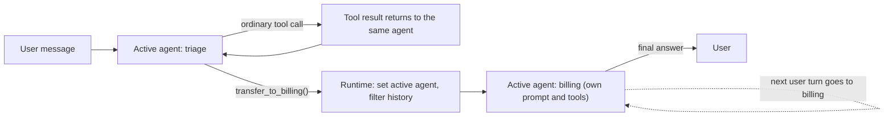

An **agent handoff** transfers control of an ongoing conversation from one agent to another: the receiving agent becomes the *active* agent, answers the user directly and keeps control on later turns until it hands off again or the run ends. The model triggers it by calling a transfer tool (`transfer_to_<agent>` in OpenAI's naming, `transfer_to_agent` in Google ADK), and the runtime, not the tool body, performs the switch. The contrast is **agent-as-tool** (the [subagent](subagents.md) shape): a caller invokes a specialist, gets a result back and stays in charge. OpenAI introduced the term in its October 2024 cookbook, where a handoff was likened to a phone transfer in which the new person already knows what was said ([cookbook](../sources/openai-orchestrating-agents-cookbook.md), [LangChain](../sources/langchain-multi-agent-handoffs-docs.md)).

## Mechanics

Every framework below implements the same three steps on top of [function calling](function-calling.md):

1. **Expose** each permitted target as a tool, with the target's description telling the model when to pick it.
2. **Intercept** the call. The runtime recognises the handoff tool and does not treat its output as an ordinary tool result.
3. **Switch and re-prompt.** The runtime sets the active agent, decides what history the new agent sees, and runs the new agent's [loop](agent-loop.md) with its own instructions and tools.

Synthesis: the diagram generalises the loops described in the OpenAI cookbook and Agents SDK docs.

### OpenAI Agents SDK

- **Origin.** In the 2024 cookbook (and the Swarm sample library), a transfer function simply returned an `Agent` object. The loop saw that, swapped `current_agent`, and all agents shared one `messages` list, each swapping in its own system prompt ([cookbook](../sources/openai-orchestrating-agents-cookbook.md)). The [Agents SDK](openai-agents-sdk.md) formalised this.
- **Declaration.** `Agent(handoffs=[...])` accepts agents or `handoff()` objects. Each is a tool named `transfer_to_<agent_name>` by default; `handoff_description` on the target is appended to the tool description ([handoffs docs](../sources/openai-agents-sdk-handoffs-docs.md)).
- **`handoff()` options.** `tool_name_override`, `tool_description_override`, `on_handoff` (callback), `input_type` (a schema for arguments the model fills in at handoff time, such as a reason or priority), `input_filter`, `is_enabled` (bool or callable, checked at runtime) and `nest_handoff_history`. `input_type` is metadata for `on_handoff`; it does not replace the next agent's input or choose the destination. Because `is_enabled` runs before the model supplies arguments, argument-level checks belong at the start of `on_handoff`, which can raise to block the transfer ([handoffs docs](../sources/openai-agents-sdk-handoffs-docs.md)).
- **Runner semantics.** Each turn ends in a final output, a handoff (switch agent and loop again) or tool calls ([running agents](../sources/openai-agents-sdk-running-agents-docs.md)). If the model emits several handoff calls in one turn, only the first runs; the others get the tool output "Multiple handoffs detected, ignoring this one." Each handoff is recorded as a `handoff_span` in traces ([runtime source](../sources/openai-agents-python-handoff-runtime-source.md), [tracing](../sources/openai-agents-sdk-tracing-docs.md)).
- **Prompting.** `RECOMMENDED_PROMPT_PREFIX` or `prompt_with_handoff_instructions` adds standard handoff guidance to an agent's instructions ([handoffs docs](../sources/openai-agents-sdk-handoffs-docs.md)).

### LangGraph and LangChain

- **Handoff as state update.** LangChain's v1 docs define a handoff as a tool that writes a persisted state variable (`active_agent`, `current_step`), after which the graph routes on it. Two implementations: one agent whose prompt and tools are swapped per state by `@wrap_model_call` middleware (recommended for most cases), or separate agent subgraphs ([LangChain](../sources/langchain-multi-agent-handoffs-docs.md)); see [agent hooks and middleware](agent-hooks-and-middleware.md).
- **`Command`.** In the subgraph form, the handoff tool returns `Command(goto="sales_agent", update={...}, graph=Command.PARENT)`. `graph=Command.PARENT` sends the routing to the parent graph, which is how a tool inside one agent's subgraph moves control to a sibling node ([LangChain](../sources/langchain-multi-agent-handoffs-docs.md), [graph API](../sources/langgraph-graph-api-docs.md)). See [LangGraph](langgraph.md).
- **Message hygiene.** If the tool updates `messages`, it must append a `ToolMessage` matching `runtime.tool_call_id`, otherwise the receiving model sees a tool call with no response ([LangChain](../sources/langchain-multi-agent-handoffs-docs.md)).
- **Persistence.** A checkpointer keeps `active_agent` across turns, so the next user message goes straight to the specialist ([LangChain](../sources/langchain-multi-agent-handoffs-docs.md)).

### Google ADK

- **Single transfer tool.** An `LlmAgent` with transfer targets gets one `transfer_to_agent(agent_name)` tool whose `agent_name` is a JSON Schema enum of valid targets (the code comment says this prevents hallucinated names), optionally with a `transfer_reason`. The function only sets `transfer_to_agent` on the tool context's actions; the runtime does the switch ([ADK source](../sources/google-adk-agent-transfer-source.md)). See [Google ADK](google-adk.md).
- **Targets come from the agent tree.** Valid targets are the agent's sub-agents, its parent (unless `disallow_transfer_to_parent`) and its peers (unless `disallow_transfer_to_peers`). ADK injects instructions listing each target's `description` and telling the model to transfer to the parent if no one fits ([ADK source](../sources/google-adk-agent-transfer-source.md)).
- **ADK 2.0 modes.** Sub-agents in default `chat` mode are true handoffs: they talk to the user and return control only via an explicit transfer. `task` mode agents may ask clarifying questions and return automatically on `finish_task`; `single_turn` agents return immediately and can run in parallel. These two run in an isolated session branch and are excluded from `transfer_to_agent` targets, which makes them agent-as-tool, not handoff ([collaborative workflows](../sources/google-adk-collaborative-workflows-docs.md), [ADK source](../sources/google-adk-agent-transfer-source.md)).

### Microsoft Agent Framework

`HandoffBuilder` builds a mesh of agents with no central orchestrator; handoff tools are injected per the `add_handoff` rules (all-to-all by default). Agents keep separate sessions, so each broadcasts user and agent messages to every participant, with tool content, including handoff calls, filtered out. An agent that replies without handing off pauses the workflow for user input, unless experimental autonomous mode is on (default cap 50 turns per agent) ([Agent Framework](../sources/microsoft-agent-framework-handoff-orchestration-docs.md)). See [Microsoft Agent Framework](microsoft-agent-framework.md).

## Handoff vs agent-as-tool

| | Handoff | Agent-as-tool |
|---|---|---|
| Who owns the task | Receiver takes full ownership | Caller keeps responsibility |
| Control after the specialist finishes | Stays with the receiver until it transfers again | Returns to the caller in the same run |
| Who talks to the user | The active specialist, directly | Only the caller |
| Context the specialist sees | Conversation so far, by default (filterable) | Only what the caller passes (OpenAI default: one `input` string) |
| What the caller sees back | Nothing; it is no longer running | The specialist's output (extractable) |
| Parallelism | Sequential | Several specialists can run at once |
| Topology | Mesh or tree of peers | Hub and spoke |

Sources: [Agent Framework](../sources/microsoft-agent-framework-handoff-orchestration-docs.md), [LangChain](../sources/langchain-multi-agent-handoffs-docs.md), [OpenAI tools](../sources/openai-agents-sdk-tools-docs.md), [OpenAI handoffs](../sources/openai-agents-sdk-handoffs-docs.md).

**Cost profile.** LangChain's worked example counts model calls per pattern. For a one-shot request, handoffs take 3 calls and subagents 4. When the same request repeats in turn 2, handoffs total 5 calls against 8 for subagents, because the specialist is already active. For a three-domain comparison, handoffs need 7+ calls and ~14K+ tokens against 5 calls and ~9K tokens for subagents, because handoffs run sequentially and carry history, while subagents work in parallel with isolated context ([LangChain](../sources/langchain-multi-agent-handoffs-docs.md)). See [cost and latency optimization](cost-and-latency-optimization.md).

## Context passing

What the receiver sees is the main design decision, and the defaults differ:

- **OpenAI Agents SDK: everything.** The receiver sees the full prior conversation. `input_filter` gets a `HandoffInputData` (`input_history`, `pre_handoff_items`, `new_items`, ...) and returns a trimmed one; `handoff_filters.remove_all_tools` strips tool items. Opt-in beta `nest_handoff_history` collapses earlier turns into a summary block in a `<CONVERSATION HISTORY>` wrapper ([handoffs docs](../sources/openai-agents-sdk-handoffs-docs.md)); compare [context compaction](context-compaction.md).
- **LangChain subgraphs: almost nothing.** The docs recommend passing only the `AIMessage` holding the handoff call and its `ToolMessage`, summarising prior work into the `ToolMessage` if needed ([LangChain](../sources/langchain-multi-agent-handoffs-docs.md)).
- **Agent Framework: messages, not tools.** User and agent text is synced to all participants; function calls, results and approval payloads are dropped ([Agent Framework](../sources/microsoft-agent-framework-handoff-orchestration-docs.md)).
- **Agent-as-tool: nothing unless passed.** An OpenAI `as_tool()` run does not inherit the parent's conversation; you share a `session` explicitly or pass structured `parameters` ([OpenAI tools](../sources/openai-agents-sdk-tools-docs.md)).
- **Application state is separate.** In the OpenAI SDK the run `context` object (database handles, user IDs) is available to tools, hooks and handoffs but never sent to the model ([agents docs](../sources/openai-agents-sdk-agents-docs.md)); `input_type` carries model-chosen metadata ([handoffs docs](../sources/openai-agents-sdk-handoffs-docs.md)).

Synthesis: full history maximises continuity but inherits every earlier tool output, including untrusted content, and grows token cost on each hop. Minimal history is cheap and clean but loses decisions the user already made. Cognition's argument that agents must share full traces because actions carry implicit decisions ([Cognition](../sources/cognition-dont-build-multi-agents.md)) favours the first; LangChain's guidance favours the second. A structured handoff payload (an `input_type` summary or a `ToolMessage` brief) plus filtered history is the usual middle ground. See [context engineering](context-engineering.md).

## Failure modes

- **Malformed history.** A handoff that writes messages without a matching `ToolMessage` leaves a dangling tool call ([LangChain](../sources/langchain-multi-agent-handoffs-docs.md)). Parallel tool calls in the same turn need explicit handling; LangChain's examples assume one call, and the OpenAI SDK silently executes only the first handoff ([runtime source](../sources/openai-agents-python-handoff-runtime-source.md)).
- **Wrong or invented target.** Routing depends on tool and agent descriptions. ADK constrains names with an enum and tells agents to make descriptions distinguish them from peers ([ADK source](../sources/google-adk-agent-transfer-source.md)).
- **Ping-pong and runaway loops.** Mutual handoff edges (specialist back to triage) can cycle. Budgets are the backstop: `max_turns` raises `MaxTurnsExceeded` in the OpenAI SDK ([running agents](../sources/openai-agents-sdk-running-agents-docs.md)); LangGraph's `recursion_limit` caps super-steps ([graph API](../sources/langgraph-graph-api-docs.md)); Agent Framework caps autonomous turns per agent ([Agent Framework](../sources/microsoft-agent-framework-handoff-orchestration-docs.md)).
- **Stuck in a specialist.** ADK `chat` sub-agents only return via an explicit transfer, and Agent Framework hands back to the user whenever an agent answers without a handoff; its docs note you cannot force every turn to be a handoff without stopping the agent from giving real answers ([collaborative workflows](../sources/google-adk-collaborative-workflows-docs.md), [Agent Framework](../sources/microsoft-agent-framework-handoff-orchestration-docs.md)).
- **Lost context and conflicting decisions.** Aggressive filtering drops facts the receiver needs. MAST, a taxonomy built from multi-agent traces, records loss of conversation history (2.8%), conversation reset (2.2%), information withholding (0.85%) and ignoring another agent's input (1.9%) among its failure modes ([MAST](../sources/cemri-2025-mast-multi-agent-failures.md)). See [error analysis](error-analysis.md).
- **Guardrail gaps.** In the OpenAI SDK, input guardrails run only for the first agent and output guardrails only for the agent producing the final output; tool guardrails do not cover handoff calls ([handoffs docs](../sources/openai-agents-sdk-handoffs-docs.md), [guardrails](../sources/openai-agents-sdk-guardrails-docs.md)). See [agent guardrails](agent-guardrails.md).
- **Leaking data across agents.** `remove_all_tools` does not redact tool data already restated in normal messages, and nested history summaries can keep tool arguments and outputs ([handoffs docs](../sources/openai-agents-sdk-handoffs-docs.md)). Synthesis: a specialist with sensitive tools that receives unfiltered history also receives any [prompt injection](prompt-injection.md) earlier agents read, which can complete a [lethal trifecta](lethal-trifecta.md).
- **Platform incompatibilities.** With server-managed conversation state (`conversation_id`, `previous_response_id`), the OpenAI SDK rejects handoff input filters with a `UserError` and disables nested history ([runtime source](../sources/openai-agents-python-handoff-runtime-source.md)). Agent Framework workflows rebuilt from checkpoints need stable agent IDs and names, because routing depends on them ([Agent Framework](../sources/microsoft-agent-framework-handoff-orchestration-docs.md)).
- **Side effects in the handoff tool.** LangChain advises being explicit about whether a handoff tool only changes routing state or also acts, for example creating a ticket ([LangChain](../sources/langchain-multi-agent-handoffs-docs.md)).

## Practical guidance

- **Start with one agent.** OpenAI's guide advises getting the most out of a single agent before splitting into several ([OpenAI guide](../sources/openai-practical-guide-building-agents.md)). LangChain's single-agent middleware form gives handoff-like behaviour (changing prompt and tools by state) without separate agents ([LangChain](../sources/langchain-multi-agent-handoffs-docs.md)).
- **Choose handoffs for conversational routing.** They fit triage-to-specialist flows where the specialist must talk to the user over several turns, such as customer support. Choose agent-as-tool when you need parallel work, a single voice to the user, or the caller to combine results ([LangChain](../sources/langchain-multi-agent-handoffs-docs.md), [Agent Framework](../sources/microsoft-agent-framework-handoff-orchestration-docs.md)). Many systems mix both; see [agent design patterns](agent-design-patterns.md).
- **Restrict the graph.** Allow only the edges you need (`add_handoff`, `disallow_transfer_to_peers`, `is_enabled`), and always give a way back to a router or a human ([Agent Framework](../sources/microsoft-agent-framework-handoff-orchestration-docs.md), [ADK source](../sources/google-adk-agent-transfer-source.md), [handoffs docs](../sources/openai-agents-sdk-handoffs-docs.md)). See [human-in-the-loop](human-in-the-loop.md).
- **Decide the context contract per edge.** Filter tool items by default and pass a structured brief (reason, summary, IDs) through `input_type` or the `ToolMessage` ([handoffs docs](../sources/openai-agents-sdk-handoffs-docs.md), [LangChain](../sources/langchain-multi-agent-handoffs-docs.md)).
- **Enforce policy outside the handoff.** Put checks on the tools each specialist can call, not only on the entry agent ([guardrails](../sources/openai-agents-sdk-guardrails-docs.md)).
- **Trace and evaluate routing.** Handoffs appear as spans in OpenAI SDK traces ([tracing](../sources/openai-agents-sdk-tracing-docs.md)). Synthesis: treat "routed to the right agent with the right context" as its own eval target, separate from final-answer quality; see [agent evaluation](agent-evaluation.md), [LLM observability](llm-observability.md) and [OpenTelemetry GenAI](opentelemetry-genai.md).
- **Across organisations, use a protocol.** For agents owned by another team or vendor, delegate over [A2A](agent2agent-protocol.md) rather than an in-process handoff.

## Sources

- [Orchestrating Agents: Routines and Handoffs (OpenAI Cookbook)](../sources/openai-orchestrating-agents-cookbook.md)
- [OpenAI Agents SDK: handoffs](../sources/openai-agents-sdk-handoffs-docs.md) · [tools / agents as tools](../sources/openai-agents-sdk-tools-docs.md) · [handoff runtime source](../sources/openai-agents-python-handoff-runtime-source.md) · [running agents](../sources/openai-agents-sdk-running-agents-docs.md) · [agents](../sources/openai-agents-sdk-agents-docs.md) · [guardrails](../sources/openai-agents-sdk-guardrails-docs.md) · [tracing](../sources/openai-agents-sdk-tracing-docs.md)
- [LangChain multi-agent docs (overview and handoffs)](../sources/langchain-multi-agent-handoffs-docs.md) · [LangGraph graph API](../sources/langgraph-graph-api-docs.md)
- [ADK agent transfer source](../sources/google-adk-agent-transfer-source.md) · [ADK collaborative workflows](../sources/google-adk-collaborative-workflows-docs.md)
- [Microsoft Agent Framework handoff orchestration](../sources/microsoft-agent-framework-handoff-orchestration-docs.md)
- [A Practical Guide to Building Agents (OpenAI)](../sources/openai-practical-guide-building-agents.md)
- [Don't Build Multi-Agents (Cognition)](../sources/cognition-dont-build-multi-agents.md)
- [MAST multi-agent failure taxonomy](../sources/cemri-2025-mast-multi-agent-failures.md)
