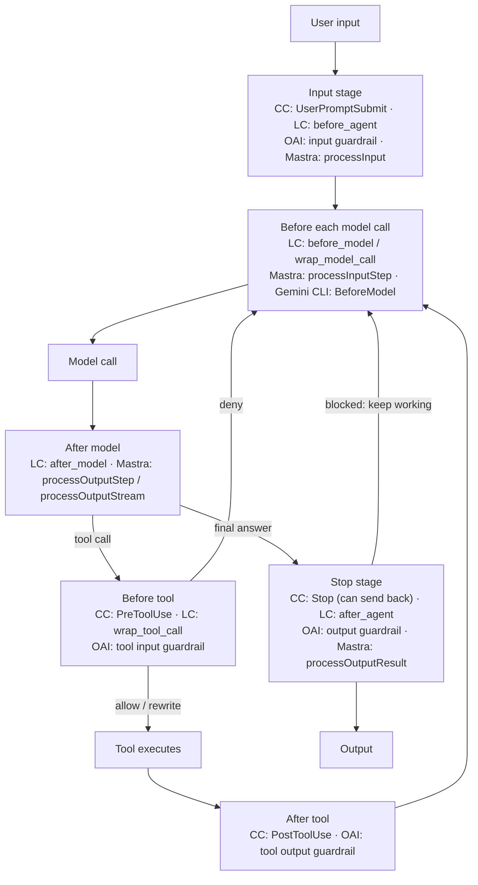

**Agent hooks and middleware** are code that the [harness](harness-engineering.md) runs at fixed points of the [agent loop](agent-loop.md) (before the model is called, after it answers, before and after each tool call, when the agent tries to stop) regardless of what the model decides. They are how you make part of an agent's behaviour deterministic: a hook can block a tool call, rewrite its arguments, inject context, retry a step, or simply log. The names differ by framework (Claude Code and Codex call them *hooks*, LangChain *middleware*, Mastra *processors*, the OpenAI Agents SDK splits them into *guardrails* that can halt a run and *lifecycle hooks* that only observe), but the mechanism is the same: interception points owned by the harness, not the prompt ([harness engineering](../sources/harness-engineering-blog-post.md); [LangChain, anatomy of a harness](../sources/langchain-anatomy-of-an-agent-harness.md)).

Synthesis: an instruction in a [system prompt](system-prompts.md) or [instruction file](agent-instruction-files.md) asks the model to behave; a hook makes the harness enforce it. Use instructions for judgement and hooks for rules that must hold every time.

## Two shapes of interception

Every framework below uses one or both of these shapes.

- **Event hooks (node-style).** A function is called at a named event with a snapshot of the state, and returns a decision or a state update. Claude Code's `PreToolUse`, LangChain's `before_model`, Mastra's `processInput`.
- **Wrappers (onion-style).** A function receives the request and a `handler` for the next layer, and decides whether to call it zero, one or many times. This is what makes short-circuiting, retries, fallbacks and caching expressible. LangChain's `wrap_model_call` / `wrap_tool_call`, Microsoft Agent Framework's agent, chat and function middleware ([MAF pipeline docs](../sources/microsoft-agent-framework-agent-pipeline-docs.md)).

Synthesis: the diagram maps where each framework's interception points sit on one turn of the loop.

## Claude Code and the Claude Agent SDK

**Events.** Claude Code fires roughly 30 lifecycle events, among them `SessionStart/End`, `UserPromptSubmit`, `PreToolUse`, `PostToolUse`, `PostToolUseFailure`, `PermissionRequest`, `Stop`, `SubagentStart/Stop` and `PreCompact/PostCompact` ([hooks reference](../sources/claude-code-hooks-docs.md)). Configuration nests event → matcher group → handlers. A matcher is an exact tool name, a pipe list (`Edit|Write`) or a regex; it tests the tool name only, never arguments ([Agent SDK hooks](../sources/claude-agent-sdk-hooks-docs.md)).

**Handlers.** Five types: `command` (JSON on stdin), `http` (POST), `mcp_tool`, `prompt` (a single-turn model judgement) and `agent` (an experimental subagent with read tools). The [Claude Agent SDK](claude-agent-sdk.md) adds in-process callbacks registered in `options.hooks` via `HookMatcher(matcher=..., hooks=[...], timeout=...)`; settings-file hooks still load too when the matching setting source is enabled, which it is by default. The Python SDK supports a subset of events (no `SessionStart`/`SessionEnd` callbacks, for example); TypeScript supports almost all ([Agent SDK hooks](../sources/claude-agent-sdk-hooks-docs.md)).

**Decisions.**
- Command hooks: exit 0 is success (stdout parsed as JSON if it is one object); exit 2 blocks and feeds stderr to the model; any other exit code is a non-blocking error, so a script that exits 1 does not enforce anything ([hooks reference](../sources/claude-code-hooks-docs.md)).
- `PreToolUse` returns `permissionDecision` (`allow`, `deny`, `ask`, `defer`), a reason shown to the model, `updatedInput` to rewrite arguments, and `additionalContext`. `PostToolUse` can append context or replace the tool output with `updatedToolOutput`. `Stop` can return `decision: block` to send the agent back to work.
- When several hooks match they run in parallel, and the most restrictive decision wins: deny over defer over ask over allow ([Agent SDK hooks](../sources/claude-agent-sdk-hooks-docs.md)).

**Place in the permission pipeline.** Hooks run first in the SDK's evaluation order: hooks, deny rules, ask rules, permission mode, allow rules, then the app's `canUseTool` callback. A hook's `allow` does not override a deny rule, and deny rules hold even in `bypassPermissions`. Calls that are auto-approved never reach `canUseTool`, so a `PreToolUse` hook is the place to inspect every call ([permissions docs](../sources/claude-agent-sdk-permissions-docs.md); see [agent guardrails](agent-guardrails.md)).

**Failure behaviour.** Failures fail open by default: a hook that crashes, returns invalid output or returns nothing lets the action proceed. `onFailure: "block"` makes a hook fail closed, but `Stop`, `SubagentStop`, `TaskCompleted` and `TeammateIdle` ignore it. Default timeouts are 600 s for command, http and SDK callback hooks, 30 s for `prompt` hooks and for `UserPromptSubmit`, 60 s for `agent` hooks, and a shared 1.5 s budget for `SessionEnd`. A `PreToolUse` callback that times out blocks the call; a `Stop` callback that times out counts as no decision ([hooks reference](../sources/claude-code-hooks-docs.md); [Agent SDK hooks](../sources/claude-agent-sdk-hooks-docs.md)).

**Other CLIs converge.** OpenAI Codex mirrors Claude Code's event names and the exit-2 convention, adds `PreModelRequest`/`PostModelRequest`, and requires each non-managed hook to be trusted by hash, so an edited hook needs re-review ([Codex hooks](../sources/openai-codex-hooks-docs.md)). Gemini CLI uses different names (`BeforeModel`, `BeforeToolSelection`, `BeforeTool`, `AfterAgent`), supports only command hooks with a 60,000 ms default timeout, and fingerprints project hooks ([Gemini CLI hooks](../sources/gemini-cli-hooks-docs.md)). See [coding agents](coding-agents.md).

## LangChain v1 middleware

In [LangChain](langchain.md) v1, `create_agent` is the loop and nearly everything else is middleware ([LangChain middleware docs](../sources/langchain-agents-middleware-docs.md)).

- **Six hooks.** Node-style `before_agent`, `before_model`, `after_model`, `after_agent` return dict updates merged into state through reducers. Wrap-style `wrap_model_call` and `wrap_tool_call` receive a `handler` they may call zero, one or many times.
- **Order** for `middleware=[m1, m2, m3]`: `before_*` run m1 → m3, `after_*` run m3 → m1, and `wrap_*` nest with m1 outermost.
- **Control flow.** A hook declared with `can_jump_to` may return `jump_to` of `"end"`, `"tools"` or `"model"`. `wrap_model_call` can pass `request.override(tools=..., model=..., system_message=...)` to the handler, which is how per-step tool filtering and model swaps work; all tools must still be registered up front.
- **State.** Middleware can declare its own `state_schema`. On conflicting writes to a key without a reducer, the outermost middleware wins.
- **Built-ins** cover the common deterministic controls: `SummarizationMiddleware` (see [context compaction](context-compaction.md)), `HumanInTheLoopMiddleware`, `ModelCallLimitMiddleware` / `ToolCallLimitMiddleware`, `ModelRetryMiddleware` / `ToolRetryMiddleware`, `ModelFallbackMiddleware`, `PIIMiddleware`, `LLMToolSelectorMiddleware` and `ContextEditingMiddleware`.
- **Human approval** is middleware plus a [LangGraph](langgraph.md) interrupt. `interrupt_on` maps tool names to policies, and the reviewer answers approve, edit, reject or respond. A checkpointer and `thread_id` are required. Use `reject`, not `respond`, to deny a side-effecting tool, because `respond` looks like success to the model ([HITL middleware](../sources/langchain-human-in-the-loop-middleware-docs.md); see [human-in-the-loop](human-in-the-loop.md)).

## OpenAI Agents SDK: guardrails plus observational hooks

The [OpenAI Agents SDK](openai-agents-sdk.md) splits control and observation into separate primitives.

- **Guardrails** return `GuardrailFunctionOutput` with `tripwire_triggered`. A tripped wire raises `InputGuardrailTripwireTriggered` or `OutputGuardrailTripwireTriggered` and halts the run ([guardrails docs](../sources/openai-agents-sdk-guardrails-docs.md)).
  - Input guardrails run only on the first agent, and by default in parallel with it (`run_in_parallel=True`), so tokens and even tool side effects may already have happened when they trip. `run_in_parallel=False` makes them blocking.
  - Output guardrails run only on the agent producing the final output.
  - Tool guardrails (`@tool_input_guardrail`, `@tool_output_guardrail`) wrap function tools on every call and can allow, or reject with a message to the model. They do not cover handoffs, hosted tools such as web search, or built-in execution tools such as computer and shell. Agents reached by [handoff](agent-handoffs.md) skip input guardrails, so cross-agent checks belong on tools.
- **Lifecycle hooks.** `RunHooks` (`on_agent_start/end`, `on_llm_start/end`, `on_tool_start/end`, `on_handoff`) and per-agent `AgentHooks` all return `None`. The reference documents no way for them to block or rewrite. They are for logging, metrics and side effects ([lifecycle reference](../sources/openai-agents-sdk-lifecycle-reference.md)).

## Mastra processors

[Mastra](mastra.md) agents take `inputProcessors`, `outputProcessors` and `errorProcessors` arrays, run sequentially in array order ([Mastra processors](../sources/mastra-processors-docs.md)).

- `processInput` runs once at the start. `processInputStep` runs on every loop step, including tool-call continuations, and can swap `model`, `tools`, `toolChoice` and system messages. `processLLMRequest` rewrites the outbound prompt transiently, without saving it to history.
- `processOutputStream` sees each streamed chunk and can drop it. `processOutputStep` validates each step and can request a retry. `processOutputResult` sees the final result. `processAPIError` handles provider rejections.
- `abort(reason)` throws a `TripWire`. Streams then emit a `tripwire` chunk, and `generate()` sets `result.tripwire`. `abort(reason, { retry: true })` retries the step, but only if `maxProcessorRetries` is set; it is unset by default, which disables step retries.
- With memory on, memory processors run before yours on input and after yours on output, so an output abort also prevents the turn from being saved.
- Built-ins include `ModerationProcessor`, `PromptInjectionDetector`, `PIIDetector`, `TokenLimiter`, `ToolCallFilter` and `TokenCostControl`.

## Comparison

| | Claude Code / Agent SDK | LangChain v1 | OpenAI Agents SDK | Mastra |
|---|---|---|---|---|
| Name | hooks | middleware | guardrails + lifecycle hooks | processors |
| Shape | event hooks; shell, HTTP, MCP, prompt, agent or in-process callback | event hooks + wrappers | tripwire checks; observe-only hooks | event hooks per stage and step |
| Block a tool call | `PreToolUse` deny / exit 2 | `wrap_tool_call` without calling handler | tool input guardrail (function tools only) | not documented per tool call; abort on step |
| Rewrite tool args | `updatedInput` | modify request before calling handler | not documented | not documented |
| Change model / tools per step | `PreModelSwitch` can block a switch (TS) | `request.override(...)` | not documented | `processInputStep` |
| Force continuation | `Stop` → `decision: block` | `jump_to: "model"` | not documented | step retry |
| Multiple handlers | parallel, most restrictive wins | ordered onion | not documented | sequential, array order |
| Halt semantics | deny / `continue: false`; failures fail open unless `onFailure: "block"` | `jump_to: "end"` | tripwire exception halts the run | `abort()` throws `TripWire` |

"Not documented" means the cited docs do not describe it, not that it is impossible.

Synthesis: the Claude Code family is built for *policy* (external scripts, managed settings, trust controls, process isolation). LangChain and MAF are built for *composition* (wrappers that nest retries, fallbacks and caching). OpenAI separates *halting* from *observing*. Mastra is organised around *message streams*, with per-chunk and per-step processing.

## Deterministic control patterns

Each pattern names the documented mechanism it relies on.

1. **Deny-list on dangerous calls.** A `PreToolUse` hook or `wrap_tool_call` inspects arguments (paths, shell commands) and denies with a reason the model can act on. Match on tool name, then check arguments inside the hook, because matchers do not see arguments ([Agent SDK hooks](../sources/claude-agent-sdk-hooks-docs.md)).
2. **Argument rewriting.** Redirect writes into a sandbox path, inject credentials, or pin a tenant ID with `updatedInput`, instead of trusting the model to supply them.
3. **Feedback hooks.** Run a formatter, linter or test after file edits (`PostToolUse`) and return failures as context. The harness writers cite hooks as the way to make verification steps deterministic ([harness engineering](../sources/harness-engineering-blog-post.md); [LangChain, anatomy of a harness](../sources/langchain-anatomy-of-an-agent-harness.md)).
4. **Completion gates.** A `Stop` hook that blocks until tests pass keeps the agent working. This is the "Ralph loop" idea of catching the exit attempt ([LangChain, anatomy of a harness](../sources/langchain-anatomy-of-an-agent-harness.md)). Bound it, because a gate that never passes loops forever.
5. **Budgets and limits.** `ModelCallLimitMiddleware`, `ToolCallLimitMiddleware` and Mastra's `TokenCostControl` cap runaway loops in code rather than through prompt pleas. See [cost and latency optimisation](cost-and-latency-optimization.md).
6. **Context control.** Summarisation, context editing and tool-call filtering as middleware or processors, plus `PreCompact` hooks to archive the transcript before compaction ([context compaction](context-compaction.md)).
7. **Data-protection filters.** PII redaction on input and output (`PIIMiddleware`, `PIIDetector`), and moderation or injection detectors as processors. These are model- or regex-based and therefore probabilistic; see [guardrail tooling](guardrail-tooling.md) and [PII and data privacy](pii-and-data-privacy.md).
8. **Approval gates.** Route selected tools to a human (`ask` decision, `HumanInTheLoopMiddleware`). Durable interrupts need a checkpointer; see [human-in-the-loop](human-in-the-loop.md) and [durable execution](durable-agent-execution.md).
9. **Audit and telemetry.** Observe-only hooks (OpenAI `RunHooks`, async Claude hooks, `PostToolUse` webhooks) feed [observability](llm-observability.md) pipelines, for example as [OpenTelemetry GenAI](opentelemetry-genai.md) spans. Async Claude hooks cannot block or inject context ([Agent SDK hooks](../sources/claude-agent-sdk-hooks-docs.md)).

## Limits and failure modes

- **Fail-open defaults.** Claude Code hooks proceed on crash, invalid output or a missing return unless `onFailure: "block"` is set, and even that is ignored on `Stop`-type events. A command hook that exits 1 instead of 2 enforces nothing ([hooks reference](../sources/claude-code-hooks-docs.md)). Treat a security hook like a firewall rule and test the failure path.
- **Coverage gaps.** A hook only sees what passes through its interception point. A `Write|Edit` matcher misses a Bash command that writes the same file. OpenAI tool guardrails skip hosted tools, built-in execution tools and handoffs, and input guardrails skip agents reached by handoff ([Agent SDK hooks](../sources/claude-agent-sdk-hooks-docs.md); [guardrails docs](../sources/openai-agents-sdk-guardrails-docs.md)). Back hooks with a sandbox, which constrains the process whatever tool the model picks ([agent guardrails](agent-guardrails.md); [code execution sandboxes](code-execution-sandboxes.md)).
- **Parallel checks race side effects.** OpenAI's default parallel input guardrails may trip after tokens are spent or tools have run. Claude's parallel hooks finish in non-deterministic order, so none may depend on another having run ([guardrails docs](../sources/openai-agents-sdk-guardrails-docs.md); [Agent SDK hooks](../sources/claude-agent-sdk-hooks-docs.md)).
- **Post hooks cannot undo.** `PostToolUse` runs after the side effect. Codex states outright that it cannot undo a command ([Codex hooks](../sources/openai-codex-hooks-docs.md)). Anything irreversible must be gated *before* execution.
- **Ordering surprises.** LangChain's `after_*` hooks run in reverse order, and on conflicting state writes the outermost middleware wins. Mastra memory ordering means an output abort also drops persistence ([LangChain middleware docs](../sources/langchain-agents-middleware-docs.md); [Mastra processors](../sources/mastra-processors-docs.md)).
- **Loops and recursion.** `Stop` gates and step retries can loop. A `UserPromptSubmit` hook that spawns subagents can retrigger itself. Hooks may not fire when a run ends at `max_turns` ([Agent SDK hooks](../sources/claude-agent-sdk-hooks-docs.md)).
- **"Deterministic" only describes the trigger.** A `prompt`/`agent` hook, a moderation processor or an LLM-based guardrail decides with a model, which reintroduces [non-determinism](llm-non-determinism.md) and its own [prompt-injection](prompt-injection.md) surface. Synthesis: keep hard security invariants in plain code, and use model-judged hooks for quality gates.
- **Hooks are code with your privileges.** Shell hooks run with user privileges, so project and plugin hooks need review. Codex and Gemini CLI re-prompt for trust when a hook changes ([hooks reference](../sources/claude-code-hooks-docs.md); [Codex hooks](../sources/openai-codex-hooks-docs.md); [Gemini CLI hooks](../sources/gemini-cli-hooks-docs.md)).

## Practical guidance

Synthesis, drawing on the sources above:

- Put each control at the earliest point that sees enough to decide: block at pre-tool, verify at post-tool, gate completion at stop.
- For security, combine three layers: a hook (precise, argument-aware), static deny rules (which survive a hook's `allow` in the Claude SDK), and a sandbox or egress limit (which survives a missed matcher). This matters most for agents that combine private data, untrusted content and outbound channels, the [lethal trifecta](lethal-trifecta.md).
- Opt into fail-closed (`onFailure: "block"`, `run_in_parallel=False`) for any check that protects an invariant. Leave fail-open for telemetry.
- Give the model a usable reason on every deny, so it can take another path instead of retrying the same call.
- Keep hooks fast and idempotent. They run on every matching event, often in parallel, under timeouts.
- Test hooks like code: unit-test the decision function, then run an [agent evaluation](agent-evaluation.md) that tries to bypass it (for example, the same write through a different tool).

## Sources

- [Hooks reference (Claude Code docs)](../sources/claude-code-hooks-docs.md)
- [Intercept and control agent behavior with hooks (Claude Agent SDK docs)](../sources/claude-agent-sdk-hooks-docs.md)
- [Configure permissions (Claude Agent SDK docs)](../sources/claude-agent-sdk-permissions-docs.md)
- [Hooks (OpenAI Codex docs)](../sources/openai-codex-hooks-docs.md)
- [Hooks (Gemini CLI docs)](../sources/gemini-cli-hooks-docs.md)
- [LangChain agents, middleware and structured output docs](../sources/langchain-agents-middleware-docs.md)
- [Human-in-the-loop middleware (LangChain docs)](../sources/langchain-human-in-the-loop-middleware-docs.md)
- [Guardrails (OpenAI Agents SDK docs)](../sources/openai-agents-sdk-guardrails-docs.md)
- [Lifecycle hooks reference (OpenAI Agents SDK)](../sources/openai-agents-sdk-lifecycle-reference.md)
- [Mastra docs: Processors](../sources/mastra-processors-docs.md)
- [Agent Pipeline Architecture (Microsoft Agent Framework docs)](../sources/microsoft-agent-framework-agent-pipeline-docs.md)
- [Harness engineering](../sources/harness-engineering-blog-post.md)
- [LangChain: anatomy of an agent harness](../sources/langchain-anatomy-of-an-agent-harness.md)
