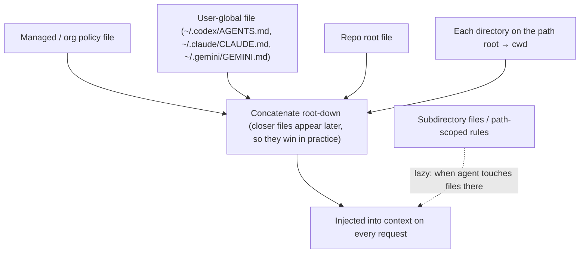

An **agent instruction file** is a plain Markdown file that a coding agent's harness finds by convention and injects into context at the start of every session. It carries the build commands, conventions and constraints the agent can't infer from the code. The cross-vendor name is **AGENTS.md**, a "README for agents" with no required schema. Codex, Cursor, Jules, Gemini CLI, GitHub Copilot's coding agent and many others read it, and it is now stewarded by the Agentic AI Foundation under the Linux Foundation ([AGENTS.md](../sources/agents-md-spec.md)). Some vendors have their own name: Claude Code uses **CLAUDE.md**, Gemini CLI uses **GEMINI.md** and Cursor uses **rules** ([Claude Code memory](../sources/claude-code-memory-docs.md), [Gemini CLI](../sources/gemini-cli-context-files-docs.md), [Cursor rules](../sources/cursor-rules-docs.md)). Functionally these files are a user-editable extension of the [system prompt](system-prompts.md). They are *context*, not configuration: the model reads them and may still not follow them.

## Discovery and merge

All the major harnesses **concatenate** the files they find rather than letting one replace another, and they order them so the file nearest the working directory comes last. The details differ:

| | Codex (AGENTS.md) | Claude Code (CLAUDE.md) | Gemini CLI (GEMINI.md) | Cursor |
|---|---|---|---|---|
| Global | `~/.codex/AGENTS.override.md` or `AGENTS.md` (first non-empty) | `~/.claude/CLAUDE.md`; managed file under `/Library/Application Support/ClaudeCode/` or `/etc/claude-code/` | `~/.gemini/GEMINI.md` | User rules (settings), Team rules (dashboard) |
| Project walk | git root → cwd, at most one file per dir (`AGENTS.override.md` > `AGENTS.md` > fallback names) | ancestors of cwd at launch; `CLAUDE.local.md` for personal, gitignored notes | workspace dirs and parents | `.cursor/rules/*.mdc`; nested AGENTS.md combine, more specific wins |
| Lazy / scoped | n/a (rebuilt each run) | subdirectory CLAUDE.md when files there are touched; `.claude/rules/*.md` with `paths:` globs | just-in-time scan when a tool touches a directory | per-rule `alwaysApply`, `globs`, description-based "Apply Intelligently", or manual `@` |
| Imports | none documented | `@path` imports, max 4 hops; external imports need approval | `@file.md` imports | referenced files read on demand |
| Size limit | `project_doc_max_bytes` default **32 KiB**; files past the cap are dropped | guidance <200 lines/file; oversized nested files truncated | none stated | guidance <500 lines/rule |
| AGENTS.md interop | native | reads AGENTS.md only when no `CLAUDE.md`, `.claude/CLAUDE.md` or `CLAUDE.local.md` exists in cwd or above (v2.1.277+), or when CLAUDE.md imports it; setting `claude-md-and-agents-md` loads both | `context.fileName: ["AGENTS.md","GEMINI.md"]` | native |

Sources: [Codex](../sources/openai-codex-agents-md-docs.md), [Claude Code memory](../sources/claude-code-memory-docs.md), [Gemini CLI](../sources/gemini-cli-context-files-docs.md), [Cursor rules](../sources/cursor-rules-docs.md). The AGENTS.md site says explicit chat prompts override file content ([AGENTS.md](../sources/agents-md-spec.md)). In Claude Code, contradictions between concatenated files may be resolved arbitrarily ([Claude Code memory](../sources/claude-code-memory-docs.md)).

Synthesis: a portable setup for a multi-agent team is a single `AGENTS.md`. Claude Code v2.1.277+ reads it directly when the repo has no CLAUDE.md; otherwise add a one-line `CLAUDE.md` containing `@AGENTS.md` (which also covers older versions and sessions where direct AGENTS.md support is unavailable) or use the setting that loads both. Note that adding a personal `CLAUDE.local.md` silently switches Claude Code off AGENTS.md under the default setting ([Claude Code memory](../sources/claude-code-memory-docs.md)). Gemini CLI can be pointed at the same file with `context.fileName`.

Two harness-specific details are easy to miss:

- **Codex** stops adding files once the combined size hits 32 KiB, so guidance in deep subdirectories is silently dropped in large monorepos. Raise the cap or split the content, then check what was actually loaded with `codex --ask-for-approval never "Summarize the current instructions."` ([Codex](../sources/openai-codex-agents-md-docs.md)).
- **Gemini CLI** shows the full concatenated context with `/memory show` ([Gemini CLI](../sources/gemini-cli-context-files-docs.md)).

## What to put in (and leave out)

The AGENTS.md site suggests these sections: overview, build and test commands, code style, testing, security, commit/PR conventions and deployment ([AGENTS.md](../sources/agents-md-spec.md)). Anthropic's current guidance is narrower. Include only what the agent cannot discover from the code ([best practices](../sources/claude-code-best-practices.md)):

- exact test, typecheck and lint commands;
- code that is misleading;
- decisions made outside the repo;
- anything you've had to correct twice.

The same guidance says to stop describing the architecture in CLAUDE.md, because current models explore the code themselves ([best practices](../sources/claude-code-best-practices.md)).

The research agrees with the narrow approach. Gloaguen et al. (arXiv 2602.11988, ICLR 2026) tested context files on SWE-bench tasks and on repos that commit their own files, across several agents and models ([paper](../sources/gloaguen-2026-evaluating-agents-md.md)):

- The files did **not** generally improve success, whether written by an LLM or by developers.
- They raised inference cost by **more than 20%**.
- Agents dutifully followed the extra instructions: more exploration, more tests. That work did not turn into more resolved issues.
- Repository overviews didn't help agents find the relevant files any faster.
- The authors recommend keeping files to minimal, non-standard requirements and evaluating any file before trusting it.

Synthesis: every line costs tokens on every request, and it also costs *behaviour*, because the agent will spend effort complying. Treat the file like production config. Add a line in response to an observed failure, and delete lines that no longer prevent one. Auto-generated `/init` files are a starting draft, not a finished artefact.

## Instruction files vs other mechanisms

| Need | Put it in |
|---|---|
| Fact or rule every session needs | instruction file |
| Rule only for some paths (e.g. `*.sql`) | path-scoped rule (`.claude/rules` with `paths:`, Cursor `globs`) or nested file |
| Long procedure or reference needed sometimes | [agent skill](agent-skills.md) (loaded on demand) |
| Rule that must hold 100% of the time | hook or permission deny rule |
| Agent-learned notes across sessions | auto memory (Claude Code `MEMORY.md`, first 200 lines / 25 KB loaded); see [agent memory](agent-memory.md) |

Sources: [extend overview](../sources/claude-code-extend-features-overview.md), [best practices](../sources/claude-code-best-practices.md), [Claude Code memory](../sources/claude-code-memory-docs.md).

The boundary that matters most is between *non-deterministic* and *deterministic* controls. "Never edit `.env`" in CLAUDE.md is a request. A `PreToolUse` hook that exits 2, or a deny rule, is enforcement ([extend overview](../sources/claude-code-extend-features-overview.md), [hooks](../sources/claude-code-hooks-docs.md)). Anthropic's diagnostic: if writing "IMPORTANT" doesn't make a line stick, either the file is too long or the line is a rule that belongs in a hook ([best practices](../sources/claude-code-best-practices.md)). Managed settings also split the two roles. Managed *settings* (`permissions.deny`, `sandbox.enabled`) enforce, while a managed *CLAUDE.md* only guides, although users can't exclude it ([Claude Code memory](../sources/claude-code-memory-docs.md)).

Cursor shows the same evolution as other harnesses. Its description-triggered rules ("Apply Intelligently") behave like skills, and `/migrate-to-skills` converts them into skills. Always-apply and glob-scoped rules stay as rules ([Cursor skills](../sources/cursor-skills-docs.md)).

## Failure modes

- **Bloat and dilution.** Long files reduce adherence. Claude Code's guidance is under 200 lines per file and Cursor's is under 500 lines per rule ([Claude Code memory](../sources/claude-code-memory-docs.md), [Cursor rules](../sources/cursor-rules-docs.md)). See [long-context degradation](long-context-degradation.md).
- **Silent truncation.** Codex's 32 KiB cap and Claude Code's per-file limit on nested files mean late content can disappear without warning ([Codex](../sources/openai-codex-agents-md-docs.md), [extend overview](../sources/claude-code-extend-features-overview.md)).
- **Precedence surprises.** If a repo has both CLAUDE.md (or a `CLAUDE.local.md`) and AGENTS.md, Claude Code by default ignores AGENTS.md unless CLAUDE.md imports it. Cursor resolves conflicts Team → Project → User, with the earlier source winning ([Claude Code memory](../sources/claude-code-memory-docs.md), [Cursor rules](../sources/cursor-rules-docs.md)).
- **Stale instructions.** Commands that no longer exist send the agent down wrong paths. Synthesis: test the commands listed in the file in CI.
- **Untrusted repositories.** Instruction files arrive with any cloned repo and are injected as trusted context, so they are a [prompt injection](prompt-injection.md) vector. Claude Code makes you approve `@` imports that point outside the working directory for exactly this reason ([Claude Code memory](../sources/claude-code-memory-docs.md)).

## When to use / when not

Use an instruction file for short, durable facts the agent gets wrong without it: the commands, the non-obvious conventions and the landmines. Don't use one for:

- architecture tours;
- style rules a linter already enforces;
- procedures needed only occasionally (make a [skill](agent-skills.md));
- anything that must be guaranteed (use a hook or permission rule).

([best practices](../sources/claude-code-best-practices.md), [paper](../sources/gloaguen-2026-evaluating-agents-md.md)). See also [coding agents](coding-agents.md) and [context engineering](context-engineering.md).

## Sources

- [AGENTS.md (open format site)](../sources/agents-md-spec.md)
- [Codex: Custom instructions with AGENTS.md](../sources/openai-codex-agents-md-docs.md)
- [Claude Code memory docs](../sources/claude-code-memory-docs.md)
- [Best practices for Claude Code](../sources/claude-code-best-practices.md)
- [Extend Claude Code](../sources/claude-code-extend-features-overview.md)
- [Cursor Rules](../sources/cursor-rules-docs.md)
- [Cursor: Agent Skills](../sources/cursor-skills-docs.md)
- [Gemini CLI: GEMINI.md context files](../sources/gemini-cli-context-files-docs.md)
- [Claude Code hooks reference](../sources/claude-code-hooks-docs.md)
- [Evaluating AGENTS.md (Gloaguen et al., 2026)](../sources/gloaguen-2026-evaluating-agents-md.md)
