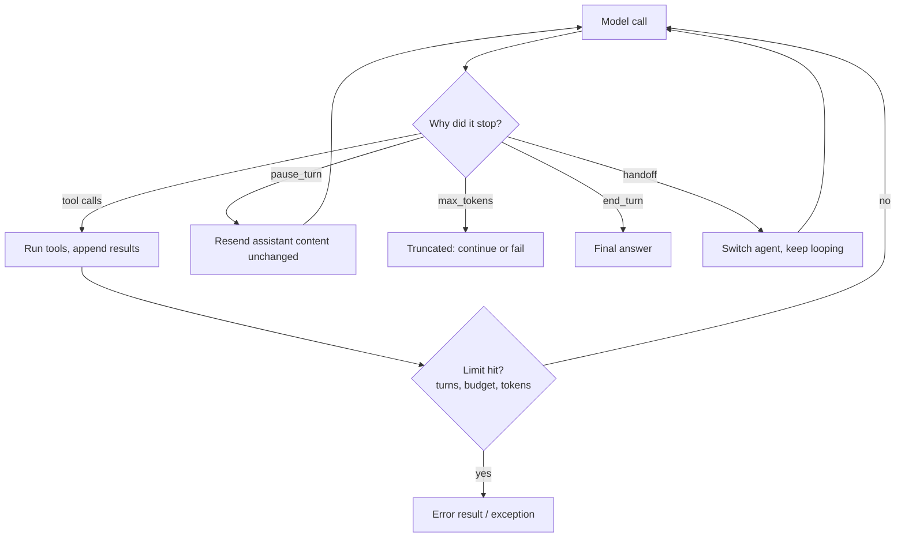

The **agent loop** is the minimal structure that makes a language model an agent. The model is called repeatedly. Each turn it either asks for one or more [tool calls](function-calling.md), which the harness executes and appends to the conversation, or it answers without calling a tool, which ends the loop. The Claude Agent SDK defines a turn the same way: one model output plus execution of its tool calls, with the loop ending on a response that has no tool calls ([Agent SDK loop docs](../sources/claude-agent-sdk-agent-loop-docs.md)).

> **Contradiction:** this page (from [The Anatomy of a Modern AI Agent](../sources/anatomy-of-a-modern-ai-agent.md)) says a turn with no tool calls ends the loop, and the sketch below returns on it. [Anthropic Messages API](anthropic-messages-api.md) documents turns that end without client tool calls but must not end the loop: `pause_turn` (resend the assistant content unchanged so server tools can continue) and `max_tokens` (truncated output), per the [API reference](../sources/anthropic-messages-api-reference.md) and [server tools docs](../sources/anthropic-server-tools-docs.md). A production loop should branch on the stop reason, not only on the presence of tool calls. Still open as of 2026-11-14: framework docs keep the simple rule ([Claude Agent SDK](../sources/claude-agent-sdk-agent-loop-docs.md)), while the [AI SDK](../sources/ai-sdk-docs.md) also ends its loop on any non-tool finish reason, so truncation handling is left to the caller.

```python
while True:
    response = model.generate(messages, tools=tools)
    messages.append(response)
    if not response.tool_calls:
        return response.text
    for call in response.tool_calls:
        messages.append(run(call))
```

## Key properties

- **No hard-coded control flow.** There is no separate planner or state machine. The model decides each next step.
- **The harness only executes.** It runs the requested [tools](tools.md), returns results, and enforces [guardrails](agent-guardrails.md). Everything around the model call is [harness engineering](harness-engineering.md).
- **Quality lives outside the loop.** How well the model chooses depends on its tools, its [context window](context-window.md) contents ([context engineering](context-engineering.md)) and its ability to check results ([verification](verification-and-evals.md)).

> **Contradiction:** [The Anatomy of a Modern AI Agent](../sources/anatomy-of-a-modern-ai-agent.md) says agents have no hard-coded control flow. [Google Cloud's pattern guide](../sources/google-cloud-choose-agentic-design-pattern.md) treats predefined workflows (sequential, parallel, loop) as legitimate agent patterns that are cheaper and more predictable than letting a model decide. Synthesis: the open loop described here is the *model-orchestrated* case. Fixed workflows wrap agents in code-driven control flow. See [agent design patterns](agent-design-patterns.md).

**ReAct** is a named form of this loop in which the model explicitly writes a Thought before each Action and records each Observation, until it reaches an answer, an iteration limit or an error. Google's guide recommends it for tasks that need continual re-planning and positions it as the step up when a single agent degrades as tools grow ([Google Cloud](../sources/google-cloud-choose-agentic-design-pattern.md)). smolagents' `MultiStepAgent` is a ReAct loop that logs each iteration as an `ActionStep` ([smolagents guide](../sources/smolagents-intro-agents-guide.md)). In LangChain 1.0, `create_agent` replaced `langgraph.prebuilt.create_react_agent` ([LangGraph 1.0](../sources/langchain-langgraph-1-0-announcement.md)). See [ReAct pattern](react-pattern.md).

## Stopping the loop

A real loop needs more exits than "no tool calls":



Synthesis: combines the stop reasons in the [Messages API reference](../sources/anthropic-messages-api-reference.md) with the run outcomes in the [OpenAI Agents SDK](../sources/openai-agents-sdk-running-agents-docs.md) and [Claude Agent SDK](../sources/claude-agent-sdk-agent-loop-docs.md) docs.

- **Stop reasons.** Claude returns `end_turn`, `max_tokens`, `stop_sequence`, `tool_use`, `pause_turn`, `refusal` or `model_context_window_exceeded` ([API reference](../sources/anthropic-messages-api-reference.md)). On `pause_turn`, resend the assistant content as-is with the same tools so server tools can continue ([server tools docs](../sources/anthropic-server-tools-docs.md)).
- **Handoffs as a branch.** The OpenAI Agents SDK Runner has three outcomes per turn: final output ends the run, a [handoff](agent-handoffs.md) switches the current agent, tool calls run and the loop repeats ([running agents](../sources/openai-agents-sdk-running-agents-docs.md)). Handoffs are themselves exposed to the model as tools such as `transfer_to_refund_agent` ([handoffs docs](../sources/openai-agents-sdk-handoffs-docs.md)).
- **Hard caps, per framework.** None of these loops is safe unbounded:

| Framework | Cap | What happens at the cap |
|---|---|---|
| [Claude Agent SDK](claude-agent-sdk.md) | `max_turns`, `max_budget_usd` (default: no limit) | `ResultMessage` subtype `error_max_turns` / `error_max_budget_usd`; the budget can overshoot by one response plus running subagents ([docs](../sources/claude-agent-sdk-agent-loop-docs.md)) |
| [OpenAI Agents SDK](openai-agents-sdk.md) | `max_turns` | Raises `MaxTurnsExceeded`, unless an `error_handlers` entry returns a fallback ([docs](../sources/openai-agents-sdk-running-agents-docs.md)) |
| [Vercel AI SDK](vercel-ai-sdk.md) | `stopWhen`: `isStepCount(n)`, `hasToolCall(...)`, custom predicates | `generateText` defaults to one step; `ToolLoopAgent` defaults to `isStepCount(20)`; `WorkflowAgent.stream()` has no default limit ([docs](../sources/ai-sdk-docs.md)) |
| [Pydantic AI](pydantic-ai.md) | `UsageLimits(request_limit, tool_calls_limit, token limits)` | Raises `UsageLimitExceeded`; `tool_calls_limit` is checked before execution, so an over-limit parallel batch runs none ([docs](../sources/pydantic-ai-docs.md)) |
| [LangChain](langchain.md) | `ModelCallLimitMiddleware`, `ToolCallLimitMiddleware` (`thread_limit`, `run_limit`, `exit_behavior`) | Per `exit_behavior` ([docs](../sources/langchain-agents-middleware-docs.md)) |

- **Hooks can veto the stop.** A Claude Code `Stop` hook can return `decision: block` to send the agent back to work, and a `PreToolUse` hook can allow, deny or rewrite a call before it runs ([hooks docs](../sources/claude-code-hooks-docs.md)). LangChain's middleware offers the same seams (`before_model`, `wrap_tool_call`, `jump_to: "end"`) ([middleware docs](../sources/langchain-agents-middleware-docs.md)). See [agent hooks and middleware](agent-hooks-and-middleware.md).

## State the loop must carry

- **Thinking blocks.** With [extended thinking](extended-thinking.md), a tool-use loop is one assistant turn. When sending tool results back, include that turn's thinking blocks (and `redacted_thinking`) complete, unmodified and in order; modified blocks get a 400, and toggling thinking mid-turn silently disables it ([thinking docs](../sources/anthropic-thinking-docs.md)).
- **Cache breakpoints.** The context grows every turn, so [prompt caching](prompt-caching.md) is what keeps the loop affordable. On a miss, Anthropic's cache looks back at most 20 blocks for an earlier entry, so long, growing conversations need an extra breakpoint. Changing thinking config or effort mid-conversation invalidates the cache ([caching docs](../sources/anthropic-prompt-caching-docs.md), [thinking docs](../sources/anthropic-thinking-docs.md)). The Claude Agent SDK caches stable prefixes (system prompt, tools, CLAUDE.md) automatically ([Agent SDK](../sources/claude-agent-sdk-agent-loop-docs.md)).
- **Compaction.** Near the context limit, older turns are summarised ([context compaction](context-compaction.md)). The Claude Agent SDK does this automatically and re-injects CLAUDE.md every request, so persistent rules belong there ([Agent SDK](../sources/claude-agent-sdk-agent-loop-docs.md)). The API offers on-demand, threshold and self-written summarisation, and rule-based context editing as an alternative ([compaction docs](../sources/anthropic-compaction-docs.md)). Compaction alone did not carry a multi-session app build; Anthropic's harness externalised state into a progress file, a JSON feature list and git ([long-running harnesses](../sources/anthropic-effective-harnesses-long-running-agents.md)).
- **Resume.** Claude Agent SDK sessions are JSONL transcripts that can be continued, resumed by ID or forked ([sessions docs](../sources/claude-agent-sdk-sessions-docs.md)); the OpenAI Agents SDK pauses for tool approval and resumes from a serialisable `RunState` ([running agents](../sources/openai-agents-sdk-running-agents-docs.md)). [Durable execution](durable-agent-execution.md) goes further: an approval can wait on a durable `sleep('7d')` with no process kept alive ([Vercel guide](../sources/vercel-durable-ai-agents-guide.md)).

## Failure modes

- **Runaway loops.** Unbounded settings (no `max_turns`, `isLoopFinished()`, `WorkflowAgent.stream()`) can loop until money or context runs out; pair them with a step or budget cap ([AI SDK docs](../sources/ai-sdk-docs.md), [Agent SDK](../sources/claude-agent-sdk-agent-loop-docs.md)).
- **Hard stops lose work.** Pydantic AI raises at `request_limit` even when the model already has what it needs ([docs](../sources/pydantic-ai-docs.md)); a single-shot Claude Agent SDK `query()` raises after yielding an error result, so check `ResultMessage.subtype` first ([Agent SDK](../sources/claude-agent-sdk-agent-loop-docs.md)).
- **Premature victory and one-shotting.** Long-running agents declare a project done too early, or attempt too much and run out of context mid-feature ([long-running harnesses](../sources/anthropic-effective-harnesses-long-running-agents.md)).
- **Sycophantic flips.** Assistants abandon correct answers when challenged ([Sharma et al.](../sources/towards-understanding-sycophancy.md)). Synthesis: an automated "are you sure?" turn is not a verification step; check with tests or an independent call instead ([LLM limitations](llm-limitations.md)).
- **Opaque runs.** Tracing each turn helps: OpenTelemetry's GenAI conventions define `invoke_agent`, `plan` and `execute_tool` spans and a `gen_ai.conversation.compacted` attribute ([OTel GenAI](../sources/opentelemetry-genai-semantic-conventions.md)). See [OpenTelemetry GenAI](opentelemetry-genai.md).

## Related

[Tools](tools.md) · [Subagents](subagents.md), which nest the loop inside itself · [Agent design patterns](agent-design-patterns.md) · [ReAct pattern](react-pattern.md) · [Agent handoffs](agent-handoffs.md) · [Harness engineering](harness-engineering.md)

## Going deeper

- [Function calling](function-calling.md): the wire protocol each loop turn uses (tool_choice, parallel calls, strict schemas).
- [Anthropic Messages API](anthropic-messages-api.md): stop reasons, `pause_turn` and server tools that run inside one request.
- [Extended thinking](extended-thinking.md): thinking blocks must be returned unmodified alongside tool results.
- [Prompt caching](prompt-caching.md): keeping a long, growing loop cheap with cache breakpoints.
- [Context compaction](context-compaction.md): summarising or clearing old turns as the loop nears the context limit.
- [Coding agents](coding-agents.md): the main worked example of a long-running agent loop.
- [Claude Agent SDK](claude-agent-sdk.md): a production loop with max_turns, budget caps and compaction.
- [OpenAI Agents SDK](openai-agents-sdk.md): the Runner loop and its final-output vs handoff vs tool-call branches.
- [Vercel AI SDK](vercel-ai-sdk.md): concrete stop conditions such as step-count limits.
- [Pydantic AI](pydantic-ai.md): `UsageLimits` as a runaway-loop guard.
- [Agent hooks and middleware](agent-hooks-and-middleware.md): intercepting model and tool calls inside the loop.
- [Durable agent execution](durable-agent-execution.md): surviving crashes and resuming the loop later.
- [Human-in-the-loop](human-in-the-loop.md): pausing the loop for approval.

## Sources

- [The Anatomy of a Modern AI Agent](../sources/anatomy-of-a-modern-ai-agent.md)
- [Choose a design pattern for your agentic AI system (Google Cloud)](../sources/google-cloud-choose-agentic-design-pattern.md)
- [Anthropic Messages API reference](../sources/anthropic-messages-api-reference.md)
- [Anthropic server tools docs](../sources/anthropic-server-tools-docs.md)
- [Anthropic thinking docs](../sources/anthropic-thinking-docs.md)
- [Anthropic prompt caching docs](../sources/anthropic-prompt-caching-docs.md)
- [Anthropic compaction docs](../sources/anthropic-compaction-docs.md)
- [How the agent loop works (Claude Agent SDK docs)](../sources/claude-agent-sdk-agent-loop-docs.md)
- [Claude Agent SDK sessions docs](../sources/claude-agent-sdk-sessions-docs.md)
- [Running agents (OpenAI Agents SDK docs)](../sources/openai-agents-sdk-running-agents-docs.md)
- [Handoffs (OpenAI Agents SDK docs)](../sources/openai-agents-sdk-handoffs-docs.md)
- [AI SDK docs](../sources/ai-sdk-docs.md)
- [Pydantic AI docs](../sources/pydantic-ai-docs.md)
- [LangChain and LangGraph 1.0 announcement](../sources/langchain-langgraph-1-0-announcement.md)
- [LangChain agents and middleware docs](../sources/langchain-agents-middleware-docs.md)
- [smolagents intro to agents guide](../sources/smolagents-intro-agents-guide.md)
- [Claude Code hooks docs](../sources/claude-code-hooks-docs.md)
- [Building durable AI agents (Vercel)](../sources/vercel-durable-ai-agents-guide.md)
- [Effective harnesses for long-running agents (Anthropic)](../sources/anthropic-effective-harnesses-long-running-agents.md)
- [Towards Understanding Sycophancy in Language Models](../sources/towards-understanding-sycophancy.md)
- [OpenTelemetry GenAI semantic conventions](../sources/opentelemetry-genai-semantic-conventions.md)
