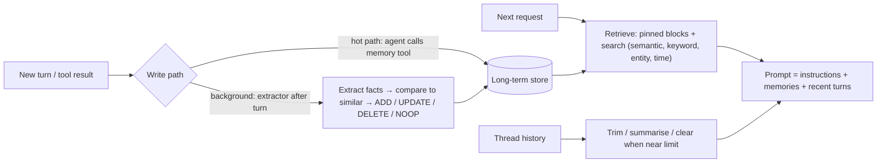

**Agent memory** is everything an agent can use beyond the tokens in its current [context window](context-window.md): the running state of the current task, and information persisted across turns, sessions and users that is written, retrieved and edited on purpose. An LLM is stateless between calls. "Memory" is always an application-level system that decides **what to write, where to store it, and what to load back into the prompt**. In practice that makes it a form of [context engineering](context-engineering.md) with a database attached ([LangGraph](../sources/langgraph-memory-docs.md), [Anthropic](../sources/anthropic-effective-context-engineering.md)).

## Short-term vs long-term

| | Short-term (working) memory | Long-term memory |
|---|---|---|
| Scope | One thread or task run | Across threads, sessions, users |
| Typical content | Message history, tool results, scratch state, uploaded files | Facts about the user, past episodes, learned rules |
| Lives in | The prompt, plus a checkpoint of graph state | An external store (files, KV/JSON docs, [vector DB](vector-databases.md), graph DB) |
| Main problem | Growth: window overflow, cost, [context rot](long-context-degradation.md) | Deciding what to write, retrieving the right item, keeping it correct |
| Tools | Trimming, summarisation/compaction, tool-result clearing | Extraction pipelines, memory tools, semantic search |

LangGraph makes this split concrete. Short-term memory is the state of one `thread_id`, persisted by a **checkpointer** (`InMemorySaver` in development; Postgres, Redis or MongoDB savers in production). Long-term memory is a **store** of JSON documents addressed by `(namespace, key)`, for example `("user-123", "memories")`, with `put`, `get` and `search(namespace, query=..., filter=...)`. Semantic search is enabled by an [embedding](embeddings.md) `index` config ([LangGraph docs](../sources/langgraph-memory-docs.md)). The owner's [experiment 25](../sources/notebook-25-memory-agent.md) shows the short-term half: two calls on the same `thread_id` with a `MemorySaver`, where the second recalls the first.

## Episodic, semantic, procedural

The taxonomy comes from CoALA, which maps cognitive-science memory types onto language agents ([Sumers et al.](../sources/sumers-2023-coala.md)):

| Type | Holds | Typical implementation | Example |
|---|---|---|---|
| Working | What the current decision cycle uses | The prompt / graph state | Current plan, retrieved docs |
| Episodic | Past experiences and trajectories | Stored (input, actions, outcome) records, replayed as [few-shot examples](few-shot-prompting.md) | "Last time this API 429'd, backoff worked" |
| Semantic | Facts about the world and the user | Profile document or collection of facts, searched by embedding | "User prefers email; works in UTC+10" |
| Procedural | How to act | Model weights, agent code, and the [system prompt](system-prompts.md) | Instructions the agent rewrites from feedback |

CoALA calls moving data from long-term into working memory **retrieval**, and writing to long-term memory **learning**. It warns that writing to procedural memory is the riskiest kind, because it can introduce bugs or subvert the designer's intent ([Sumers et al.](../sources/sumers-2023-coala.md)). LangGraph's procedural pattern is an `update_instructions` node that rewrites the prompt held in the store from feedback ([LangGraph docs](../sources/langgraph-memory-docs.md)).

For semantic memory LangGraph contrasts two shapes. A **profile** is one JSON document patched on every update; it is compact but gets error-prone as it grows. A **collection** is many small documents; recall is better, but updates and deletes are harder and search quality decides everything ([LangGraph docs](../sources/langgraph-memory-docs.md)).

## The memory pipeline

Synthesis: the diagram combines the write paths described by LangGraph and [Mem0](mem0.md) with the retrieval and compaction steps described by Mem0, [Letta](letta.md) and Anthropic.

### Writing memories

- **Hot path vs background.** Writing during the interaction (for example, the agent calls a `save_memory` tool) makes memories available immediately but adds latency and splits the agent's attention. Background writing removes that cost but needs a trigger: per turn, on a timer, or on compaction ([LangGraph docs](../sources/langgraph-memory-docs.md)). Letta's "dreaming" runs background [subagents](subagents.md) that consolidate memory every N user messages or on compaction ([Letta docs](../sources/letta-memory-docs.md)).
- **Extract-then-update (Mem0).** For each new message pair, an LLM extracts candidate facts. Its inputs are a rolling conversation summary, the last 10 messages and the new pair. Each fact is compared with the 10 most similar stored memories, and the LLM picks **ADD**, **UPDATE**, **DELETE** (contradicted) or **NOOP** through a tool call. Mem0g adds an entity graph in Neo4j and marks outdated edges invalid instead of deleting them, which helps temporal questions ([Chhikara et al.](../sources/chhikara-2025-mem0.md)). The current Mem0 docs describe `add` as additive extraction into SQL + vector + entity stores, with corrections made through explicit `update`/`delete` calls. `infer=False` stores text verbatim ([Mem0 docs](../sources/mem0-docs-memory.md)).
- **Reflection.** Generative Agents periodically turn raw observations into higher-level insights. A reflection runs when the summed importance of recent events passes 150, and each insight cites the memories it came from ([Park et al.](../sources/park-2023-generative-agents.md)).

### Retrieving memories

- **Pinned (always in context).** Letta **memory blocks** (`label`, `description`, `value`, character `limit`, `read_only`) are prepended to every prompt inside `<memory_blocks>`. One block can be shared by several agents; writes replace the whole value, so concurrent writers can overwrite each other (last write wins) ([Letta docs](../sources/letta-memory-docs.md)). MemGPT's "working context" is the same idea ([Packer et al.](../sources/packer-2023-memgpt.md)).
- **Searched on demand.** Letta's archival memory (`archival_memory_insert`/`archival_memory_search`, tags, pagination) and conversation search, MemGPT's recall and archival storage, and LangGraph `store.search` all rely on the agent or the application issuing a query, which makes this a form of [agentic RAG](agentic-rag.md) over the agent's own history ([Letta](../sources/letta-memory-docs.md), [MemGPT](../sources/packer-2023-memgpt.md)).
- **Scoring.** Generative Agents rank by recency (0.995 decay per hour) + importance (LLM-rated 1–10) + relevance (cosine), each min-max normalised, with equal weights ([Park et al.](../sources/park-2023-generative-agents.md)). Mem0 blends semantic, keyword, entity and temporal signals, which is [hybrid search](hybrid-search.md) applied to memories ([Mem0 docs](../sources/mem0-docs-memory.md)). LongMemEval finds gains from indexing by extracted facts and from time-aware query expansion ([Wu et al.](../sources/wu-2024-longmemeval.md)).
- **Always scope.** Filter every search by `user_id` / `agent_id` / `run_id` or namespace so users' memories never mix ([Mem0 docs](../sources/mem0-docs-memory.md)).

### Managing short-term growth

- **Trim:** LangGraph `trim_messages(strategy="last", max_tokens=..., start_on="human")` trims only what the model sees. `RemoveMessage` deletes from state ([LangGraph docs](../sources/langgraph-memory-docs.md)).
- **Summarise:** MemGPT keeps a recursive summary of evicted messages at the head of its FIFO queue. It warns the model at about 70% of the window and evicts about half the queue at the flush point ([Packer et al.](../sources/packer-2023-memgpt.md)). LangMem's `SummarizationNode` keeps a running summary ([LangGraph docs](../sources/langgraph-memory-docs.md)). Anthropic's server-side **compaction** (beta) replaces older turns with a summary block, either on demand or at a token threshold ([compaction docs](../sources/anthropic-compaction-docs.md)).
- **Clear:** Anthropic context editing `clear_tool_uses_20250919` drops old tool results by rule. Defaults are a 100k-token trigger and keeping the last 3 tool uses. Each clear invalidates the [prompt cache](prompt-caching.md) prefix, so `clear_at_least` makes each clear free enough tokens to be worth it ([context editing docs](../sources/anthropic-context-editing-docs.md)).

## Implementations compared (as of 2026-11)

| System | Model of memory | Who decides writes | Retrieval | Hosting |
|---|---|---|---|---|
| Claude memory tool (`memory_20250818`) | Files under `/memories` | The model, via `view/create/str_replace/insert/delete/rename` | Model browses and reads files (just-in-time) | Client-side: your storage |
| Letta (ex-MemGPT) | Pinned blocks + archival passages + message history in a DB | Agent tools; background consolidation | Blocks always in context; tool search for the rest | Letta server/cloud |
| Mem0 | Extracted facts (+ graph memory on the managed platform only) | LLM extraction pipeline on `add` | Multi-signal search, scoped by ids | OSS library or managed platform |
| LangGraph | Checkpointed thread state + namespaced JSON store | Your graph nodes (hot path or background) | `store.search`, semantic index optional | Your Postgres/Redis/etc. |

Sources: [Anthropic memory tool](../sources/anthropic-memory-tool-docs.md), [Letta](../sources/letta-memory-docs.md), [Mem0](../sources/mem0-docs-memory.md), [LangGraph](../sources/langgraph-memory-docs.md).

**Claude memory tool specifics.** When the tool is present, the API injects an instruction to view the memory directory before anything else and to record progress, on the assumption that context may be reset at any time. The application implements every command. File views truncate past 16,000 characters. The docs pair memory with context editing: Claude gets a warning before results are cleared so it can save them. They also pair it with compaction, where memory holds whatever must survive the summary. For multi-session coding they recommend an initializer session that writes a progress log and feature checklist, then has each later session read those first and update them before ending ([memory tool docs](../sources/anthropic-memory-tool-docs.md)). See also [Claude Agent SDK](claude-agent-sdk.md) and [LangGraph](langgraph.md).

## Evidence on what works

- MemGPT raised GPT-4's Deep Memory Retrieval accuracy on multi-session chat from 32.1% to 92.5% (GPT-4 Turbo 35.3% to 93.4%). The approach depends on reliable [function calling](function-calling.md): GPT-3.5 Turbo gained less (38.7% to 66.9%), and on nested key-value retrieval MemGPT with GPT-3.5 or GPT-4 Turbo degraded from two nesting levels while MemGPT with GPT-4 held up ([Packer et al.](../sources/packer-2023-memgpt.md)).
- On LOCOMO, full context scored highest (J 72.9%), but Mem0 reached 66.9% with p95 latency of 1.44 s against 17.12 s and about 7k memory tokens against 26k. The [benchmark](benchmarks.md) is vendor-run on 10 conversations with the adversarial category dropped, so treat it as directional ([Chhikara et al.](../sources/chhikara-2025-mem0.md)).
- LongMemEval reports that commercial assistants and long-context LLMs lose about 30% accuracy on sustained cross-session memory. It tests extraction, multi-session reasoning, temporal reasoning, knowledge updates and abstention ([Wu et al.](../sources/wu-2024-longmemeval.md)).
- In Generative Agents ablations, removing memory, reflection and planning dropped believability from 29.89 to 21.21 TrueSkill ([Park et al.](../sources/park-2023-generative-agents.md)).

## Failure modes

| Failure | Mechanism | Mitigation |
|---|---|---|
| Stale or contradictory facts | Additive writes never retire old facts; profile patches drift | UPDATE/DELETE step, invalidate rather than delete (Mem0g), timestamps ([Mem0](../sources/chhikara-2025-mem0.md)) |
| Temporal confusion | Memories lack time metadata | Store timestamps; time-aware query expansion ([LongMemEval](../sources/wu-2024-longmemeval.md)) |
| Retrieval miss / wrong memory | Granularity or embedding mismatch | Fact-level keys, hybrid signals, [reranking](reranking.md) ([LongMemEval](../sources/wu-2024-longmemeval.md), [Mem0 docs](../sources/mem0-docs-memory.md)) |
| False recall instead of abstaining | Model answers from a near-miss memory | Evaluate abstention explicitly ([LongMemEval](../sources/wu-2024-longmemeval.md)); see [hallucination](hallucination.md) |
| Lossy summaries | Compaction drops a detail later turns need | Custom summary prompt, keep recent turns verbatim, save to memory before compaction ([compaction](../sources/anthropic-compaction-docs.md), [memory tool](../sources/anthropic-memory-tool-docs.md)) |
| Memory poisoning | Attacker queries plant records later retrieved as demonstrations: 98.2% injection, 76.8% attack success in MINJA | Treat memory as untrusted input, provenance per record, per-user isolation, review writes ([Dong et al.](../sources/dong-2025-minja.md)). A follow-up study finds success rates drop sharply when the memory bank already holds legitimate records, so the headline numbers are an upper bound ([Dong et al. source page](../sources/dong-2025-minja.md)); see [prompt injection](prompt-injection.md) |
| Cross-user leakage | Unscoped search or shared namespace | Mandatory `user_id`/namespace filters ([Mem0 docs](../sources/mem0-docs-memory.md)) |
| Path traversal / unbounded growth | Model-chosen paths and sizes | Canonicalise paths under `/memories`, cap sizes, expire stale files ([memory tool](../sources/anthropic-memory-tool-docs.md)) |
| Sensitive data retention | Personal data written to long-lived store | Strip before write; client-side storage makes the tool ZDR- and HIPAA-eligible, though ZDR excludes Anthropic's "Covered Models" ([memory tool](../sources/anthropic-memory-tool-docs.md)) |
| Procedural drift | Agent rewrites its own instructions badly | Gate prompt self-edits behind review and evals ([CoALA](../sources/sumers-2023-coala.md)) |

## When to use what

Synthesis (from the sources above):

- **Single-session task that fits the window:** no long-term memory. Use checkpointed state plus trimming or compaction.
- **Long-running single agent (coding, research):** compaction or context editing for the thread, plus a file-based memory (Claude memory tool or plain notes) for progress logs and decisions.
- **Personalised assistant across sessions:** an extraction pipeline (Mem0 or a LangGraph background node) writing scoped semantic facts, with a small always-in-context profile (Letta block style) and search for the rest.
- **Learning from experience:** episodic records reused as few-shot examples. Keep procedural self-modification behind human review.
- **Don't** reach for memory when the knowledge is shared corpus data; that is plain [RAG](retrieval-augmented-generation.md). **Don't** stuff full history into a long window by default either. It is the most accurate option on LOCOMO, but it is slow and expensive and degrades as it grows ([Mem0](../sources/chhikara-2025-mem0.md), [context rot](../sources/anthropic-effective-context-engineering.md)).
- Evaluate memory with LongMemEval-style probes (updates, temporal questions, abstention), not only recall. See [LLM evaluation](llm-evaluation.md).

## Sources

- [Cognitive Architectures for Language Agents (CoALA)](../sources/sumers-2023-coala.md)
- [MemGPT](../sources/packer-2023-memgpt.md)
- [Generative Agents](../sources/park-2023-generative-agents.md)
- [Mem0 paper](../sources/chhikara-2025-mem0.md)
- [Mem0 documentation](../sources/mem0-docs-memory.md)
- [Letta documentation](../sources/letta-memory-docs.md)
- [LangGraph memory documentation](../sources/langgraph-memory-docs.md)
- [Claude memory tool docs](../sources/anthropic-memory-tool-docs.md)
- [Claude context editing docs](../sources/anthropic-context-editing-docs.md)
- [Claude compaction docs](../sources/anthropic-compaction-docs.md)
- [Effective context engineering for AI agents](../sources/anthropic-effective-context-engineering.md)
- [LongMemEval](../sources/wu-2024-longmemeval.md)
- [MINJA memory injection](../sources/dong-2025-minja.md)
- [Notebook experiment 25: Memory Agent](../sources/notebook-25-memory-agent.md)
