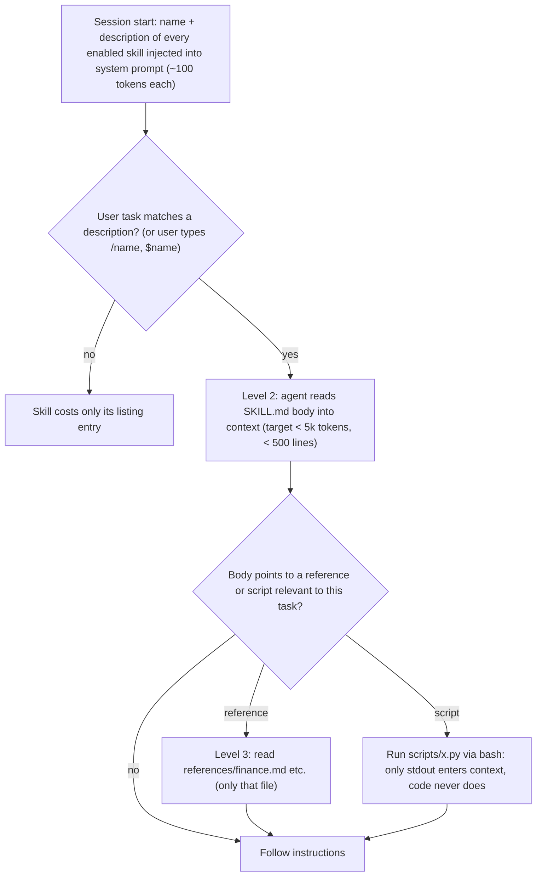

An **Agent Skill** is a directory containing a `SKILL.md` file (YAML frontmatter with a `name` and a `description`, then Markdown instructions) and, optionally, scripts, reference documents and assets. The agent sees only each skill's name and description at startup. When a task matches a description, it reads the body, and it opens bundled files or runs bundled scripts only if the task needs them. Anthropic introduced skills in October 2025 as a way to package procedural knowledge, the "how we do X here" that a new hire would get in an onboarding guide. Anthropic published the format as an open standard on 2025-12-18 at agentskills.io, and [coding agents](coding-agents.md) such as Codex, Gemini CLI and Cursor now read it ([Anthropic](../sources/anthropic-equipping-agents-with-skills.md), [spec](../sources/agent-skills-specification.md), [Codex](../sources/openai-codex-skills-docs.md), [Gemini CLI](../sources/gemini-cli-skills-docs.md), [Cursor](../sources/cursor-skills-docs.md)). Skills are a [context engineering](context-engineering.md) mechanism. They don't add new actions the way [tools](tools.md) or [MCP](model-context-protocol.md) do. They add knowledge about how to use the actions an agent already has.

## How progressive disclosure works

Anthropic's documentation gives these costs for each level ([overview](../sources/anthropic-agent-skills-overview.md), [spec](../sources/agent-skills-specification.md)):

| Level | Loaded | Typical cost |
|---|---|---|
| 1. Metadata (`name`, `description`) | always, at startup | ~100 tokens per skill |
| 2. `SKILL.md` body | when triggered | under 5k tokens recommended |
| 3. Bundled files and scripts | when read or run | zero until accessed; scripts cost only their output |

Because files stay on disk until the agent reads them, Anthropic calls the total content a skill can bundle "effectively unbounded" ([Anthropic](../sources/anthropic-equipping-agents-with-skills.md)). The design has two prerequisites: the agent needs a filesystem and a shell or code-execution tool. This is why the Claude API only runs skills inside the code-execution container (see [code execution sandboxes](code-execution-sandboxes.md)) ([API guide](../sources/anthropic-skills-api-guide.md)).

**Level 1 is not free at scale.** Every model-invocable skill puts its description in front of every request:

- **Claude Code** caps the listing at about 1% of the [context window](context-window.md). Once over the cap, it drops descriptions starting with the least-used skills and keeps only their names. It also truncates each description at 1,536 characters ([Claude Code skills](../sources/claude-code-skills-docs.md)).
- **Codex** caps its list at 2% of the window (8,000 characters if the window size is unknown), shortens descriptions first and then omits skills. `skills.max_context_tokens` raises the cap to at most 10k tokens ([Codex](../sources/openai-codex-skills-docs.md)).

Synthesis: a truncated description loses the keywords the model matches against. So past a few dozen skills, the usual failure isn't context bloat. Skills simply stop triggering.

## The format

The open spec requires two fields ([spec](../sources/agent-skills-specification.md)):

- **`name`**: 1–64 characters, lowercase `a-z0-9-`, no leading, trailing or doubled hyphens, and it must equal the directory name.
- **`description`**: 1–1024 characters, saying what the skill does and when to use it.

Optional fields are `license`, `compatibility` (≤500 characters), `metadata` (a string map) and an experimental `allowed-tools`. Anthropic's API also rejects XML tags in either required field, and rejects names containing `anthropic` or `claude` ([best practices](../sources/anthropic-skill-authoring-best-practices.md)). By convention, `scripts/` holds executables, `references/` holds on-demand docs and `assets/` holds templates and data. References should sit one level deep from `SKILL.md`.

[Harnesses](harness-engineering.md) extend the frontmatter in different ways:

| Harness | Locations | Invocation | Notable extensions |
|---|---|---|---|
| Claude Code | `~/.claude/skills`, `.claude/skills` (walks up to repo root; nested dirs load lazily), managed, plugins | auto by description; `/name` | `disable-model-invocation`, `user-invocable`, `allowed-tools`/`disallowed-tools`, `context: fork` (run in a [subagent](subagents.md)), `model`, `effort`, `paths`, `hooks`, `arguments`, `` !`cmd` `` pre-execution |
| Codex | `.agents/skills` (repo), `~/.agents/skills`, `/etc/codex/skills`, bundled | auto; `$name` or `/skills` | `agents/openai.yaml`: `allow_implicit_invocation`, UI metadata, MCP tool dependencies |
| Gemini CLI | `.gemini/skills` or `.agents/skills` (workspace > user > extension > built-in) | model calls `activate_skill`; **user approves** before body loads | skill dir becomes an allowed path on activation |
| Cursor (2.4+) | `.cursor/skills`, `.agents/skills`, plus `.claude/skills` and `.codex/skills` for compatibility | auto; `/name`; Custom Mode for whole session | `paths`, `disable-model-invocation`, `icon`/`color` |
| Claude API | uploaded via `/v1/skills`; `container.skills` (≤20 per request) | auto | pre-built `pptx`, `xlsx`, `docx`, `pdf`; versions pinned or `latest` |

Sources: [Claude Code](../sources/claude-code-skills-docs.md), [Codex](../sources/openai-codex-skills-docs.md), [Gemini CLI](../sources/gemini-cli-skills-docs.md), [Cursor](../sources/cursor-skills-docs.md), [API guide](../sources/anthropic-skills-api-guide.md).

The table shows a portability trap. Claude Code ignores unknown frontmatter keys without warning, but uploads to claude.ai or the Skills API hard-error on any key outside the open standard. Custom skills also don't sync between claude.ai, the API and Claude Code ([Claude Code skills](../sources/claude-code-skills-docs.md), [overview](../sources/anthropic-agent-skills-overview.md)). Runtime environments differ too. API skills have no network access and cannot install packages, claude.ai network access depends on admin settings, and Claude Code has full network access ([overview](../sources/anthropic-agent-skills-overview.md)).

## Slash commands converged into skills

A slash command is a user-triggered prompt template. Vendors are folding these into skills:

- **Claude Code** merged custom commands into skills: `.claude/commands/deploy.md` and `.claude/skills/deploy/SKILL.md` both create `/deploy` ([Claude Code skills](../sources/claude-code-skills-docs.md)).
- **Cursor** ships a `/migrate-to-skills` command that converts slash commands into skills with `disable-model-invocation: true` ([Cursor](../sources/cursor-skills-docs.md)).
- **Gemini CLI** still keeps commands as a separate TOML format: `prompt`, `{{args}}`, `!{shell}` (which asks for confirmation before running) and `@{file}` injection ([Gemini commands](../sources/gemini-cli-custom-commands-docs.md)).

In Claude Code the remaining difference is who may invoke the skill:

| Frontmatter | User can invoke | Model can invoke | Context cost before use |
|---|---|---|---|
| default | yes | yes | description every request |
| `disable-model-invocation: true` | yes | no | zero |
| `user-invocable: false` | no | yes | description every request |

Mark skills with side effects (deploy, send, delete) `disable-model-invocation: true`. That way they run only when named, and their descriptions use no context ([extend overview](../sources/claude-code-extend-features-overview.md)).

## Skills vs tools, MCP, hooks, instruction files, subagents

| Mechanism | What it adds | Loaded | Deterministic? |
|---|---|---|---|
| [Agent instruction file](agent-instruction-files.md) (CLAUDE.md/AGENTS.md) | always-on rules | every request | no (model may ignore) |
| Skill | on-demand procedure/knowledge + scripts | description always, body on match | no |
| [Tool](tools.md) / [MCP](model-context-protocol.md) server | new actions and data access | tool names (schemas often deferred) | the action is; choosing it is not |
| [Hook](agent-hooks-and-middleware.md) | handler run by the harness at a lifecycle event | nothing unless it returns output | yes |
| [Subagent](subagents.md) | isolated context window | when spawned | no |
| Plugin / extension | packaging of all the above | n/a | n/a |

Sources: [extend overview](../sources/claude-code-extend-features-overview.md), [hooks](../sources/claude-code-hooks-docs.md).

Anthropic frames the MCP–skill relationship as complementary. MCP provides the connection to a system. A skill teaches how to use it well, for example a database schema plus the team's query patterns ([extend overview](../sources/claude-code-extend-features-overview.md)). Inside a skill, refer to MCP tools by their fully qualified `Server:tool` names ([best practices](../sources/anthropic-skill-authoring-best-practices.md)). Skills and subagents combine in both directions. A subagent definition can preload skills, and a skill with `context: fork` runs in a subagent that sees only the skill content ([Claude Code skills](../sources/claude-code-skills-docs.md)).

**Hooks** are the enforcement counterpart of skills. Claude Code, Codex and Gemini CLI have converged on a similar contract ([Claude Code hooks](../sources/claude-code-hooks-docs.md), [Codex hooks](../sources/openai-codex-hooks-docs.md), [Gemini hooks](../sources/gemini-cli-hooks-docs.md)):

- A command runs on an event such as `PreToolUse`/`BeforeTool`, `PostToolUse`, `UserPromptSubmit`, `Stop` or `SessionStart`.
- It receives JSON on stdin. **Exit 2 blocks** the action, with stderr sent back to the model as the reason. On `Stop`-type events, blocking means the agent keeps working; Codex's `PostToolUse` cannot undo a command that already ran, it only replaces the result the model sees. Exit 0 can return JSON decisions such as deny, ask, rewritten input or added context.
- In Claude Code (and Gemini CLI), any other non-zero exit (including 1) is only a warning and the action proceeds. In Claude Code a failing or timed-out hook fails open unless a `command`/`http` hook sets `onFailure: "block"` (v2.1.295+; no effect on `Stop`, `SubagentStop` or async hooks).

Because hooks run arbitrary code, Codex and Gemini CLI tie trust to a hash or fingerprint of each project hook, so an edited hook has to be approved again. In Claude Code, a rule the model keeps skipping belongs in a hook. The skill can declare that hook in its own `hooks` frontmatter ([Claude Code skills](../sources/claude-code-skills-docs.md), [best practices for Claude Code](../sources/claude-code-best-practices.md)).

**Plugins** package skills, commands, subagents, hooks, MCP and LSP servers into one versioned unit, namespaced as `/plugin:skill`. Claude Code distributes them through marketplaces, Codex through plugins with connectors, and Gemini CLI through extensions installed from GitHub ([plugins reference](../sources/claude-code-plugins-reference.md), [Codex](../sources/openai-codex-skills-docs.md), [Gemini extensions](../sources/gemini-cli-extensions-docs.md)). A `CLAUDE.md` inside a plugin is *not* loaded. Instructions a plugin wants in context must be packaged as a skill ([plugins reference](../sources/claude-code-plugins-reference.md)).

## Do skills work? Evidence

SkillsBench (v4, 2026-06), a [benchmark](benchmarks.md), ran 87 tasks across 18 model-harness configurations, each scored by a deterministic verifier ([SkillsBench](../sources/li-2026-skillsbench.md)):

- Curated skills raised the average pass rate from 33.9% to 50.5%. Per-configuration gains ranged from +4.1 to +25.7 points.
- Focused skills with at most three modules beat exhaustive documentation bundles.
- Smaller models with skills could match larger models without them.
- Skills the model wrote for itself did not help: v1 reported no average benefit, and v4 reports self-generated skills landing below the no-skill baseline on all three configurations tested.
- Curated skills are not uniformly positive: 13 of 87 tasks had negative deltas, typically when a skill prescribed a single "correct" pipeline with no applicability boundaries or fallback.
- The authors call their setting optimistic: high-quality skills on containerised tasks.

Synthesis: skills pay off when they carry knowledge the model doesn't have (proprietary procedures, verifier quirks, domain rules). Restating what the model already knows doesn't help, and asking the model to write its own skills without human review or evals can make things worse.

## Authoring guidance

From [best practices](../sources/anthropic-skill-authoring-best-practices.md) unless noted:

- **The description is the trigger.** Write it in the third person, cover both *what* and *when*, and include the words users actually say. "Helps with documents" fails, and the model may be choosing among 100+ skills.
- **Be concise; assume competence.** Include only what the model lacks. Keep `SKILL.md` under 500 lines and split by domain (`reference/finance.md`, `reference/sales.md`) so irrelevant files are never read.
- **Keep references one level deep.** The model may only preview nested files (e.g. `head -100`). Add a table of contents to any reference file over 100 lines.
- **Set degrees of freedom by fragility.** Use prose heuristics for judgement calls and an exact script with "do not modify" for migrations.
- **Prefer scripts for deterministic steps.** Scripts should handle errors themselves and avoid magic constants. Say explicitly whether the model should *run* or *read* each one. A validator loop (run, fix, repeat) or a plan-validate-execute step with an intermediate file catches errors before destructive changes.
- **Put the most important rules at the top.** In Claude Code, an invoked skill stays in the conversation and is never re-read. After [compaction](context-compaction.md), only its first 5,000 tokens are re-attached ([Claude Code skills](../sources/claude-code-skills-docs.md)).
- **Develop eval-first.** Find the gaps without a skill, write at least three evals, measure a baseline, then write minimal instructions. Test with every model tier you'll deploy on. Claude Code's skill-creator automates with/without-skill benchmarks and description tuning with should-trigger and should-not-trigger prompts ([Claude Code skills](../sources/claude-code-skills-docs.md)). See [verification and evals](verification-and-evals.md).
- **Encode verification in skills.** The owner's loop tutorial treats a skill as the place where the agent's self-check criteria live, so unattended loops can tell when they're done ([notebook](../sources/notebook-loops.md)).

## Failure modes

- **Silent non-triggering.** Malformed YAML (or `---` not on line 1) loads the body with empty metadata, so `/name` still works but automatic matching never fires. Validate with `skills-ref validate` or `claude plugin validate` ([spec](../sources/agent-skills-specification.md), [Claude Code skills](../sources/claude-code-skills-docs.md)).
- **Over-triggering or overlap.** Vague or overlapping descriptions make the model load the wrong skill. Fix by narrowing the descriptions or making the skill manual-only ([extend overview](../sources/claude-code-extend-features-overview.md)).
- **Mistaking `allowed-tools` for a sandbox.** In Claude Code it pre-approves tools for the invoking turn and restricts nothing ([Claude Code skills](../sources/claude-code-skills-docs.md)).
- **Supply-chain and [prompt injection](prompt-injection.md) risk.** A skill is instructions plus code running with the agent's permissions. A malicious one can exfiltrate data, and a skill that fetches external URLs can pull in hostile instructions even if its author is trustworthy. Audit skills like any software you install ([overview](../sources/anthropic-agent-skills-overview.md), [Anthropic](../sources/anthropic-equipping-agents-with-skills.md)). Gemini CLI's per-activation consent prompt and Codex's hook trust are partial mitigations. See [LLM security risks](llm-security-risks.md).
- **Compliance.** As of 2026-11, Agent Skills on Anthropic's API are not eligible for [zero data retention](data-retention-and-residency.md) (ZDR) or HIPAA (see [PII and data privacy](pii-and-data-privacy.md)) ([overview](../sources/anthropic-agent-skills-overview.md)). Custom API skills are workspace-wide, so multitenant apps need one workspace per tenant ([API guide](../sources/anthropic-skills-api-guide.md)).

## When to use / when not

Use a skill when:

- a multi-step procedure, house style or domain reference is needed *sometimes*, not on every turn;
- you'd otherwise paste the same playbook into chat for the third time;
- deterministic helper scripts should ship alongside the instructions.

Don't use a skill when:

- the rule must hold every time: use a hook or permission rule;
- every session needs the fact: use an [instruction file](agent-instruction-files.md);
- the agent needs a new capability or live data: use a [tool](tools.md) or [MCP server](mcp-in-practice.md);
- the work would flood the main context: use a [subagent](subagents.md).

([extend overview](../sources/claude-code-extend-features-overview.md))

## Sources

- [Equipping agents for the real world with Agent Skills (Anthropic)](../sources/anthropic-equipping-agents-with-skills.md)
- [Agent Skills specification](../sources/agent-skills-specification.md)
- [Agent Skills overview (Claude Platform)](../sources/anthropic-agent-skills-overview.md)
- [Using Agent Skills with the API](../sources/anthropic-skills-api-guide.md)
- [Skill authoring best practices](../sources/anthropic-skill-authoring-best-practices.md)
- [Claude Code skills docs](../sources/claude-code-skills-docs.md)
- [Extend Claude Code](../sources/claude-code-extend-features-overview.md)
- [Claude Code hooks reference](../sources/claude-code-hooks-docs.md)
- [Claude Code plugin manifest reference](../sources/claude-code-plugins-reference.md)
- [Best practices for Claude Code](../sources/claude-code-best-practices.md)
- [Codex: Build skills](../sources/openai-codex-skills-docs.md)
- [Codex: Hooks](../sources/openai-codex-hooks-docs.md)
- [Gemini CLI: Agent Skills](../sources/gemini-cli-skills-docs.md)
- [Gemini CLI: Custom commands](../sources/gemini-cli-custom-commands-docs.md)
- [Gemini CLI: Hooks](../sources/gemini-cli-hooks-docs.md)
- [Gemini CLI: Extensions](../sources/gemini-cli-extensions-docs.md)
- [Cursor: Agent Skills](../sources/cursor-skills-docs.md)
- [SkillsBench (Li et al., 2026)](../sources/li-2026-skillsbench.md)
- [Loop Engineering (Loic's Notebook)](../sources/notebook-loops.md)
