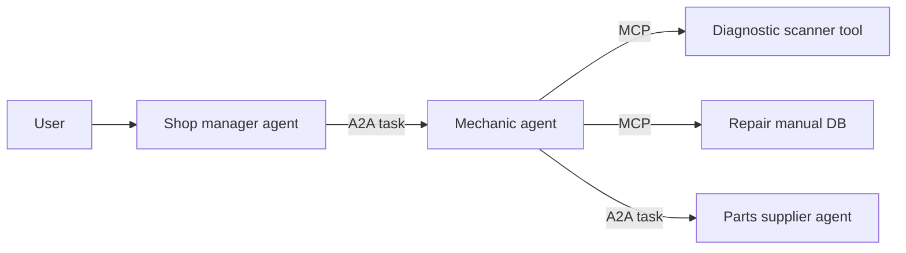
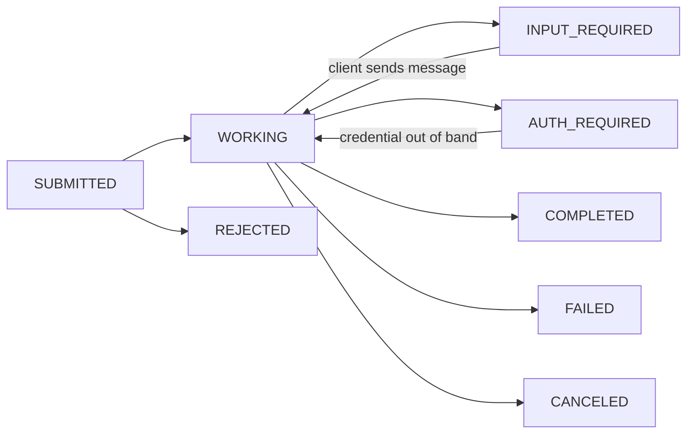

The **Agent2Agent (A2A) protocol** is an open standard that lets one agent (the **client**) discover another agent (the **remote** agent) and delegate work to it, even when the two come from different vendors or frameworks and neither can see the other's internals. The remote agent publishes a JSON **Agent Card** that describes its skills, endpoints and auth. The client sends **Messages** made of **Parts**. Longer work is tracked as a **Task** with a defined state machine and produces **Artifacts** ([spec](../sources/a2a-specification-v1.md)). Google launched A2A on 2025-04-09 with 50+ partners ([announcement](../sources/google-a2a-announcement.md)). It is now an Apache-2.0 Linux Foundation project inside the Agentic AI Foundation, alongside MCP ([repo](../sources/a2a-github-repo.md)). The current line is v1.0 ([spec](../sources/a2a-specification-v1.md)).

## Why it exists, and how it differs from MCP

[MCP](model-context-protocol.md) is **vertical**: it connects one agent to [tools](tools.md), which have structured inputs and outputs and are usually stateless. A2A is **horizontal**: it connects agents, which reason, plan and hold multi-turn state ([A2A and MCP](../sources/a2a-and-mcp-docs.md)). The design principles say agents should collaborate without being reduced to a tool. They also call for building on HTTP, SSE and JSON-RPC, being secure by default, supporting tasks that run for hours or days with [humans in the loop](human-in-the-loop.md), and staying modality agnostic ([announcement](../sources/google-a2a-announcement.md)).

| | MCP | A2A |
|---|---|---|
| Connects | Agent → tools/data | Agent → agent |
| Counterpart | Transparent function with schema | Opaque agent with skills |
| State | Stateless calls; explicit handles if needed ([MCP in practice](mcp-in-practice.md)) | Task lifecycle + `contextId` conversations |
| Discovery | `tools/list` on a known server | Agent Card at a well-known URL or a registry |
| Long work | Tasks extension | Core: streaming, polling, push webhooks |
| Output | `content` / `structuredContent` | Messages and Artifacts made of Parts |

The two are designed to be combined. Agents talk to each other over A2A, and each one reaches its own tools over MCP ([A2A and MCP](../sources/a2a-and-mcp-docs.md), [notebook](../sources/notebook-webmcp-a2a.md)).

*(The auto-repair example from the [A2A docs](../sources/a2a-and-mcp-docs.md).)*

## The Agent Card

Discovery works in three ways: the card at `https://{domain}/.well-known/agent-card.json`, a registry, or direct configuration ([spec](../sources/a2a-specification-v1.md)). Required fields (all of the groups below except security):

- **Identity:** `name`, `description`, `version`.
- **Content types:** `defaultInputModes` / `defaultOutputModes` (media types).
- **Skills:** each has `id`, `name`, `description` and `tags`, with optional `examples` and per-skill modes. Routing agents use skills and examples to decide where to send work, so write them carefully ([builder's guide](../sources/aaif-a2a-v1-builders-guide.md)).
- **`supportedInterfaces`:** an ordered list of `{url, protocolBinding, protocolVersion, tenant?}` with bindings `JSONRPC`, `GRPC` or `HTTP+JSON`. The first entry is preferred. All bindings must be functionally equivalent, and the SDK client picks the first one it supports ([builder's guide](../sources/aaif-a2a-v1-builders-guide.md)).
- **`capabilities`:** `streaming`, `pushNotifications`, `extendedAgentCard`. These are commitments. If push is advertised as false, push calls must fail with `PushNotificationNotSupportedError`.
- **`securitySchemes` / `security`:** API key, HTTP auth, OAuth 2.0 (authorization code, client credentials, device code), OpenID Connect, mTLS.

Cards can be signed with JWS (RFC 7515) over RFC 8785 (JCS) canonical JSON, excluding the `signatures` field, and clients should verify a signature before trusting a card. An authenticated `GetExtendedAgentCard` call can reveal skills that are not shown publicly ([spec](../sources/a2a-specification-v1.md)).

## Tasks, messages and artifacts

- **Message:** has `role` (user/agent), `parts`, and optional `contextId`, `taskId` and `referenceTaskIds`. A **Part** holds exactly one of `text`, `raw` bytes, `url` or `data` (JSON), plus an optional `mediaType`. This is how agents negotiate modality ([spec](../sources/a2a-specification-v1.md), [announcement](../sources/google-a2a-announcement.md)).
- **Task:** has `id`, `contextId`, `status`, `history` and `artifacts`. `contextId` groups several tasks into one conversation, and a contextId/taskId mismatch must be rejected.
- **Artifact:** has an `artifactId` and one or more Parts. It is the deliverable.
- A simple request may get back a bare Message with no Task, so clients must handle both shapes ([builder's guide](../sources/aaif-a2a-v1-builders-guide.md)).

Synthesis: transitions drawn from the state list in the [spec](../sources/a2a-specification-v1.md). The spec groups the states as active, interrupted and terminal. Sending a message to a terminal task returns `UnsupportedOperationError`, and cancelling one returns `TaskNotCancelableError` ([builder's guide](../sources/aaif-a2a-v1-builders-guide.md)).

## Operations and bindings

The abstract operations are SendMessage, SendStreamingMessage, GetTask, ListTasks (cursor-paginated), CancelTask, SubscribeToTask, push-notification config create/get/list/delete, and GetExtendedAgentCard. In the REST binding these become paths such as `POST /message:send`, `POST /message:stream`, `GET /tasks/{id}` and `POST /tasks/{id}:cancel`. JSON-RPC and REST stream over SSE, and each event is a `StreamResponse` delivered in order ([spec](../sources/a2a-specification-v1.md)).

There are three ways to follow long work ([builder's guide](../sources/aaif-a2a-v1-builders-guide.md)):

1. **Polling** `GetTask` works everywhere, including behind firewalls that block inbound traffic.
2. **[Streaming](streaming.md)** over SSE needs `capabilities.streaming`. A task stream opens with the Task, then sends status and artifact updates, and closes at a terminal state.
3. **Push notifications:** the agent POSTs `StreamResponse` payloads to the client's webhook. The client needs no open connection. The agent authenticates the call, uses 10–30 s timeouts with backoff, and refuses private address ranges. The receiver returns 2xx and deduplicates.

**Versioning:** clients send `A2A-Version: 1.0`. A missing header is treated as 0.3, which makes a 1.0-only agent answer `VersionNotSupportedError`. To fix this, add a second interface entry that declares 0.3 and enable the SDK's compatibility flag ([builder's guide](../sources/aaif-a2a-v1-builders-guide.md)). Migrating from 0.3 to 1.0 also changed the card: `supportedInterfaces` replaces the single `url` + `preferredTransport` ([spec](../sources/a2a-specification-v1.md)). The well-known path had already moved from `agent.json` to `agent-card.json` in 0.3 (July 2025), and v1.0 registered it as a well-known URI ([builder's guide](../sources/aaif-a2a-v1-builders-guide.md)). The owner's [notebook](../sources/notebook-webmcp-a2a.md) still shows the older pre-0.3 `agent.json` shape.

## Security

- **Transport and identity:** production requires TLS (1.3+ recommended), certificate validation and signed cards ([spec](../sources/a2a-specification-v1.md)).
- **In-task authorization:** when the remote agent needs extra credentials mid-task, it moves the task to `AUTH_REQUIRED` and explains why. The credential should arrive out of band, and the state itself grants nothing ([spec](../sources/a2a-specification-v1.md)).
- **Card route vs protocol route:** keep the public card route outside the protocol endpoint's auth middleware, or new clients cannot discover the agent ([builder's guide](../sources/aaif-a2a-v1-builders-guide.md)).

Synthesis: a remote agent's Messages and Artifacts are untrusted input, exactly like MCP tool output, so the same [prompt injection](prompt-injection.md) and [guardrail](agent-guardrails.md) discipline applies at every A2A boundary.

## SDKs

Official SDKs as of 2026-11-14 ([repo](../sources/a2a-github-repo.md)):

| Language | Package |
|---|---|
| Python | `a2a-sdk` |
| Go | `github.com/a2aproject/a2a-go` |
| JavaScript | `@a2a-js/sdk` |
| Java | `a2a-java` repo (Maven) |
| .NET | `A2A` |
| Rust | `a2a-lf` |

A Python server has three parts: a card, an **executor**, and routes. The executor receives a `RequestContext` and writes events to an `EventQueue`, and those events become the wire output. A client resolves the card, builds a client from it, and iterates the stream until it sees a terminal status ([builder's guide](../sources/aaif-a2a-v1-builders-guide.md)).

## Failure modes

- **Gateway timeouts:** `SendMessage` blocks until a terminal or interrupted state by default. Set `returnImmediately: true` in `SendMessageConfiguration` (then poll, subscribe or use push) or stream for long tasks ([builder's guide](../sources/aaif-a2a-v1-builders-guide.md)).
- **Invalid stream shapes:** mixing a Message with task events in one stream, or sending several Messages, raises `InvalidAgentResponseError` at runtime ([builder's guide](../sources/aaif-a2a-v1-builders-guide.md)).
- **Silent 0.3 fallback** when the version header is omitted (above).
- **Harder to reason about:** opaque agents are harder to debug than typed tool calls, and multi-agent hops add latency and failure modes. The ecosystem is still young ([notebook](../sources/notebook-webmcp-a2a.md)).

## When to use / when not

- **Use A2A** to delegate to an agent owned by another team, vendor or organisation, to expose your agent for others to call, or when the work is long-running, multi-turn, needs mid-task input or auth, or returns rich artifacts ([A2A and MCP](../sources/a2a-and-mcp-docs.md), [notebook](../sources/notebook-webmcp-a2a.md)).
- **Use MCP instead** when the capability is a well-defined, stateless function. A2A agents can even expose such skills MCP-style ([A2A and MCP](../sources/a2a-and-mcp-docs.md)).
- **Use in-process [subagents](subagents.md)** when all the agents live in one codebase you control. Synthesis: a network protocol adds auth, versioning and latency that buy nothing inside a single process. See [agent design patterns](agent-design-patterns.md).

## Sources

- [A2A Protocol Specification v1.0](../sources/a2a-specification-v1.md)
- [AAIF: A2A v1.0 Builder's Guide, Part 1](../sources/aaif-a2a-v1-builders-guide.md)
- [A2A and MCP (A2A docs)](../sources/a2a-and-mcp-docs.md)
- [Google: A2A, a New Era of Agent Interoperability](../sources/google-a2a-announcement.md)
- [a2aproject/A2A GitHub repository](../sources/a2a-github-repo.md)
- [Notebook: WebMCP & A2A](../sources/notebook-webmcp-a2a.md)
