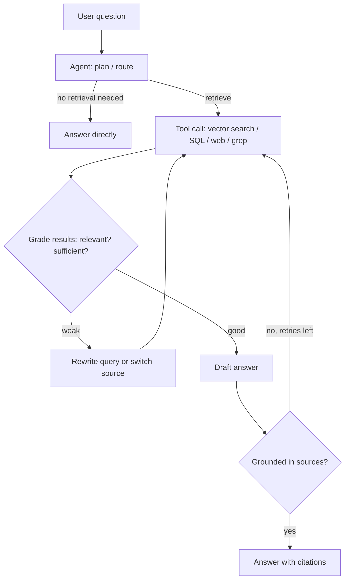

**Agentic RAG** puts an LLM in control of the retrieval process instead of running a fixed retrieve-then-generate pipeline. Retrieval becomes one or more [tools](tools.md) the model calls inside an [agent loop](agent-loop.md): it decides *whether* to retrieve, *which* source to query, *how* to phrase the query, whether the results are good enough, and when to stop ([Notebook exp. 22](../sources/notebook-22-agentic-rag.md)). A survey frames it as RAG plus the agentic patterns of reflection, planning, tool use and multi-agent collaboration ([Singh et al.](../sources/singh-2025-agentic-rag-survey.md)). It targets the case where "one retrieval isn't enough" ([Notebook](../sources/notebook-rag-cag.md)).

## From pipeline to loop

Synthesis: this diagram combines the routing, corrective and self-reflective loops described in the sources below.

## Architectures

| Pattern | What the agent decides | Source |
|---|---|---|
| Retrieval-as-tool (ReAct) | Whether and what to retrieve, across several turns | [Notebook exp. 22](../sources/notebook-22-agentic-rag.md) |
| Single-agent router | Which source fits the query: vector store, SQL, web, recommender | [Singh et al.](../sources/singh-2025-agentic-rag-survey.md) |
| Adaptive RAG | A classifier picks no retrieval, single-step or multi-step by query complexity | [Singh et al.](../sources/singh-2025-agentic-rag-survey.md) |
| Corrective RAG (CRAG) | Grade retrieved docs; refine, replace with web search, or both | [Yan et al.](../sources/yan-2024-corrective-rag.md) |
| Self-RAG | Model emits tokens deciding when to retrieve and critiquing relevance and support | [Asai et al.](../sources/asai-2023-self-rag.md) |
| Multi-agent / hierarchical | Specialist retrieval agents per source, coordinated by a master or tiers | [Singh et al.](../sources/singh-2025-agentic-rag-survey.md) |
| Graph-based | Agents combine graph traversal with document retrieval for multi-hop | [Singh et al.](../sources/singh-2025-agentic-rag-survey.md), see [GraphRAG](graphrag.md) |

## Corrective RAG (CRAG)

A lightweight **retrieval evaluator** (T5-large, 0.77B, fine-tuned) scores each query-document pair in [-1, 1] and, with per-dataset thresholds, triggers one of three actions ([Yan et al.](../sources/yan-2024-corrective-rag.md)):

- **Correct** (some doc above the upper threshold): keep and refine internal docs.
- **Incorrect** (all below the lower threshold): discard them; rewrite the question into keyword queries and use web search.
- **Ambiguous**: combine refined internal and web knowledge.

Refinement is *decompose-then-recompose*: split docs into strips, score each, keep the best. CRAG improved standard RAG on all four benchmarks, e.g. PubHealth 75.6 vs 39.0 with a Self-RAG 7B generator, and is plug-and-play ([Yan et al.](../sources/yan-2024-corrective-rag.md)). The owner's [experiment 23](../sources/notebook-23-corrective-rag.md) approximates it by having the LLM itself grade relevance and fall back to a stub web search.

## Self-RAG

Self-RAG trains the generator to emit **reflection tokens** ([Asai et al.](../sources/asai-2023-self-rag.md)):

| Token | Values | Question it answers |
|---|---|---|
| Retrieve | yes / no / continue | Should I retrieve now? |
| IsRel | relevant / irrelevant | Is this passage useful? |
| IsSup | fully / partially / no support | Is my output backed by the passage? |
| IsUse | 1-5 | How useful is the whole response? |

Training: GPT-4 labels distilled into a Llama 2 7B critic; the critic annotates 150k examples offline; the generator learns the tokens by ordinary next-token prediction. Inference: retrieve when P(Retrieve=yes) passes a threshold (default 0.2), then segment-level beam search weights IsRel, IsSup, IsUse at 1.0, 1.0, 0.5. 7B and 13B Self-RAG models beat ChatGPT and retrieval-augmented Llama2-chat on QA, reasoning and fact verification ([Asai et al.](../sources/asai-2023-self-rag.md)). Most production systems imitate it with prompts rather than training: decide-to-retrieve, answer, grounding check, retry up to `MAX_TRIES` ([Notebook exp. 24](../sources/notebook-24-self-rag.md)).

## Just-in-time agentic search

Anthropic describes a shift from embedding everything up front to agents that hold lightweight references (file paths, stored queries, links) and load data through tools when needed. Claude Code, for example, loads its CLAUDE.md files at start and uses glob and grep to fetch files on demand. The trade-off is speed: runtime exploration is slower than retrieving precomputed data, and badly tooled agents waste context on dead ends ([Anthropic](../sources/anthropic-effective-context-engineering.md)). See [context engineering](context-engineering.md) and [coding agents](coding-agents.md).

Synthesis: for codebases and well-named file trees, agentic grep/read often beats a vector index because identifiers are exact and structure carries meaning; for large prose corpora, give the agent a [hybrid search](hybrid-search.md) tool rather than raw grep.

## Costs and failure modes

- **Latency and cost multiply:** every grade, rewrite and retry is an LLM call; the survey lists computational overhead and scalability under high query volume as core challenges ([Singh et al.](../sources/singh-2025-agentic-rag-survey.md)).
- **Unbounded loops:** retries must be capped ([Notebook exp. 24](../sources/notebook-24-self-rag.md)).
- **Grader errors compound:** CRAG depends on a separately trained evaluator ([Yan et al.](../sources/yan-2024-corrective-rag.md)); an LLM grader can wrongly reject good evidence or accept bad (Synthesis).
- **Evaluation is harder:** trajectories vary per run, so evaluate both final answers and retrieval steps; the survey names evaluation as an open problem ([Singh et al.](../sources/singh-2025-agentic-rag-survey.md)). See [verification and evals](verification-and-evals.md).
- **More attack surface:** web fallback and tool results bring untrusted text into the loop (Synthesis; see [prompt injection](prompt-injection.md)).

## When to use / when not

- **Use** for mixed workloads where some questions need no retrieval and others need several targeted lookups ([Notebook exp. 22](../sources/notebook-22-agentic-rag.md)); for multi-source routing (docs plus SQL plus web) ([Singh et al.](../sources/singh-2025-agentic-rag-survey.md)); when the local index may lack the answer (CRAG) ([Notebook exp. 23](../sources/notebook-23-corrective-rag.md)); for high-stakes answers needing self-verified grounding (Self-RAG) ([Notebook exp. 24](../sources/notebook-24-self-rag.md)).
- **Don't** use it when a single well-tuned retrieval pass already answers most questions: fixed pipelines are cheaper, faster and easier to evaluate ([Notebook](../sources/notebook-rag-cag.md) advises adding agentic machinery only when one pass isn't enough). This mirrors the general advice in [agent design patterns](agent-design-patterns.md) to prefer the simplest workflow that works.

Frameworks: [LangGraph](langgraph.md) (state-machine loops), [LlamaIndex](llamaindex.md), [Claude Agent SDK](claude-agent-sdk.md); memory-heavy variants overlap with [agent memory](agent-memory.md).

## Sources

- [Singh et al. 2025: Agentic RAG survey](../sources/singh-2025-agentic-rag-survey.md)
- [Yan et al. 2024: Corrective RAG](../sources/yan-2024-corrective-rag.md)
- [Asai et al. 2023: Self-RAG](../sources/asai-2023-self-rag.md)
- [Anthropic: Effective context engineering](../sources/anthropic-effective-context-engineering.md)
- [Notebook: RAG vs CAG vs GraphRAG](../sources/notebook-rag-cag.md)
- [Notebook experiment 22: Agentic RAG](../sources/notebook-22-agentic-rag.md)
- [Notebook experiment 23: Corrective RAG](../sources/notebook-23-corrective-rag.md)
- [Notebook experiment 24: Self-RAG](../sources/notebook-24-self-rag.md)
