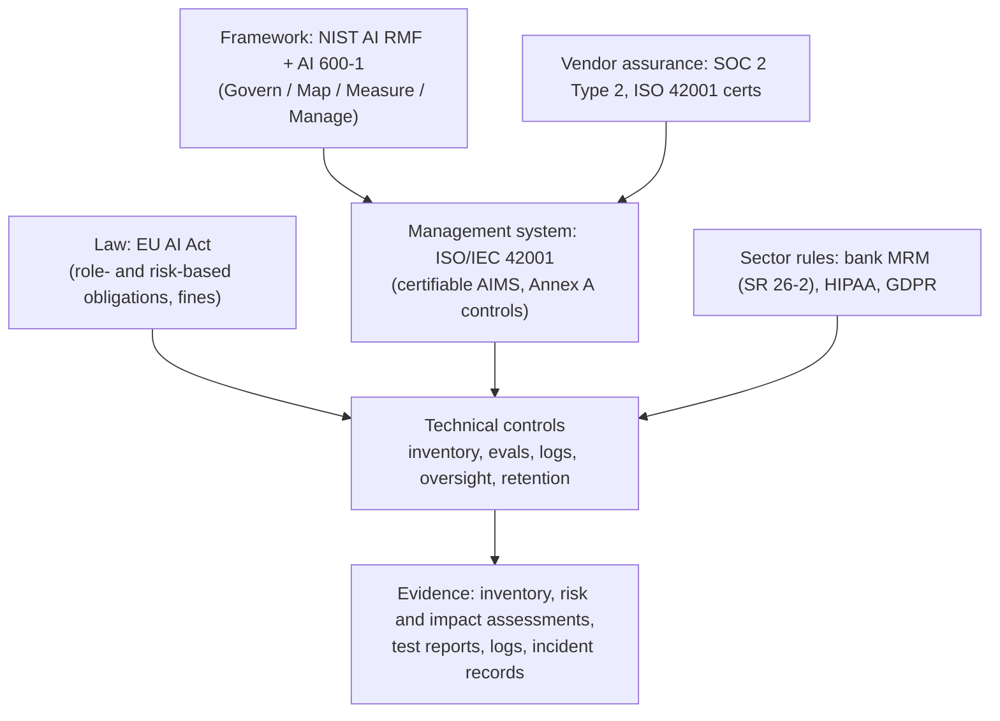

**AI governance and compliance** is how an organization shows regulators, auditors, customers and its own board that its AI systems are identified, risk-assessed, controlled and monitored. In practice, four kinds of instrument overlap. A **law** creates legal obligations: the EU AI Act. A **voluntary risk framework** gives you vocabulary and a list of practices: NIST AI RMF and its Generative AI Profile. A **certifiable management-system standard** lets a third party audit your governance process: ISO/IEC 42001. **Attestation reports** let you rely on a vendor's controls: SOC 2. Regulated sectors add their own regime on top, such as bank model risk management. An FDE does not need to be a lawyer, but has to know which obligations a deployment triggers, which evidence each one needs, and which technical controls produce that evidence. The controls themselves (retention, RBAC, audit logs, PII handling) are covered in [enterprise LLM deployment](enterprise-llm-deployment.md).

## How the pieces fit

Synthesis: this mapping is the author's; no single source draws it.

## EU AI Act

**Structure.** The Act places obligations according to your role (provider or deployer) and the risk tier of the system: prohibited practices; high-risk systems (Annex III stand-alone uses, Annex I product-embedded ones); transparency duties (Article 50); and general-purpose AI (GPAI) model obligations ([timeline](../sources/eu-ai-act-implementation-timeline.md)). An enterprise using a vendor's LLM is usually a **deployer**. It becomes a provider if it places its own system on the market under its name.

**Dates, as amended by the Digital Omnibus** (Regulation (EU) 2026/1744, in force 2026-07-27) ([Omnibus](../sources/eu-digital-omnibus-on-ai.md), [timeline](../sources/eu-ai-act-implementation-timeline.md)):

| Date | What applies |
|---|---|
| 2024-08-01 | Entry into force |
| 2025-02-02 | Prohibited practices; AI literacy (Art. 4) |
| 2025-08-02 | GPAI model obligations, governance, notified bodies, penalty provisions in Arts. 99-100 (pre-existing GPAI models: 2027-08-02) |
| 2026-08-02 | Remainder of the Act, including Art. 50 transparency (e.g. telling people they are interacting with AI) |
| 2026-12-02 | Machine-readable marking deadline for generative systems already on the market; new bans on nudifier and CSAM generation |
| 2027-12-02 | High-risk obligations for Annex III systems (previously 2026-08-02) |
| 2028-08-02 | High-risk obligations for Annex I product-embedded systems |
| 2030-08-02 | High-risk systems used by public authorities |

**What the Omnibus changed for enterprises.** AI literacy is softened from ensuring a sufficient level to supporting staff literacy. Systems that providers self-assess as non-high-risk under Art. 6(3) must still be registered, with simplified information. There is now a legal basis for processing special-category data to detect bias in any AI system, under strict necessity ([Omnibus](../sources/eu-digital-omnibus-on-ai.md)).

**Deployer duties for high-risk systems (Art. 26)** ([Art. 26](../sources/eu-ai-act-article-26-deployers.md)):

- Use the system according to the provider's instructions.
- Assign human oversight to competent, trained people with the authority to act. See [human-in-the-loop](agent-guardrails.md); the owner's experiment shows an interrupt-and-approve gate for compliance steps ([Notebook](../sources/notebook-11-human-in-the-loop.md)).
- Ensure input data you control is relevant and representative.
- Monitor operation, then suspend use and report serious incidents when needed.
- **Keep the logs under your control for at least six months.**
- Inform workers and affected people, and feed the provider's information into your GDPR DPIA.

Synthesis: the six-month log duty has to be reconciled with ZDR. Under ZDR the provider keeps nothing ([Anthropic](../sources/anthropic-api-and-data-retention.md)), so the deployer must keep its own logs, for example via a compliance or audit API ([Compliance API](../sources/anthropic-compliance-api-docs.md)) or its own gateway. Note that Anthropic's Compliance API returns content (chats, files, session transcripts) only for Claude Enterprise; for API workloads it exposes the Activity Feed, so request and response logs have to come from your own gateway.

**Penalties (Art. 99):** up to EUR 35M or 7% of worldwide turnover for prohibited practices; EUR 15M or 3% for most other obligations, including deployer and transparency duties; EUR 7.5M or 1% for misleading information to authorities. For SMEs the lower of the two amounts applies; as amended, small mid-caps also get the lower-of rule for the 3% and 1% tiers, but not for prohibited practices ([Art. 99](../sources/eu-ai-act-article-99-penalties.md)).

Synthesis on what high-risk means for typical LLM use cases. Annex III covers uses such as employment (CV screening), access to essential services (credit scoring) and education. An internal knowledge assistant is usually not high-risk. The same model used to rank job applicants is. Classify the **use**, not the model.

## NIST AI RMF and the Generative AI Profile

- **AI RMF 1.0** (NIST AI 100-1, 2023-01-26) is voluntary. Its core has four functions: **Govern** (culture, policies, accountability), **Map** (context and risk identification), **Measure** (analysis, testing, tracking), **Manage** (prioritize, respond, monitor). It comes with a Playbook and crosswalks to other frameworks. As of 2026-11 NIST says it is being revised under the US AI Action Plan ([NIST AI RMF](../sources/nist-ai-rmf.md)).
- **NIST AI 600-1** (2024-07-26) applies the framework to generative AI. It names **12 risks**: CBRN information; confabulation; dangerous or hateful content; data privacy; environmental impacts; harmful bias and homogenization; human-AI configuration; information integrity; information security; intellectual property; obscene or abusive content; value chain and component integration. Each suggested action is keyed to a subcategory ID ([AI 600-1](../sources/nist-ai-600-1-genai-profile.md)).
- Actions an FDE will actually implement ([AI 600-1](../sources/nist-ai-600-1-genai-profile.md)):
  - put every GAI system in the AI inventory with provenance and third-party details (GV-1.6);
  - keep a documented plan to halt a system posing unacceptable risk (GV-1.3-007);
  - keep an approved-vendor list, with contract clauses that allow evaluating third-party processes (GV-6.1);
  - do pre-deployment testing that matches the deployment context, since generic benchmarks and exam-style tests don't establish validity in the field ([benchmarks](benchmarks.md), [LLM evaluation](llm-evaluation.md));
  - record and disclose incidents.
- "Confabulation" is NIST's term for [hallucination](hallucination.md). It flags confabulated citations and justifications as especially misleading ([AI 600-1](../sources/nist-ai-600-1-genai-profile.md)).

## ISO/IEC 42001 (AI management system)

- **What it is:** a standard that specifies requirements to establish, implement, maintain and continually improve an AI management system (AIMS). It is for organizations that build *or* use AI ([Microsoft](../sources/microsoft-iso-42001-offering.md)).
- **Structure** (secondary source; the standard is paywalled): clauses 4-10 hold the certifiable requirements: context, leadership and AI policy, planning, support, operation, performance evaluation (internal audit, management review), improvement. Clause 6 produces the risk treatment and the **Statement of Applicability**. Clause 6.1.4 requires an **AI system impact assessment** process, which ISO 27001 has no counterpart for, and clause 8.4 requires doing it. Annex A offers 38 reference controls under nine objectives, chosen by risk rather than all mandatory ([Konfirmity](../sources/konfirmity-iso-42001-requirements.md)).
- **Certification is per organization and scope.** Microsoft (Foundry, Copilot, GitHub Copilot and others) and AWS hold accredited certificates. Customers are **not certified by association**, but can use a vendor's certificate as evidence for their own audit ([Microsoft](../sources/microsoft-iso-42001-offering.md), [AWS](../sources/aws-iso-42001-faq.md)).
- Synthesis: NIST AI RMF tells you *what* risks to manage, ISO 42001 gives you an *auditable process* to manage them, and the AI Act tells you which ones are legally required. Many organizations use one AIMS to produce evidence for all three.

## SOC 2 (vendor assurance)

- A SOC 2 report is a CPA firm's opinion, under AICPA SSAE 18, on a service organization's controls against the Trust Services Criteria: Security, Availability, Processing Integrity, Confidentiality, Privacy ([Microsoft](../sources/microsoft-soc-2-offering.md)).
- **Type 1** assesses control design at a point in time and does not look back over a period. **Type 2** also tests operating effectiveness over a period, usually 12 months. **Bridge letters** are the vendor's self-attestation for the time since the audited period and are not audit opinions ([Microsoft](../sources/microsoft-soc-2-offering.md), [AWS](../sources/aws-soc-faqs.md)).
- SOC 2 reports are under NDA (e.g. via AWS Artifact); SOC 3 is the public summary ([AWS](../sources/aws-soc-faqs.md)).
- **Read the user entity responsibilities and exceptions.** User entity responsibilities are controls *you* must operate for the overall system to meet the criteria ([Microsoft](../sources/microsoft-soc-2-offering.md)). Synthesis: a vendor's SOC 2 does not cover your prompts, your RAG index or your gateway. Those are yours to control and evidence.

## Model risk management (banking)

- On 2026-04-17 the Fed, OCC and FDIC replaced **SR 11-7** (2011), which had long been the reference for model validation, with revised interagency guidance (SR 26-2 at the Fed). The new guidance is aimed mainly at banks with over $30B in assets ([SR 26-2](../sources/fed-sr-26-2-model-risk.md)).
- What changed ([Orrick](../sources/orrick-2026-mrm-guidance.md)):
  - a narrower definition of "model";
  - risk-based tiering, where inherent risk times materiality sets the depth of oversight;
  - conceptual soundness, outcomes analysis and ongoing monitoring are kept but described more briefly;
  - effective challenge is redefined as expertise, independence and standing;
  - an explicit section on third-party models whose internals cannot be validated;
  - the guidance is not enforceable in itself.
- **Generative and agentic AI are explicitly out of scope.** Banks are told to govern them through broader risk management, and an RFI is planned ([Orrick](../sources/orrick-2026-mrm-guidance.md)). Synthesis: expect bank risk teams to still apply MRM-style controls to LLMs in practice: inventory, tiering, validation with evals, monitoring, documented vendor-model limits. They now do so without a dedicated rulebook, so an FDE should arrive with an eval suite and a model card.

## Practical guidance

- **Start with an inventory and classification.** For each system record the use case, role (provider or deployer), AI Act tier, data categories, model and vendor, and owner. NIST GV-1.6 and ISO 42001 both expect one ([AI 600-1](../sources/nist-ai-600-1-genai-profile.md), [Konfirmity](../sources/konfirmity-iso-42001-requirements.md)).
- **Generate evidence as a by-product of engineering.** Synthesis: eval reports, trace and audit logs, change records for prompts and models, and red-team results double as compliance artifacts. Design them once ([LLM observability](llm-observability.md), [verification and evals](verification-and-evals.md)).
- **Collect vendor evidence early:** SOC 2 Type 2, ISO 42001 certificate scope, DPA/BAA, retention terms. Check that the service and Region you will use are in scope ([AWS](../sources/aws-iso-42001-faq.md), [Microsoft](../sources/microsoft-iso-42001-offering.md)).
- **Pitfalls:**
  - assuming the vendor's certificate covers you;
  - treating a voluntary framework as a legal safe harbor;
  - classifying by model rather than by use;
  - running ZDR with no deployer-side logs when Art. 26 applies;
  - relying on secondary summaries of the paywalled ISO text, which disagree on Annex A numbering ([Konfirmity](../sources/konfirmity-iso-42001-requirements.md)).

## Sources

- [EU AI Act implementation timeline](../sources/eu-ai-act-implementation-timeline.md)
- [Digital Omnibus on AI (Lewis Silkin)](../sources/eu-digital-omnibus-on-ai.md)
- [EU AI Act Article 26](../sources/eu-ai-act-article-26-deployers.md)
- [EU AI Act Article 99](../sources/eu-ai-act-article-99-penalties.md)
- [NIST AI RMF](../sources/nist-ai-rmf.md)
- [NIST AI 600-1 Generative AI Profile](../sources/nist-ai-600-1-genai-profile.md)
- [Microsoft ISO/IEC 42001 offering](../sources/microsoft-iso-42001-offering.md)
- [AWS ISO/IEC 42001 FAQ](../sources/aws-iso-42001-faq.md)
- [ISO 42001 requirements (Konfirmity)](../sources/konfirmity-iso-42001-requirements.md)
- [Microsoft SOC 2 Type 2 offering](../sources/microsoft-soc-2-offering.md)
- [AWS SOC FAQs](../sources/aws-soc-faqs.md)
- [Federal Reserve SR 26-2](../sources/fed-sr-26-2-model-risk.md)
- [Orrick on the 2026 MRM guidance](../sources/orrick-2026-mrm-guidance.md)
- [Anthropic: API and data retention](../sources/anthropic-api-and-data-retention.md)
- [Anthropic Compliance API](../sources/anthropic-compliance-api-docs.md)
- [Notebook experiment 11: Human-in-the-loop](../sources/notebook-11-human-in-the-loop.md)
