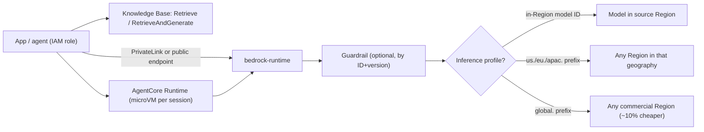

**Amazon Bedrock** is AWS's fully managed service for calling foundation models from many providers. In late 2026 that means 100+ models, including Amazon Nova, Anthropic Claude, OpenAI GPT, xAI Grok, DeepSeek, Kimi and MiniMax. Calls go through AWS IAM, VPC, CloudTrail and KMS, and nobody runs GPUs ([overview](../sources/aws-bedrock-overview.md)). Around inference sit managed building blocks: **Knowledge Bases** for [RAG](retrieval-augmented-generation.md), **Guardrails** for safety, model customization, and **AgentCore** for hosting and governing agents. The owner's field guide puts it simply: use SageMaker to train or host your own models, and Bedrock to call ready-made ones through an API ([notebook](../sources/notebook-aws-services.md)).

## Inference surface

- **APIs.** One `bedrock-runtime` endpoint serves several API styles. **Converse** is provider-neutral, with a common message and tool schema. **InvokeModel** takes the provider's native JSON body. The **[Anthropic Messages](anthropic-messages-api.md)** and **[OpenAI Responses](openai-responses-api.md)/Chat Completions** APIs are also exposed, so vendor SDKs work with a Bedrock base URL and token ([overview](../sources/aws-bedrock-overview.md)). Synthesis: use Converse when you want to swap models without code changes. Use the native APIs when you need provider-specific features first.
- **Model IDs and inference profiles.** A plain ID (`anthropic.claude-opus-4-7`) runs in the calling Region. A prefixed ID (`us.`, `eu.`, `global.`) selects a **cross-Region inference profile**, and Bedrock then picks the Region for each request ([CRIS](../sources/aws-bedrock-cross-region-inference.md)).
- **Customization.** Bedrock supports supervised [fine-tuning](fine-tuning.md), [reinforcement fine-tuning](reinforcement-fine-tuning.md) with Lambda reward functions, and [distillation](knowledge-distillation.md) ([customization](../sources/bedrock-model-customization.md)). The PT page says a custom model needs [Provisioned Throughput](provisioned-throughput.md). A separate on-demand deployment option now covers models customized from Nova Lite, Micro, Pro and 2 Lite or Llama 3.3 70B Instruct on or after July 16, 2025, in specific Regions. Check that list before you budget for PT ([PT](../sources/aws-bedrock-provisioned-throughput.md)).

## Data residency and privacy

| Profile | Where requests are processed | Price | SCP requirement |
|---|---|---|---|
| In-Region (no profile) | Source Region only | Standard | Source Region allowed |
| Geographic (US / EU / APAC) | Any Region listed in that geography's profile | Standard | All destination Regions allowed |
| Global | Any supported commercial Region | ~10% savings | `aws:RequestedRegion = "unspecified"` allowed |

*Source: [cross-Region inference](../sources/aws-bedrock-cross-region-inference.md), read 2026-11-14.*

Cross-Region traffic stays on the AWS backbone and is encrypted in transit. CloudTrail logs every call in the **source** Region, and `additionalEventData.inferenceRegion` records where it actually ran. Destination Regions do not need to be enabled in the account. Inference profiles **cannot** be combined with Provisioned Throughput ([CRIS](../sources/aws-bedrock-cross-region-inference.md)).

On isolation, Bedrock runs each provider's model in an AWS-owned **model deployment account**, one per provider per Region. Providers have no access to it, so they never see prompts, completions or logs ([data protection](../sources/aws-bedrock-data-protection.md)). For network privacy, create **interface VPC endpoints (PrivateLink)**. Customization jobs, batch jobs and the Knowledge Base's OpenSearch Serverless store can also run inside your VPC ([data protection](../sources/aws-bedrock-data-protection.md)).

## Quotas, throughput and capacity tiers

On-demand use is [rate-limited](rate-limits-and-retries.md) by **tokens per minute (TPM)** and **tokens per day (TPD)**. The accounting is not obvious ([token quotas](../sources/aws-bedrock-token-quotas.md)):

1. **When the request is admitted**, Bedrock reserves `input + max_tokens` against your quota.
2. **At completion**, it settles to `input + cache_write + output × burndown` and refunds the difference. Cache reads are free against quota.
3. **Output burndown multipliers** vary by model (late 2026):
   - 15× for Claude 4.8.
   - 10× for Claude Opus 5 and 5.5, Sonnet 5, Fable 5.1 and 5.2, and GPT-5.6 Sol, Terra and Luna.
   - 2.5× for Claude Mythos 5.x.
   - 5× for Claude Fable 5 and Claude 4.7 and older.
   - 1× otherwise, unless the model card says so.

   You are **billed** for actual tokens; burndown affects throttling only. Models served only on the `bedrock-mantle` endpoint have separate input and output quotas and no burndown.

Failure mode: setting `max_tokens` to 32K "to be safe" reserves 32K per request, so you are throttled long before real usage reaches the quota. Size `max_tokens` from the CloudWatch `OutputTokenCount` distribution ([token quotas](../sources/aws-bedrock-token-quotas.md)).

Capacity options, set per request with `service_tier` or bought ahead ([service tiers](../sources/aws-bedrock-service-tiers.md); [PT](../sources/aws-bedrock-provisioned-throughput.md)):

| Option | Mechanism | Commitment | Use when |
|---|---|---|---|
| Flex | Discounted, slower, shares on-demand quota | None | Evals, bulk summarization, background agents |
| Standard (`default`) | On-demand | None | Most traffic |
| Priority | Premium price, served ahead of Standard/Flex | None | Customer-facing latency without a reservation |
| Reserved | Reserved input/output TPM (min 100K in / 10K out), overflow to Standard, 99.5% uptime target | 1 or 3 months | Mission-critical, steady traffic |
| Provisioned Throughput | Hourly-billed **model units** (fixed in/out tokens per minute for one model) | None, 1 month or 6 months | Custom models without on-demand deployment; dedicated per-model capacity |

Batch inference is the other cost lever, covered under [batch processing](batch-processing.md).

## Knowledge Bases (managed RAG)

There are two flavours ([KB](../sources/aws-bedrock-knowledge-bases.md)):

- **Managed Knowledge Base** (recommended). AWS runs parsing (Smart Parsing for PDFs, Office files, scans, audio and video), [embedding](embeddings.md), [reranking](reranking.md), storage auto-scaling and retrieval. It adds connectors (S3, SharePoint, Confluence, Google Drive, OneDrive, web crawler), **ACL-based document-level filtering at retrieval time**, and **agentic retrieval** that splits a query into sub-queries, iterates across KBs and checks whether the evidence is sufficient (see [agentic RAG](agentic-rag.md)). It is exposed as an MCP tool through AgentCore Gateway.
- **Customer-managed KB.** You choose the [vector store](vector-databases.md): OpenSearch Serverless or managed clusters, S3 Vectors, Aurora PostgreSQL/pgvector, Neptune Analytics ([GraphRAG](graphrag.md)), Pinecone, Redis Enterprise Cloud or MongoDB Atlas. Connectors, ACLs and the Gateway integration are Managed-only.

Gotchas from the setup docs ([KB](../sources/aws-bedrock-knowledge-bases.md)):

- Only OpenSearch stores binary vectors.
- S3 Vectors caps metadata at 1 KB and 35 keys per vector. Hierarchical [chunking](chunking.md) can exceed this and fail ingestion. It also suits infrequent queries, not hot paths.
- Aurora needs both an HNSW index and a GIN full-text index; the full-text index serves the keyword half of [hybrid search](hybrid-search.md). Without pgvector 0.8 iterative scans, selective metadata filters silently return too few hits, because filtering runs after the HNSW scan.
- OpenSearch managed clusters must be publicly accessible to work with KBs.

## Guardrails

A versioned policy that you attach to inference calls by ID and version, or run standalone through `ApplyGuardrail` on any text, including non-Bedrock models ([guardrails](../sources/aws-bedrock-guardrails.md)). It has six policy types:

- **Content filters**: hate, insults, sexual, violence, misconduct and prompt attack, each with a strength setting; text and image.
- **Denied topics.**
- **Word filters.**
- **[PII](pii-and-data-privacy.md) filters** that block or mask, plus custom regex.
- **Contextual grounding** checks against the RAG source.
- **Automated Reasoning** checks against formal rules.

The Standard tier also scans code (comments, identifiers, string literals). Two limits matter in practice:

- Guardrails do **not** inspect reasoning blocks.
- To avoid false positives from [system prompts](system-prompts.md) or retrieved text, wrap only the user's text in input tags. This is SDK-only.

For how this fits a defence-in-depth design, see [agent guardrails](agent-guardrails.md) and [prompt injection](prompt-injection.md).

## Agents: Classic vs AgentCore

**Bedrock Agents** (now "Agents Classic") was the configuration-driven agent: action groups (OpenAPI or Lambda), an attached KB, editable orchestration prompt templates, and versions and aliases. It is **closed to new customers** and in maintenance mode. AWS now points to AgentCore and the Strands SDK ([agents classic](../sources/aws-bedrock-agents-classic.md)).

**AgentCore** is a set of modular services that work with any framework and any model, including models outside Bedrock ([AgentCore](../sources/aws-agentcore-overview.md)):

| Service | What it does |
|---|---|
| Runtime | Serverless host for agent/tool containers; HTTP, [MCP](model-context-protocol.md), [A2A](agent2agent-protocol.md), WebSocket |
| [Harness](harness-engineering.md) | Managed [agent loop](agent-loop.md) defined in one API call |
| Memory | Short- and long-term [agent memory](agent-memory.md), shareable |
| Gateway | Turns APIs/Lambda into MCP tools; fronts MCP servers |
| Identity | Inbound (SigV4 / OAuth JWT) and outbound (OAuth, API keys; user-delegated or autonomous) credentials |
| Policy | Deterministic Cedar-compatible rules enforced on every Gateway tool call |
| Code Interpreter, Browser | Managed sandboxes for [tools](tools.md) and [computer use](computer-use-agents.md) |
| Observability, Evaluations, Optimization | [OTel](opentelemetry-genai.md) traces ([observability](llm-observability.md)), [agent evals](agent-evaluation.md), prompt/tool-description A/B tests |
| Registry, Payments | Catalog of agents/tools/skills; x402/MPP agent payments |

Runtime internals ([runtime](../sources/aws-agentcore-runtime.md)):

- **Isolation.** Each `runtimeSessionId` gets its own **microVM** with isolated CPU, memory and filesystem.
- **Session lifetime.** A session ends after **15 min idle** or **8 h total**. The VM is then destroyed and its memory wiped, so durable state belongs in AgentCore Memory.
- **Deployments.** Configuration changes create immutable versions. Endpoints (`DEFAULT` or custom) point at versions, which gives zero-downtime rollout and rollback.
- **Platform V2 (opt-in; V1 is the default).** Instances restore from snapshots for consistent cold starts and allow images up to 10 GB, against 2 GB on V1. The container must report healthy within 120 s, and create or update takes minutes, not seconds.
- **Billing on V2.** Per second for vCPU and memory actually used, with a default allocation of 2 vCPU / 8 GB. Alternatively, a cheaper committed baseline of 1–8 GB memory that can burst to 4×, up to 8 vCPU / 32 GB.

## When to use / when not

Synthesis, drawn from the sources above:

- **Use Bedrock** when the workload already lives in AWS and the customer's security team wants IAM, CloudTrail, KMS, PrivateLink and SCPs to govern model access. It also fits when you need several model vendors under one contract and one throttling model, or managed RAG with ACL filtering over SharePoint and Confluence.
- **Prefer a direct vendor API** when you need a provider's newest features the day they ship (Bedrock exposes vendor APIs, but feature parity per model must be checked). Also prefer it when there are no AWS-governance requirements.
- **Prefer SageMaker or self-hosting** ([LLM inference serving](llm-inference-serving.md)) for custom weights, custom serving stacks, or open models Bedrock doesn't carry ([notebook](../sources/notebook-aws-services.md)).
- **Residency checklist:**
  - Pin geographic (not global) inference profiles.
  - Write SCPs that allow only the Regions in those profiles.
  - Verify `inferenceRegion` in CloudTrail.
  - Remember that PT cannot use cross-Region profiles.
- **Throughput checklist:**
  - Right-size `max_tokens`.
  - Use [prompt caching](prompt-caching.md), since cache reads are quota-free.
  - Send background work to Flex or batch.
  - Add retries with model or Region [fallback](model-routing-and-fallbacks.md).
  - Reserve capacity only for steady baseline load.

Compare with [Google Vertex AI](google-vertex-ai.md) and [Azure AI Foundry](azure-ai-foundry.md); see also [enterprise LLM deployment](enterprise-llm-deployment.md).

## Sources

- [Amazon Bedrock — Overview](../sources/aws-bedrock-overview.md)
- [Cross-Region inference](../sources/aws-bedrock-cross-region-inference.md)
- [Provisioned Throughput](../sources/aws-bedrock-provisioned-throughput.md)
- [Service tiers](../sources/aws-bedrock-service-tiers.md)
- [Token quotas and burndown](../sources/aws-bedrock-token-quotas.md)
- [Data protection and VPC/PrivateLink](../sources/aws-bedrock-data-protection.md)
- [Knowledge Bases](../sources/aws-bedrock-knowledge-bases.md)
- [Guardrails](../sources/aws-bedrock-guardrails.md)
- [Agents Classic](../sources/aws-bedrock-agents-classic.md)
- [AgentCore overview](../sources/aws-agentcore-overview.md)
- [AgentCore Runtime](../sources/aws-agentcore-runtime.md)
- [Model customization](../sources/bedrock-model-customization.md)
- [AWS Services Field Guide (Notebook)](../sources/notebook-aws-services.md)
