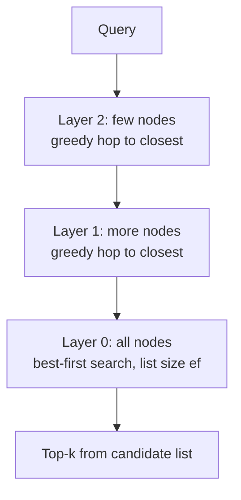

An **approximate nearest-neighbour (ANN) index** is a data structure that finds vectors close to a query without comparing it against every stored vector. It gives up a little accuracy (**recall**: the fraction of the true top-k it returns) in exchange for sublinear search time and, with compression, much less memory. Every [vector database](vector-databases.md) is built on one or more of these families: graphs (HNSW, Vamana/DiskANN), inverted files (IVF), and vector compression (scalar, product, binary, rotational quantization). The design space has four axes: speed, memory, accuracy, plus build time and I/O in some settings ([Faiss](../sources/faiss-library-paper.md)).

## Exact search first

A flat index compares the query with every vector: perfect recall at 4 × d bytes per vector ([Faiss wiki](../sources/faiss-indexes-wiki.md)). Non-exhaustive search starts to pay off above roughly 10k vectors ([Faiss](../sources/faiss-library-paper.md)). Flat search is also the right answer when a filter leaves only a small subset, which is why Qdrant, Weaviate and Milvus fall back to it for very selective filters ([Qdrant](../sources/qdrant-indexing-docs.md), [Weaviate](../sources/weaviate-vector-index-docs.md), [Milvus](../sources/milvus-index-explained.md)).

## HNSW (Hierarchical Navigable Small World)

**Structure.** A stack of proximity graphs over nested subsets of the data. Each inserted element draws a top layer `floor(-ln(U) × mL)`, an exponentially decaying distribution with recommended `mL = 1/ln(M)`, so upper layers are sparse long-range "express lanes", like a skip list. Layer 0 contains every element ([HNSW](../sources/hnsw-malkov-yashunin.md)).

**Search.** Greedy descent from the top-layer entry point to layer 1, then a best-first search on layer 0 keeping a candidate list of size `ef`. Complexity scales roughly logarithmically ([HNSW](../sources/hnsw-malkov-yashunin.md)).

**Insert.** Search for the new element's neighbours with list size `efConstruction`, then link up to `M` of them per layer (`Mmax0 = 2M` on layer 0). A heuristic prefers neighbours in diverse directions rather than just the closest ones, which helps on clustered data ([HNSW](../sources/hnsw-malkov-yashunin.md)).

| Parameter | Effect | Typical defaults |
|---|---|---|
| `M` (links per node) | Higher gives better recall at high dimension, more memory, slower build. The paper suggests 5 to 48 | pgvector 16; Qdrant 16 |
| `efConstruction` | Build-time list; higher gives a better graph and a slower build. Aim for near-1 recall during build | pgvector 64; Qdrant 100 |
| `ef` / `ef_search` | Query-time list; the main recall/latency knob. Must be ≥ k | pgvector 40; Qdrant defaults to `ef_construct`; Weaviate supports dynamic ef from the query limit |

Sources: [HNSW](../sources/hnsw-malkov-yashunin.md), [pgvector](../sources/pgvector-readme.md), [Qdrant](../sources/qdrant-indexing-docs.md), [Weaviate](../sources/weaviate-vector-index-docs.md).

**Costs and limits.** Graph links add about 60 to 450 bytes per element on top of the vectors ([HNSW](../sources/hnsw-malkov-yashunin.md)). Milvus estimates 1M 128-dim vectors at 640 MB, 128 MB of it graph ([Milvus](../sources/milvus-index-explained.md)). Faiss's HNSW supports incremental adds but not removal ([Faiss](../sources/faiss-library-paper.md)). Builds are memory-hungry: pgvector warns when the graph outgrows `maintenance_work_mem` ([pgvector](../sources/pgvector-readme.md)). Graphs are best when memory is not a constraint, and build time becomes limiting beyond about 10M vectors on one node ([Faiss](../sources/faiss-library-paper.md)).

## IVF (inverted file)

**Mechanism.** k-means trains `nlist` centroids; each vector is stored in its nearest centroid's list. A query scores the centroids and scans only the `nprobe` closest lists ([Faiss](../sources/faiss-library-paper.md)).

**Tuning.** Distance computations are minimized near `nlist ≈ sqrt(nprobe × N)`; Faiss suggests `nlist` of about C × sqrt(N) ([Faiss](../sources/faiss-library-paper.md), [Faiss wiki](../sources/faiss-indexes-wiki.md)). pgvector suggests `lists = rows/1000` up to 1M rows and `sqrt(rows)` beyond, with `probes` starting at `sqrt(lists)`. `probes = lists` is exact search ([pgvector](../sources/pgvector-readme.md)).

**Trade-offs.** IVF is cheaper to build and smaller than HNSW but slower at equal recall ([pgvector](../sources/pgvector-readme.md)). It needs representative data to train (build after loading). It handles large top-k and heavy filtering better than graphs ([Milvus](../sources/milvus-index-explained.md)), and with compression it is the standard at very large scale ([Faiss](../sources/faiss-library-paper.md)). Synthesis: clusters trained on old data drift as the distribution shifts, so periodically rebuild.

## Compression: SQ, PQ, binary, RQ

| Method | How | Size vs float32 | Notes |
|---|---|---|---|
| Scalar (SQ8) | Each dimension to 8 bits using trained min/max | 4x smaller | About 97% retrieval kept; about 99% with rescoring |
| Product (PQ) | Split into M sub-vectors, replace each by a codebook centroid ID | e.g. 768 floats to 128 bytes (about 24x) | Needs training data; asymmetric distance via per-query lookup tables |
| Binary (BQ) | Keep the sign bit, compare with Hamming distance | 32x smaller | About 92 to 96% kept on robust models; some models collapse |
| Rotational (RQ, Weaviate) | Random rotation, then 8, 4 or 1-bit quantization | about 4x, 8x, close to 32x at high dimension | No training; 8-bit reported at 98 to 99% recall, 4-bit about 94 to 95% before rescoring |
| Half precision | float16 | 2x smaller | pgvector `halfvec` raises indexable dims to 4,000 |

Sources: [Faiss](../sources/faiss-library-paper.md), [Faiss wiki](../sources/faiss-indexes-wiki.md), [HF](../sources/hf-embedding-quantization.md), [Weaviate](../sources/weaviate-vector-index-docs.md), [pgvector](../sources/pgvector-readme.md).

PQ's **asymmetric distance computation** keeps the query in full precision and sums precomputed sub-vector distances from lookup tables, so stored codes are never decompressed ([Faiss](../sources/faiss-library-paper.md)). Additive quantizers (residual, LSQ) are more accurate per bit but cost more to train and encode ([Faiss](../sources/faiss-library-paper.md)).

Compression composes with a structure: IVF-PQ, HNSW-PQ/SQ, and IVF-PQ plus a refiner. For 1M 128-dim vectors, IVF-PQ needs about 11 MB against 515 MB for IVF-FLAT ([Milvus](../sources/milvus-index-explained.md)). Compression always pairs with **refinement**: over-fetch candidates with compressed distances, then re-score them with full vectors from RAM or flash ([Faiss](../sources/faiss-library-paper.md), [HF](../sources/hf-embedding-quantization.md), [Weaviate](../sources/weaviate-vector-index-docs.md)). Matryoshka truncation is a related trick: shortlist with short prefixes, re-rank with full vectors ([MRL](../sources/matryoshka-representation-learning.md)).

## DiskANN / Vamana: indexes on SSD

DiskANN serves a billion vectors from one machine with 64 GB of RAM and an SSD ([DiskANN](../sources/diskann-neurips-2019.md)):

- **Vamana graph.** A flat graph with max degree `R`, built in two passes with candidate list `L` and a pruning factor `alpha`. `alpha > 1` keeps long-range edges, giving fewer hops. HNSW and NSG implicitly use `alpha = 1`.
- **Memory layout.** PQ codes (e.g. 32 bytes per point) stay in RAM to steer traversal. Each point's full vector and neighbour list sit together on SSD, so re-ranking with exact distances needs no extra reads.
- **BeamSearch.** Each round fetches `W` frontier nodes in parallel; W of 2 to 8 balances latency and SSD load.
- **Results.** On SIFT1B: over 5,000 QPS, under 3 ms mean latency, 95%+ 1-recall@1. Comparable-memory IVF-PQ methods plateaued near 50%.

Milvus recommends DiskANN when raw data lives on SSD and about a quarter of it fits in RAM, with disk IOPS as the bottleneck to watch ([Milvus](../sources/milvus-index-explained.md)). Weaviate's HFresh is another disk-based option: inspired by SPFresh, it keeps a compact centroid index in RAM and posting lists on disk, accepting latencies in the hundreds of milliseconds (preview in v1.36, GA in v1.38) ([Weaviate](../sources/weaviate-vector-index-docs.md)).

## Filtered ANN

Filters break the assumption that every visited node is a valid result. Post-filtering an HNSW result of `ef_search = 40` with a 10%-selective filter leaves about 4 rows ([pgvector](../sources/pgvector-readme.md)). The fixes:

- **Keep scanning:** pgvector iterative scans ([pgvector](../sources/pgvector-readme.md)).
- **Make the graph filter-aware:** Qdrant's per-value extra edges ([Qdrant](../sources/qdrant-indexing-docs.md)).
- **Skip non-matching nodes in distance computations and add multi-hop neighbour expansion:** ACORN in Weaviate and Qdrant ([Weaviate](../sources/weaviate-vector-index-docs.md), [Qdrant](../sources/qdrant-indexing-docs.md)).
- **Switch to brute force on the matching subset** when it is small. Milvus suggests graph indexes under 85% filtered out, IVF at 85 to 95%, and FLAT at the extreme (over 98% in its prose, over 95% in its decision matrix) ([Milvus](../sources/milvus-index-explained.md)).

## Choosing and tuning

| Situation | Index |
|---|---|
| Under ~10k vectors, or a tiny filtered subset | Flat (exact) |
| Fits in RAM, low latency, high recall, small k | HNSW |
| Very large, memory-bound, large k or heavy filters | IVF + PQ/SQ (+ refine) |
| Raw data on SSD, RAM about 1/4 of the data | DiskANN |
| Recall above 99% required | Flat, ideally GPU |

Sources: [Faiss](../sources/faiss-library-paper.md), [Milvus](../sources/milvus-index-explained.md).

Tuning loop (Synthesis, consistent with Faiss's Pareto-sweep approach in [Faiss](../sources/faiss-library-paper.md)):

1. Compute exact top-k for a few hundred real queries with a flat index; this is ground truth.
2. Sweep the query-time knob (`ef_search` or `nprobe`) and plot recall@k against p95 latency.
3. Pick the cheapest point that meets the recall target (often 0.95+). Raise `M` or `efConstruction` only if `ef` alone cannot reach it.
4. Re-measure with production filters and after bulk deletes and updates.
5. Measure end-to-end answer quality too ([LLM evaluation](llm-evaluation.md)): ANN recall is rarely the weakest link next to [chunking](chunking.md) and [reranking](reranking.md).

## Sources

- [HNSW paper (Malkov & Yashunin)](../sources/hnsw-malkov-yashunin.md)
- [The Faiss Library](../sources/faiss-library-paper.md)
- [Faiss indexes wiki](../sources/faiss-indexes-wiki.md)
- [DiskANN (NeurIPS 2019)](../sources/diskann-neurips-2019.md)
- [pgvector README](../sources/pgvector-readme.md)
- [Qdrant indexing docs](../sources/qdrant-indexing-docs.md)
- [Weaviate vector index, filtering and quantization docs](../sources/weaviate-vector-index-docs.md)
- [Milvus Index Explained](../sources/milvus-index-explained.md)
- [Binary and scalar embedding quantization](../sources/hf-embedding-quantization.md)
- [Matryoshka Representation Learning](../sources/matryoshka-representation-learning.md)
