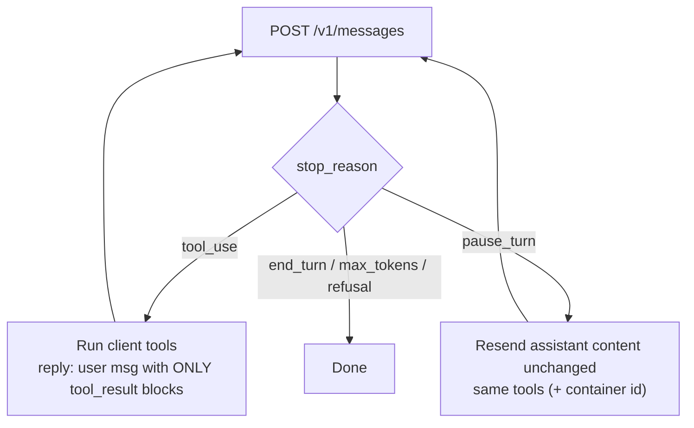

The **Messages API** (`POST /v1/messages`) is Anthropic's single generation endpoint for Claude. A request carries `model`, `max_tokens` (required), an optional top-level `system`, optional `tools`, and a `messages` array of alternating `user` / `assistant` turns whose `content` is a list of typed **content blocks** (`text`, `image`, `document`, `tool_use`, `tool_result`, `thinking`, server-tool blocks). The response is one assistant message with its own content blocks, a `stop_reason`, and `usage` ([API reference](../sources/anthropic-messages-api-reference.md)). The API is **stateless**: there is no stored response ID to chain from, so the client resends the whole conversation every turn and relies on opt-in [prompt caching](prompt-caching.md) for cost. Stateful agent hosting lives in separate beta endpoints (Agents, Sessions, Environments for Managed Agents) ([API overview](../sources/anthropic-api-overview.md)).

## Request and response essentials

- **Headers:** `Authorization: Bearer` (or legacy `x-api-key`), `anthropic-version` (current `2026-10-21`), `content-type`; `anthropic-workspace-id` for keys not scoped to a workspace. Responses include a `request-id` header for support ([API overview](../sources/anthropic-api-overview.md)).
- **Versioning:** within a version, inputs and outputs stay stable, but new enum values and streaming event types can appear, so parsers must tolerate unknown ones. Version `2026-10-21` removed `temperature`, `top_p` and `top_k`: sending any of them returns 400 on every model ([versioning](../sources/anthropic-api-versioning.md), [sampling removal](../sources/anthropic-api-2026-10-21-sampling-removal.md); see [sampling parameters](sampling-parameters.md)).
- **`stop_reason`:** `end_turn`, `max_tokens`, `stop_sequence`, `tool_use`, `pause_turn`, `refusal`, `model_context_window_exceeded`. Usage splits input into `input_tokens` + `cache_creation_input_tokens` + `cache_read_input_tokens`. `max_tokens: 0` pre-warms the cache without generating ([API reference](../sources/anthropic-messages-api-reference.md)).
- **System prompts:** top-level `system` plus, on most current models (not Sonnet 5), mid-conversation `system` messages that override earlier instructions from their position on ([mid-conversation system messages](../sources/anthropic-mid-conversation-system-messages.md); see [system prompts](system-prompts.md)).
- **Assistant prefill** is rejected on Claude 4.6+ ([thinking docs](../sources/anthropic-thinking-docs.md)).
- **Size limits:** 128 MB per Messages request first-party; 32 MB on Anthropic-operated cloud platforms, 30 MB on Google-managed Vertex, 20 MB on Bedrock ([API overview](../sources/anthropic-api-overview.md)).
- **Models (Nov 2026):** Fable 5.2, Opus 5.5, Sonnet 5.5, Haiku 5.5, all with 1M context and 128K synchronous output; Mythos 5.2 matches Fable 5.2 but is limited to verified organisations ([models overview](../sources/anthropic-models-overview.md)).

## Tools: client, server, and the turn

**Client tools** are defined with `name`, `description`, `input_schema` (plus optional `strict`, `input_examples`, `defer_loading`, `cache_control`). Claude returns `tool_use` blocks with `toolu_` IDs; you answer in the next user message with matching `tool_result` blocks (set `is_error` on failures), all results in one message before any text. Parallel calls are on by default; `tool_choice` is `auto`, `any`, `tool` or `none`, with `disable_parallel_tool_use` inside it. Forced tool choice (`any`/`tool`) is rejected on Opus 5.5, Sonnet 5.5 and Fable/Mythos 5.1-5.2, and with manual extended thinking, so use `auto` with strict tools or [structured outputs](structured-outputs.md) instead ([tool use docs](../sources/anthropic-tool-use-docs.md), [thinking docs](../sources/anthropic-thinking-docs.md)). Tool definitions add a hidden system prompt of roughly 286-804 tokens ([tool use docs](../sources/anthropic-tool-use-docs.md)).

**Server tools** (web search, web fetch, code execution, tool search) run inside the request as `server_tool_use` blocks (`srvtoolu_` IDs) followed by their result blocks; you never send a result for them. The server-side loop may stop with `pause_turn`: resend the assistant content as-is with the same tools, possibly several times. If Claude mixes a server tool and a client tool in one parallel group, you get `stop_reason: "tool_use"` with an unresolved `server_tool_use`; reply with only `tool_result` blocks and the server tool runs next request ([server tools](../sources/anthropic-server-tools-docs.md)).

| Server tool | Key facts |
|---|---|
| Web search (`web_search_20250305` / `_20260209` / `_20260318`) | `max_uses`, allow **or** block domains, `user_location`; results carry `encrypted_content` and citations carry `encrypted_index`, both of which must be sent back unchanged; $10 per 1,000 searches; newer versions filter results with code (dynamic filtering), which is not ZDR-eligible unless `allowed_callers: ["direct"]` ([web search](../sources/anthropic-web-search-tool-docs.md)) |
| Code execution (`code_execution_20250825` / `_20260120` / `_20260521`) | sandboxed Python/Bash, no network, 5 GiB RAM; containers last 30 days; 1,550 free hours/month then $0.05/hour (free when the request also carries `web_search_20260209`/`web_fetch_20260209` or later); not ZDR-eligible ([code execution](../sources/anthropic-code-execution-tool-docs.md)) |
| Computer use (`computer_toolset_20260801`) | client-executed (you run actions and return screenshots), but versioned and schema-defined by Anthropic ([computer use](../sources/anthropic-computer-use-tool-docs.md); see [computer-use agents](computer-use-agents.md)) |

## Thinking

Thinking appears as `thinking` blocks with an encrypted `signature`. The visible text is a summary written by another model, and on Claude 5 models `display` defaults to `"omitted"`; you are billed for the full reasoning either way. On Claude 5 models thinking is adaptive and on by default, steered by `effort` in `output_config`; `max_tokens` is the only hard spend ceiling. `budget_tokens` with `type: "enabled"` returns 400 on Claude 4.7+. Within a tool-use turn, thinking blocks (including `redacted_thinking`) must be returned complete and unmodified, or the request fails with 400. Changing the thinking configuration invalidates cache breakpoints ([thinking docs](../sources/anthropic-thinking-docs.md); see [extended thinking](extended-thinking.md)).

Synthesis: all three providers now use the same pattern of opaque, provider-signed reasoning state that the client must replay byte-for-byte: Anthropic `signature`, OpenAI `encrypted_content`, Gemini `thought_signature`. None of these artifacts works with another provider.

## Caching, files, compaction

- **Prompt caching** is opt-in, either per block with `cache_control` breakpoints or with one top-level `cache_control` ("automatic caching", which moves the breakpoint forward as the conversation grows and is unavailable on Bedrock's `bedrock-runtime`) (the owner's [RAG vs CAG](../sources/notebook-rag-cag.md) tutorial shows the pattern: a large handbook in `system` marked `cache_control: ephemeral`): up to 4 breakpoints (automatic caching uses one), with the prefix hashed in order `tools` → `system` → `messages`. TTL is 5 minutes (write 1.25x) or 1 hour (write 2x); reads cost 0.1x (0.05x on Opus/Sonnet 5.5, 0.025x on Fable/Mythos 5.1-5.2). The minimum prefix is 512 tokens on 5.x models. Changing tools invalidates everything, and a cache entry exists only once the first response starts streaming ([caching docs](../sources/anthropic-prompt-caching-docs.md)). Cache reads do not count toward ITPM rate limits ([rate limits](../sources/anthropic-rate-limits-docs.md)).
- **Files API** (stable): upload once and reference the `file_id` in `document`, `image` or `container_upload` blocks; 500 MB per file, 1 TB per org. Files are workspace-scoped, so never accept file IDs from end users. Only generated files can be downloaded, and the Files API is not ZDR-eligible ([Files API](../sources/anthropic-files-api-docs.md)).
- **Compaction** and context editing manage long histories client- or server-side ([compaction](../sources/anthropic-compaction-docs.md)).
- **Structured outputs** use `output_config.format`, with grammar-constrained JSON Schema (no recursion, `additionalProperties: false`), limits of 20 strict tools, and a 24-hour grammar cache ([structured outputs](../sources/anthropic-structured-outputs-docs.md)).

## Streaming, limits, data

- SSE flow: `message_start` → `content_block_start` / `_delta` / `_stop` → `message_delta` → `message_stop`, with `ping` events. Errors such as `overloaded_error` can arrive inside a 200 stream. SDKs require streaming for large `max_tokens` (above about 21K) ([streaming docs](../sources/anthropic-streaming-docs.md), [thinking docs](../sources/anthropic-thinking-docs.md)).
- Rate limits: RPM, ITPM and OTPM per model class, enforced by a token bucket. On top sit ramp limits (`ramp_limit_exceeded`) and monthly spend caps (429 with no `retry-after`), with `anthropic-ratelimit-*` headers ([rate limits](../sources/anthropic-rate-limits-docs.md); see [rate limits and retries](rate-limits-and-retries.md)).
- Data: inputs and outputs are deleted within 30 days by default. Under ZDR nothing is stored once the response returns, but stateful features (Files, Batch, code execution) step outside ZDR, and Fable/Mythos models require 30-day retention ([data retention](../sources/anthropic-api-and-data-retention.md)).
- Batch is 50% off and stacks with cache discounts; fast mode costs a premium ([pricing](../sources/anthropic-pricing.md); see [batch processing](batch-processing.md)).

## Porting gotchas

- **From OpenAI:** there is no `instructions`/`previous_response_id`, so you resend history. `system` is top-level (or a mid-conversation system message), not a message role. Tool results are user-turn `tool_result` blocks, not a `tool` role. `max_tokens` is required. Sampling parameters return 400 ([API reference](../sources/anthropic-messages-api-reference.md), [versioning](../sources/anthropic-api-versioning.md)).
- **Via the OpenAI-compatible endpoint:** `strict` is ignored, prompt caching is unavailable, system messages are hoisted and concatenated, thinking is hidden, file and audio parts return 400, and `n` must be 1. Anthropic labels it a testing tool, not a production path ([OpenAI compat](../sources/anthropic-openai-sdk-compatibility.md)).
- **Cloud platforms:** partner clouds lag on features: Google-managed Vertex and Azure-hosted Foundry get only basic web search (no dynamic filtering), Bedrock is not listed for web search, and request size is capped at 20 MB (Bedrock) or 30 MB (Google-managed Vertex) ([web search](../sources/anthropic-web-search-tool-docs.md), [API overview](../sources/anthropic-api-overview.md); see [Amazon Bedrock](amazon-bedrock.md), [Google Vertex AI](google-vertex-ai.md)).

## When to use / when not

Synthesis:
- **Use** the native Messages API (with the official SDK) for any production Claude workload; you control state, which suits ZDR, audit, and portability.
- **Design** your own conversation store and a cache-friendly prompt layout (stable tools and system first, a breakpoint, or automatic caching, at the end of the growing history). See [context engineering](context-engineering.md).
- **Prefer** the [Claude Agent SDK](claude-agent-sdk.md) or Managed Agents if you want hosted state and an agent loop rather than raw turns.
- **Avoid** the OpenAI-compatible endpoint beyond quick evals. Compare with the [OpenAI Responses API](openai-responses-api.md) and the [Gemini API](gemini-api.md).

## Sources

- [Messages API reference](../sources/anthropic-messages-api-reference.md)
- [API overview](../sources/anthropic-api-overview.md)
- [API versions](../sources/anthropic-api-versioning.md)
- [2026-10-21 sampling parameter removal](../sources/anthropic-api-2026-10-21-sampling-removal.md)
- [Tool use docs](../sources/anthropic-tool-use-docs.md)
- [Server tools](../sources/anthropic-server-tools-docs.md)
- [Web search tool](../sources/anthropic-web-search-tool-docs.md)
- [Code execution tool](../sources/anthropic-code-execution-tool-docs.md)
- [Computer use tool](../sources/anthropic-computer-use-tool-docs.md)
- [Thinking docs](../sources/anthropic-thinking-docs.md)
- [Prompt caching docs](../sources/anthropic-prompt-caching-docs.md)
- [Structured outputs docs](../sources/anthropic-structured-outputs-docs.md)
- [Streaming docs](../sources/anthropic-streaming-docs.md)
- [Files API](../sources/anthropic-files-api-docs.md)
- [Mid-conversation system messages](../sources/anthropic-mid-conversation-system-messages.md)
- [Compaction docs](../sources/anthropic-compaction-docs.md)
- [Rate limits docs](../sources/anthropic-rate-limits-docs.md)
- [API and data retention](../sources/anthropic-api-and-data-retention.md)
- [Models overview](../sources/anthropic-models-overview.md)
- [Pricing](../sources/anthropic-pricing.md)
- [OpenAI SDK compatibility](../sources/anthropic-openai-sdk-compatibility.md)
- [Notebook: RAG vs CAG vs GraphRAG](../sources/notebook-rag-cag.md)
