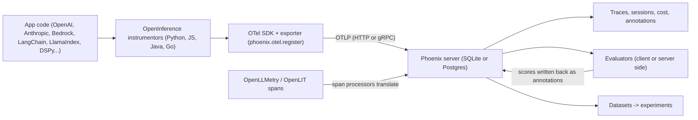

**Arize Phoenix** is an [LLM observability](llm-observability.md) and [evaluation](llm-evaluation.md) tool from Arize AI. It is built on **[OpenTelemetry](opentelemetry-genai.md) (OTel)**: applications emit spans over OTLP, and Phoenix stores them as traces. It adds LLM and code evaluators, annotations, datasets, experiments, a prompt playground and [prompt management](prompt-management.md) on top. Its instrumentation layer, **OpenInference** (Apache-2.0), is a set of OTel auto-instrumentors plus attribute conventions for LLM spans. Phoenix itself is under the **Elastic License 2.0**: source-available and free to self-host with no feature gates, but not OSI open source. Arize AX is the separate paid SaaS/enterprise product ([arize-phoenix-docs](../sources/arize-phoenix-docs.md), [phoenix-evals](../sources/phoenix-evals-and-self-hosting-docs.md)). Latest release at time of writing: v21.1.0 (2026-11-13).

## How tracing works

Synthesis: assembled from the tracing, evals and datasets docs ([arize-phoenix-docs](../sources/arize-phoenix-docs.md), [phoenix-evals](../sources/phoenix-evals-and-self-hosting-docs.md)).

**Setup.** `phoenix.otel.register(project_name, auto_instrument, batch, endpoint, protocol, headers)` configures a tracer provider and, with `auto_instrument=True`, activates every installed OpenInference instrumentor. Environment variables: `PHOENIX_COLLECTOR_ENDPOINT`, `PHOENIX_API_KEY`, `PHOENIX_PROJECT_NAME`. A local server listens on `localhost:6006`. Python defaults to `batch=False` (simple span processor, which is easy to debug but exports synchronously). TypeScript defaults to `batch: true`, so call `shutdown()` to flush spans before a short-lived process exits ([phoenix-evals](../sources/phoenix-evals-and-self-hosting-docs.md)). Synthesis: turn batching on in Python production services.

**OpenInference conventions.** Every span must carry `openinference.span.kind`, one of LLM, EMBEDDING, CHAIN, RETRIEVER, RERANKER, TOOL, AGENT, GUARDRAIL, EVALUATOR, PROMPT or DECISION. Other attributes include `llm.token_count.{prompt,completion,total}` with cache and reasoning breakdowns, flattened `llm.input_messages.N.message.*`, `retrieval.documents` (id, score, content), `session.id` and `user.id` ([arize-phoenix-docs](../sources/arize-phoenix-docs.md)). These conventions predate the official **OTel GenAI semantic conventions** (`gen_ai.operation.name`, `gen_ai.provider.name`, `gen_ai.usage.*`, `gen_ai.conversation.id`) ([otel-genai](../sources/opentelemetry-genai-semantic-conventions.md)). Synthesis: the two vocabularies overlap but are not identical. If a client's collector or APM expects `gen_ai.*`, check what the receiving side understands before standardising on one. Phoenix's translators for OpenLLMetry and OpenLIT spans ([phoenix-evals](../sources/phoenix-evals-and-self-hosting-docs.md)) reduce lock-in at the instrumentation layer.

**Privacy.** The OTel GenAI spec says instrumentations should not capture prompt/response content by default, and recommends storing content externally and recording references ([otel-genai](../sources/opentelemetry-genai-semantic-conventions.md)). OpenInference instrumentors are built to show full messages, so for regulated clients decide explicitly what content is captured (see [PII and data privacy](pii-and-data-privacy.md)). Synthesis.

**Cost tracking** (since 2025-06): per-span cost = token counts × a per-model price table (built in, overridable in Settings > Models), rolled up to trace and project. It is not retroactive, and spans without token counts get no cost. Built-in prices now update from [LiteLLM](litellm.md)'s model price list (blog, 2026-11-02) ([arize-phoenix-docs](../sources/arize-phoenix-docs.md)).

## Evals (`arize-phoenix-evals`)

- **Score model:** every evaluator returns a `Score` with `name`, `kind` (llm, code, human), `direction` (higher or lower is better), and optional `score`, `label`, `explanation`, `metadata`. Evaluators expose `evaluate` / `async_evaluate` and an `input_schema` ([phoenix-evals](../sources/phoenix-evals-and-self-hosting-docs.md)).
- **LLM judges** answer through forced [tool calling](function-calling.md) / [structured outputs](structured-outputs.md), never by parsing free text, which removes a common source of judge breakage. `ClassificationEvaluator(name, prompt_template, llm, choices, direction)` takes `choices` as a label list or a label-to-score dict. `LLM(provider, model)` returns label plus explanation. `DecisionModel` returns per-label probabilities and no explanation ([phoenix-evals](../sources/phoenix-evals-and-self-hosting-docs.md)).
- **Input mapping:** `input_mapping` maps evaluator fields to your data by key, dot/JSONPath or callable, and `bind_evaluator` fixes the mapping. `async_evaluate_dataframe` batches with [rate-limit handling, retries](rate-limits-and-retries.md) and dynamic concurrency (claimed up to 20x faster) ([phoenix-evals](../sources/phoenix-evals-and-self-hosting-docs.md)).
- **Pre-built metrics:** faithfulness, hallucination, completeness, conciseness, correctness, retrieval relevance, tool selection, tool invocation, tool response handling, refusal, user friction, PII, toxicity. Code metrics: exact match, regex, precision/recall/F1. Arize claims 85%+ F1 on its own golden datasets, which is a vendor claim to re-validate on client data ([phoenix-evals](../sources/phoenix-evals-and-self-hosting-docs.md)). Ragas, DeepEval and Cleanlab metrics plug in as well ([arize-phoenix-docs](../sources/arize-phoenix-docs.md); see [RAGAS and DeepEval](ragas-and-deepeval.md)).
- **Judges are traced:** each evaluator run is logged to a dedicated Phoenix project (judge prompt, reasoning, score, timing), so you can debug the judge with the same tools as the app ([phoenix-evals](../sources/phoenix-evals-and-self-hosting-docs.md)). Human annotations attach to spans and traces alongside LLM and code scores ([arize-phoenix-docs](../sources/arize-phoenix-docs.md)).

## Datasets and experiments

`create_dataset(name, examples)` builds a dataset, often from traces. `run_experiment(dataset, task, evaluators, experiment_name)` runs a new app version over it and scores it, with results compared in the dataset's Experiments tab. The TypeScript equivalents are in `@arizeai/phoenix-client` ([phoenix-evals](../sources/phoenix-evals-and-self-hosting-docs.md)). **Span Replay** re-runs a traced LLM call in the playground with edits ([arize-phoenix-docs](../sources/arize-phoenix-docs.md)). This supports the trace → [error analysis](error-analysis.md) → dataset → experiment loop that Husain and Shankar recommend ([husain-shankar-2026](../sources/husain-shankar-2026-ai-evals-faq.md)) and that the owner's notebook calls the eval flywheel ([notebook-llm-evaluation](../sources/notebook-llm-evaluation.md)).

Recent additions include a built-in debugging agent (PXI), a remote [MCP](model-context-protocol.md) server endpoint for [coding agents](coding-agents.md), and `px setup` in `@arizeai/phoenix-cli`, which hands instrumentation work to a coding agent ([arize-phoenix-docs](../sources/arize-phoenix-docs.md), [phoenix-evals](../sources/phoenix-evals-and-self-hosting-docs.md)).

## Deployment and pricing (as of 2026-11-14)

- **Self-hosted Phoenix:** free, with no usage limits or feature gates, and can run air-gapped. Auth options: OAuth2, LDAP or local, with RBAC and retention policies. Deploy with `pip install arize-phoenix && phoenix serve`, Docker (`arizephoenix/phoenix`), Helm or CloudFormation. Storage is SQLite by default; use PostgreSQL in production ([phoenix-evals](../sources/phoenix-evals-and-self-hosting-docs.md)).
- **Arize AX** (hosted): Free (25k spans/month, 1 GB, 15-day retention), Pro $50/month (50k spans, 10 GB, 30 days), Enterprise custom with SaaS or self-hosted deployment ([phoenix-evals](../sources/phoenix-evals-and-self-hosting-docs.md)).
- **Licence caveat:** ELv2 forbids offering the software to third parties as a hosted or managed service and forbids circumventing licence-key functionality. Internal self-hosting is fine ([elv2](../sources/elastic-license-2.md)). The docs call it open source; it is not OSI-approved ([arize-phoenix-docs](../sources/arize-phoenix-docs.md)). Synthesis: if a client's procurement only accepts OSI licences, raise this early.

## Comparison

| | Phoenix | [Braintrust](braintrust.md) | [Langfuse](langfuse.md) |
|---|---|---|---|
| Instrumentation | OTel-native (OpenInference) | Own SDK wrappers | OTel-based SDKs; OTLP endpoint is HTTP only |
| Free self-host | Yes, all features (ELv2) | No | Yes (OSS) |
| Eval style | Structured-output classifiers, pre-built templates, experiments | Experiments with baseline diffing, online scoring rules | Judges, datasets, scores |
| Hosted entry price | AX Pro $50/mo | Pro $249/mo | Core $29/mo |

Sources: [phoenix-evals](../sources/phoenix-evals-and-self-hosting-docs.md), [braintrust-platform-docs](../sources/braintrust-platform-docs.md), [langfuse-pricing](../sources/langfuse-pricing-and-v4.md), [langfuse-observability](../sources/langfuse-observability-docs.md).

## Limitations and failure modes

Synthesis, grounded in the cited docs:
- SQLite is the default store. Fine on a laptop, but a long-running shared instance should use Postgres plus retention policies, or trace volume will outgrow it.
- Unflushed spans: TypeScript batching without `shutdown()`, or serverless functions that exit early, lose the last spans.
- Missing token counts mean missing cost. Some [streaming](streaming.md) paths and custom spans do not report usage.
- Pre-built judge templates come with vendor-reported accuracy. Calibrate them against human labels before using them as gates ([llm-as-judge](llm-as-judge.md)).
- Phoenix's docs document evaluators run in code (client side) or server side, not sampled rules like Braintrust's online scoring. Plan how production traces get scored, for example a scheduled job that pulls recent spans, evaluates them and logs results back as annotations.

## When to use / when not

Synthesis:
- **Pick Phoenix** when data must stay inside the client's VPC or on-prem at no licence cost, when the stack is already OTel (it can sit beside an existing collector), when the app uses [LlamaIndex](llamaindex.md)/[LangChain](langchain.md)/[DSPy](dspy.md) and needs zero-code instrumentation, or for local debugging during a [POC](poc-to-production.md) (`phoenix serve` and you have a UI in a minute).
- **Look elsewhere** when the team's main workflow is collaborative experiment review with regression diffing and managed online scoring ([Braintrust](braintrust.md)), when the client needs an OSI licence ([Langfuse](langfuse.md)), or when the app is [LangGraph](langgraph.md)-centric and the client already pays for [LangSmith](langsmith.md).

## Sources

- [Arize Phoenix and OpenInference documentation](../sources/arize-phoenix-docs.md)
- [Phoenix docs: evals, experiments, phoenix-otel, self-hosting, pricing](../sources/phoenix-evals-and-self-hosting-docs.md)
- [OpenTelemetry GenAI semantic conventions](../sources/opentelemetry-genai-semantic-conventions.md)
- [Husain and Shankar: AI evals FAQ](../sources/husain-shankar-2026-ai-evals-faq.md)
- [Braintrust platform docs](../sources/braintrust-platform-docs.md)
- [Langfuse pricing and v4](../sources/langfuse-pricing-and-v4.md)
- [Langfuse observability docs](../sources/langfuse-observability-docs.md)
- [Elastic License 2.0](../sources/elastic-license-2.md)
- [Notebook: LLM evaluation and observability](../sources/notebook-llm-evaluation.md)
