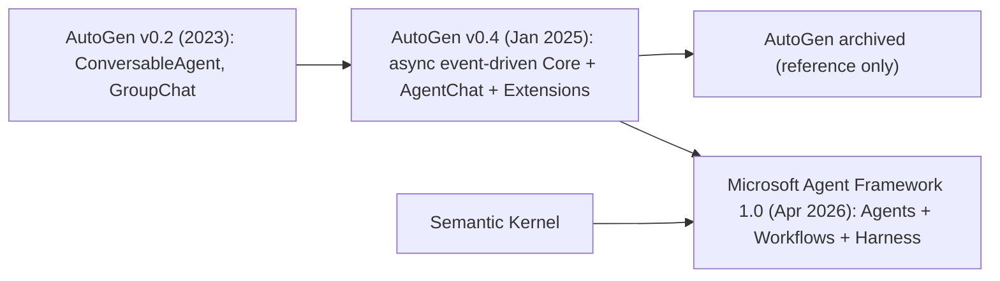

**AutoGen** is Microsoft Research's open-source framework for building LLM applications from multiple **conversable agents** that talk to each other, to humans and to [tools](tools.md) to solve a task ([Wu et al., 2023](../sources/wu-2023-autogen.md)). It popularised group-chat orchestration and code-writing/code-executing agent pairs. **As of 2026-11 AutoGen is archived**: it gets no bug fixes, security fixes or support, and Microsoft advises against production use ([README](../sources/autogen-github-readme.md)). Its successor is **[Microsoft Agent Framework (MAF)](microsoft-agent-framework.md)**, built by the AutoGen and Semantic Kernel teams. MAF combines AutoGen's simple agent abstractions with Semantic Kernel's enterprise features and adds typed graph workflows ([MAF overview](../sources/microsoft-agent-framework-overview.md)). MAF 1.0 went GA for .NET and Python on 2026-04-03 ([MAF 1.0](../sources/microsoft-agent-framework-1-0-announcement.md)). This page covers both, because you will meet AutoGen code in existing projects and should build new work on MAF.

## Lineage

## AutoGen's architecture (v0.4 line)

v0.4 was a ground-up rewrite. v0.2 users had complained about architectural limits, a messy API and weak debugging ([v0.4 blog](../sources/microsoft-autogen-v0-4-blog.md)). It has three layers:

| Layer | What it is |
|---|---|
| **Core** (`autogen-core`) | Asynchronous, event-driven message passing between agents (`RoutedAgent` + message handlers), with local and experimental distributed runtimes, Python and .NET |
| **AgentChat** (`autogen-agentchat`) | High-level API: `AssistantAgent`, `UserProxyAgent`, teams such as `RoundRobinGroupChat`, `SelectorGroupChat` (an LLM picks the next speaker), `Swarm` (handoffs), `MagenticOneGroupChat`, experimental `GraphFlow`, plus termination conditions |
| **Extensions** (`autogen-ext`) | Model clients (OpenAI, Azure, Anthropic, Ollama), [code executors](code-execution-sandboxes.md) (Docker, Azure), [MCP](model-context-protocol.md) |

Sources for the table: [README](../sources/autogen-github-readme.md), [v0.4 blog](../sources/microsoft-autogen-v0-4-blog.md), [migration guide](../sources/microsoft-agent-framework-autogen-migration-guide.md) (class names), [Notebook](../sources/notebook-autogen-crewai.md) (SelectorGroupChat).

It also ships **AutoGen Studio** (a low-code GUI, explicitly not production-ready) and **Magentic-One**, a generalist multi-agent system for web and file tasks ([README](../sources/autogen-github-readme.md), [v0.4 blog](../sources/microsoft-autogen-v0-4-blog.md)).

The coordination style is **emergent**. Agents post to a shared conversation, a selector or round-robin policy picks who speaks next, and a termination condition (such as `TextMentionTermination("TERMINATE")` or `StopAfterNMessages`) ends the run. This makes AutoGen flexible for code-heavy and novel topologies, but you must supply firm stop conditions ([Notebook](../sources/notebook-autogen-crewai.md)).

## Microsoft Agent Framework

MAF has four areas ([MAF overview](../sources/microsoft-agent-framework-overview.md)):

- **Agents.** An `Agent` wraps a chat client with instructions and tools (`@tool`, hosted tools, MCP). Unlike AutoGen's `AssistantAgent`, which is single-turn unless `max_tool_iterations` is raised, an MAF `Agent` keeps calling tools until it can answer ([migration guide](../sources/microsoft-agent-framework-autogen-migration-guide.md)). `AgentSession` holds conversation state, context providers supply [memory](agent-memory.md), and middleware intercepts agent actions.
- **Harness agent.** An opinionated long-task agent with planning and todos, [context compaction](context-engineering.md), file access and memory, and tool approval.
- **Workflows.** Explicit execution paths. **Graph** workflows (`WorkflowBuilder`) connect typed **executors** with **edges** (conditional, fan-out, fan-in), emit events, and [checkpoint](durable-agent-execution.md) at **superstep** boundaries. Python also has an experimental **functional** `@workflow` API that uses native control flow ([workflows](../sources/microsoft-agent-framework-workflows-docs.md)).
- **Integrations.** Model providers, memory stores, evaluation and UI adapters.

Built-in multi-agent **orchestrations**: sequential, concurrent, handoff, group chat and **Magentic** (a manager agent dynamically coordinates specialists). They support [human-in-the-loop](human-in-the-loop.md) through approval-required tools and request-info pauses ([workflows](../sources/microsoft-agent-framework-workflows-docs.md)).

### What changed from AutoGen

| Aspect | AutoGen | Agent Framework |
|---|---|---|
| Programming model | Dual: low-level Core *or* high-level Team | Single `Workflow` abstraction (graph or functional) |
| Graph semantics | `GraphFlow`: control flow, messages broadcast, edges are transitions | Data flow: typed messages routed on edges activate executors |
| Node types | Agents only | Agents, functions, sub-workflows |
| Human-in-the-loop | No built-in pause in Teams | Request/response pauses (`ctx.request_info`, `RequestInfoExecutor`) |
| Checkpointing | None built in | Superstep checkpoints, resume |
| Runtime | Embedded + experimental distributed | Single-process today; distributed planned |
| [Agent loop](agent-loop.md) | Single-turn by default | Multi-turn tool loop by default |

Source: [migration guide](../sources/microsoft-agent-framework-autogen-migration-guide.md). The mapping: `RoundRobinGroupChat` becomes `SequentialBuilder`, and `MagenticOneGroupChat` becomes `MagenticBuilder` (with `max_round_count` and stall limits).

> **Contradiction:** The AutoGen migration guide lists Anthropic and Ollama clients as "planned" and Swarm-style handoff and SelectorGroupChat as "future patterns" ([migration guide](../sources/microsoft-agent-framework-autogen-migration-guide.md)). The 1.0 announcement and the overview list Anthropic Claude and Ollama connectors and a handoff orchestration as available ([MAF 1.0](../sources/microsoft-agent-framework-1-0-announcement.md), [workflows](../sources/microsoft-agent-framework-workflows-docs.md)). The guide is probably stale in places, so check the current docs.

### Status at 1.0 (2026-04)

Stable: agent abstraction and connectors (Foundry, Azure OpenAI, OpenAI, Anthropic, [Bedrock](amazon-bedrock.md), [Gemini](gemini-api.md), Ollama), middleware, memory and context providers ([Mem0](mem0.md), Redis, Neo4j and more), graph workflows with checkpointing, the five orchestrations, declarative YAML agents and workflows, and MCP. [A2A](agent2agent-protocol.md) 1.0 was announced as "coming soon". Preview: DevUI, Foundry hosted agents, AG-UI, [skills](agent-skills.md), the Agent Harness, and GitHub Copilot SDK and Claude Code SDK harness connectors ([MAF 1.0](../sources/microsoft-agent-framework-1-0-announcement.md)). The Go SDK is in public preview ([MAF overview](../sources/microsoft-agent-framework-overview.md)).

## Limitations and failure modes

- **AutoGen is unmaintained.** Unpatched vulnerabilities may remain. Migrate before production ([README](../sources/autogen-github-readme.md)).
- **Conversation-driven orchestration wanders.** Group chats can loop or let agents talk past each other without strict termination, which costs tokens and latency (see [cost and latency optimization](cost-and-latency-optimization.md)) ([Notebook](../sources/notebook-autogen-crewai.md)).
- **Migration isn't mechanical.** Single-agent code ports easily. Multi-agent teams must be rethought from event-driven chat to data-flow graphs ([migration guide](../sources/microsoft-agent-framework-autogen-migration-guide.md)).
- **MAF scope.** It is single-process for now (no distributed runtime yet), many features are still preview, and it is Azure/Foundry-centric in samples and defaults ([migration guide](../sources/microsoft-agent-framework-autogen-migration-guide.md), [MAF 1.0](../sources/microsoft-agent-framework-1-0-announcement.md)).
- **Responsibility stays with you.** Microsoft states that responsible-AI mitigations and data-flow compliance with third-party systems are the builder's job ([MAF overview](../sources/microsoft-agent-framework-overview.md)).

## When to use it, and when not

- **AutoGen:** only to maintain or migrate existing systems, or to read it as a reference design for conversation-based multi-agent patterns and Magentic-One.
- **Agent Framework:** for .NET shops, Azure / [Azure AI Foundry](azure-ai-foundry.md) deployments, teams already on Semantic Kernel, or anywhere you need typed, checkpointed workflows with human-in-the-loop and a range of orchestration patterns behind one API.
- **Neither:** if a function or single call suffices. Microsoft's own rule is to write a function instead of an agent when you can ([MAF overview](../sources/microsoft-agent-framework-overview.md)). For Python-first graph control, [LangGraph](langgraph.md) and [Google ADK](google-adk.md) 2.0 are peers. For role/task crews, use [CrewAI](crewai.md). For thin agent loops, use the [OpenAI Agents SDK](openai-agents-sdk.md) or the [Claude Agent SDK](claude-agent-sdk.md).

## Sources

- [AutoGen paper (Wu et al., 2023)](../sources/wu-2023-autogen.md)
- [AutoGen v0.4 blog](../sources/microsoft-autogen-v0-4-blog.md)
- [microsoft/autogen README](../sources/autogen-github-readme.md)
- [Microsoft Agent Framework overview](../sources/microsoft-agent-framework-overview.md)
- [AutoGen to Agent Framework migration guide](../sources/microsoft-agent-framework-autogen-migration-guide.md)
- [Agent Framework workflows and orchestrations](../sources/microsoft-agent-framework-workflows-docs.md)
- [Agent Framework 1.0 announcement](../sources/microsoft-agent-framework-1-0-announcement.md)
- [AutoGen vs CrewAI (Notebook)](../sources/notebook-autogen-crewai.md)
