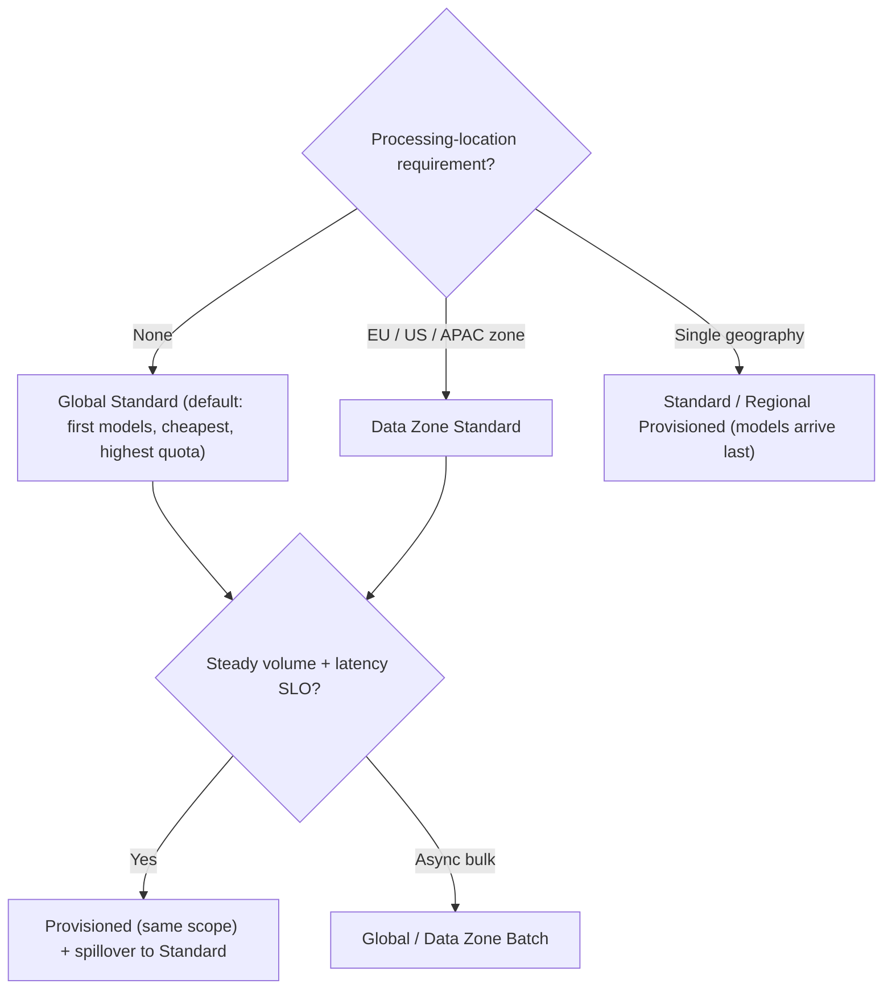

**Azure AI Foundry** is Microsoft's platform for building with models and agents on Azure. It is now branded **Microsoft Foundry**, after earlier names Azure AI Studio and Azure AI Foundry. It wraps **Azure OpenAI**, meaning OpenAI models hosted by Microsoft, together with a 10,000+ model catalogue, Foundry Agent Service, [guardrails](agent-guardrails.md), [evaluations](llm-evaluation.md) and [observability](llm-observability.md). All of it sits under one Azure resource provider with shared Entra RBAC, networking and Azure Policy ([overview](../sources/microsoft-foundry-overview.md)). Microsoft hosts the models itself. They don't call OpenAI-operated services, and prompts aren't shared with model providers or used for training ([privacy](../sources/microsoft-foundry-data-privacy.md)).

## Resource model and APIs (what changed)

| Dimension | Classic | Current Foundry |
|---|---|---|
| Resources | Hub + Azure OpenAI + AI Services | One **Foundry resource** with **projects** |
| Agent API | Assistants (threads, runs) | **Responses API** (conversations, items; "Agents v2") |
| Versioning | Monthly `api-version` | Stable `/openai/v1/` routes |
| SDK | Many packages, 5+ endpoints | `azure-ai-projects` 2.x + `OpenAI()` client on one project endpoint |

*Source: [overview](../sources/microsoft-foundry-overview.md), ms.date 2026-08-13.*

Existing Azure OpenAI resources can be upgraded in place and keep their endpoint and keys. Hub-based projects survive only in the "Foundry (classic)" portal. That still matters because **managed-compute** deployments of open models, such as [Hugging Face](hugging-face-ecosystem.md) weights on dedicated VMs, still require a hub project ([models](../sources/microsoft-foundry-models-overview.md)).

**Two catalogue categories** ([models](../sources/microsoft-foundry-models-overview.md)):

- **Models sold by Azure.** Microsoft-hosted, under Microsoft Product Terms, with Microsoft support and SLAs. Includes Azure OpenAI.
- **Partner and community models.** Anthropic Claude, Hugging Face and others, billed via Azure Marketplace under the provider's terms. For example, Claude falls under Anthropic's DPA.

Synthesis: a customer's procurement and DPA review differs between the two categories. Check which category a model falls in before promising "Azure terms".

## Deployment types and data residency

A deployment's **SKU** decides where inference runs and how it is billed. **Data at rest always stays in the resource's geography**; only *processing* location varies ([deployment types](../sources/microsoft-foundry-deployment-types.md); [privacy](../sources/microsoft-foundry-data-privacy.md)).

| Processing scope | Pay-per-token | Reserved | Batch (−50%, 24 h target) |
|---|---|---|---|
| Global: any Azure region | `GlobalStandard` | `GlobalProvisionedManaged` | `GlobalBatch` |
| Data zone: US, EU (EU Data Boundary) or APAC | `DataZoneStandard` | `DataZoneProvisionedManaged` | `DataZoneBatch` |
| Azure geography | `Standard` | `ProvisionedManaged` | — |

There is also `DeveloperTier`, for [fine-tuned](fine-tuning.md) model evaluation only. Deployments last 24 h and carry no SLA or residency guarantee.

*Synthesis diagram built from the [deployment types](../sources/microsoft-foundry-deployment-types.md) guidance.*

Key facts ([deployment types](../sources/microsoft-foundry-deployment-types.md)):

- **Launch order.** New models appear first in Global, then Data Zone, then per-geography, with *no guaranteed date* for the last step. Strict-residency customers therefore lag on model access.
- **Zones can grow.** Microsoft can add regions to a data zone without notice.
- **Enforcement.** Azure Policy can deny specific SKUs, for example blocking `GlobalStandard` across a subscription.
- **Per-request tiers.** Global Standard supports **Flex** and **Priority** processing. Data Zone Standard supports Priority only.

## Quotas

Quotas ([rate limits](rate-limits-and-retries.md)) are enforced no higher than the **subscription** ([quotas](../sources/microsoft-foundry-quotas-limits.md)).

- **Quota pools (after May 7, 2026).** Quota is migrating to subscription-level pools, starting with Realtime Translate and Realtime Whisper; other models follow. Global Standard shares one pool per model version across all regions; Data Zone shares one per zone.
- **Quota tiers.** Free (Tier 0), then Tiers 1–6, assigned from usage, Enterprise Agreement (EA/MCA-E) status and payment history. Upgrades are automatic unless you set `NoAutoUpgrade`. Free-tier subscriptions can't request quota increases.
- **Per-model limits.** Each model version has a TPM limit and an RPM tied to it, for example 1 or 10 RPM per 1,000 TPM. Example Tier 1 figures:
  - gpt-4.1 Global Standard: 1M TPM.
  - gpt-5 Global Standard: 250K TPM.
- **Hard limits:**
  - 30 Azure OpenAI resources per region per subscription.
  - 32 standard deployments per resource.
  - 128 tools per chat request.
  - 100,000 PTUs per deployment.

## Provisioned throughput (PTU)

A PTU ([provisioned throughput](provisioned-throughput.md)) is capacity held for your deployment whether or not you use it ([PTU](../sources/microsoft-foundry-provisioned-throughput.md)). Key mechanics:

- **Quota vs capacity.** PTU *quota* is model-independent but scoped per subscription × region × deployment type. *Capacity* is the physical supply in a region. Quota does not guarantee capacity, and scaling down releases capacity you may not get back.
- **Sizing.** Inputs are RPM, prompt and completion sizes, a per-model output-to-input weight, and the cache-hit rate.
  - Before GPT-6 Astra, cached tokens consume no PTU.
  - From GPT-6 Astra on, cache reads and writes count.
- **Spillover.** Overflow 429s can route to a Standard deployment in the same resource, for all requests or per request via the `x-ms-spillover-deployment` header. This works for Azure OpenAI models only.
- **Billing.** Hourly $/PTU/hr from creation to deletion, or discounted through **1-month or 1-year Azure Reservations**. Reservations are a billing discount, not a capacity hold. The safe sequence is: deploy, confirm capacity, then buy the reservation.
- **Priority processing** is the no-commitment alternative, pay-per-token with a per-model latency target.

Failure mode: teams that scale PTUs down at night to save money can't get capacity back in the morning ([PTU](../sources/microsoft-foundry-provisioned-throughput.md)).

## Guardrails (formerly content filters)

A guardrail is a named set of **controls**. Each control pairs a risk, an intervention point and an action ([guardrails](../sources/microsoft-foundry-guardrails.md)).

- **Risks:**
  - hate, sexual, self-harm and violence, each with severity-based blocking levels (Off / Low / Medium / High);
  - user prompt attacks and indirect attacks ([prompt injection](prompt-injection.md));
  - protected material (text and code);
  - [PII](pii-and-data-privacy.md), groundedness and task adherence (preview).
- **Intervention points:** user input and output for models. Agents (preview) add **tool call** and **tool response**.
- **Scope:** guardrails cover only agents built in Foundry Agent Service, not other agents registered in the control plane. Spotlighting and groundedness don't yet apply to agents.
- **Defaults:** models get `Microsoft.DefaultV2`.
- **Override rule:** an agent's guardrail *fully replaces* its model's. If the agent's guardrail lacks tool-call controls, tool traffic goes unscanned.
- **Approvals:** turning off output filtering requires an approved "modified guardrails" application.
- **Retirement:** groundedness detection in Azure OpenAI retires April 30, 2027.

**Abuse monitoring** is a separate system ([privacy](../sources/microsoft-foundry-data-privacy.md)):

- It samples flagged traffic for review: by LLM first, then by humans under just-in-time access, with EEA reviewers for EEA deployments.
- Approved customers can get *modified* abuse monitoring, which means no storage and no human review. Verify it via the resource capability `ContentLogging=false`.

## Foundry Agent Service

Agent Service builds on the [Responses API](openai-responses-api.md) and offers four ways to run an agent ([Agent Service](../sources/microsoft-foundry-agent-service.md)):

- **Prompt agents.** Declarative instructions, model and [tools](tools.md), fully hosted and versioned.
- **Voice-based prompt agents.** Run over Voice Live, either speech-to-speech or a cascaded STT → LLM → TTS pipeline ([voice agents](voice-agents.md)).
- **Hosted agents.** Your container or .zip, built with [Agent Framework](microsoft-agent-framework.md), [LangGraph](langgraph.md), the [OpenAI Agents SDK](openai-agents-sdk.md), the Anthropic Agent SDK ([Claude Agent SDK](claude-agent-sdk.md)) or custom code. Each gets a managed endpoint, autoscaling and a dedicated **Entra agent identity**.
- **Ephemeral agents.** Call the Responses API directly, with the definition kept in your code.

Platform features:

- **Toolboxes** expose curated tools behind one managed [MCP](model-context-protocol.md) endpoint with central auth and versioning. Tools include [web search](web-search-apis.md), file search, [code interpreter](code-execution-sandboxes.md), MCP servers, OpenAPI and functions.
- **MCP authentication** options are key, managed identity, or OAuth on-behalf-of.
- **Publishing** targets Teams, Microsoft 365 Copilot and the Entra Agent Registry. [A2A](agent2agent-protocol.md) v1.0 is GA.

## Network isolation

([network isolation](../sources/microsoft-foundry-network-isolation.md))

- **Inbound.** Set public network access to Disabled and add a private endpoint. DNS resolves the same hostname through a `privatelink` zone inside the VNet. Custom DNS must forward to 168.63.129.16.
- **Outbound for agents.** Use VNet injection into a subnet delegated to `Microsoft.App/environments` (/27 or larger). The **Standard setup** uses your own Storage, AI Search and Cosmos DB so agent state stays in your tenant. Their private endpoints are *not* auto-created.
- **Tool support when isolated:**

  | Path | Tools |
  |---|---|
  | Your subnet | MCP, OpenAPI, Functions, A2A |
  | Private endpoint | AI Search, File Search |
  | Microsoft backbone | Code Interpreter |
  | **Public internet** | Bing, Web Search, SharePoint grounding |
  | Not supported | Browser automation, [computer use](computer-use-agents.md), Logic Apps, image generation |

- **Gotchas:**
  - Outbound networking can't be changed after creation, so adding it later means redeploying.
  - AI Search indexers left on multitenant execution silently produce empty indexes behind private endpoints.
  - Avoid 172.17.0.0/16.
  - Tool calls need a **project-level** capability host.

## When to use / when not

Synthesis, drawn from the sources above:

- **Use Foundry** when the customer is a Microsoft shop: Entra ID, M365/Teams distribution, Azure Policy, EA commitments. Also use it when they want OpenAI models under Microsoft's DPA and EU Data Boundary, or when agents must be published into Teams or Copilot.
- **Default to Global Standard.** Move to Data Zone for EU/US residency, and accept the later model availability. Use Regional only when a single geography is mandated.
- **Provisioned** fits measured, steady, latency-sensitive load. Pair it with spillover, and buy reservations only after the deployment exists.
- **Watch for:**
  - partner models (e.g. Claude) carrying different terms and support from models sold by Azure;
  - public-internet tools in "isolated" agents;
  - agent guardrails silently dropping model-level protections.
- Compare [Amazon Bedrock](amazon-bedrock.md) and [Google Vertex AI](google-vertex-ai.md); see also [enterprise LLM deployment](enterprise-llm-deployment.md) and [cost and latency optimization](cost-and-latency-optimization.md).

## Sources

- [What is Microsoft Foundry?](../sources/microsoft-foundry-overview.md)
- [Foundry Models overview](../sources/microsoft-foundry-models-overview.md)
- [Deployment types](../sources/microsoft-foundry-deployment-types.md)
- [Provisioned throughput (PTU)](../sources/microsoft-foundry-provisioned-throughput.md)
- [Quotas and limits](../sources/microsoft-foundry-quotas-limits.md)
- [Data, privacy and security](../sources/microsoft-foundry-data-privacy.md)
- [Guardrails and controls](../sources/microsoft-foundry-guardrails.md)
- [Agent Service overview](../sources/microsoft-foundry-agent-service.md)
- [Network isolation](../sources/microsoft-foundry-network-isolation.md)
