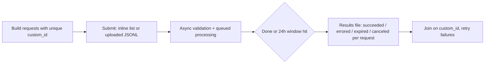

**Batch processing** means submitting many independent model requests as one asynchronous job and collecting the results later, in exchange for a large discount and separate capacity. Anthropic's Message Batches API, OpenAI's Batch API and Gemini's Batch API all charge **50% of standard price** and promise completion within **24 hours**, usually much sooner. Each request carries a client-chosen id because results come back unordered ([Anthropic](../sources/anthropic-message-batches-docs.md), [OpenAI](../sources/openai-batch-api-guide.md), [Gemini](../sources/gemini-batch-api-docs.md)). Synthesis: providers can fill idle GPU capacity with work that has no latency SLO, and the discount is the price of giving up immediacy.

## Lifecycle

## Vendor comparison (as of 2026-11)

| | Anthropic Message Batches | OpenAI Batch API | Gemini Batch API |
|---|---|---|---|
| Discount | 50% | 50% | 50% |
| Window | Most finish < 1 h; expire at 24 h | 24 h completion window (only value) | 24 h target; job expires after 48 h pending/running |
| Input | JSON list of `{custom_id, params}` in the create call | Uploaded JSONL: `custom_id`, `method`, `url`, `body`; one model per file | Inline list (< 20 MB) or JSONL file of `GenerateContentRequest` |
| Size limits | 100,000 requests or 256 MB | 50,000 requests, 200 MB file; 2,000 batches/hour | < 20 MB inline; input file up to 2 GB |
| Endpoints | Messages | Responses, Chat Completions, Embeddings, Completions, Moderations, image generations and edits | generateContent (plus embeddings) |
| Statuses | `in_progress` (→ `canceling`) → `ended` | `validating`, `in_progress`, `finalizing`, `completed`, `failed`, `expired`, `cancelling`, `cancelled` | `JOB_STATE_PENDING` … `SUCCEEDED`, `FAILED`, `CANCELLED`, `EXPIRED` |
| Per-request outcome | `succeeded`, `errored`, `canceled`, `expired` (only succeeded billed) | Output file + separate error file; expired requests get `batch_expired` | JSONL of responses or status objects |
| Result retention | 29 days | Files expire after 30 days by default (1 h–30 d configurable) | not specified in the docs read |
| Rate limits | Separate batch limits (HTTP + queued requests) | Separate pool; per-model queued-token limits | Higher rate limits in exchange for slower turnaround |

Sources: [Anthropic](../sources/anthropic-message-batches-docs.md), [OpenAI](../sources/openai-batch-api-guide.md), [Gemini](../sources/gemini-batch-api-docs.md).

## Behaviour to design around

- **Unordered results.** All three return results in arbitrary order, so always join on `custom_id`. Anthropic restricts it to `^[a-zA-Z0-9_-]{1,64}$` ([Anthropic](../sources/anthropic-message-batches-docs.md), [OpenAI](../sources/openai-batch-api-guide.md)).
- **Late validation.** Anthropic validates each request's params asynchronously, so a malformed request surfaces only when the whole batch ends. Dry-run one request on the synchronous API first ([Anthropic](../sources/anthropic-message-batches-docs.md)).
- **Partial completion.** At expiry, unfinished requests fail (`expired` / `batch_expired`). Completed results stay available and are billed ([OpenAI](../sources/openai-batch-api-guide.md), [Anthropic](../sources/anthropic-message-batches-docs.md)). Gemini differs: a job pending or running for more than 48 hours moves to `JOB_STATE_EXPIRED` and produces no results ([Gemini](../sources/gemini-batch-api-docs.md)). Under heavy demand, more requests can expire ([Anthropic](../sources/anthropic-message-batches-docs.md)).
- **Unsupported in batch (Claude).** `stream: true`, fast-mode `speed`, server-side `fallbacks`, and `max_tokens: 0` cache pre-warming ([Anthropic](../sources/anthropic-message-batches-docs.md)).
- **Spend control.** Anthropic batches can slightly exceed a workspace spend limit because of concurrent processing ([Anthropic](../sources/anthropic-message-batches-docs.md)).
- **[Data retention](data-retention-and-residency.md).** Anthropic batches are not Zero-Data-Retention eligible (29-day storage) ([Anthropic](../sources/anthropic-message-batches-docs.md)). Check this for regulated customers. See [AI governance and compliance](ai-governance-and-compliance.md).

## Stacking discounts with caching

Batch and [cache](prompt-caching.md) discounts multiply. Anthropic's cache multipliers stack with the batch discount ([Anthropic caching](../sources/anthropic-prompt-caching-docs.md)), and Gemini lists separate batch-tier cached-token rates (e.g. Gemini 3.8 Flash cached input $0.0375/MTok in batch vs $0.075 standard, through 2026; both double on 1 Jan 2027) ([Gemini pricing](../sources/gemini-context-caching-docs.md)). Gemini batch requests use explicit caches by setting `cached_content` per request, though the batch guide describes hits as billed "at standard context caching rates", so confirm which rate applies on your invoice ([Gemini batch](../sources/gemini-batch-api-docs.md)). The catch: requests run concurrently and in any order, so hits are best-effort. Anthropic reports 30–98% hit rates and suggests the 1-hour TTL for shared context ([Anthropic](../sources/anthropic-message-batches-docs.md)). Synthesis: to raise the hit rate, put the shared prefix in a single cache breakpoint, use the long TTL, and consider warming the cache with one synchronous request before submitting the batch.

[Structured outputs](structured-outputs.md) work inside batches, which is the common pattern for bulk extraction ([Anthropic structured outputs](../sources/anthropic-structured-outputs-docs.md)).

## When to use / when not

- **Use** for offline [evals](llm-evaluation.md) and [LLM-as-judge](llm-as-judge.md) runs, dataset labelling, [synthetic data](synthetic-data-generation.md) for [fine-tuning](fine-tuning.md) or [distillation](knowledge-distillation.md), bulk [document processing](document-processing.md), backfills, [embedding](embeddings.md) a corpus, and nightly summarisation ([Gemini](../sources/gemini-batch-api-docs.md), [Anthropic](../sources/anthropic-message-batches-docs.md)).
- **Don't use** for anything user-facing, for multi-turn [agent loops](agent-loop.md) where each step depends on the last (each step would be a separate batch round-trip), or when you need [streaming](streaming.md).
- **Alternatives.** Synthesis: for "cheap but within minutes" work, a [rate-limited](rate-limits-and-retries.md) worker pool on the synchronous API with prompt caching may beat batch on latency. Some vendors also sell intermediate tiers, such as Gemini's Flex inference ([Gemini pricing](../sources/gemini-context-caching-docs.md)). See [cost and latency optimization](cost-and-latency-optimization.md).

## Sources

- [Anthropic Message Batches Docs](../sources/anthropic-message-batches-docs.md)
- [OpenAI Batch API Guide](../sources/openai-batch-api-guide.md)
- [Gemini Batch API Docs](../sources/gemini-batch-api-docs.md)
- [Gemini API Context Caching and Pricing Docs](../sources/gemini-context-caching-docs.md)
- [Anthropic Prompt Caching Docs](../sources/anthropic-prompt-caching-docs.md)
- [Anthropic Structured Outputs Docs](../sources/anthropic-structured-outputs-docs.md)
