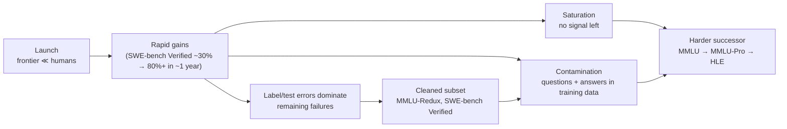

A **benchmark** is a fixed, public dataset plus a scoring procedure used to compare models on a capability, such as knowledge recall (MMLU), expert reasoning (GPQA), software engineering (SWE-bench) or tool-using dialogue (τ-bench). Benchmarks compare models in isolation; they do not tell you how a model performs in your application, which needs custom [evals](llm-evaluation.md) ([OpenAI](../sources/openai-evaluation-best-practices.md)). Their useful life is short: they saturate as models improve and lose validity as questions leak into training data ([Anthropic](../sources/anthropic-demystifying-evals-for-ai-agents.md), [GSM1k](../sources/zhang-2024-gsm1k.md)).

## The major benchmarks

| Benchmark | Measures | Format / size | Grading | Status (as of 2026-11) |
|---|---|---|---|---|
| [MMLU](../sources/hendrycks-2020-mmlu.md) (2020) | broad knowledge, 57 subjects | 4-option multiple choice | exact choice | saturated; ~6.5% of questions erroneous ([Gema](../sources/gema-2024-are-we-done-with-mmlu.md)) |
| [MMLU-Pro](../sources/wang-2024-mmlu-pro.md) (2024) | knowledge + reasoning | 10-option MC | exact choice | 16-33 pts harder than MMLU; less prompt-sensitive |
| [GPQA](../sources/rein-2023-gpqa.md) (2023) | PhD-level bio/phys/chem | 448 MC questions (main set); "Diamond" = 198-question high-agreement subset | exact choice | experts 65%, web-assisted non-experts 34%, GPT-4 39% at launch |
| [HLE](../sources/phan-2025-humanitys-last-exam.md) (2025) | frontier expert knowledge, 100+ subjects | 2,500 MC + short answer, multimodal | LLM-judged answer match (o3-mini); also **calibration error** | top score on the official site leaderboard 38.3% (Gemini 3 Pro), but that leaderboard has not added newer models, so treat it as a floor; private held-out set; HLE-Rolling and HLE-Diamond variants released Oct 2025 and Sep 2026 |
| [SWE-bench](../sources/jimenez-2023-swe-bench.md) (2023) | resolving real GitHub issues | 2,294 tasks, 12 Python repos | run repo tests (fail-to-pass) | Claude 2: 1.96% at launch |
| [SWE-bench Verified](../sources/openai-swe-bench-verified.md) (2024) | same, cleaned | 500 human-validated tasks | tests | OpenAI stopped reporting it Feb 2026 (flawed tasks, contamination) and recommended SWE-bench Pro; secondary reports say it withdrew that recommendation in July 2026 ([Decoder](../sources/decoder-openai-retires-swe-bench-verified.md)) |
| [τ-bench](../sources/yao-2024-tau-bench.md) / [τ²-bench](../sources/barres-2025-tau2-bench.md) | tool-using customer-service agents with policy | LLM-simulated user; retail, airline, telecom | final DB state vs goal; **pass^k** | GPT-4o <50% pass^1, <25% pass^8 (retail, 2024) |
| [ARC-AGI-2](../sources/chollet-2025-arc-agi-2.md) (2025) | fluid reasoning on novel grid puzzles | few input-output examples per task | exact grid; cost per task reported | ~3% for frontier models at launch; every task human-solved |
| [ARC-AGI-3](../sources/arc-agi-3-overview.md) | learning by exploration | interactive games, no instructions | efficiency vs humans | ARC Prize 2026 results due 4 Dec 2026 |
| [Chatbot Arena](../sources/chiang-2024-chatbot-arena.md) | human preference in open chat | anonymous pairwise battles | crowd votes → rating | gameable via private variant testing ([Singh](../sources/singh-2025-leaderboard-illusion.md)) |
| [LiveBench](../sources/white-2024-livebench.md) | math, code, reasoning, language, IF, data | monthly refreshed recent questions | objective ground truth, no judge | contamination-limited by design |

Other agent benchmarks named by Anthropic: Terminal-Bench (coding), BrowseComp (research), WebArena and OSWorld (computer use) ([Anthropic](../sources/anthropic-demystifying-evals-for-ai-agents.md)). Inspect ships 200+ benchmark implementations for running these yourself ([Inspect](../sources/inspect-ai-docs.md)).

## How each family works

- **Multiple-choice knowledge (MMLU, MMLU-Pro, GPQA).** The model picks a letter; scoring is exact. Cheap and objective, but four options reward guessing and small prompt-format changes shift scores 4-5 points on MMLU; MMLU-Pro's ten options cut sensitivity to ~2% ([MMLU-Pro](../sources/wang-2024-mmlu-pro.md)). GPQA's design target is "Google-proof": skilled non-experts with web access and 30+ minutes per question score near chance ([GPQA](../sources/rein-2023-gpqa.md)).
- **Expert closed-ended (HLE).** Built because MMLU saturated; scoring includes calibration error because models answer wrong with high confidence (e.g. GPT-5 25.3% accuracy, 50% calibration error on the site's leaderboard) ([HLE](../sources/phan-2025-humanitys-last-exam.md)).
- **Execution-graded agent tasks (SWE-bench).** The agent gets a repo snapshot and an issue and must produce a patch; the grader runs the tests from the fixing PR ([SWE-bench](../sources/jimenez-2023-swe-bench.md)). Validity depends on the tests: OpenAI found overly specific tests and underspecified issues, and had 93 developers triple-label 1,699 samples to build the 500-task Verified set ([OpenAI](../sources/openai-swe-bench-verified.md)).
- **Simulated-user agent tasks (τ-bench).** An LLM plays the customer; the grader compares the final database to a goal state, so it is deterministic even though the dialogue is not. pass^k (all k trials succeed) measures reliability ([τ-bench](../sources/yao-2024-tau-bench.md)). τ²-bench lets the user act with tools too; scores drop when agents must guide users ([τ²-bench](../sources/barres-2025-tau2-bench.md)).
- **Novelty-based reasoning (ARC-AGI).** Tasks use only basic cognitive building blocks, not cultural knowledge, and are designed to be easy for humans and hard for AI; every ARC-AGI-2 task was solved by at least two non-experts within two attempts. Cost per task is reported because brute-force compute can buy score: a preview of o3 cost an estimated $200 per ARC-AGI-1 task at low compute (76%) and $20,000 at high compute (88%) ([ARC-AGI-2](../sources/chollet-2025-arc-agi-2.md), [ARC-AGI](../sources/arc-agi-3-overview.md)).
- **Preference arenas.** Pairwise human votes on user prompts, aggregated into a rating ([Chiang](../sources/chiang-2024-chatbot-arena.md)). See [LLM-as-judge](llm-as-judge.md) for the automated equivalent.

## Saturation and the benchmark lifecycle

Synthesis, from the sources below:

Evidence: SWE-bench Verified went from about 30-40% to over 80% in roughly a year ([Anthropic](../sources/anthropic-demystifying-evals-for-ai-agents.md)); 57% of MMLU Virology questions contain errors ([Gema](../sources/gema-2024-are-we-done-with-mmlu.md)); at least 59.4% of audited hard SWE-bench Verified tasks had flawed tests or descriptions ([Decoder](../sources/decoder-openai-retires-swe-bench-verified.md)). Near the ceiling, remaining "failures" are increasingly benchmark bugs, not model limits.

## Contamination

Contamination is test data (questions, and worse, answers) appearing in pretraining or fine-tuning data, so the score measures recall instead of capability.

- **Detection by fresh replica.** GSM1k re-created GSM8k's style and difficulty from scratch; some model families dropped up to 8 points, and the gap correlated (r² = 0.36) with how likely the model was to generate GSM8k items verbatim. Many frontier models showed little overfitting ([GSM1k](../sources/zhang-2024-gsm1k.md)).
- **Memorised solutions.** Frontier models in 2026 could reproduce some SWE-bench Verified gold patches from memory, one reason OpenAI stopped reporting the benchmark and moved to non-public tests ([Decoder](../sources/decoder-openai-retires-swe-bench-verified.md)). Its suggested successor, SWE-bench Pro, has since drawn similar audits of flawed tasks; OpenAI reportedly dropped it in July 2026 (secondary sources only) ([Decoder](../sources/decoder-openai-retires-swe-bench-verified.md)).
- **Mitigations:** private held-out sets (HLE; ARC's semi-private and private splits) ([HLE](../sources/phan-2025-humanitys-last-exam.md), [ARC-AGI-2](../sources/chollet-2025-arc-agi-2.md)); time-based refresh from post-cutoff sources (LiveBench) ([LiveBench](../sources/white-2024-livebench.md)); and your own private evals.

## Reading a leaderboard critically

- **Error bars.** A difference smaller than about two paired standard errors is noise. GPQA's few hundred questions give wide intervals; Miller's example needed ~1,000 questions to detect a 3-point gap ([Miller](../sources/miller-2024-adding-error-bars-to-evals.md)).
- **Harness matters.** Agent scores test model plus scaffold together; a better scaffold or fixed grader can move a score dramatically (CORE-Bench 42% → 95%) ([Anthropic](../sources/anthropic-demystifying-evals-for-ai-agents.md)).
- **Selective reporting.** Arena providers tested many private variants and published the best (27 for Llama 4); access to Arena data was unequal and extra Arena data gave up to 112% relative gains on that distribution ([Singh](../sources/singh-2025-leaderboard-illusion.md)).
- **Judge-graded benchmarks** inherit [judge biases](llm-as-judge.md); objectively scored ones avoid them ([LiveBench](../sources/white-2024-livebench.md)).
- **Compute and cost.** Reasoning-model scores depend on test-time compute; compare at equal budget where possible ([ARC-AGI-2](../sources/chollet-2025-arc-agi-2.md)). See [test-time compute](test-time-compute.md).
- **pass@1 vs pass^k.** A model with good average accuracy can still be unreliable across repeated trials ([τ-bench](../sources/yao-2024-tau-bench.md)).

## When to use benchmarks

Synthesis:

- **Use** them to shortlist models for a capability class (coding, agentic tool use, expert QA), to track the [frontier](frontier-model-landscape.md), and as a sanity check after [fine-tuning](fine-tuning.md) or [quantization](quantization.md) (no collapse on general ability).
- **Do not use** them as the deciding evidence for a customer deployment. Pick the benchmark closest to the workload (τ-bench for support agents, SWE-bench-style for coding), then decide with a private eval on the customer's own data; see [model selection](model-selection.md).
- Prefer recent, contamination-resistant, objectively graded benchmarks, and check whether the reported number is self-reported by the vendor or independently run.

## Sources

- [MMLU (Hendrycks et al.)](../sources/hendrycks-2020-mmlu.md)
- [Are We Done with MMLU? (Gema et al.)](../sources/gema-2024-are-we-done-with-mmlu.md)
- [MMLU-Pro (Wang et al.)](../sources/wang-2024-mmlu-pro.md)
- [GPQA (Rein et al.)](../sources/rein-2023-gpqa.md)
- [Humanity's Last Exam (Phan et al.)](../sources/phan-2025-humanitys-last-exam.md)
- [SWE-bench (Jimenez et al.)](../sources/jimenez-2023-swe-bench.md)
- [Introducing SWE-bench Verified (OpenAI)](../sources/openai-swe-bench-verified.md)
- [OpenAI retires SWE-bench Verified (The Decoder)](../sources/decoder-openai-retires-swe-bench-verified.md)
- [τ-bench (Yao et al.)](../sources/yao-2024-tau-bench.md)
- [τ²-bench (Barres et al.)](../sources/barres-2025-tau2-bench.md)
- [ARC-AGI-2 (Chollet et al.)](../sources/chollet-2025-arc-agi-2.md)
- [ARC-AGI series and ARC-AGI-3](../sources/arc-agi-3-overview.md)
- [Chatbot Arena (Chiang et al.)](../sources/chiang-2024-chatbot-arena.md)
- [The Leaderboard Illusion (Singh et al.)](../sources/singh-2025-leaderboard-illusion.md)
- [GSM1k (Zhang et al.)](../sources/zhang-2024-gsm1k.md)
- [LiveBench (White et al.)](../sources/white-2024-livebench.md)
- [Adding Error Bars to Evals (Miller)](../sources/miller-2024-adding-error-bars-to-evals.md)
- [Demystifying evals for AI agents (Anthropic)](../sources/anthropic-demystifying-evals-for-ai-agents.md)
- [Evaluation best practices (OpenAI)](../sources/openai-evaluation-best-practices.md)
- [Inspect docs](../sources/inspect-ai-docs.md)
