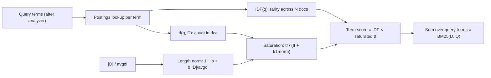

**BM25** (from the Okapi system; Lucene cites Robertson et al., "Okapi at TREC-3", 1994) is a bag-of-words ranking function: for each query term that appears in a document it multiplies an inverse-document-frequency weight by a term-frequency score that **saturates** with repetition and is **normalized by document length**, then sums over query terms. It has two free parameters, `k1` (saturation) and `b` (length normalization). It is the default scorer in Lucene, and so in Elasticsearch, OpenSearch and Solr, and it is the lexical half of nearly every [hybrid search](hybrid-search.md) stack. It needs no training, works on any language your tokenizer handles, and is still a hard zero-shot baseline for neural retrievers ([Robertson & Zaragoza](../sources/robertson-zaragoza-2009-probabilistic-relevance-framework.md), [Lucene](../sources/lucene-bm25similarity.md), [BEIR](../sources/thakur-2021-beir.md)).

## The formula

For query Q with terms q₁…qₙ and document D:

```
score(D, Q) = Σᵢ IDF(qᵢ) · tf(qᵢ, D) · (k1 + 1)
                          ─────────────────────────────────────────
                          tf(qᵢ, D) + k1 · (1 − b + b · |D| / avgdl)
```

- `tf(q, D)`: occurrences of q in D (after tokenization, stemming, stopwords).
- `|D|`: document (field) length in tokens; `avgdl`: average length across the collection.
- `IDF(q)`: in the original Robertson/Spärck Jones form, `log((N − n + 0.5) / (n + 0.5))`, with N documents in the collection and n containing q. Without relevance judgments the RSJ weight reduces to this IDF-like quantity.
- Query-term frequency is effectively linear: a term repeated in the query just counts again. The original Okapi formula had a separate `k3` saturation for query terms and an extra length correction; both were found unimportant and are usually dropped ([Robertson & Zaragoza](../sources/robertson-zaragoza-2009-probabilistic-relevance-framework.md)).
- The `(k1 + 1)` numerator factor is optional: it scales every term equally, so rankings do not change. It only makes a single occurrence score the same as the plain RSJ weight ([Robertson & Zaragoza](../sources/robertson-zaragoza-2009-probabilistic-relevance-framework.md)). Lucene leaves it out; Tantivy keeps it ([Lucene](../sources/lucene-bm25similarity.md), [Tantivy](../sources/tantivy-bm25-source.md)).



### Why each piece exists

- **IDF.** Rare terms carry more evidence, so they dominate the score; a term in nearly every document contributes almost nothing ([Elastic](../sources/elastic-practical-bm25.md)).
- **Saturation (k1).** Robertson's "eliteness" model treats a term as being "about" a document or not. Once a document is clearly about the term, more occurrences add little. The tf component therefore has an asymptote: `k1 + 1` with the factor, `1` in Lucene's form. Unlike `tf` or `1 + log tf`, it never grows without bound ([Robertson & Zaragoza](../sources/robertson-zaragoza-2009-probabilistic-relevance-framework.md)).
- **Length normalization (b).** Long documents contain more term occurrences simply because they are long. `B = (1 − b) + b · |D|/avgdl` rescales tf before saturation: `b = 1` normalizes fully, `b = 0` turns it off ([Robertson & Zaragoza](../sources/robertson-zaragoza-2009-probabilistic-relevance-framework.md)).

### Worked numbers

Synthesis (arithmetic on the formulas above): Lucene form, k1 = 1.2, b = 0.75, a document of average length.

| tf | Lucene `tf/(tf+K)` | with `(k1+1)` |
|---|---|---|
| 1 | 0.455 | 1.00 |
| 2 | 0.625 | 1.375 |
| 3 | 0.714 | 1.57 |
| 10 | 0.893 | 1.96 |
| ∞ | 1.0 | 2.2 |

The same tf = 1 in a document **twice** the average length scores 0.323 instead of 0.455. On the IDF side, with N = 1,000,000, Lucene's IDF is about 11.5 for a term in 10 documents and ln 2 ≈ 0.69 for a term in half of them. A single match on a rare term therefore outweighs ten matches on a common one.

## Parameters k1 and b

| | Effect | Lucene / Elasticsearch / OpenSearch / Tantivy default | Literature guidance |
|---|---|---|---|
| `k1` | Higher means slower saturation, so repeated terms keep adding score. `k1 = 0` scores presence only. | 1.2 | 1.2 < k1 < 2 |
| `b` | Higher means stronger penalty for long documents. `b = 0` disables length normalization. | 0.75 | 0.5 < b < 0.8 |

Sources: [Lucene](../sources/lucene-bm25similarity.md), [Elasticsearch](../sources/elasticsearch-similarity-docs.md), [Tantivy](../sources/tantivy-bm25-source.md), [Elastic](../sources/elastic-practical-bm25.md), [Robertson & Zaragoza](../sources/robertson-zaragoza-2009-probabilistic-relevance-framework.md).

- The model gives no theoretical values; optima depend on document and query types ([Robertson & Zaragoza](../sources/robertson-zaragoza-2009-probabilistic-relevance-framework.md)).
- Research toolkits differ: Anserini defaults to **k1 = 0.9, b = 0.4**, which BEIR used for its baseline ([Kamphuis et al.](../sources/kamphuis-2020-which-bm25.md), [BEIR](../sources/thakur-2021-beir.md)). Check which defaults a paper used before you compare its "BM25" number with yours.
- Synthesis: for short, uniform chunks (typical RAG [chunking](chunking.md)), `b` matters less because `|D|/avgdl` stays near 1. For corpora that mix tweets with manuals, `b` matters a lot. Tune `k1` and `b` on a small labelled query set with [retrieval metrics](retrieval-metrics.md) (nDCG@10, recall@k) before tuning anything fancier.

## Variants and implementation details

"BM25" names a family of functions. [Kamphuis et al. (ECIR 2020)](../sources/kamphuis-2020-which-bm25.md) compared eight of them on Robust04, Core17 and Core18 and found **no statistically significant differences**. Choices like the stopword list often moved results more than the BM25 variant did. The differences still matter for reproducibility and edge cases:

- **Negative IDF.** The RSJ IDF goes negative when a term appears in more than half the documents, so a match *lowers* the score. Lucene and Tantivy use `log(1 + (N − n + 0.5)/(n + 0.5))`, which is always positive. ATIRE uses `log(N/n)` ([Kamphuis et al.](../sources/kamphuis-2020-which-bm25.md), [Lucene](../sources/lucene-bm25similarity.md)).
- **Lossy document length.** Lucene and Tantivy encode length in one byte (256 values) and precompute the length-normalization term per value. Kamphuis et al. found the effectiveness cost negligible, and the speed gain negligible too ([Kamphuis et al.](../sources/kamphuis-2020-which-bm25.md), [Tantivy](../sources/tantivy-bm25-source.md)).
- **Long-document fixes.** BM25L and BM25+ add a constant δ to tf to counter over-penalizing long documents. BM25-adpt learns a k1 per term ([Kamphuis et al.](../sources/kamphuis-2020-which-bm25.md)).
- **BM25F.** For multi-field documents, BM25F sums weighted tf across fields first and saturates once per term. Scoring each field separately and adding the results lets one term saturate twice ([Robertson & Zaragoza](../sources/robertson-zaragoza-2009-probabilistic-relevance-framework.md)).
- **Collection statistics.** IDF and avgdl come from whatever statistics the engine sees. Tantivy sums them over a searcher's segments and lets you supply your own provider ([Tantivy](../sources/tantivy-bm25-source.md)). Synthesis: in sharded or frequently updated indexes, the same document can score differently over time or across shards. Don't treat raw BM25 scores as stable or as comparable across queries.

## Implementations

| Engine / library | Notes |
|---|---|
| **Apache Lucene** (`BM25Similarity`) | Defaults k1 1.2, b 0.75, `discountOverlaps` true (synonym/overlap tokens are not counted in length). Scores `IDF·boost · tf/(tf + K)` with no `(k1+1)`, so a term's contribution is capped at IDF·boost. Code is written to keep scores monotonic under float rounding ([Lucene](../sources/lucene-bm25similarity.md)). |
| **Elasticsearch** | BM25 is the default `similarity`, set per field in the mapping. Alternatives: DFR, DFI, IB, LM Dirichlet, LM Jelinek-Mercer, scripted. Changing the index-wide default needs close/update/reopen. Scripted scores must stay positive, non-decreasing in tf and non-increasing in length ([Elasticsearch](../sources/elasticsearch-similarity-docs.md)). |
| **OpenSearch** | Lucene-based like Elasticsearch. Adds a `hybrid` query whose normalization processor (since 2.10) rescales BM25 and vector sub-scores, plus "neural sparse" learned-sparse search on the same inverted index ([normalization](../sources/opensearch-normalization-processor-docs.md), [neural sparse](../sources/opensearch-neural-sparse-search-blog.md)). |
| **Tantivy** (Rust) | k1 = 1.2 and b = 0.75 are compile-time constants, not configurable through the public API. Lucene-style IDF, keeps `(k1+1)`, one-byte fieldnorms with a 256-entry cache ([Tantivy](../sources/tantivy-bm25-source.md)). |
| **bm25s** (Python) | "Eager" scoring: precomputes every (term, doc) score into a SciPy sparse matrix at index time, so a query is a sparse row sum. Supports Robertson, ATIRE, BM25L, BM25+, Lucene (default). Claims up to 500x over the most popular Python BM25 library. README QPS on SciFact: 952.92 vs 20.81 (Elasticsearch) vs 47.6 (rank-bm25), but only 12.2 vs 11.88 vs Elasticsearch on MS MARCO. `mmap` cuts RAM on NQ from 4.36 GB to 0.49 GB ([bm25s](../sources/lu-2024-bm25s.md)). |

Synthesis: use bm25s for in-process prototypes, evals and small-to-medium corpora where you want no server. Use a Lucene-family engine or Tantivy when you need incremental updates, filtering, sharding, highlighting and phrase queries. Eager scoring must rebuild the matrix when IDF or avgdl change.

## Why it remains a strong baseline

- **Zero-shot robustness.** On BEIR's 18 datasets, BM25 trails neural models by 7 to 18 points in domain (MS MARCO) but beats many of them out of domain. Average nDCG@10 relative to BM25: DPR −47.7%, ANCE −7.4%, TAS-B −2.8%, docT5query +1.6%, ColBERT +2.5%. BM25 followed by a cross-encoder [reranker](reranking.md) did best at +11% and beat BM25 on 16 of 18 datasets ([BEIR](../sources/thakur-2021-beir.md)).
- **Exact-match signals embeddings blur.** IDs, error codes, SKUs, names and rare jargon are high-IDF tokens that BM25 rewards directly. Synthesis: this is why [contextual retrieval](contextual-retrieval.md) adds BM25 alongside [embeddings](embeddings.md). Anthropic reports that adding contextual BM25 to contextual embeddings cut the top-20 retrieval failure rate from 3.7% to 2.9%, and reranking cut it to 1.9% ([Anthropic](../sources/anthropic-contextual-retrieval.md)).
- **No representational ceiling of single vectors.** Single-vector embeddings can realize only a bounded set of top-k result sets for a given dimension ([Weller et al.](../sources/limits-of-embedding-retrieval.md)). Synthesis: sparse lexical scoring lives in a vocabulary-sized space and is not subject to that particular bound, which is one argument for keeping a lexical leg.
- **Cost.** BEIR's estimate for 1M DBPedia documents: BM25 index about 0.4 GB vs about 3 GB for 768-d dense. For BioASQ (~15M docs): 18 GB vs about 900 GB for ColBERT ([BEIR](../sources/thakur-2021-beir.md)). OpenSearch measured BM25 P50 latency of 8 ms vs 56.6 ms for dense on a 1M-passage subset ([OpenSearch](../sources/opensearch-neural-sparse-search-blog.md)).
- **Caveat on the evidence.** Several BEIR datasets were annotated from lexical-system candidates, so relevant documents without term overlap may be unjudged. That biases the benchmark toward BM25 ([BEIR](../sources/thakur-2021-beir.md)).

## BM25 in hybrid search

BM25 is normally the lexical retriever in [hybrid search](hybrid-search.md), run in parallel with a dense [ANN index](ann-indexes.md) and fused:

- **Reciprocal rank fusion (RRF)** uses ranks, not scores: `Σ 1/(k + rank)` with k = 60. That sidesteps the fact that BM25 scores are unbounded and query-dependent while cosine similarities are bounded ([Cormack et al.](../sources/cormack-2009-reciprocal-rank-fusion.md), [Elasticsearch RRF](../sources/elasticsearch-rrf-retriever-docs.md)).
- **Score blending** normalizes then combines. A tuned convex combination beat RRF in-domain and out-of-domain, and RRF proved more parameter-sensitive than assumed ([Bruch et al.](../sources/bruch-2022-fusion-functions-hybrid-retrieval.md)). OpenSearch defaults to `min_max` normalization with optional per-clause weights ([OpenSearch](../sources/opensearch-normalization-processor-docs.md)). Weaviate's `alpha` runs from 0 (pure BM25) to 1 (pure vector), with relative-score fusion as its default since v1.24 ([Weaviate](../sources/weaviate-hybrid-search-docs.md)).
- **Measured gain.** On BEIR plus Amazon ESCI, OpenSearch reports average nDCG@10 of 0.419 for BM25, 0.410 for dense TAS-B and 0.450 for the hybrid ([OpenSearch](../sources/opensearch-neural-sparse-search-blog.md)).

Synthesis: BM25 also works as the cheap first stage in front of a cross-encoder or LLM [reranker](reranking.md), and as a fast tool for [agentic RAG](agentic-rag.md), where an agent can issue exact keyword queries and reformulate them ([query transformation](query-transformation.md)).

## BM25 vs SPLADE (learned sparse retrieval)

SPLADE keeps BM25's data structure (an inverted index of term → weight) but **learns** the weights. A BERT masked-language-model head scores every vocabulary term. Weights go through `log(1 + ReLU(·))` saturation, then are pooled over input tokens: sum in v1, max in v2. A FLOPS regularizer keeps the vectors sparse, with separate pressure on queries and documents ([SPLADE](../sources/formal-2021-splade.md), [SPLADE v2](../sources/formal-2021-splade-v2.md)).

| | BM25 | SPLADE |
|---|---|---|
| Term weights | Formula: IDF × saturated tf | Learned per (text, vocab term) |
| Vocabulary mismatch | Unsolved: no match, no score | Expansion adds related terms (e.g. *legs* → *leg*, topic words). About 32 terms added and 20 dropped per document on average |
| Training | None | Needs a GPU and training data (MS MARCO). Inference at index time, and at query time unless document-only |
| Vocabulary | Your analyzer's (any language, custom tokens) | The encoder's WordPiece vocabulary |
| MS MARCO dev MRR@10 | 0.184 | 0.322 (v1), 0.340 (SPLADE-max), 0.368 (DistilSPLADE-max) |
| BEIR zero-shot subset, avg nDCG@10 | 0.456 (tuned) | 0.464 (SPLADE-max), 0.506 (DistilSPLADE-max) |
| Serving | Inverted index | Inverted index; FLOPS can approach BM25 levels |

Sources: [SPLADE](../sources/formal-2021-splade.md), [SPLADE v2](../sources/formal-2021-splade-v2.md).

OpenSearch's production version of this idea reports, on BEIR plus ESCI, average nDCG@10 of 0.462 (document-only) and 0.492 (bi-encoder) vs 0.419 for BM25. Document-only P50 latency was 10.2 ms vs 8 ms for BM25 and 176.3 ms for the bi-encoder. Its index was 6.8 GB vs 1 GB for BM25 on 8.8M passages ([OpenSearch](../sources/opensearch-neural-sparse-search-blog.md)). Late-interaction models such as ColBERT are another step up in cost and quality; see [late-interaction retrieval](late-interaction-retrieval.md).

Synthesis: SPLADE is the upgrade when you want lexical-style infrastructure with better recall and can afford an encoder. Keep BM25 when you need zero training, arbitrary tokenization (codes, non-English, domain identifiers outside WordPiece), exact explainability, or the cheapest possible baseline.

## Limits and failure modes

- **Vocabulary mismatch.** Synonyms, paraphrases and cross-lingual queries get zero credit. "car" does not match "automobile" ([SPLADE](../sources/formal-2021-splade.md), [Elastic](../sources/elastic-practical-bm25.md)).
- **No semantics or word order.** BM25 is a bag of words: negation, word order and meaning are invisible ([Elastic](../sources/elastic-practical-bm25.md)). Phrase queries and proximity are engine features layered on top.
- **The analyzer is half the model.** Tokenization, stemming and stopwords decide what "a term" is. Differences there often exceed differences between BM25 variants ([Kamphuis et al.](../sources/kamphuis-2020-which-bm25.md)). Synthesis: a whitespace tokenizer on CJK text, or a stemmer that mangles product codes, will quietly wreck recall. Inspect the analyzed tokens, not the raw text. See [tokenization](tokenization.md) for the separate LLM sense of the word.
- **Long-document bias.** Standard BM25 over-penalizes very long documents. BM25L and BM25+ exist for this ([Kamphuis et al.](../sources/kamphuis-2020-which-bm25.md)). Synthesis: chunking documents to similar sizes usually sidesteps it.
- **Common-term traps.** With RSJ IDF, terms in more than half the corpus get negative weight. Lucene-style IDF avoids that but still makes them near-worthless, which hurts on small or homogeneous corpora where key domain words appear everywhere ([Kamphuis et al.](../sources/kamphuis-2020-which-bm25.md)).
- **Scores are not probabilities.** They are unbounded and depend on corpus statistics and query length. Synthesis: don't use a fixed BM25 score threshold for "no good answer". Use rank-based fusion or calibrated rerankers instead.
- **Benchmark flattery.** Lexically biased judgments can overstate BM25 relative to dense models ([BEIR](../sources/thakur-2021-beir.md)).

## Practical guidance

Synthesis, drawing on the sources above:

1. **Always build the BM25 baseline first.** It takes minutes (bm25s or an Elasticsearch/OpenSearch index), and it tells you whether dense retrieval earns its cost on *your* queries. Report the engine, variant, k1, b and analyzer with the number.
2. **Get the analyzer right before tuning k1/b.** Use language-appropriate stemming and stopwords, keep identifiers intact (e.g. a `keyword` subfield for codes), and index titles as a separate, boosted field (BM25F-style).
3. **Tune k1 ∈ [0.9, 2.0] and b ∈ [0.3, 0.9]** with a small grid on a labelled query set, scored with [retrieval metrics](retrieval-metrics.md). Keep defaults if the gain is within noise.
4. **Go hybrid when queries mix keywords and natural language.** Start with RRF (k = 60, no tuning). Move to a tuned convex combination once you have labels.
5. **Put a reranker after the fused candidates** (e.g. top 100 to 150). BM25 + cross-encoder was the strongest BEIR configuration, and the reranking stage gave Anthropic's largest single drop in failures.
6. **Consider contextual BM25.** Prepend a short LLM-written context to each chunk before indexing so that chunk-level BM25 can match document-level terms ([contextual retrieval](contextual-retrieval.md)).
7. **Reach for learned sparse (SPLADE / neural sparse) when** you want better recall on the inverted-index stack you already run, and can afford encoder inference at ingest.

Related: [retrieval-augmented generation](retrieval-augmented-generation.md), [vector databases](vector-databases.md), [embeddings](embeddings.md).

## Sources

- [Robertson & Zaragoza 2009: The Probabilistic Relevance Framework: BM25 and Beyond](../sources/robertson-zaragoza-2009-probabilistic-relevance-framework.md)
- [Elastic: Practical BM25, Part 2](../sources/elastic-practical-bm25.md)
- [Kamphuis et al. 2020: Which BM25 Do You Mean?](../sources/kamphuis-2020-which-bm25.md)
- [Apache Lucene BM25Similarity](../sources/lucene-bm25similarity.md)
- [Elasticsearch docs: Similarity settings](../sources/elasticsearch-similarity-docs.md)
- [Tantivy bm25.rs](../sources/tantivy-bm25-source.md)
- [Lù 2024: BM25S](../sources/lu-2024-bm25s.md)
- [Thakur et al. 2021: BEIR](../sources/thakur-2021-beir.md)
- [Formal et al. 2021: SPLADE](../sources/formal-2021-splade.md)
- [Formal et al. 2021: SPLADE v2](../sources/formal-2021-splade-v2.md)
- [OpenSearch blog: sparse semantic encoders](../sources/opensearch-neural-sparse-search-blog.md)
- [OpenSearch docs: Normalization processor](../sources/opensearch-normalization-processor-docs.md)
- [Cormack et al. 2009: Reciprocal Rank Fusion](../sources/cormack-2009-reciprocal-rank-fusion.md)
- [Bruch et al. 2022: Fusion functions for hybrid retrieval](../sources/bruch-2022-fusion-functions-hybrid-retrieval.md)
- [Elasticsearch docs: RRF retriever](../sources/elasticsearch-rrf-retriever-docs.md)
- [Weaviate docs: Hybrid search](../sources/weaviate-hybrid-search-docs.md)
- [Anthropic: Introducing Contextual Retrieval](../sources/anthropic-contextual-retrieval.md)
- [Weller et al.: Theoretical limits of embedding-based retrieval](../sources/limits-of-embedding-retrieval.md)
