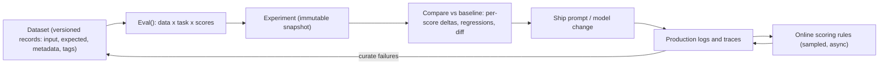

**Braintrust** is a commercial, SaaS-first platform for [LLM evaluation](llm-evaluation.md) and [observability](llm-observability.md). Its core abstraction is the **experiment**: an immutable snapshot of running a `task` over `data` and grading it with `scores`, stored so that every run can be compared row by row with a baseline. The same scorers then run on sampled production logs (**online scoring**), and production traces flow back into versioned **datasets**. This closes the offline/online loop in one product. The scorer library, `autoevals`, is MIT-licensed and usable without the platform, but the platform itself is closed source ([braintrust-eval-sdk-docs](../sources/braintrust-eval-sdk-docs.md), [braintrust-platform-docs](../sources/braintrust-platform-docs.md), [autoevals](../sources/braintrust-autoevals-github.md)).

## The eval loop

Synthesis: the diagram stitches together the experiment, dataset and online-scoring docs ([braintrust-platform-docs](../sources/braintrust-platform-docs.md)).

## Eval() and experiments

`Eval(name, data, task, scores, ...)` is the entry point in Python and TypeScript. `data` is inline records or `init_dataset(...)`. `task` is the function under test. `scores` is a list of scorers. Useful parameters ([braintrust-platform-docs](../sources/braintrust-platform-docs.md)):

- `trial_count`: run each case N times and average, which addresses non-determinism.
- `max_concurrency`: unset by default. Set it, or large evals hit provider 429s (see [rate limits](rate-limits-and-retries.md)).
- `parameters`: values exposed for editing in the playground.
- `metadata` and an experiment name.

`bt eval <file>` runs eval files (`--watch` reruns on save, TypeScript is transpiled, `.env` loads automatically) and prints a link to the stored experiment ([braintrust-eval-sdk-docs](../sources/braintrust-eval-sdk-docs.md)). Playground runs overwrite, while experiments persist. The same experiment can be created from code, the UI, or CI on every PR ([braintrust-platform-docs](../sources/braintrust-platform-docs.md)).

**Comparison** is the main feature. Rows are matched by `input` by default; set a custom comparison key in project settings (for example `input.user_query`) if inputs contain timestamps or IDs. The view shows per-score deltas, counts of regressions and improvements, an overall comparison grade (improvement, regression, tradeoff or tie) that also weighs latency, cost, errors and load, and a character-level diff (up to 4,096 characters per field). If no baseline is set, the default is the most recent experiment on the same git branch, which only works when experiments were logged with git metadata ([braintrust-platform-docs](../sources/braintrust-platform-docs.md)).

## Scorers

A scorer receives `input`, `output`, `expected`, `metadata` and `trace`, and returns a number in [0, 1]. Classifier scorers return labels instead ([braintrust-platform-docs](../sources/braintrust-platform-docs.md)). There are three kinds:

- **autoevals**: LLM-classifier scorers (Factuality, ClosedQA, Battle, Summarization, SQL, Translation, Moderation, Security, Humor), Ragas-style [RAG](retrieval-augmented-generation.md) scorers (context precision/recall/relevancy, faithfulness, answer relevancy), [embedding](embeddings.md) similarity, and heuristics (Levenshtein, ExactMatch, NumericDiff, JSONDiff, JSON validity). An LLM classifier is a template over `{{input}}`, `{{output}}` and `{{expected}}`. `choice_scores` maps the judge's chosen option to a number, and `use_cot` makes it reason first ([chain-of-thought](chain-of-thought.md)). Any OpenAI-compatible endpoint works through `OPENAI_BASE_URL` ([autoevals](../sources/braintrust-autoevals-github.md)).
- **LLM-as-judge** scorers defined in the UI or in code (see [LLM-as-judge](llm-as-judge.md)).
- **Custom code** (Python/TS functions).

**Span vs trace scorers:** a span scorer grades one span. A trace scorer sees the whole trace, which is what you need for [agent evaluation](agent-evaluation.md) (tool choice, step count, final state). Scorers can live inline in the eval file, be pushed from code, or be built in the UI, so the same scorer can serve offline and online ([braintrust-platform-docs](../sources/braintrust-platform-docs.md)).

## Datasets

A dataset is a set of records with `input` (required), `expected`, `metadata` and `tags`. Every change is versioned, so an experiment can pin a dataset version and a later comparison stays apples to apples. Records come from uploads (e.g. CSV mapped to input/expected), the SDK, production logs, user feedback, traces, or the Loop agent ([braintrust-platform-docs](../sources/braintrust-platform-docs.md), [braintrust-eval-sdk-docs](../sources/braintrust-eval-sdk-docs.md)).

## Online scoring

Online scoring rules are configured per project. Each rule sets ([braintrust-platform-docs](../sources/braintrust-platform-docs.md)):

| Setting | Behaviour |
|---|---|
| Scorers | Any saved scorer (same ones as offline) |
| Scope | Single span; whole trace (scored after 30 s idle); or a group of up to 64 traces sharing a key such as session ID |
| Filter | SQL. No `!=`, and filters see only data present at `span.end()` |
| Sampling rate | Docs suggest 1-10% for high volume, 50-100% for low-volume or critical flows |

Scoring runs asynchronously, so it adds no latency to the app, and retries transient scorer failures up to 5 times. It does **not** backfill unless you "rewind" a rule, and traces logged while a rule is paused are never scored by it. The UI shows each rule's estimated 24-hour LLM cost. Failure mode (synthesis): a filter on a field you set after `span.end()` silently matches nothing, and a rule added after an incident will not score the incident's traffic without a rewind.

## Prompts, Loop and tracing

Prompts are stored by slug and loaded with `load_prompt` / `loadPrompt` by version or environment. `build()` renders messages and parameters without calling the model. With a wrapped client (`wrap_openai`) the prompt ID and version are recorded on the LLM span. The SDK cache serves the last copy on transient errors, except for loads pinned to a version or environment ([braintrust-prompts-docs](../sources/braintrust-prompts-docs.md); see [prompt management](prompt-management.md)). **Loop** is an in-product agent. It investigates logs and experiments, drafts prompts, scorers, datasets and dashboards (with approval), can open GitHub PRs, and bills against model credits ([braintrust-platform-docs](../sources/braintrust-platform-docs.md)).

## Architecture and deployment

Braintrust splits a **control plane** that it runs (UI, auth, metadata) from a **data plane** (logs, traces, datasets, prompts). The data plane consists of an API service, Postgres for metadata, Redis, object storage as the source of truth, and **Brainstore**, Braintrust's own database with writer, reader and fast-reader nodes over a write-ahead log on object storage. The browser talks to the data plane directly via CORS, so trace contents need not pass through Braintrust's servers when the data plane is yours. Deployment: SaaS on every plan; BYOC (data plane in your cloud, operated by Braintrust) on Enterprise; the pricing page also lists on-prem/hosted for Enterprise. **There is no free self-hosted edition** ([braintrust-platform-docs](../sources/braintrust-platform-docs.md)).

## Pricing (as of 2026-11-14)

| Plan | Price | Included |
|---|---|---|
| Starter | $0 | 1 GB processed data, 10K scores, 14-day retention, $10 model credits |
| Pro | $249/month | 5 GB, 50K scores, 30-day retention (longer at $0.50/GB/month), $100 model credits |
| Enterprise | custom | on-prem/hosted, RBAC, BAA, SLA |

Overage is $4/GB and $2.50 per 1K scores on Starter, $3/GB and $1.50 per 1K scores on Pro. Users are unlimited on every plan ([braintrust-platform-docs](../sources/braintrust-platform-docs.md)). The billing unit is data volume plus **scores**, so heavy online scoring at a high sampling rate is a direct cost lever, separate from the judge model's token cost.

## Compared with alternatives

| | Braintrust | [Langfuse](langfuse.md) | [LangSmith](langsmith.md) | [Arize Phoenix](arize-phoenix.md) |
|---|---|---|---|---|
| Licence | Closed platform, MIT scorers | Open source (self-hosted OSS free) | Closed | Elastic License 2.0 |
| Free self-host | No (BYOC/on-prem on Enterprise) | Yes | No (Enterprise self-host) | Yes, no feature gates |
| Paid entry (2026-11) | Pro $249/mo, unlimited users | Core $29/mo | Plus $39/seat/mo | Arize AX Pro $50/mo |
| Centre of gravity | Experiment comparison, online scoring | Tracing, prompt mgmt | [LangChain](langchain.md)/[LangGraph](langgraph.md) tracing and deployment | OTel/OpenInference tracing, evals |

Sources: [langfuse-pricing](../sources/langfuse-pricing-and-v4.md), [langsmith-tracing](../sources/langsmith-tracing-sdk-and-deployment.md), [phoenix-evals](../sources/phoenix-evals-and-self-hosting-docs.md), [braintrust-platform-docs](../sources/braintrust-platform-docs.md).

## When to use / when not

Synthesis:
- **Pick Braintrust** when the client's bottleneck is iteration speed on prompts and models: many people (PMs and domain experts included, since seats are unlimited) comparing experiments, curating datasets from production, and reusing one set of scorers in CI and online. It fits the recommendation to feed production failures back into CI datasets and run cheap checks on all traffic and expensive judges on a sample ([husain-shankar-2026](../sources/husain-shankar-2026-ai-evals-faq.md)).
- **Avoid it** when data cannot leave the client's network and they will not buy Enterprise BYOC (use Phoenix or Langfuse self-hosted), when OTel-native tracing into an existing observability stack is the main need, or for a one-off [POC](poc-to-production.md) where a pytest suite with [DeepEval](ragas-and-deepeval.md) or a [promptfoo](promptfoo.md) config is enough.
- Watch the score meter: set the sampling rate per rule and keep deterministic scorers (JSON validity, ExactMatch) ahead of LLM judges.

## Sources

- [Braintrust docs: Eval SDK quickstart](../sources/braintrust-eval-sdk-docs.md)
- [Braintrust platform docs: experiments, scorers, datasets, online scoring, architecture, pricing](../sources/braintrust-platform-docs.md)
- [Braintrust autoevals](../sources/braintrust-autoevals-github.md)
- [Braintrust docs: prompts](../sources/braintrust-prompts-docs.md)
- [Husain and Shankar: AI evals FAQ](../sources/husain-shankar-2026-ai-evals-faq.md)
- [Langfuse pricing and v4](../sources/langfuse-pricing-and-v4.md)
- [LangSmith tracing SDK and deployment](../sources/langsmith-tracing-sdk-and-deployment.md)
- [Phoenix evals and self-hosting docs](../sources/phoenix-evals-and-self-hosting-docs.md)
