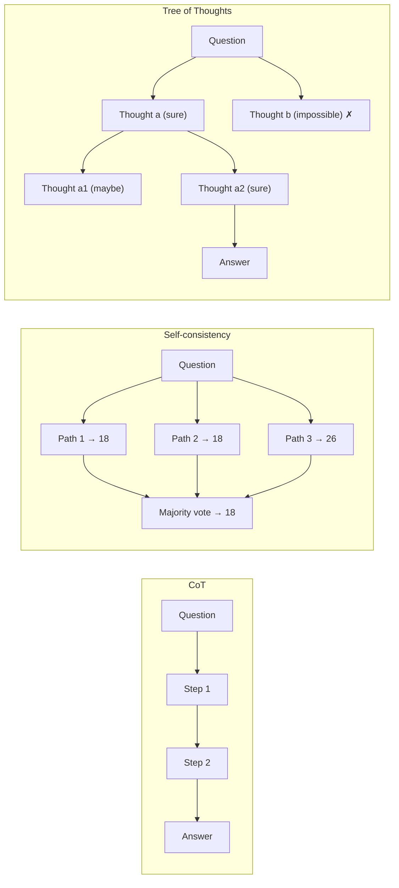

**Chain-of-thought (CoT)** prompting gets a language model to write out intermediate reasoning steps before its final answer. Because each generated token is conditioned on the ones before it, the written steps act as working memory, and accuracy on multi-step arithmetic, logic and planning rises. Wei et al. introduced it in 2022 with few-shot exemplars that contained reasoning ([Wei et al.](../sources/wei-2022-chain-of-thought.md)). Since 2024–25, [reasoning models](reasoning-models.md) do this internally ([extended thinking](extended-thinking.md)), which changes how, and whether, you should prompt for it.

## Variants

| Technique | Mechanism | Cost multiplier | Best for |
|---|---|---|---|
| Few-shot CoT | Exemplars show question → steps → answer | 1 call, longer prompt and output | Non-reasoning models, a specific reasoning style |
| Zero-shot CoT | Trigger phrase "Let's think step by step", then answer extraction | 1–2 calls | No exemplars available |
| Self-consistency | Sample N CoT paths at temperature > 0, majority-vote the final answers | N calls | One verifiable answer (number, option) |
| Tree of Thoughts | LM proposes steps, LM evaluates them, BFS/DFS search with backtracking | 5–100x CoT tokens | Puzzles, planning, search problems |
| Built-in thinking | Model reasons in hidden/summarised thinking tokens, controlled by effort | Thinking tokens billed | Default on current frontier models |

**Few-shot CoT.** PaLM 540B with eight CoT exemplars set the GSM8K state of the art in 2022, beating fine-tuned GPT-3 with a verifier. The ability appears only in sufficiently large models ([Wei et al.](../sources/wei-2022-chain-of-thought.md)). See [few-shot prompting](few-shot-prompting.md).

**Zero-shot CoT.** Kojima et al. used two stages: (1) append "Let's think step by step" and generate reasoning; (2) feed back prompt plus reasoning plus an answer trigger ("Therefore, the answer is…") to get a parseable answer. With text-davinci-002, MultiArith rose from 17.7% to 78.7% and GSM8K from 10.4% to 40.7%. It underperforms well-crafted few-shot CoT, gave no gain on commonsense tasks, and is sensitive to trigger wording ([Kojima et al.](../sources/kojima-2022-zero-shot-reasoners.md)).

**Self-consistency.** Instead of [greedy decoding](sampling-parameters.md) of one chain, sample many and take the most common final answer. The idea is that correct reasoning paths converge while errors scatter. With 40 sampled paths, gains over CoT were GSM8K +17.9, SVAMP +11.0, AQuA +12.2, StrategyQA +6.4, ARC-challenge +3.9 points; performance saturates quickly, so 5–10 paths capture most of it ([Wang et al.](../sources/wang-2022-self-consistency.md)). The owner's experiment runs the CoT chain five times and votes on the `Answer:` lines ([Notebook 16](../sources/notebook-16-self-consistency.md)).

**Tree of Thoughts (ToT).** Four choices: how big a "thought" is; how to generate candidates (sample independently, or propose several in one prompt); how to evaluate states (score each as sure/maybe/impossible, or vote); and the search (BFS keeping the best *b*, or DFS with pruning and backtracking). On Game of 24 with GPT-4: CoT 4%, CoT-SC 9%, ToT (b=5) 74%, at about $0.74 per problem ([Yao et al.](../sources/yao-2023-tree-of-thoughts.md)). The owner's experiment is a simplified beam search with separate proposer and scorer models ([Notebook 17](../sources/notebook-17-tree-of-thoughts.md)).

## Prompting CoT in practice

- **Separate reasoning from answer.** Ask for reasoning, then a final answer in a fixed marker (`<answer>` tags, or `Answer: <result>`) so code can extract it ([Anthropic](../sources/anthropic-prompting-best-practices.md), [Notebook 15](../sources/notebook-15-chain-of-thought.md)).
- **General beats prescriptive.** On Claude with thinking, "think thoroughly" often beats a hand-written step list; the model's reasoning frequently exceeds what a human would prescribe ([Anthropic](../sources/anthropic-prompting-best-practices.md)).
- **Self-check.** Ending with "verify your answer against [criteria]" catches errors in code and maths. The exception is models that already self-verify, where it causes over-verification (Anthropic names Claude Opus 5) ([Anthropic](../sources/anthropic-prompting-best-practices.md)).
- **Chaining instead of one long chain.** When you need to inspect intermediate outputs, split into separate calls (draft → critique → refine) ([Anthropic](../sources/anthropic-prompting-best-practices.md)). See [prompt engineering](prompt-engineering.md).

## CoT on reasoning models (as of 2026-11)

Vendors now say **not** to ask reasoning models for visible step-by-step reasoning:

- **OpenAI:** reasoning models reason internally; "think step by step" is unnecessary and can hurt. Keep prompts simple ([OpenAI reasoning](../sources/openai-reasoning-best-practices.md)).
- **Google:** Gemini 2.5 and 3 think internally, so asking them to show steps is usually unnecessary; asking them to think carefully on hard problems spends more thinking tokens for quality ([Google](../sources/google-gemini-prompting-strategies.md)).
- **Anthropic:** Claude 4.6+ uses adaptive thinking (`thinking: {type: "adaptive"}`) with depth set by `output_config.effort`; `budget_tokens` errors on Claude 4.7+. Manual CoT is a fallback only when thinking is off. On the newest models (Fable 5.x, Opus 5.5, Opus 5, Sonnet 5.5) a prompt asking for visible reasoning in `<thinking>` tags may be declined; lower the effort instead if cost matters ([Anthropic](../sources/anthropic-prompting-best-practices.md)).
- **Evidence:** on GPQA Diamond, explicit CoT gave small, variable gains on non-reasoning models (many already reason unprompted) and only marginal gains on reasoning models at a large time and token cost ([Meincke et al.](../sources/meincke-2025-decreasing-value-of-cot.md)).

Synthesis: self-consistency and ToT survive as *orchestration* patterns (sampling and search in your code around many calls), not as prompt wording. See [test-time compute](test-time-compute.md).

## Limitations and failure modes

- **Unfaithfulness.** The written chain is not necessarily why the model answered. Biasing features, such as making the correct option always "(A)", shifted answers and cut accuracy by up to 36%, while explanations never mentioned the bias ([Turpin et al.](../sources/turpin-2023-unfaithful-cot.md)). Reasoning models mentioned hints they had used only about 25% (Claude 3.7 Sonnet) and 39% (DeepSeek R1) of the time, and verbalised reward hacks in under 2% of cases ([Anthropic research](../sources/anthropic-reasoning-models-dont-say-think.md)). Do not treat CoT as an audit log. Use external checks ([verification and evals](verification-and-evals.md)).
- **Scale dependence.** Small models don't benefit, or get worse ([Wei et al.](../sources/wei-2022-chain-of-thought.md), [Kojima et al.](../sources/kojima-2022-zero-shot-reasoners.md)).
- **Variance.** CoT can flip answers the model would otherwise get right ([Meincke et al.](../sources/meincke-2025-decreasing-value-of-cot.md)).
- **Cost and latency.** Every reasoning token is billed output; self-consistency multiplies calls by N, and ToT by 5–100x tokens ([Yao et al.](../sources/yao-2023-tree-of-thoughts.md)). See [cost and latency optimization](cost-and-latency-optimization.md).
- **Voting needs comparable answers.** Self-consistency fits numbers and options; free-text outputs need a judge or clustering ([Wang et al.](../sources/wang-2022-self-consistency.md)). Synthesis: an [LLM-as-judge](llm-as-judge.md) can stand in, at additional cost.

## When to use / when not

Synthesis: the table below combines the vendor guidance and papers above.

| Situation | Choice |
|---|---|
| Frontier reasoning model | Don't prompt CoT; tune effort/thinking settings |
| Non-reasoning or small hosted model, multi-step task | Few-shot or zero-shot CoT with an answer marker |
| Single verifiable answer, accuracy matters more than cost | Self-consistency with N=5–10 (Wang et al. sampled 40 paths but say 5–10 realises most of the gain) |
| Search or planning with dead ends | ToT or an [agent loop](agent-loop.md) with backtracking |
| Simple lookup, classification or extraction | No CoT: it adds latency and variance |
| Need an explanation users will trust as the cause | CoT is not sufficient; add grounding and citations |

## Sources

- [Chain-of-Thought Prompting Elicits Reasoning](../sources/wei-2022-chain-of-thought.md)
- [Large Language Models are Zero-Shot Reasoners](../sources/kojima-2022-zero-shot-reasoners.md)
- [Self-Consistency Improves Chain of Thought Reasoning](../sources/wang-2022-self-consistency.md)
- [Tree of Thoughts](../sources/yao-2023-tree-of-thoughts.md)
- [Language Models Don't Always Say What They Think](../sources/turpin-2023-unfaithful-cot.md)
- [Reasoning models don't always say what they think (Anthropic)](../sources/anthropic-reasoning-models-dont-say-think.md)
- [The Decreasing Value of Chain of Thought in Prompting](../sources/meincke-2025-decreasing-value-of-cot.md)
- [Prompting best practices (Anthropic)](../sources/anthropic-prompting-best-practices.md)
- [Reasoning best practices (OpenAI)](../sources/openai-reasoning-best-practices.md)
- [Prompt design strategies (Google Gemini)](../sources/google-gemini-prompting-strategies.md)
- [Notebook experiment 15: Chain-of-Thought](../sources/notebook-15-chain-of-thought.md)
- [Notebook experiment 16: Self-Consistency](../sources/notebook-16-self-consistency.md)
- [Notebook experiment 17: Tree of Thoughts](../sources/notebook-17-tree-of-thoughts.md)
