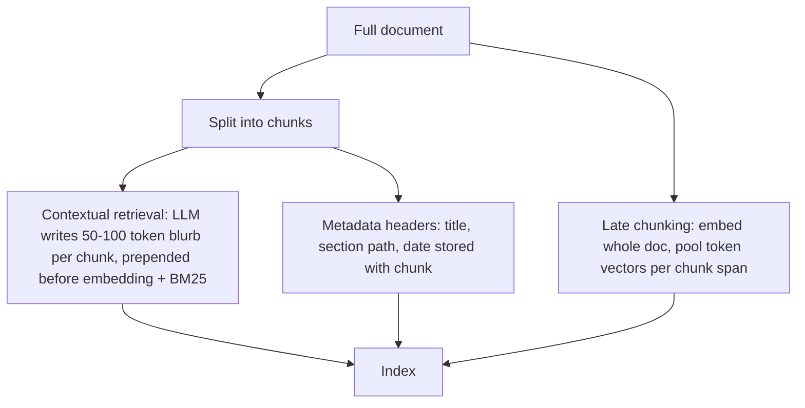

**Chunking** is the ingestion step of [RAG](retrieval-augmented-generation.md) that splits each document into smaller pieces, each embedded and indexed as its own retrieval unit. The chunk is simultaneously the unit of *matching* (its embedding must sit near the queries it answers) and the unit of *context* (what the LLM actually reads). Those two jobs pull in opposite directions, which is why chunking choice alone changed retrieval recall by up to 9% in Chroma's benchmark ([Chroma](../sources/chroma-evaluating-chunking.md)), and why chunking "severs context across boundaries" is listed as a core RAG limit ([Notebook](../sources/notebook-rag-cag.md)).

## The core trade-off

- **Small chunks** (around 100-300 tokens) give a focused embedding and precise matches, but can strip the chunk of what it is about: "revenue grew 3%" without the company or quarter ([Anthropic](../sources/anthropic-contextual-retrieval.md)).
- **Large chunks** (800+ tokens) keep context but average several topics into one vector and fill the prompt with irrelevant tokens. Chroma's measurements show this as very low token-level precision ([Chroma](../sources/chroma-evaluating-chunking.md)).
- **Overlap** copies text across neighbouring chunks so a sentence cut at a boundary survives somewhere. It raises index size and duplicates tokens in the prompt; Chroma found removing overlap improved IoU ([Chroma](../sources/chroma-evaluating-chunking.md)).

Chunk size is also bounded by the [embedding model](embeddings.md)'s max input length and interacts with [tokenization](tokenization.md): sizes are usually set in tokens, not characters (Synthesis).

## Strategies

| Strategy | How it splits | Strengths | Weaknesses |
|---|---|---|---|
| Fixed-size token window (e.g. `TokenTextSplitter`) | Every N tokens, with M overlap | Trivial, predictable | Cuts mid-sentence; OpenAI Assistants default 800/400 had the worst efficiency in Chroma's test |
| Recursive character (`RecursiveCharacterTextSplitter`) | Tries separators in order (`\n\n`, `\n`, `.`, ` `) until pieces fit | Respects paragraphs and sentences; best all-rounder in Chroma's test at 200 tokens, 0 overlap | Ignores semantics |
| Structure-aware | Headings, Markdown/HTML sections, code functions, table rows | Chunks match how the author organized meaning | Needs a parser per format ([document processing](document-processing.md)) |
| Semantic (Kamradt) | Embeds sentences, splits where adjacent similarity drops below a percentile | Topic-coherent chunks | Default version scored slightly below average; unbounded chunk size unless capped |
| Cluster semantic (Chroma) | Groups sentences to maximize within-chunk similarity under a max size | Highest precision and IoU at 200 tokens | Extra embedding pass |
| LLM chunker | LLM picks split points | Highest recall (about 92) | Slow and costly; low precision at the sizes tested |
| Late chunking | Embed the whole document with a long-context model, then mean-pool token vectors per chunk span | Chunk vectors carry document context, no extra training | Needs token-level outputs from a long-context embedder |

Sources: Chroma rows from [Chroma](../sources/chroma-evaluating-chunking.md); late chunking from [Günther et al.](../sources/gunther-2024-late-chunking.md); structure-aware row is Synthesis.

Chroma's headline numbers (text-embedding-3-large, 5 chunks retrieved): recursive 200/0 recall 88.1 / IoU 6.9; cluster 200 recall 87.3 / IoU 8.0; LLM (GPT-4o) recall 91.9 / IoU 3.9; token 800/400 recall 87.9 / IoU 1.4 ([Chroma](../sources/chroma-evaluating-chunking.md)). Treat these as directional: the dataset is small and synthetic.

## Putting context back into the chunk

Three ways to fix the "orphaned chunk" problem without making chunks huge:

Synthesis: the metadata-header branch is a common practice not measured in these sources.

- **[Contextual retrieval](contextual-retrieval.md)** (Anthropic): Claude 3 Haiku sees the whole document plus the chunk and writes a short situating context; cost about $1.02 per million document tokens with prompt caching (2024 pricing). It cut retrieval failures 35% alone and 49% combined with contextual [BM25](bm25.md) ([hybrid search](hybrid-search.md)). Generic document summaries attached to chunks helped very little ([Anthropic](../sources/anthropic-contextual-retrieval.md)).
- **Late chunking** gets similar context-awareness inside the embedding model, without an LLM call per chunk ([Günther et al.](../sources/gunther-2024-late-chunking.md)).

> **Contradiction:** this page, citing [Günther et al.](../sources/gunther-2024-late-chunking.md), presents late chunking as giving similar context-awareness to contextual retrieval. The contextual retrieval page, citing [Merola & Singh 2025](../sources/merola-2025-late-chunking-vs-contextual-retrieval.md), reports late chunking as model-dependent (from neutral to strongly negative) and slightly less relevant than contextual retrieval, though cheaper to compute.
- **Small-to-big retrieval** (Synthesis): index small chunks for matching, but return the parent section to the LLM. Frameworks such as [LlamaIndex](llamaindex.md) ship this pattern.

## Chunking for other consumers

Chunk size also matters for LLM extraction, not just embedding. In [GraphRAG](graphrag.md), GPT-4 extracted almost twice as many entity references from 600-token chunks as from 2,400-token chunks; the paper used 600 tokens with 100 overlap ([Edge et al.](../sources/edge-2024-graphrag.md)).

## Measuring chunk quality

Document-level recall hides waste. Chroma's token-level metrics are a better lens ([Chroma](../sources/chroma-evaluating-chunking.md)):

- **Recall:** fraction of the relevant tokens that were retrieved.
- **Precision:** fraction of retrieved tokens that are relevant (what you pay for in the prompt).
- **IoU:** Jaccard of retrieved vs relevant tokens; penalizes both misses and padding.

Synthesis: in practice, build a small labelled set from your own documents (questions plus the exact supporting span), sweep chunk size, overlap and splitter, and pick on [recall@k](retrieval-metrics.md) at the k you will actually pass to the model, then check end-to-end answer quality with [RAG evaluation](retrieval-augmented-generation.md).

## Failure modes

- Tables split across chunks lose their header row; code split mid-function loses its signature (Synthesis).
- Pronouns and implicit subjects ("the company", "it") make chunks unfindable ([Anthropic](../sources/anthropic-contextual-retrieval.md)).
- Defaults copied from tutorials (800/400) waste prompt tokens without improving recall ([Chroma](../sources/chroma-evaluating-chunking.md)).
- Changing the chunker requires re-embedding the corpus, so version your ingestion pipeline (Synthesis).

## Practical guidance

- Start with a recursive splitter around 200-400 tokens and little or no overlap; tune separators for your format ([Chroma](../sources/chroma-evaluating-chunking.md)).
- Prefer structure-aware splitting when documents have real structure (Synthesis).
- Add contextual retrieval when chunks are not self-explanatory; it pairs with [prompt caching](prompt-caching.md) to stay cheap ([Anthropic](../sources/anthropic-contextual-retrieval.md)).
- If the corpus fits in the [context window](context-window.md) (about 200k tokens), skip chunking entirely ([Anthropic](../sources/anthropic-contextual-retrieval.md)).

## Sources

- [Chroma: Evaluating Chunking Strategies for Retrieval](../sources/chroma-evaluating-chunking.md)
- [Anthropic: Introducing Contextual Retrieval](../sources/anthropic-contextual-retrieval.md)
- [Günther et al. 2024: Late Chunking](../sources/gunther-2024-late-chunking.md)
- [Edge et al. 2024: GraphRAG](../sources/edge-2024-graphrag.md)
- [Notebook: RAG vs CAG vs GraphRAG](../sources/notebook-rag-cag.md)
