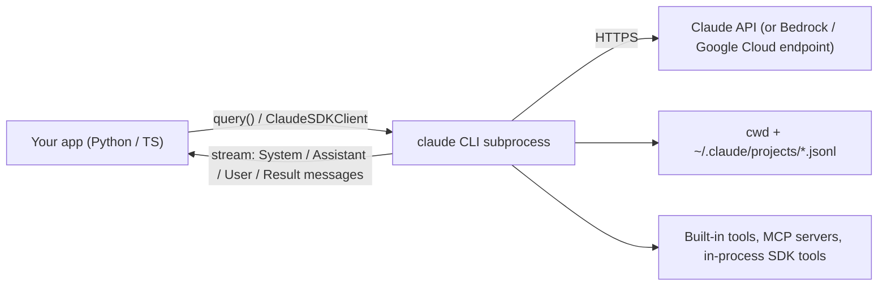

The **Claude Agent SDK** is Anthropic's library for embedding the agent that powers Claude Code in your own Python or TypeScript application. It ships the same [agent loop](agent-loop.md), built-in [tools](tools.md) (file read/edit, Bash, grep, web fetch), permission system, sessions, hooks, [subagents](subagents.md) and context management as Claude Code, programmable from code ([overview](../sources/claude-agent-sdk-overview-docs.md)). It was called the Claude Code SDK until September 2025. Anthropic renamed it because the same harness was being used for research, video and note-taking work, not just coding ([Anthropic, 2025](../sources/anthropic-building-agents-with-claude-agent-sdk.md)). Most frameworks give you primitives to assemble an agent. This SDK gives you a finished, opinionated agent ("give Claude a computer") that you configure and constrain.

## Architecture: a library wrapping a CLI subprocess

When you call `query()`, the SDK spawns a `claude` CLI subprocess and talks to it over stdio. That process owns a shell, a working directory and JSONL session transcripts on local disk. Both SDKs bundle a native Claude Code binary pinned to the SDK version, so updating the SDK also updates the agent ([hosting](../sources/claude-agent-sdk-hosting-docs.md), [agent loop](../sources/claude-agent-sdk-agent-loop-docs.md)).

Anthropic offers four ways to build with Claude, and the SDK is one of them ([overview](../sources/claude-agent-sdk-overview-docs.md)):

| Option | Who runs the loop | Use when |
|---|---|---|
| Client SDK (raw Messages API) | You write it (or use the beta tool runner) | You need full control, few tools, or non-agentic calls |
| **Agent SDK** | Claude Code binary, in a process you operate | You want Claude Code's tools, permissions and context handling inside your own service |
| Claude Code CLI | Claude Code, interactive | Day-to-day development, one-off tasks |
| Managed Agents | Anthropic-hosted harness and sandbox | You don't want to operate the loop or the sandbox |

## The loop and its message stream

Each turn, Claude gets the system prompt, tool definitions and history. It replies with text and/or tool calls. The SDK runs the tools and feeds the results back. The run ends when a response contains no tool calls. Your code consumes a typed stream: `SystemMessage` (`init`, `compact_boundary`), one `AssistantMessage` per content block, `UserMessage` for tool results, optional `StreamEvent` deltas, and a final `ResultMessage` carrying `total_cost_usd`, `usage`, `num_turns` and `session_id` ([agent loop](../sources/claude-agent-sdk-agent-loop-docs.md)).

Key controls on `ClaudeAgentOptions` / `Options`:

| Option | Effect | Default |
|---|---|---|
| `max_turns` | Cap on tool-use turns; ends with `error_max_turns` | unlimited |
| `max_budget_usd` | Spend cap including subagents; ends with `error_max_budget_usd` | unlimited |
| `effort` | `low` … `max` reasoning depth per turn | resolved by Claude Code |
| `allowed_tools` / `disallowed_tools` | Pre-approve / deny (bare name removes the tool) | none |
| `tools` | Which built-ins exist in context at all | all core built-ins |
| `permission_mode` | `default`, `dontAsk`, `acceptEdits`, `plan`, `auto`, `bypassPermissions` | `default` |
| `setting_sources` | Load CLAUDE.md, skills, hooks, settings from user/project/local | project for default options |
| `mcp_servers`, `agents`, `hooks` | External tools, subagent definitions, lifecycle callbacks | none |
| `resume`, `continue`, `fork_session` | Session continuity | new session |

Read-only tools (and custom tools marked `readOnlyHint`) run in parallel. Tools that change state run one at a time. When the context nears its limit, older history is compacted automatically, so durable rules belong in CLAUDE.md, which is re-injected on every request, rather than in the first prompt ([agent loop](../sources/claude-agent-sdk-agent-loop-docs.md)).

## Permissions: the main safety surface

Every tool call goes through a fixed order: **hooks, then deny rules, ask rules, permission mode, allow rules, and finally your `canUseTool` callback** ([permissions](../sources/claude-agent-sdk-permissions-docs.md)). This order causes the classic misconfigurations:

- `allowed_tools` **pre-approves**. It does not restrict. Unlisted tools still exist and fall through to the mode and callback. To hide a tool, use `tools` or a bare name in `disallowed_tools`.
- In `bypassPermissions` mode, tools you didn't list are approved too. Only deny rules, ask rules and hooks still bite.
- Auto-approved calls never reach `canUseTool`. If you need to audit every call, use a `PreToolUse` hook.
- For headless agents, the docs recommend an explicit allow-list plus `dontAsk`, which turns every would-be prompt into a denial.

`auto` mode uses a classifier model to approve or block actions such as shell commands and network calls. Subagents inherit `plan`, `acceptEdits`, `auto` and `bypassPermissions` from the parent, and a subagent's own `bypassPermissions` setting is never applied ([permissions](../sources/claude-agent-sdk-permissions-docs.md)). This is a concrete form of [agent guardrails](agent-guardrails.md) enforced outside the model.

## Tools, MCP and subagents

Custom tools are `@tool` / `tool()` functions wrapped in an **in-process MCP server** (`create_sdk_mcp_server`) and addressed as `mcp__<server>__<tool>`. Tool search is on by default and defers MCP schemas until they are needed, which saves context. If a handler throws, the exception becomes an error result the model can react to, and the loop keeps going ([custom tools](../sources/claude-agent-sdk-custom-tools-docs.md)). External servers use standard [MCP](model-context-protocol.md).

Subagents are defined with `AgentDefinition` (description, prompt, tools, model, `maxTurns`, effort, permission mode) and invoked through the `Agent` tool. Unless it is a fork (`subagent_type: "fork"`, which copies the conversation so far), a subagent starts with a fresh context: its own prompt, the delegation prompt, project CLAUDE.md and its tools. By default a spawned subagent runs in the background and its report arrives in a later turn, unless Claude needs the result immediately. Only its final message returns to the parent. Defaults allow 3 levels of nesting and 20 concurrent subagents, with no spend cap unless you set `max_budget_usd`. The docs warn that Opus 5 delegates more readily than earlier models, so set these caps ([subagents](../sources/claude-agent-sdk-subagents-docs.md)).

## Sessions and hosting

Sessions are local JSONL transcripts. `continue` resumes the latest session in the directory, `resume` takes an ID, and `fork_session` branches the history. Sessions persist the conversation, **not the filesystem**, so a forked agent's file edits are real ([sessions](../sources/claude-agent-sdk-sessions-docs.md)). In production, one session is one subprocess with roughly 1 GiB RAM / 5 GiB disk / 1 CPU as a floor. There are four session patterns: ephemeral, long-running, hybrid (rehydrate from a `SessionStore`), and multi-agent container. Tokens typically cost an order of magnitude more than the container. For multi-tenant isolation you need empty `setting_sources`, auto memory disabled, and a per-tenant config directory, `cwd` and egress policy ([hosting](../sources/claude-agent-sdk-hosting-docs.md)).

## Limitations and failure modes

- **Heavy runtime.** It's a stateful subprocess with a shell, not a stateless HTTP call. Concurrency is bounded by RAM, and memory grows over long sessions ([hosting](../sources/claude-agent-sdk-hosting-docs.md)).
- **No built-in wall-clock timeout** for sessions or subagents. Only turn and budget caps exist (plus a `CLAUDE_ASYNC_AGENT_STALL_TIMEOUT_MS` stall watchdog for subagents that stop producing output, which is not a total-runtime deadline), and the budget can overshoot by one response plus any subagents still running ([agent loop](../sources/claude-agent-sdk-agent-loop-docs.md), [hosting](../sources/claude-agent-sdk-hosting-docs.md)).
- **Claude-only.** It runs Claude models (via the Anthropic API or the Bedrock and Google Cloud endpoints), not arbitrary providers ([hosting](../sources/claude-agent-sdk-hosting-docs.md)).
- **Settings leakage.** Filesystem settings and CLAUDE.md load by default and can leak across tenants ([hosting](../sources/claude-agent-sdk-hosting-docs.md)).
- **Error semantics.** A single-shot `query()` raises *after* yielding an error result, so wrap it and check the result `subtype` ([agent loop](../sources/claude-agent-sdk-agent-loop-docs.md)).
- **Licensing and branding.** You must use API-key auth (no claude.ai login without approval), and you can't brand your product as Claude Code ([overview](../sources/claude-agent-sdk-overview-docs.md)).

## When to use it, and when not

Use it when the task looks like "an engineer with a computer": [coding agents](coding-agents.md), file-heavy research, document processing, ops automation. These are cases where agentic search over files, Bash and verification by running things beat hand-built tools. Anthropic's own advice is to start with agentic search and add semantic search only if needed, and to verify work through rules, screenshots or an [LLM judge](llm-as-judge.md) ([Anthropic, 2025](../sources/anthropic-building-agents-with-claude-agent-sdk.md)).

Avoid it for low-latency chat, single-shot extraction or classification, multi-provider requirements, or very high fan-out serverless workloads. For those, use the raw API with [function calling](function-calling.md), or a lighter framework such as [Pydantic AI](pydantic-ai.md), [OpenAI Agents SDK](openai-agents-sdk.md) or [LangGraph](langgraph.md). Anthropic's general guidance still applies: start with the simplest solution and add agentic machinery only when it measurably helps ([Building effective agents](../sources/anthropic-building-effective-agents.md)).

Synthesis: compared with the other SDKs on this wiki ([OpenAI Agents SDK](openai-agents-sdk.md), [Google ADK](google-adk.md), [CrewAI](crewai.md), [AutoGen / Agent Framework](autogen.md)), the Claude Agent SDK is the most "batteries-included single agent". Its multi-agent story is model-driven subagent delegation, not declarative graphs, and its strongest differentiators are the permission pipeline and the computer-use-style toolset.

## Sources

- [Agent SDK overview](../sources/claude-agent-sdk-overview-docs.md)
- [How the agent loop works](../sources/claude-agent-sdk-agent-loop-docs.md)
- [Configure permissions](../sources/claude-agent-sdk-permissions-docs.md)
- [Work with sessions](../sources/claude-agent-sdk-sessions-docs.md)
- [Subagents in the SDK](../sources/claude-agent-sdk-subagents-docs.md)
- [Give Claude custom tools](../sources/claude-agent-sdk-custom-tools-docs.md)
- [Hosting the Agent SDK](../sources/claude-agent-sdk-hosting-docs.md)
- [Building agents with the Claude Agent SDK](../sources/anthropic-building-agents-with-claude-agent-sdk.md)
- [Building effective agents](../sources/anthropic-building-effective-agents.md)
