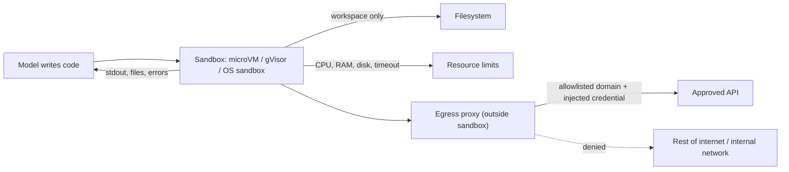

A **code execution sandbox** is an isolated, resource-limited environment in which an agent runs code that a model wrote: a data-analysis script, a test suite, a shell command, a whole dev server. The sandbox defines four boundaries: **compute isolation** (the code cannot reach the host kernel or other tenants), **filesystem isolation** (only a workspace is visible or writable), **network egress control** (which destinations, if any, it can reach), and **resource limits** (CPU, memory, disk, wall-clock). The options run from provider-hosted tools (Anthropic code execution, OpenAI Code Interpreter and hosted shell, Gemini code execution), through sandbox platforms you call from your own agent (E2B, Modal, Daytona, Vercel Sandbox), to OS-level sandboxes around a local agent (Claude Code, Codex). They are built on microVMs (Firecracker), user-space kernels (gVisor) or OS primitives (bubblewrap, seccomp, Seatbelt).

## Why agents execute code

- **Code as the action format.** CodeAct showed that agents emitting executable Python, rather than JSON tool calls, reached up to 20% higher success across 17 LLMs. Code gives loops, composition and libraries, and interpreter errors drive self-debugging ([CodeAct](../sources/wang-2024-codeact.md)). AutoGen treats code execution as a first-class part of its conversation-driven agents ([notebook](../sources/notebook-autogen-crewai.md); see [AutoGen](autogen.md)).
- **Context economy.** If MCP tools are presented as importable code, the agent filters and joins data in the sandbox and returns only the result. Anthropic reports one workflow falling from about 150k to about 2k tokens. Intermediate data (including PII, which can be tokenized) never enters the context ([code execution with MCP](../sources/anthropic-code-execution-with-mcp.md); see [context engineering](context-engineering.md), [MCP](model-context-protocol.md)).
- **Exact computation.** Arithmetic, statistics, charts and file conversion are things LLMs do badly in-token and an interpreter does exactly.

The cost is that the agent now runs arbitrary code. Anthropic's own caveat: you need a secure sandbox, resource limits and monitoring, which direct tool calls avoid ([code execution with MCP](../sources/anthropic-code-execution-with-mcp.md)).

## Threat model

Treat model-written code as untrusted. A [prompt injection](prompt-injection.md) hidden in a file, issue, web page or dependency can steer it. Escape from the VM is not required for damage. With open egress, the code can upload data, probe internal networks or attack third parties ([Vercel](../sources/vercel-2026-sandbox-network-boundary.md)). This is the [lethal trifecta](../sources/willison-2025-lethal-trifecta.md): private data, untrusted content and a channel out. A sandbox removes the third leg only if it controls the network. Anthropic's Claude Code post states the dual requirement plainly. Without network isolation, a compromised agent exfiltrates keys. Without filesystem isolation, it can escape the sandbox and reach the network ([Claude Code sandboxing](../sources/anthropic-claude-code-sandboxing.md)).

*Synthesis: combines the boundaries described by the Vercel, E2B, OpenAI shell and Claude Code sources.*

## Isolation technologies

| Technology | Mechanism | Strength | Cost / limits | Used by |
|---|---|---|---|---|
| **Firecracker microVM** | KVM VMM with five emulated devices plus a jailer as second barrier | Separate guest kernel per sandbox; small attack surface | Boot under 125 ms, under 5 MiB overhead, up to 150 VMs/s/host | AWS Lambda/Fargate, E2B, Vercel Sandbox ([Firecracker](../sources/firecracker-microvm.md), [E2B](../sources/e2b-sandbox-docs.md), [Vercel](../sources/vercel-sandbox-docs.md)) |
| **gVisor** | User-space Go kernel (Sentry) intercepts syscalls; Gofer mediates files over 9P | Host kernel never sees app syscalls | Per-syscall overhead; incomplete syscall and `/proc` coverage | Modal default runtime ([gVisor](../sources/gvisor-docs.md), [Modal](../sources/modal-sandboxes-docs.md)) |
| **Plain containers** | Namespaces + cgroups on a shared host kernel | Weakest of the three for hostile code | Cheapest, fastest | Synthesis: fine for trusted code or as an inner layer; Firecracker's authors call the old container-versus-VM trade-off unacceptable for multi-tenant infrastructure ([Firecracker](../sources/firecracker-microvm.md)) |
| **OS sandbox** | bubblewrap/seccomp (Linux), Seatbelt (macOS) around a local agent | Confines a process on the developer's own machine | Same kernel; may fail inside Docker | Claude Code, Codex ([Claude Code](../sources/anthropic-claude-code-sandboxing.md), [Codex](../sources/openai-codex-sandbox-approvals.md)) |

gVisor's systrap platform (default since mid-2023) suits nested VMs, and its KVM platform suits bare metal ([gVisor](../sources/gvisor-docs.md)). Hardware side channels remain even with microVMs: cooperating workloads on one host can leak signals through cache timing ([Vercel](../sources/vercel-sandbox-docs.md)).

## Provider-hosted code tools (as of 2026-11)

| | Anthropic code execution | OpenAI Code Interpreter / hosted shell | Gemini code execution |
|---|---|---|---|
| Tool | `code_execution_20250825` / `_20260120` / `_20260521`; sub-tools `bash_code_execution`, `text_editor_code_execution` | `code_interpreter`; `shell` with `container_auto` or `container_reference` | `{"type": "code_execution"}` |
| Languages | Bash + Python 3.11 | Python; shell image has Python, Node, Java, PHP, Ruby, Go (Debian 12) | Python only |
| Resources | 5 GiB RAM, 5 GiB disk, 1 CPU; 90 s per REPL cell under programmatic tool calling | 1g / 4g / 16g / 64g memory tiers | 30 s per run; up to 5 automatic retries |
| Network | None; pre-installed libraries only | Code Interpreter: not documented. Shell: off by default; org allowlist + per-request `network_policy`; `domain_secrets` substituted by a sidecar | Not documented; no package installs |
| State | Container lives 30 days; checkpointed after ~5 min idle, restored by ID | Expires after 20 min idle; state unrecoverable | Per request |
| Price | 1,550 free h/org/month, then USD 0.05/container-hour (5-min minimum); free when `web_search_20260209` / `web_fetch_20260209` or later is in the request | USD 0.03 (1 GB) to 1.92 (64 GB) per 20-minute session; footnote says billed per minute with a 5-minute minimum | Tokens only; intermediate tokens billed as input |

Sources: [Anthropic](../sources/anthropic-code-execution-tool-docs.md), [OpenAI Code Interpreter](../sources/openai-code-interpreter-docs.md), [OpenAI shell](../sources/openai-shell-tool-docs.md), [OpenAI pricing](../sources/openai-container-pricing.md), [Gemini](../sources/gemini-code-execution-docs.md).

Mechanics worth knowing:

- **Server-side loop.** Anthropic runs every command server-side inside one API request and returns `server_tool_use` blocks. Long turns can end with `pause_turn`, which you resend to continue ([Anthropic](../sources/anthropic-code-execution-tool-docs.md)).
- **Files.** Upload through a Files API and download generated outputs by file ID. OpenAI cites generated files as `container_file_citation` annotations ([OpenAI](../sources/openai-code-interpreter-docs.md)).
- **Retention.** Anthropic code execution is not ZDR-eligible: container data is kept up to 30 days. Including files bills container time even if the tool is never called ([Anthropic](../sources/anthropic-code-execution-tool-docs.md)).

## Sandbox platforms (as of 2026-11)

| | E2B | Modal Sandboxes | Daytona | Vercel Sandbox |
|---|---|---|---|---|
| Isolation | Firecracker microVM | gVisor; VM runtime option | "Dedicated kernel" (containers and VMs) | Firecracker microVM, root via `sudo` |
| Lifetime | 1 h Hobby / 24 h Pro; pause/resume keeps memory and filesystem | 5 min default, up to 24 h; `idle_timeout`; filesystem snapshots | Auto-stop/archive/delete; ephemeral mode | 5 min default; 45 min Hobby / 24 h Pro per session; persistent by default |
| Default egress | Open | Open (no inbound) | Restricted on low tiers; open on tiers 3-4 | Open |
| Egress controls | IP/CIDR/domain allow + deny; Host/SNI match; allow wins | `block_network`, CIDR allowlist, SNI domain allowlist (beta; TLS/443 only), sidecar proxy | CIDR (max 10) or domain (max 100) allowlist or block-all | Network policy, domain/CIDR, TLS-terminating rules |
| Secrets | Proxy-injected; never enter VM | Env vars; OIDC identity token | Not documented here | Firewall credential injection |
| Notable | Code Interpreter SDK with stateful `run_code` | GPUs (gVisor only), tunnels | Under 90 ms start; Windows/macOS/GPU types | Active-CPU billing; 10,000 concurrent on Pro |

Sources: [E2B](../sources/e2b-sandbox-docs.md), [Modal](../sources/modal-sandboxes-docs.md), [Daytona](../sources/daytona-sandbox-docs.md), [Vercel docs](../sources/vercel-sandbox-docs.md).

## Network egress control in depth

- **Default-deny, then allowlist.** The modes are fully open, fully isolated, default-deny with domain rules (for services whose IPs change) or CIDR rules (for fixed infrastructure), and **time-varying policy**: allow the package registry during setup, then remove it before untrusted code runs ([Vercel blog](../sources/vercel-2026-sandbox-network-boundary.md)). Codex cloud works the same way: setup phase online, agent phase offline, secrets removed first ([Codex](../sources/openai-codex-sandbox-approvals.md)).
- **How domain matching works, and where it leaks.** Domain allowlists usually inspect TLS SNI on port 443 and the Host header on port 80, without decrypting traffic. That means:
  - QUIC/UDP cannot be domain-filtered, and other ports fall back to CIDR rules ([E2B](../sources/e2b-sandbox-docs.md)).
  - Domain fronting on shared TLS endpoints can get past an SNI allowlist, and Encrypted Client Hello is unsupported ([Modal](../sources/modal-sandboxes-docs.md)).
  - Allowing one CDN or object-store hostname may open other tenants on the same endpoint ([E2B](../sources/e2b-sandbox-docs.md)).
  - DNS can be a channel out: E2B auto-allows 8.8.8.8 (all traffic to it, not just DNS) whenever a domain is allowlisted, unless you set `dns_servers` ([E2B](../sources/e2b-sandbox-docs.md)), and Vercel lists a reachable resolver as a classic bypass ([Vercel blog](../sources/vercel-2026-sandbox-network-boundary.md)).
- **Platform defaults differ.** Daytona keeps "essential services" (npm, PyPI, GitHub) reachable on its default tier policy, but on tiers 3-4 a custom allowlist or block-all drops them ([Daytona](../sources/daytona-sandbox-docs.md)). Rule precedence also differs: in E2B, allow beats deny ([E2B](../sources/e2b-sandbox-docs.md)).
- **Testing pitfall.** In E2B, a blocked TCP connect can appear to succeed because the firewall accepts it first. Test with an application-level request ([E2B](../sources/e2b-sandbox-docs.md)).

## Secrets and filesystem isolation

The core rule: **a secret inside the sandbox belongs to whatever code runs there.** The pattern converging across vendors is **credential brokering**. The sandbox holds a placeholder or a reference, and a proxy outside the VM attaches the real credential only on requests to the approved destination.

- **Vercel** terminates TLS with a per-sandbox CA that is discarded when the sandbox stops ([Vercel blog](../sources/vercel-2026-sandbox-network-boundary.md)).
- **E2B** treats secrets as write-only values injected at its egress proxy ([E2B](../sources/e2b-sandbox-docs.md)).
- **OpenAI shell** uses `domain_secrets`: the model sees only `$API_KEY` and a sidecar substitutes the value ([OpenAI shell](../sources/openai-shell-tool-docs.md)).
- **Claude Code on the web** runs a git proxy that checks each operation, then attaches the real token ([Claude Code](../sources/anthropic-claude-code-sandboxing.md)).

Residual risk: the destination still receives the credential and could echo it back ([E2B](../sources/e2b-sandbox-docs.md)). Brokering also breaks nested containers that don't trust the proxy CA ([Vercel docs](../sources/vercel-sandbox-docs.md)).

For the filesystem:

- Confine writes to the workspace. Codex keeps `.git`, `.codex` and `.aws` read-only even inside writable roots ([Codex](../sources/openai-codex-sandbox-approvals.md)).
- Mount data in read-only where you can. Persist outputs outside ephemeral containers, as OpenAI recommends ([OpenAI](../sources/openai-code-interpreter-docs.md)).
- For several agents in one sandbox, Vercel gives each a separate Linux user ([Vercel docs](../sources/vercel-sandbox-docs.md)).

See [agent authentication and authorization](agent-authentication-and-authorization.md).

## Patterns

- **Data-analysis agent.** Upload CSV/XLSX, let the model run pandas and matplotlib, then return the chart and summary. Provider tools fit when the needed libraries are pre-installed and no network is needed. Synthesis: move to a platform sandbox when you need custom packages, private data sources reached through brokered credentials, more memory than the provider tier offers (5 GiB on Anthropic, up to 64g on OpenAI), or long jobs. Related: [text-to-SQL](text-to-sql.md), [document processing](document-processing.md).
- **Coding agent.** Clone the repo in setup with network on. Then cut egress and run the agent with an approval policy, and push through a scoped git proxy ([Codex](../sources/openai-codex-sandbox-approvals.md), [Claude Code](../sources/anthropic-claude-code-sandboxing.md)). Snapshots skip reinstalling dependencies on later runs ([Vercel docs](../sources/vercel-sandbox-docs.md)). See [coding agents](coding-agents.md).
- **Code-mode tool calling.** Run tool orchestration inside the sandbox (Anthropic programmatic tool calling, MCP-as-code) to keep intermediate results out of context ([Anthropic](../sources/anthropic-code-execution-tool-docs.md), [code execution with MCP](../sources/anthropic-code-execution-with-mcp.md)). See [tools](tools.md), [function calling](function-calling.md).
- **Sandbox per session or per tenant.** Never share one sandbox across end users. Synthesis: map a sandbox to a session ID, set an idle timeout, and kill it explicitly when done. This controls cost: Vercel bills only active CPU, but provisioned memory is billed even when idle ([Vercel docs](../sources/vercel-sandbox-docs.md)).
- **Sandboxing instead of approvals.** Claude Code's OS sandbox cut permission prompts by 84%, which reduces approval fatigue ([Claude Code](../sources/anthropic-claude-code-sandboxing.md)). Keep [human-in-the-loop](human-in-the-loop.md) for actions that leave the boundary.

## Failure modes

- **Timeouts and lost state.**
  - Gemini caps each run at 30 s ([Gemini](../sources/gemini-code-execution-docs.md)).
  - OpenAI containers expire after 20 idle minutes and lose all in-memory state ([OpenAI](../sources/openai-code-interpreter-docs.md)).
  - Platform sandboxes default to a 5-minute life ([Modal](../sources/modal-sandboxes-docs.md), [Vercel docs](../sources/vercel-sandbox-docs.md)).
  - Synthesis: design the agent to re-hydrate from files, not from Python variables. See [durable agent execution](durable-agent-execution.md).
- **Missing packages.** With no network, the model cannot `pip install`, so it falls back to a worse approach or fails ([Anthropic](../sources/anthropic-code-execution-tool-docs.md), [Gemini](../sources/gemini-code-execution-docs.md)). Fix this by baking a custom image or template.
- **Silent egress holes.** DNS, fronting, shared CDNs and allowlists that fail open (see above).
- **Compatibility breaks.** gVisor lacks some syscalls ([gVisor](../sources/gvisor-docs.md)). OS sandboxes can fail inside Docker ([Codex](../sources/openai-codex-sandbox-approvals.md)).
- **Data retention surprises.** Provider containers keep uploaded data for 30 days in Anthropic's case. That matters for [PII and data privacy](pii-and-data-privacy.md) reviews ([Anthropic](../sources/anthropic-code-execution-tool-docs.md)).
- **Quality side effects.** Gemini notes that enabling code execution can degrade unrelated outputs such as creative writing ([Gemini](../sources/gemini-code-execution-docs.md)).

## When to use which

Synthesis:

- **Provider tool:** quick analysis, prototypes, or a single provider, with no private network access and data-retention terms that are acceptable. Least operational work.
- **Sandbox platform (E2B, Modal, Daytona, Vercel):** custom images, GPUs, long-running or persistent workspaces, brokered access to your APIs, multi-provider agents, or many concurrent sessions. Choose microVM isolation (E2B, Vercel) for hostile multi-tenant code. Choose Modal when you need GPUs or Modal's serverless stack and gVisor's isolation is acceptable.
- **Self-hosted Firecracker/gVisor:** when data residency or air-gapping rules out SaaS, and you can operate a VMM fleet.
- **OS-level sandbox:** a developer-machine agent working on local files. It is not a multi-tenant boundary.
- **No sandbox:** only for fixed, reviewed code paths. If the model chooses what runs, sandbox it. Combine with [agent guardrails](agent-guardrails.md) and see [LLM security risks](llm-security-risks.md).

## Sources

- [Anthropic code execution tool docs](../sources/anthropic-code-execution-tool-docs.md)
- [OpenAI Code Interpreter guide](../sources/openai-code-interpreter-docs.md)
- [OpenAI shell tool guide](../sources/openai-shell-tool-docs.md)
- [OpenAI container pricing](../sources/openai-container-pricing.md)
- [Gemini code execution docs](../sources/gemini-code-execution-docs.md)
- [E2B docs](../sources/e2b-sandbox-docs.md)
- [Modal Sandboxes docs](../sources/modal-sandboxes-docs.md)
- [Daytona docs](../sources/daytona-sandbox-docs.md)
- [Vercel Sandbox docs](../sources/vercel-sandbox-docs.md)
- [Vercel: a sandbox without a network boundary](../sources/vercel-2026-sandbox-network-boundary.md)
- [Firecracker](../sources/firecracker-microvm.md)
- [gVisor docs](../sources/gvisor-docs.md)
- [CodeAct (Wang et al., 2024)](../sources/wang-2024-codeact.md)
- [Code execution with MCP (Anthropic)](../sources/anthropic-code-execution-with-mcp.md)
- [Claude Code sandboxing (Anthropic)](../sources/anthropic-claude-code-sandboxing.md)
- [Codex approvals and security (OpenAI)](../sources/openai-codex-sandbox-approvals.md)
- [The lethal trifecta (Willison)](../sources/willison-2025-lethal-trifecta.md)
- [AutoGen vs CrewAI (Loic's Notebook)](../sources/notebook-autogen-crewai.md)
