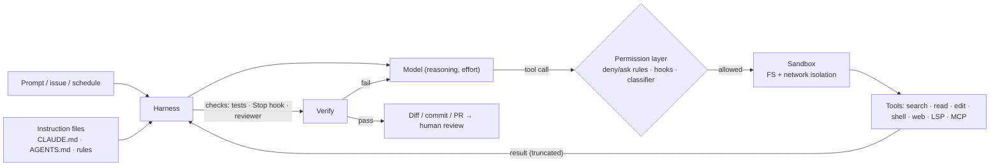

A **coding agent** is an LLM running in an [agent loop](agent-loop.md) inside a software repository. It gathers context (search, read files), acts (edit files, run shell commands, use git) and verifies (run tests, builds, linters, screenshots), repeating until the task is done or it hands back to a human. The model supplies the reasoning. The **[harness](harness-engineering.md)** around it (Claude Code, OpenAI Codex, Cursor's agent, GitHub Copilot's cloud agent, Devin) supplies the tools, decides what enters the context, enforces permissions and [sandboxing](code-execution-sandboxes.md), and persists state across sessions ([How Claude Code works](../sources/claude-code-how-it-works.md)). Benchmark scores and real-world results measure the model and harness together ([Anthropic SWE-bench post](../sources/anthropic-swe-bench-sonnet.md)).

## Anatomy of a harness

Synthesis: the diagram merges the Claude Code loop description, its permission/[hook](agent-hooks-and-middleware.md)/sandbox layering, and the Codex and Copilot equivalents described below.

**Core tools.** Claude Code groups its built-in tools into file operations, search (glob/regex), execution (shell, tests, git), web, and code intelligence (diagnostics, go-to-definition), plus tools for subagents and asking the user ([How it works](../sources/claude-code-how-it-works.md)). Anthropic's SWE-bench scaffold showed how far a minimal set goes: a bash tool and one view/edit tool reached 49% on SWE-bench Verified with Claude 3.5 Sonnet in January 2025 ([SWE-bench post](../sources/anthropic-swe-bench-sonnet.md)). See [tools](tools.md) and [function calling](function-calling.md).

**Tool design is the agent-computer interface (ACI).** SWE-agent showed that interface details shift results by several points. On SWE-bench Lite with GPT-4 Turbo (18.0% full configuration), removing the edit command cost 7.7 points, editing without lint guardrails cost 3.0, and showing the full file instead of a 100-line window cost 5.3 ([SWE-agent](../sources/swe-agent-yang-2024.md)). Lessons repeated across sources:

| Design choice | Why | Source |
|---|---|---|
| Exact-match string replacement (`old_str`→`new_str`, error unless exactly one match) | Most reliable edit format; failure is explicit and retryable | [Anthropic](../sources/anthropic-swe-bench-sonnet.md) |
| Absolute paths | Agent stops getting lost after `cd` | [Anthropic](../sources/anthropic-swe-bench-sonnet.md) |
| Lint check rejects broken edits | Failed edits cascade: success odds fall from 90.5% to 57.2% after one failed edit | [SWE-agent](../sources/swe-agent-yang-2024.md) |
| Capped, summarised search output (e.g. 50 hits) and truncated tool results (Claude Code default 25k tokens) | Keeps context high-signal; truncation message steers to narrower queries | [SWE-agent](../sources/swe-agent-yang-2024.md), [writing tools](../sources/anthropic-writing-tools-for-agents.md) |
| Grep **plus** semantic ([embedding](embeddings.md)) search | Cursor: +12.5% average offline accuracy; in an online A/B, code retention rose most (+2.6%) on 1,000+ file repos | [Cursor](../sources/cursor-semantic-search.md) |
| Collapse old observations / [compact](context-compaction.md) history | Bounded context growth | [SWE-agent](../sources/swe-agent-yang-2024.md), [How it works](../sources/claude-code-how-it-works.md) |

Single-model edits replaced the 2024 pattern where a large model wrote edit instructions and a small "apply" model executed them, which was fragile ([Cognition](../sources/cognition-dont-build-multi-agents.md)).

**Context management.** Each session starts with a fresh window. Claude Code loads instruction files, auto memory (first 200 lines or 25KB of MEMORY.md), [skill](agent-skills.md) descriptions and [MCP](model-context-protocol.md) tool *names* (definitions are deferred and loaded via tool search). It compacts automatically near the limit, and early detailed instructions can be lost when it does ([How it works](../sources/claude-code-how-it-works.md)). As of November 2026 most current Claude models have a 1M-token window, so running out is rare. `/clear` between unrelated tasks still helps quality and cost because every turn re-sends the whole conversation ([best practices](../sources/claude-code-best-practices.md)). See [context engineering](context-engineering.md), [context window](context-window.md) and [prompt caching](prompt-caching.md).

## Instruction files: CLAUDE.md, AGENTS.md, rules

All major agents inject repo-level Markdown ([agent instruction files](agent-instruction-files.md)) into the context. These files are *guidance the model may weigh*, not enforcement ([memory docs](../sources/claude-code-memory-docs.md)).

| | Claude Code | OpenAI Codex | Cursor | Copilot cloud agent |
|---|---|---|---|---|
| Main file | `CLAUDE.md` (+ `CLAUDE.local.md`, managed policy file) | `AGENTS.md` (+ `AGENTS.override.md`, fallback names) | `.cursor/rules/*.mdc`, `AGENTS.md` | custom instructions, `AGENTS.md` (listed as supported by agents.md) |
| Discovery | Ancestors at launch; subdirectories lazily when touched; concatenated root→cwd | Global `~/.codex`, then root→cwd, at most one file per dir, concatenated | Nested AGENTS.md merge, more specific wins; rules by mode | n/a in sources |
| Scoping | `.claude/rules/` with `paths:` globs; `@path` imports (max 4 hops) | Nesting per directory | Always / intelligent / glob / manual | |
| Size guidance | < 200 lines per file | 32 KiB combined cap (`project_doc_max_bytes`); later files dropped | < 500 lines per rule | |
| AGENTS.md interop | Reads AGENTS.md if no CLAUDE.md (v2.1.277+); else import it or change the setting | Native | Native | Native |

Sources: [memory docs](../sources/claude-code-memory-docs.md), [Codex AGENTS.md](../sources/openai-codex-agents-md-docs.md), [Cursor rules](../sources/cursor-rules-docs.md), [agents.md](../sources/agents-md-spec.md).

AGENTS.md is a vendor-neutral convention that came out of OpenAI Codex, Amp, Jules, Cursor and Factory. It is now stewarded by the Agentic AI Foundation under the Linux Foundation and reports 60k+ adopting repositories as of November 2026. It has no required fields, the nearest file wins, and an explicit chat prompt overrides everything ([agents.md](../sources/agents-md-spec.md)).

**What to put in them** ([best practices](../sources/claude-code-best-practices.md)): only what the agent can't discover by reading code, or would re-derive every session. That means exact install/test/typecheck/lint commands (including how to run one test file), misleading areas ("legacy dir is live, don't copy it"), decisions made outside the repo, and anything you have corrected twice. Leave out architecture descriptions the agent can read for itself. Every line costs attention on every task. Shouting ("IMPORTANT") tends to make the model over-apply a rule. A line that keeps being ignored means the file is too long, or the rule needs a hook. Long procedures belong in on-demand skills, not always-loaded files.

## Permissions and sandboxing

Two orthogonal controls, which both Anthropic and OpenAI separate explicitly:

1. **Permission / approval policy**: when the agent must ask. Claude Code offers Manual, Accept edits, Plan (read-only) and Auto modes. Auto is the starting mode for interactive terminal and VS Code sessions (v2.1.283+). In Auto, a classifier model screens risky actions such as `curl | bash`, production deploys, force pushes, data exfiltration and actions that look driven by content the agent read. Allow/ask/deny rules and PreToolUse hooks run first, and deny rules hold even in bypass mode ([best practices](../sources/claude-code-best-practices.md)). Codex has `on-request`, `never` (CI) and `granular` approval policies, plus an optional auto-review agent that fails closed ([Codex security](../sources/openai-codex-sandbox-approvals.md)).
2. **Sandbox**: what commands can physically do. Claude Code uses bubblewrap (Linux) or seatbelt (macOS) to confine writes to the working directory, and routes network traffic through a domain-allowlisting proxy. It cut permission prompts by 84% internally ([sandboxing post](../sources/anthropic-claude-code-sandboxing.md)). Codex has `read-only`, `workspace-write` and `danger-full-access` modes, network off by default, and `.git`/`.codex`/`.aws` kept read-only inside writable roots ([Codex security](../sources/openai-codex-sandbox-approvals.md)).

Both layers are needed. Without network isolation an injected agent can exfiltrate keys. Without filesystem isolation it can escape the sandbox ([sandboxing post](../sources/anthropic-claude-code-sandboxing.md)). Permission rules match *tool calls, not intent*. A `Read(.env)` deny catches `cat .env` but not a script that opens the file. A WebFetch domain deny doesn't stop `curl` unless the sandbox is on ([best practices](../sources/claude-code-best-practices.md)). See [agent guardrails](agent-guardrails.md) and [prompt injection](prompt-injection.md).

**Cloud and asynchronous agents** move isolation into managed VMs or containers:
- Claude Code on the web keeps git credentials outside the sandbox. A proxy checks, for example, that a push targets only the configured branch, then attaches the real token ([sandboxing post](../sources/anthropic-claude-code-sandboxing.md)).
- Codex cloud may use the network during setup, then runs the agent phase offline with secrets removed ([Codex security](../sources/openai-codex-sandbox-approvals.md)).
- Copilot's cloud agent runs either in a GitHub Actions environment (one repo, 59-minute cap) or in a cloud sandbox (can span repos in one org, no custom compute or self-hosted runners), behind a firewall. It pushes only to a `copilot/` branch, can't approve or merge its own PRs (and its requester can't approve them either), and Actions workflows don't run until a human with write access approves. It also strips hidden characters from inputs and self-scans with CodeQL and secret scanning ([Copilot docs](../sources/github-copilot-cloud-agent-docs.md)).

## Verification: the decisive practice

An agent stops when work *looks* done, so it needs a check that returns pass/fail ([best practices](../sources/claude-code-best-practices.md)). Claude Code's escalation ladder runs from the prompt ("run the auth tests and keep going until they pass"), to `/goal` (a separate model checks a condition each turn), to a `Stop` hook that exits with code 2 to send the agent back (capped at eight consecutive blocks), to review by a fresh subagent that never saw the reasoning. Ask for evidence (the command and its output), not a claim. When asking a reviewer for issues, tell it to skip style, or it will always find *something* ([best practices](../sources/claude-code-best-practices.md)). Unit tests can lie by omission: Anthropic's long-running harness only got reliable feature completion once agents tested as a user through browser automation (see [computer-use agents](computer-use-agents.md)) ([long-running harnesses](../sources/anthropic-effective-harnesses-long-running-agents.md)). See [verification and evals](verification-and-evals.md).

## Long-running and parallel work

- **Externalise state.** For multi-session builds, an initializer agent writes `init.sh`, a progress log, a JSON feature list (all failing at first) and an initial commit. Each later session reads these, runs a smoke test, implements one feature and commits. This counters the two observed failures: *one-shotting* (running out of context mid-feature) and *premature victory* ([long-running harnesses](../sources/anthropic-effective-harnesses-long-running-agents.md)). Related: [agent memory](agent-memory.md).
- **Subagents** add parallelism, isolate noisy output and give unbiased review, at a token cost. They don't make answers smarter ([best practices](../sources/claude-code-best-practices.md)). Cognition (Devin) warns that parallel subagents writing code make conflicting implicit decisions. It prefers a single-threaded agent, with a history-compression model for very long tasks ([Cognition](../sources/cognition-dont-build-multi-agents.md)). See [subagents](subagents.md).
- **Parallel sessions** use git worktrees ([How it works](../sources/claude-code-how-it-works.md)).
- **Headless runs** (`claude -p`, Codex with approval `never`) belong in CI and loops. Before running unattended, settle five things: define done, give a self-check, restrict scope, cap turns or spend (`--max-turns`, `--max-budget-usd`), and route results to a human-approved PR ([best practices](../sources/claude-code-best-practices.md)).

## Benchmarks and what they mean

| Benchmark | What | Status (2026-11) |
|---|---|---|
| SWE-bench (2023) | 2,294 real issues from 12 Python repos, graded by the fixing PR's tests. Claude 2 solved 1.96% at launch | Historical baseline ([paper](../sources/jimenez-2023-swe-bench.md)) |
| SWE-bench Verified | 500 human-validated tasks | OpenAI stopped reporting it in Feb 2026: models reproduce gold patches; 59.4% of 138 audited hard tasks had flawed tests; SOTA crept 74.9%→80.9% in six months ([OpenAI](../sources/openai-swe-bench-verified-retired.md)) |
| SWE-bench Pro | 1,865 long-horizon tasks, 41 repos, private held-out and commercial subsets | At release (v1, Sept 2025) best was GPT-5 at 23.3% public; the v2 paper (Nov 2025) reports up to 43.6% public (Claude Sonnet 4.5) and 17.8% commercial (Claude Opus 4.1). Grading quality disputed by third parties ([paper](../sources/swe-bench-pro-2025.md)) |
| Terminal-Bench 2.0 | 89 hard terminal tasks with their own environments | Frontier agents < 65% at publication ([paper](../sources/terminal-bench-2026.md)) |

Read scores with care. They mix model and scaffold, hidden tests let agents believe they succeeded when they hadn't, and some failures are environment problems ([SWE-bench post](../sources/anthropic-swe-bench-sonnet.md)). Productivity is not the same as benchmark score. In METR's 2025 randomized trial, experienced developers on their own mature repos took 19% *longer* with early-2025 AI tools (mainly Cursor with Claude 3.5/3.7 Sonnet), yet believed they had been sped up ~20% ([METR](../sources/metr-2025-developer-productivity.md)). See [benchmarks](benchmarks.md) and [LLM evaluation](llm-evaluation.md).

## Product landscape (2026-11)

| Product | Shape | Distinctive points |
|---|---|---|
| Claude Code | Terminal-first, also IDE/desktop/web/Slack/CI; local, cloud or remote-control execution | Hooks, skills, subagents, auto-mode classifier, OS sandbox; default Opus 5.5 at medium effort ([How it works](../sources/claude-code-how-it-works.md), [best practices](../sources/claude-code-best-practices.md)) |
| OpenAI Codex | Open-source CLI (Apache-2.0) plus IDE extension, desktop app and cloud | AGENTS.md origin, sandbox modes × approval policies ([Codex security](../sources/openai-codex-sandbox-approvals.md)) |
| Cursor | IDE-native agent | Custom-trained code embeddings plus grep, `.mdc` rules ([Cursor](../sources/cursor-semantic-search.md)) |
| GitHub Copilot cloud agent | Asynchronous, issue/PR-driven, runs on Actions or GitHub cloud sandboxes | Inherits GitHub branch protection, reviews and audit ([Copilot docs](../sources/github-copilot-cloud-agent-docs.md)) |
| Devin (Cognition) | Autonomous cloud engineer | Single-threaded, context-sharing philosophy ([Cognition](../sources/cognition-dont-build-multi-agents.md)) |

To build your own coding agent rather than use one, see [Claude Agent SDK](claude-agent-sdk.md) and [OpenAI Agents SDK](openai-agents-sdk.md).

## Failure modes

- **Says done when it isn't**: no runnable check, hidden tests, or tests that don't exercise the real path ([best practices](../sources/claude-code-best-practices.md), [long-running harnesses](../sources/anthropic-effective-harnesses-long-running-agents.md)).
- **Wrong or over-specific fix** (~52% of SWE-agent failures) and **cascading failed edits** (~23%) ([SWE-agent](../sources/swe-agent-yang-2024.md)).
- **Context poisoning by failed attempts**: after two failed corrections, `/clear` and re-prompt rather than adding a third ([best practices](../sources/claude-code-best-practices.md)).
- **Instruction drift**: rules lost at compaction, too-long instruction files, contradictory nested files, or a Codex chain silently capped at 32 KiB ([memory docs](../sources/claude-code-memory-docs.md), [Codex AGENTS.md](../sources/openai-codex-agents-md-docs.md)).
- **Approval fatigue**: users rubber-stamp prompts, which sandboxes are designed to fix ([sandboxing post](../sources/anthropic-claude-code-sandboxing.md)).
- **Prompt injection** from issues, web pages or committed instruction files, contained by sandbox, firewall, hidden-character filtering and branch limits ([Codex security](../sources/openai-codex-sandbox-approvals.md), [Copilot docs](../sources/github-copilot-cloud-agent-docs.md)).
- **Cost blowups**: hundreds of turns per task, background loops and subagents ([SWE-bench post](../sources/anthropic-swe-bench-sonnet.md), [best practices](../sources/claude-code-best-practices.md)).

## When to use / when not

Synthesis, drawing on the sources above and the [Notebook harness tutorial](../sources/notebook-agent-engineering.md):
- **Good fit:** tasks with a crisp pass/fail check (failing test, typecheck, migration across many files, CI fix), repo exploration and Q&A, scaffolding, and batch migrations via headless loops. These are open-ended work where the model should drive but the stop condition is measurable.
- **Use more structure** (a graph workflow, narrow tools, [human gates](human-in-the-loop.md)) when the path must be guaranteed, as in compliance flows or irreversible operations, and whenever actions touch production systems that checkpoints can't undo.
- **Be sceptical** of claimed speedups for experts on familiar, high-standards codebases. Measure on your own work ([METR](../sources/metr-2025-developer-productivity.md)).
- **FDE checklist:** a short AGENTS.md/CLAUDE.md with commands; deny rules plus sandbox for secrets and network; a Stop hook or CI as the definition of done; branch protection and human merge; turn and budget caps for unattended runs.

## Sources

- [How Claude Code works](../sources/claude-code-how-it-works.md)
- [Best practices for Claude Code](../sources/claude-code-best-practices.md)
- [How Claude remembers your project](../sources/claude-code-memory-docs.md)
- [Claude Code sandboxing (Anthropic, 2025)](../sources/anthropic-claude-code-sandboxing.md)
- [Raising the bar on SWE-bench Verified (Anthropic, 2025)](../sources/anthropic-swe-bench-sonnet.md)
- [Effective harnesses for long-running agents (Anthropic, 2025)](../sources/anthropic-effective-harnesses-long-running-agents.md)
- [Writing effective tools for agents (Anthropic, 2025)](../sources/anthropic-writing-tools-for-agents.md)
- [AGENTS.md](../sources/agents-md-spec.md)
- [Codex: custom instructions with AGENTS.md](../sources/openai-codex-agents-md-docs.md)
- [Codex: agent approvals and security](../sources/openai-codex-sandbox-approvals.md)
- [GitHub Copilot cloud agent docs](../sources/github-copilot-cloud-agent-docs.md)
- [Cursor: improving agent with semantic search](../sources/cursor-semantic-search.md)
- [Cursor rules docs](../sources/cursor-rules-docs.md)
- [Don't Build Multi-Agents (Cognition, 2025)](../sources/cognition-dont-build-multi-agents.md)
- [SWE-bench (Jimenez et al., 2023)](../sources/jimenez-2023-swe-bench.md)
- [SWE-agent (Yang et al., 2024)](../sources/swe-agent-yang-2024.md)
- [Why we no longer evaluate SWE-bench Verified (OpenAI, 2026)](../sources/openai-swe-bench-verified-retired.md)
- [SWE-Bench Pro (Scale AI, 2025)](../sources/swe-bench-pro-2025.md)
- [Terminal-Bench (2026)](../sources/terminal-bench-2026.md)
- [METR developer productivity RCT (2025)](../sources/metr-2025-developer-productivity.md)
- [Harness vs Loop vs Graph Engineer (Notebook)](../sources/notebook-agent-engineering.md)
