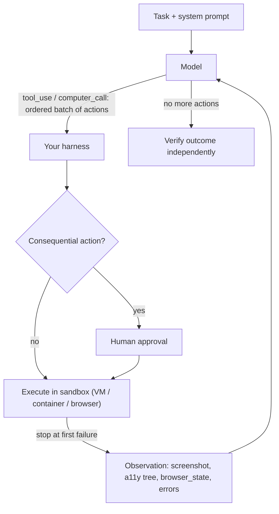

A **computer-use agent** is an [agent loop](agent-loop.md) whose tools are the human interface itself: it observes a screen (screenshots, and for browsers often the accessibility tree), and acts with mouse clicks, typing, scrolling and key presses. It lets a model operate software that has no API: legacy desktop apps, web portals, internal tools. The model only *proposes* actions; your [harness](harness-engineering.md) executes them in a sandboxed VM, container or browser and returns the new observation. Vendors ship the model side (Anthropic's computer-use and browser-use toolsets, OpenAI's computer tool behind CUA/Operator); open tooling such as Playwright MCP supplies the browser side. They are the most general [tools](tools.md) an agent can have, and the most error-prone and attack-exposed.

## The loop

Both vendors use the same basic contract, with Anthropic's docs spelling out more of the error handling ([Anthropic computer use](../sources/anthropic-computer-use-tool-docs.md), [OpenAI computer use](../sources/openai-computer-use-guide.md)):

- The model may return **several actions in one turn** (Anthropic: multiple `tool_use` blocks; OpenAI: an ordered `actions` array in one `computer_call`). Execute them in order. Anthropic specifies: on the first failure, return an error for it and a fixed "Not executed" error for every later one; any unanswered `tool_use` block gets the next request rejected. OpenAI's guide gives no equivalent batch-error rule.
- Because a single batch can complete a multi-step action, [human approval](human-in-the-loop.md) must inspect **each** action before it runs, not the turn as a whole ([Anthropic computer use](../sources/anthropic-computer-use-tool-docs.md)).
- In OpenAI's API a `computer_call` with `status: "completed"` means the model finished *writing* the call, not that anything ran ([OpenAI computer use](../sources/openai-computer-use-guide.md)).
- The final message is a claim, not a fact: OpenAI advises verifying the actual outcome and capping steps, time and cost ([OpenAI computer use](../sources/openai-computer-use-guide.md)). See [verification and evals](verification-and-evals.md).

## The tool surfaces (as of 2026-11)

| | Anthropic computer use | Anthropic browser use | OpenAI computer use | Playwright MCP |
|---|---|---|---|---|
| Scope | Whole desktop | Browser tabs | Desktop or browser | Browser |
| Observation | Screenshots (+ `zoom` crops) | Accessibility tree refs, page text, screenshots, `browser_state` tab list | Screenshots | Accessibility snapshots; screenshots optional |
| Actions | 17 members: clicks, drag, mouse down/up, scroll, type, key (repeat), hold_key, wait, zoom | 31 members incl. `navigate`, `read_page`, `find`, `form_input`, tabs; JS exec, uploads, console/network off by default | click, double_click, drag, move, scroll, keypress, type, wait, screenshot; or model-written Playwright/PyAutoGUI code | navigate, snapshot, click, type, fill form, evaluate, tabs; `--caps=vision` adds coordinates |
| Version / model | `computer_toolset_20260801` (Fable/Mythos 5.2, Opus/Sonnet/Haiku 5.5); `computer_20251124` beta for Opus 4.5-4.7 and Sonnet 4.6 | `browser_toolset_20260801` | [Responses API](openai-responses-api.md) `computer` tool; `gpt-6-astra`, `gpt-6.1-sol`, code execution recommended for Astra | MCP server, any MCP client |

Sources: [Anthropic computer use](../sources/anthropic-computer-use-tool-docs.md), [Anthropic browser use](../sources/anthropic-browser-use-tool-docs.md), [OpenAI computer use](../sources/openai-computer-use-guide.md), [Playwright MCP](../sources/playwright-mcp-readme.md).

### Pixels vs structure

The central design choice is how the agent **grounds** an action on a target:

- **Coordinates from screenshots** work on anything (canvas, remote desktops, native apps) but depend on [visual grounding](multimodal-models.md), the main failure cause in OSWorld ([OSWorld](../sources/osworld-benchmark.md)).
- **Element references from the accessibility tree** are deterministic and usually cheaper in tokens than a screenshot ([Anthropic browser use](../sources/anthropic-browser-use-tool-docs.md), [Playwright MCP](../sources/playwright-mcp-readme.md)). But refs go stale when the DOM changes, and the API cannot detect it, so the executor must return an error ([Anthropic browser use](../sources/anthropic-browser-use-tool-docs.md)). Fall back to coordinates for canvas, video, virtualized lists and cross-origin iframes.
- **Code generation** (the model writes Playwright or PyAutoGUI scripts) is OpenAI's recommended path for its newest model ([OpenAI computer use](../sources/openai-computer-use-guide.md)), and Playwright's README suggests CLI-plus-skills over MCP for coding agents to save tokens ([Playwright MCP](../sources/playwright-mcp-readme.md)).

Synthesis: prefer the most structured interface that exists: a real API or [MCP](model-context-protocol.md) tool, then DOM/accessibility actions, then coordinates. OpenAI's guide makes the same ordering explicit by listing function tools, MCP and plain [web search](web-search-apis.md) as alternatives when the UI isn't the only way in ([OpenAI computer use](../sources/openai-computer-use-guide.md)).

### Screenshots, coordinates and tokens

- Coordinates are in **screenshot pixels**. If you downscale screenshots, scale clicks back up; on macOS Retina (2x), halve them ([Anthropic computer use](../sources/anthropic-computer-use-tool-docs.md)).
- Screenshots over the model's cap (2,576 px / 4,784 visual tokens on Claude 4.7+, 1,568 px earlier) are **rejected**, not downscaled, for tool results ([Anthropic vision](../sources/anthropic-vision-docs.md)). Recommended display: 1024x768 or 1280x720 for desktops, 1280x800 or 1366x768 for web apps, nothing above 1920x1080 ([Anthropic computer use](../sources/anthropic-computer-use-tool-docs.md)).
- Each screenshot is about 1,000-1,800 input tokens, so long sessions are a [context engineering](context-engineering.md) problem. Prune old screenshots in batches (Anthropic suggests keep the last three, prune every 25 turns) so [prompt caching](prompt-caching.md) still hits; on Fable/Mythos 5.1-5.2 and Opus/Sonnet/Haiku 5.5, client-side pruning invalidates every later [thinking block](extended-thinking.md), so Anthropic advises avoiding it (if you must prune, set `prefix_mismatch_behavior: "drop_block"`) ([Anthropic computer use](../sources/anthropic-computer-use-tool-docs.md)).
- Above 20 images in one request, a stricter per-image size limit applies, and screenshots in tool results count ([Anthropic vision](../sources/anthropic-vision-docs.md)).

## How good are they?

| Date | Result on OSWorld | Source |
|---|---|---|
| 2024-04 | Best model 12.24%; humans over 72.36% | [OSWorld](../sources/osworld-benchmark.md) |
| 2024-10 | Claude 3.5 Sonnet 14.9% screenshot-only (22.0% with more steps) | [Anthropic 2024](../sources/anthropic-computer-use-announcement-2024.md) |
| 2025-01 | OpenAI CUA 38.1%; also WebArena 58.1% (human 78.2%), WebVoyager 87% | [OpenAI CUA](../sources/openai-cua-announcement.md) |

The benchmark itself moved: OSWorld-Verified (2025-07) fixed broken tasks, and OSWorld 2.0 (2026-06) is the newer, harder version ([OSWorld](../sources/osworld-benchmark.md)). Synthesis: scores have risen fast since these snapshots and this wiki has no primary source for a current leaderboard figure, so check the official OSWorld leaderboard before quoting one, and remember that easy web benchmarks (WebVoyager) overstate reliability compared with harder ones ([OpenAI CUA](../sources/openai-cua-announcement.md)). See [benchmarks](benchmarks.md).

Persistent failure modes, from the sources:

- **GUI grounding and operational knowledge** (knowing *where* to click and *how* an app works) ([OSWorld](../sources/osworld-benchmark.md)).
- **Brittleness** to layout changes and visual noise ([OSWorld](../sources/osworld-benchmark.md)).
- **Fine-grained manipulation**: scrolling, dragging and zooming were hard in the first generation ([Anthropic 2024](../sources/anthropic-computer-use-announcement-2024.md)); Anthropic still advises keyboard shortcuts for dropdowns and scrollbars ([Anthropic computer use](../sources/anthropic-computer-use-tool-docs.md)).
- **Stale state**: acting on stale element refs or an outdated screenshot ([Anthropic browser use](../sources/anthropic-browser-use-tool-docs.md)).
- **False success**: claiming a task is done when it isn't, hence independent verification ([OpenAI computer use](../sources/openai-computer-use-guide.md)).
- Higher screenshot resolution and keeping a text trajectory history helped in OSWorld's analysis ([OSWorld](../sources/osworld-benchmark.md)).

Prompting practices that raise reliability ([Anthropic computer use](../sources/anthropic-computer-use-tool-docs.md)): well-specified tasks with explicit steps; ask for a screenshot after each step to confirm the outcome; put instructions before the screenshot; ask about specific regions so the model uses `zoom` on small text; include example screenshots and successful tool calls for repeated tasks.

## Safety: the threat model

A computer-use agent reads untrusted content (pages, emails, documents, ads, images) while holding the power to click, submit, download and send. That is the ideal setting for indirect [prompt injection](prompt-injection.md): for example, hidden white text in an email telling the agent to forward confidential mail ([Anthropic injection](../sources/anthropic-2025-prompt-injection-defenses-browser.md)).

Model-side defenses help but don't close the gap. Under an adaptive Best-of-N attacker, Anthropic measured browser-agent attack success rates of 8-14% for model alone, falling to 1.4-2.4% with improved safeguards (RL training on injections plus classifiers on incoming content); its own conclusion is that no browser agent is immune and 1% is still meaningful risk ([Anthropic injection](../sources/anthropic-2025-prompt-injection-defenses-browser.md)). Anthropic's classifiers scan tool-returned screenshots and steer the model to check with the user before acting ([Anthropic computer use](../sources/anthropic-computer-use-tool-docs.md)); OpenAI's API surfaces pending safety checks that should stop the loop or go to a human approval callback ([OpenAI computer use](../sources/openai-computer-use-guide.md)).

So the harness must be the security boundary. Combined checklist from the vendor docs ([Anthropic computer use](../sources/anthropic-computer-use-tool-docs.md), [Anthropic browser use](../sources/anthropic-browser-use-tool-docs.md), [OpenAI computer use](../sources/openai-computer-use-guide.md), [Playwright MCP](../sources/playwright-mcp-readme.md)):

1. **Isolate**: dedicated VM or container, minimal privileges, fresh browser profile without credentials, no access to sensitive filesystems or internal networks.
2. **Restrict the network**: domain allowlist enforced at the network layer and re-checked after redirects; block loopback, link-local and private ranges; accept only `http(s)` URLs, parsed with a real URL parser. Playwright MCP's origin lists are explicitly *not* a security boundary.
3. **Minimize powers**: keep JavaScript execution, file upload and console/network reading off unless needed; Playwright's unsafe code tool is RCE-equivalent.
4. **Gate consequential actions**: purchases, account changes, sending messages, accepting terms or cookies need human confirmation, checked per action.
5. **Keep secrets out of view**: no credentials in page text or screenshots; if the agent must log in, weigh the injection risk first.
6. **Bound runs**: step, time and cost limits; always tear down sessions.
7. **Tell users**: disclose the risks and get consent; sites see your executor's network identity.

See also [agent guardrails](agent-guardrails.md) and [LLM security risks](llm-security-risks.md).

## When to use / when not

- **Use** for software without an API (legacy desktop, vendor portals), long-tail cross-app workflows, UI testing and QA, and data entry where a human checks the result. Start with low-risk tasks, as Anthropic advised at launch ([Anthropic 2024](../sources/anthropic-computer-use-announcement-2024.md)).
- **Prefer a browser toolset or Playwright** over full desktop control when the task stays in the browser ([Anthropic browser use](../sources/anthropic-browser-use-tool-docs.md)).
- **Don't use** when an API, MCP server or a fixed set of known actions exists ([OpenAI computer use](../sources/openai-computer-use-guide.md)); for read-only lookups, use web search or fetch instead ([Anthropic browser use](../sources/anthropic-browser-use-tool-docs.md)).
- **Avoid** unattended runs that touch money, identity or irreversible actions. Synthesis: for production RPA-style workloads, record a successful agent trajectory once and convert it into a deterministic script (or [coding agent](coding-agents.md)-generated Playwright code), keeping the model for recovery when the script breaks; this cuts cost and latency compared with a screenshot per step.

## Sources

- [Anthropic Computer Use Tool Docs](../sources/anthropic-computer-use-tool-docs.md)
- [Anthropic Browser Use Tool Docs](../sources/anthropic-browser-use-tool-docs.md)
- [Anthropic, Introducing Computer Use (2024)](../sources/anthropic-computer-use-announcement-2024.md)
- [OpenAI, Computer-Using Agent](../sources/openai-cua-announcement.md)
- [OpenAI Computer Use Guide](../sources/openai-computer-use-guide.md)
- [OSWorld Benchmark](../sources/osworld-benchmark.md)
- [Anthropic, Prompt Injection in Browser Use](../sources/anthropic-2025-prompt-injection-defenses-browser.md)
- [Playwright MCP README](../sources/playwright-mcp-readme.md)
- [Anthropic Vision Docs](../sources/anthropic-vision-docs.md)
