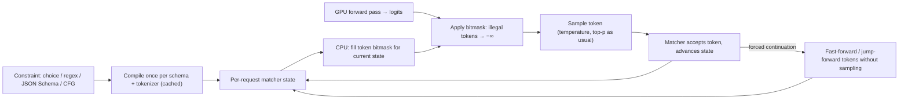

**Constrained decoding** (also called guided or structured generation) restricts which tokens a language model may emit at each step so that the finished output is guaranteed to belong to a formal language: a fixed choice list, a regex, a JSON Schema, or a context-free grammar. Before sampling, the engine computes a mask over the [vocabulary](tokenization.md) of tokens that can still lead to a valid string, sets the logits of every other token to −∞, and samples from what remains ([Willard & Louf](../sources/efficient-guided-generation-outlines.md), [Outlines](../sources/outlines-docs.md)). It is the mechanism under every vendor's "strict" or "structured outputs" mode ([structured outputs](structured-outputs.md)) and under the grammar options of self-hosted engines ([vLLM](../sources/vllm-structured-outputs-docs.md), [llama.cpp](../sources/llama-cpp-docs.md)). The guarantee is about **form**, not truth: it can force a field to exist and to be a number, not to be the right number.

## The decoding loop



Synthesis: the loop above combines the steps the engine sources describe. Three costs matter: **compile time** (once per schema, hits first-request latency), **per-step mask time** (CPU work that must fit inside the GPU forward pass to be "free"), and **distortion** (the masked distribution is not what the model would have produced).

## How the engines compile constraints

### Regex → finite-state machine (Outlines, `outlines-core`)

Willard and Louf compile a regex into a finite-state machine over characters, then build an **index** mapping each FSM state to the set of vocabulary tokens whose full byte string can be consumed from that state. At decode time the mask is a lookup ([Willard & Louf](../sources/efficient-guided-generation-outlines.md)). JSON Schema is handled by converting the schema to a regex, which works for bounded structures but cannot express unbounded nesting. The price is paid up front: the index is built for every state, which is fast at runtime but slow to compile. JSONSchemaBench measured Outlines compile times of 3.5–8.1 s per schema on Llama-3.1-8B ([JSONSchemaBench](../sources/jsonschemabench-2025.md)), and the llguidance authors note precomputing all states limits constraint complexity and costs memory ([llguidance blog](../sources/llguidance-go-brrr-2025.md)).

### CFG → pushdown automaton with prechecked tokens (XGrammar)

JSON with arbitrary nesting, or a SQL or DSL grammar, needs a context-free grammar and so a stack. Naively, every vocabulary token would need a stack-dependent check every step. XGrammar splits tokens into **context-independent** ones (validity decidable from the automaton position alone, precomputed per grammar position) and **context-dependent** ones (checked at runtime against a persistent stack), applies grammar transformations to shrink the second set, and overlaps mask computation on CPU with the GPU forward pass. It reports up to 100× speedups over earlier engines and near-zero end-to-end overhead ([XGrammar](../sources/xgrammar-structured-generation.md)). It accepts JSON Schema, regex, EBNF and Lark grammars and "structural tags" (schemas that apply only inside tagged spans, used for tool calls and reasoning). It is the default backend in [vLLM](vllm.md), SGLang, TensorRT-LLM and MLC-LLM; XGrammar-2 shipped in May 2026 ([XGrammar GitHub](../sources/xgrammar-github.md)).

### On-the-fly Earley + lexer + token trie (llguidance / Guidance)

llguidance (Microsoft, Rust, MIT) does almost no precomputation. A regex lexer built from regex derivatives handles nearly all checks; an Earley parser handles the grammar and is consulted for only about 0.1–1% of token checks; the vocabulary is stored as a byte trie so one illegal byte prunes a whole subtree; and a "slicer" skips the trie for vocabulary slices the lexer allows wholesale. Reported numbers: ~50 µs average per mask on a 128k vocabulary, ~2 ms startup, under 1% of masks above 1 ms ([llguidance](../sources/llguidance-github.md), [blog](../sources/llguidance-go-brrr-2025.md)). It is integrated in vLLM (0.8.2+), SGLang (0.4.4+), llama.cpp (b4613+), Chromium, and since 2025-05-20 in OpenAI's Structured Outputs for JSON Schema ([llguidance](../sources/llguidance-github.md)).

### llama.cpp GBNF

llama.cpp has its own grammar format, GBNF, plus a JSON-schema-to-grammar path (`--grammar`, `--json-schema`, per-request `json_schema`) ([llama.cpp](../sources/llama-cpp-docs.md)); it can also be built with llguidance ([llguidance](../sources/llguidance-github.md)).

### Engine comparison (JSONSchemaBench, early 2025)

| Engine | Approach | Compile (median) | Time / output token | Coverage notes |
|---|---|---|---|---|
| Unconstrained | none | – | ~15–17 ms | – |
| Guidance (llguidance) | Earley + lexer, on the fly, fast-forward | ~0 s | 6.4–9.5 ms | highest empirical coverage on 6/8 datasets |
| llama.cpp GBNF | grammar interpreter | ~0.05 s | 27–30 ms | strong on some datasets |
| XGrammar | PDA + precomputed context-independent tokens | 0.11–0.30 s (HF backend) | 65–67 ms (HF backend) | under-constrained in 38/43 test-suite categories |
| Outlines | regex FSM index | 3.5–8.1 s | 30–47 ms | 0.03 empirical coverage on "GitHub Hard" |
| OpenAI / Gemini | server-side | – | – | reject many schemas, near-100% compliance on accepted ones |

Source: [JSONSchemaBench](../sources/jsonschemabench-2025.md); several of its authors build Guidance, so treat the ranking as one well-documented benchmark, not neutral ground truth. The Guidance, llama.cpp and Outlines rows were measured on a llama.cpp backend; the XGrammar numbers were measured through [Hugging Face](hugging-face-ecosystem.md) Transformers, where Guidance itself ran at ~37 ms per token, so the XGrammar row is not directly comparable to the others, and it does not reflect a serving engine where XGrammar overlaps mask work with the GPU ([JSONSchemaBench](../sources/jsonschemabench-2025.md), [XGrammar](../sources/xgrammar-structured-generation.md)). Engines have changed since (XGrammar-2, llguidance 1.x).

## Latency in practice

- **Compile time** dominates for new schemas. Vendors cache compiled grammars (Anthropic: 24 h from last use; OpenAI notes extra latency on a schema's first request) ([Anthropic](../sources/anthropic-structured-outputs-docs.md), [OpenAI](../sources/openai-structured-outputs-guide.md)). Synthesis: in self-hosted serving, per-request dynamic schemas favour low-startup engines (llguidance); a small set of fixed schemas favours precompiling ones.
- **Per-step masking** is CPU work. llguidance budgets 0.1–10 ms per mask depending on batch size and cores, and claims 16 cores can keep up with batches of ~3,200 at a 10 ms forward pass ([llguidance](../sources/llguidance-github.md), [blog](../sources/llguidance-go-brrr-2025.md)). Synthesis: the slow-mask tail, not the average, is what stalls a batch, because every sequence waits for the slowest mask.
- **Constraints can make decoding faster.** When the grammar forces the next characters (`{"name": "` boilerplate, closing braces), the engine can append them without sampling. JSONSchemaBench measured Guidance at 6.4–9.5 ms per output token vs 15–17 ms unconstrained ([JSONSchemaBench](../sources/jsonschemabench-2025.md)); DOMINO reports up to ~2× speedups ([DOMINO](../sources/domino-guiding-llms-right-way.md)). See also [speculative decoding](speculative-decoding.md) and [LLM inference serving](llm-inference-serving.md).

## Effect on output quality

The evidence conflicts, and the conflict is mostly about methodology:

- **Harm claimed.** Tam et al. found format restrictions significantly degrade reasoning, more so the stricter the format ([Let Me Speak Freely?](../sources/let-me-speak-freely.md)).
- **Harm disputed.** .txt re-ran the tasks with matched prompts and regex answer parsing and found structured generation equal or better (GSM8K 0.77→0.78, Last Letter 0.73→0.77, Shuffle Objects 0.41→0.44), arguing the original conflated vendor JSON mode with constrained decoding and gave the JSON condition a worse prompt ([Say What You Mean](../sources/dottxt-say-what-you-mean.md)). JSONSchemaBench also found constrained runs slightly above unconstrained on the same three tasks ([JSONSchemaBench](../sources/jsonschemabench-2025.md)).
- **Real mechanisms of distortion.** (1) *Token misalignment*: forcing a string through unnatural subword splits pushes the model off-distribution and costs accuracy; DOMINO aligns constraints with subword boundaries to avoid it ([DOMINO](../sources/domino-guiding-llms-right-way.md)). Guidance's quality edge is attributed to *token healing* ([JSONSchemaBench](../sources/jsonschemabench-2025.md)). (2) *No room to think*: if the answer field comes first, the model must commit before reasoning. Put a reasoning field first, or reason outside the grammar: Anthropic applies the grammar only to the final output, not [thinking blocks](extended-thinking.md) ([Anthropic](../sources/anthropic-structured-outputs-docs.md)), and vLLM separates reasoning from constrained content via `--reasoning-parser` ([vLLM](../sources/vllm-structured-outputs-docs.md)). (3) *Forced choice*: when the "right" continuation is masked, the model picks the best legal one, which can be a well-formed fabrication ([OpenAI](../sources/openai-structured-outputs-guide.md)).

Synthesis: describe the schema in the prompt as well as enforcing it, order fields so reasoning precedes answers, and evaluate constrained vs unconstrained on your own task ([LLM evaluation](llm-evaluation.md)) rather than trusting either camp.

## Provider strict modes: what each enforces (as of 2026-11)

| Feature | OpenAI strict | Anthropic strict | Gemini | vLLM / SGLang (xgrammar, llguidance) |
|---|---|---|---|---|
| Recursion | yes (`$ref`) | no (400) | bounded | yes (CFG) |
| Numeric bounds | yes | no (400) | – | engine-dependent |
| String `pattern` | yes | simple regex only | – | yes (Rust regex syntax) |
| String length | not listed as supported | no (400) | silently stripped | engine-dependent |
| `minItems`/`maxItems` | yes | only 0/1 | yes | engine-dependent |
| `allOf` / `not` | no / no | `allOf` yes | – | engine-dependent |
| Optional fields | must be `required` + nullable | allowed (limits apply) | allowed | engine-dependent |
| Arbitrary CFG / regex output | no | no | no | yes |

Sources: [OpenAI](../sources/openai-structured-outputs-guide.md), [Anthropic](../sources/anthropic-structured-outputs-docs.md), [Gemini](../sources/gemini-structured-outputs-docs.md), [vLLM](../sources/vllm-structured-outputs-docs.md), [JSONSchemaBench](../sources/jsonschemabench-2025.md). Full API shapes and limits are on [structured outputs](structured-outputs.md). The key distinction: OpenAI and Anthropic *reject* unsupported keywords, Gemini *silently drops* some, and open-source engines vary in whether they enforce or under-constrain them ([JSONSchemaBench](../sources/jsonschemabench-2025.md)).

## Example: self-hosted vLLM

```python
from openai import OpenAI
client = OpenAI(base_url="http://localhost:8000/v1", api_key="x")
r = client.chat.completions.create(
    model="Qwen/Qwen3-8B",
    messages=[{"role": "user", "content": "Classify: 'refund not received'"}],
    extra_body={"structured_outputs": {"choice": ["billing", "shipping", "other"]}},
)
```

The `structured_outputs` key replaces the `guided_*` fields removed in vLLM v0.12.0; `regex`, `json`, `grammar` and `structural_tag` are the other kinds, and the backend is `auto`, `xgrammar` or `guidance` ([vLLM](../sources/vllm-structured-outputs-docs.md)).

## Failure modes

1. **Truncation.** The grammar cannot close a JSON object if `max_tokens` ends generation first; check the stop reason before parsing ([OpenAI](../sources/openai-structured-outputs-guide.md), [Anthropic](../sources/anthropic-structured-outputs-docs.md)).
2. **Refusals.** A safety refusal can bypass the schema (Anthropic `stop_reason: "refusal"`, OpenAI `refusal` content part) ([Anthropic](../sources/anthropic-structured-outputs-docs.md), [OpenAI](../sources/openai-structured-outputs-guide.md)).
3. **Enum drift.** Claude may return an enum value differing only in case ([Anthropic](../sources/anthropic-structured-outputs-docs.md)). Synthesis: normalise and validate enums client-side; in self-hosted engines, a `choice` constraint is exact.
4. **Silent under-constraint.** Gemini strips length/uniqueness keywords; XGrammar accepted invalid output in many JSON Schema Test Suite categories in early 2025 ([Gemini](../sources/gemini-structured-outputs-docs.md), [JSONSchemaBench](../sources/jsonschemabench-2025.md)). Always re-validate with the original schema.
5. **Schema rejection / compile blow-up.** Complex unions and many optional fields grow grammar state (Anthropic: each optional parameter roughly doubles part of the state space; 180 s compile timeout) ([Anthropic](../sources/anthropic-structured-outputs-docs.md)).
6. **Whitespace runaway.** Unconstrained whitespace lets a model loop on spaces or newlines until the token limit; OpenAI documents this for JSON mode without instructions ([OpenAI](../sources/openai-structured-outputs-guide.md)). Synthesis: prefer compact-JSON whitespace settings where the engine offers them.
7. **Special-token mismatch.** A grammar literal like `</think>` can match the text without matching the special token ID ([vLLM](../sources/vllm-structured-outputs-docs.md)).
8. **Hallucination to fit** when the input lacks the requested data ([OpenAI](../sources/openai-structured-outputs-guide.md)); see [hallucination](hallucination.md).

## When to use / when not

- **Use** when code consumes the output: extraction, classification, routing, tool arguments ([function calling](function-calling.md)), [text-to-SQL](text-to-sql.md) with a SQL grammar, [document processing](document-processing.md). Synthesis: small and [local models](local-llms.md) likely benefit most, since they follow format instructions less reliably.
- **Use a regex or `choice` constraint** for labels and IDs instead of a JSON wrapper. Synthesis: fewer tokens, no parsing.
- **Don't** constrain long-form reasoning or prose; constrain only the final answer.
- **Don't treat it as validation.** Semantic rules (cross-field consistency, "quote must appear in source") need client-side validation and retry, as in [Instructor](instructor-and-outlines.md).
- **API vs self-hosted.** On APIs you get the vendor's schema subset and no arbitrary grammars; self-hosted you choose the engine and get regex/CFG, at the cost of operating it ([open-weight models](open-weight-models.md)).

## Sources

- [Efficient Guided Generation for LLMs (Outlines paper)](../sources/efficient-guided-generation-outlines.md)
- [XGrammar paper](../sources/xgrammar-structured-generation.md)
- [XGrammar GitHub and docs](../sources/xgrammar-github.md)
- [llguidance README](../sources/llguidance-github.md)
- [LLGuidance: Making Structured Outputs Go Brrr](../sources/llguidance-go-brrr-2025.md)
- [JSONSchemaBench](../sources/jsonschemabench-2025.md)
- [Guiding LLMs The Right Way (DOMINO)](../sources/domino-guiding-llms-right-way.md)
- [Let Me Speak Freely?](../sources/let-me-speak-freely.md)
- [Say What You Mean (.txt)](../sources/dottxt-say-what-you-mean.md)
- [vLLM Structured Outputs Docs](../sources/vllm-structured-outputs-docs.md)
- [Outlines Documentation](../sources/outlines-docs.md)
- [llama.cpp docs](../sources/llama-cpp-docs.md)
- [OpenAI Structured Outputs Guide](../sources/openai-structured-outputs-guide.md)
- [Anthropic Structured Outputs Docs](../sources/anthropic-structured-outputs-docs.md)
- [Gemini Structured Outputs Docs](../sources/gemini-structured-outputs-docs.md)
