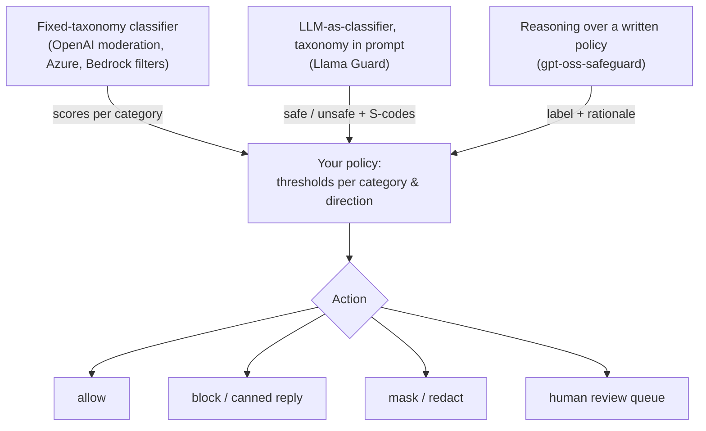

**Content moderation** for LLM applications means classifying content against a **harm taxonomy** and acting on the result. The content can be a user prompt, a model response, an image, or a tool result. The taxonomy covers categories such as hate, harassment, sexual content, violence, self-harm and illicit activity. The action is to block, mask, warn, route to a [human](human-in-the-loop.md), or simply log. It answers a different question from [prompt-injection](prompt-injection.md) detection. Moderation asks *is this content harmful?* Injection detection asks *is this text trying to override my instructions?* The two need different classifiers ([Prompt Shields](../sources/azure-ai-content-safety-docs.md) state this explicitly). Moderation is one layer of [guardrail tooling](guardrail-tooling.md).

## How moderation classifiers work

There are three generations, and all three are in production today:

1. **Fixed-taxonomy classifiers.** A trained model returns per-category probabilities or severities. OpenAI's 2022 recipe shows that the hard part is the process around the model: a precise taxonomy, clear labelling instructions, data-quality control, and **active learning** to find rare harmful events in mostly benign traffic ([Markov et al.](../sources/markov-2022-undesired-content-detection.md)). These classifiers are fast and cheap, but the policy is frozen into the training data.
2. **LLM classifiers with the taxonomy in the prompt.** Llama Guard feeds the category definitions and the conversation to an instruction-tuned LLM, which generates `safe` or `unsafe` plus the violated categories. It handles user prompts and agent responses as separate tasks. You can swap the taxonomy zero- or few-shot at inference time ([Inan et al.](../sources/inan-2023-llama-guard.md)). This is a specialised form of [LLM-as-judge](llm-as-judge.md).
3. **Policy-reasoning models.** gpt-oss-safeguard (20b and 120b, Apache 2.0) takes a policy you write in prose, reasons about it with selectable effort (low, medium, high), and returns a label with its rationale. You change the policy by editing text, not by retraining ([card](../sources/gpt-oss-safeguard-model-card.md)). A related approach, Anthropic's Constitutional Classifiers, uses a written "constitution" to *generate [synthetic training data](synthetic-data-generation.md)* for faster classifiers ([Sharma et al.](../sources/sharma-2025-constitutional-classifiers.md)).

Synthesis: as you move from 1 to 3, you gain policy flexibility and explanations, and you pay in latency and compute. Pick the cheapest generation that can express your policy.

## The main options (as of 2026-11)

| | OpenAI moderation | Azure AI Content Safety | [Bedrock](amazon-bedrock.md) content filters | Llama Guard 4 | gpt-oss-safeguard |
|---|---|---|---|---|---|
| Categories | 13 (harassment, hate, illicit, self-harm, sexual, violence + subcategories) | 4: hate, sexual, violence, self-harm | 5: hate, insults, sexual, violence, misconduct | 14 MLCommons (S1-S14) | whatever your policy says |
| Output | `flagged`, booleans, `category_scores` 0-1 | severity 0-7 (text) or 0/2/4/6 | blocked / not at NONE/LOW/MEDIUM/HIGH strength | `safe` or `unsafe\nS9` | label + reasoning |
| Images | yes, only self-harm, sexual (not sexual/minors) and violence categories | yes (0/2/4/6) | yes | yes, multi-image | text |
| Customisation | own thresholds on scores | blocklists, custom categories (preview) | denied topics, word filters | taxonomy in prompt, fine-tune | rewrite policy |
| Price / hosting | free API | per call, S0 1000 req/10 s | per policy evaluated | open weights, 12B | open weights, 16 GB GPU (20b) |

Sources: [OpenAI](../sources/openai-moderation-guide.md), [Azure](../sources/azure-ai-content-safety-docs.md), [Bedrock](../sources/aws-bedrock-guardrails.md), [Llama Guard 4](../sources/llama-guard-4-model-card.md), [gpt-oss-safeguard](../sources/gpt-oss-safeguard-model-card.md).

Key mechanics to know:

- **OpenAI.** `omni-moderation-latest` scores text and images. Categories that don't support images score 0 on image-only input. Inline moderation in the [Responses API](openai-responses-api.md) covers tool arguments and outputs, but for a [stream](streaming.md) the verdict only arrives after generation finishes. A refusal that *talks about* a harmful topic can still be flagged ([OpenAI](../sources/openai-moderation-guide.md)).
- **Azure.** Severity is ordinal, not a probability. [Foundry](azure-ai-foundry.md) blocking levels map onto it: Low blocks only high severity, Medium blocks medium and high, High blocks everything from low up. "Safe" means only that nothing scored higher. Protected-material detection (lyrics, articles, recipes, code) is a separate, English-only API. Foundry moderates the first 1,000 text characters free ([Azure](../sources/azure-ai-content-safety-docs.md)).
- **Bedrock.** Strength is set per category *and* per direction (`inputStrength`, `outputStrength`), so you can be strict on what the model says and lenient on what users ask. Actions are `BLOCK` or `NONE` (detect only). Content filters ignore tool results and tool-call arguments ([Bedrock](../sources/aws-bedrock-guardrails.md)).
- **Llama Guard 4.** A 12B model pruned from Llama 4 Scout. On Meta's in-house English response-classification (output filtering) set: recall 69%, FPR 11%, F1 61%. Multilingual recall drops to 43% (FPR 3%), and image F1 is 38% for a single image and 52% for several. Categories like defamation, IP and elections need up-to-date world knowledge, and the card warns it is weak there ([card](../sources/llama-guard-4-model-card.md)).

## Thresholds and evaluation

Synthesis grounded in the sources: moderation is a precision/recall decision you make per category and per direction.

- **Scores are signals, not verdicts.** OpenAI advises building your own policy on `category_scores` rather than relying only on `flagged`. Because the model is upgraded continuously, thresholds need recalibration ([OpenAI](../sources/openai-moderation-guide.md)). AWS likewise updates its guardrail models automatically ([Bedrock](../sources/aws-bedrock-guardrails.md)). Pin what you can, and re-run a labelled eval set on a schedule ([LLM evaluation](llm-evaluation.md)).
- **Measure over-refusal as well as misses.** XSTest shows that models and safety prompts often refuse safe prompts that merely sound dangerous ("kill a Python process"). This comes from lexical overfitting ([XSTest](../sources/xstest-exaggerated-safety.md)). Production safeguards have measured costs too: Constitutional Classifiers added 0.38 percentage points of refusals ([Sharma et al.](../sources/sharma-2025-constitutional-classifiers.md)).
- **Base rates matter.** Harmful content is rare, so even a low FPR can produce many false blocks. Markov et al. use active learning precisely because rare events are hard to sample.
- **Shadow first.** Run in detect-only mode (Bedrock action `NONE`, Azure annotate), review the flags, then turn on blocking.

## Limitations and failure modes

- **[Jailbreak](jailbreaks.md)-able judges.** An LLM classifier can be manipulated by the content it is judging. The Llama Guard 4 card recommends pairing it with Prompt Guard ([card](../sources/llama-guard-4-model-card.md)).
- **Context blindness.** Single-message classifiers miss harm spread across turns or tool calls. The same text can be fine in a medical app and not in a children's app. Synthesis: pass the conversation, or at least the last few turns, when the tool allows it.
- **Language and modality gaps.** Azure trains on 8 languages, and some of its features are English-only. OpenAI scores images for only 3 category groups.
- **Out of scope:** CSAM detection. OpenAI and Azure both say their APIs are not designed for it. Synthesis: route it to dedicated child-safety tooling.
- **Streaming.** A verdict on a full response arrives after the user has seen the tokens, unless you buffer (see the streaming trade-off in [guardrail tooling](guardrail-tooling.md)).

## When to use / when not

Synthesis:

- **Use a managed fixed-taxonomy API** (OpenAI, Azure, Bedrock) when your policy matches its categories and you are already on that platform. It is the cheapest and fastest option.
- **Use Llama Guard** when data cannot leave your infrastructure, or when you need the S1-S14 taxonomy across text and images.
- **Use a policy-reasoning model** when the policy is product-specific (for example, "no medical dosing advice", or marketplace rules), changes often, or you need explanations for appeals. Accept the higher latency, or run it offline for labelling.
- **Don't** use moderation to stop prompt injection, enforce topic scope, or check factuality. Use Prompt Guard or Prompt Shields, topic rails, and grounding checks ([hallucination](hallucination.md)) for those.

## Sources

- [Markov et al. 2022, A Holistic Approach to Undesired Content Detection](../sources/markov-2022-undesired-content-detection.md)
- [OpenAI moderation guide](../sources/openai-moderation-guide.md)
- [Inan et al. 2023, Llama Guard](../sources/inan-2023-llama-guard.md)
- [Llama Guard 4 model card](../sources/llama-guard-4-model-card.md)
- [gpt-oss-safeguard model card](../sources/gpt-oss-safeguard-model-card.md)
- [Azure AI Content Safety documentation](../sources/azure-ai-content-safety-docs.md)
- [Amazon Bedrock Guardrails documentation](../sources/aws-bedrock-guardrails.md)
- [Sharma et al. 2025, Constitutional Classifiers](../sources/sharma-2025-constitutional-classifiers.md)
- [XSTest](../sources/xstest-exaggerated-safety.md)
