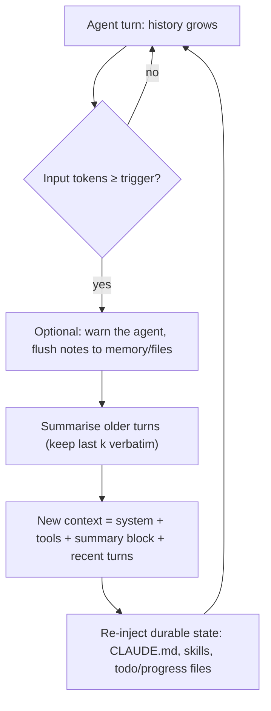

**Context compaction** is the technique of replacing the older part of a conversation or agent trajectory with a summary, written by a model, once the history approaches a token limit, so that the run can continue in a bounded [context window](context-window.md). The summary takes the place of the turns it covers. The model then continues from "summary + recent turns + new input" instead of the full transcript ([Anthropic compaction](../sources/anthropic-compaction-docs.md), [Anthropic context engineering](../sources/anthropic-effective-context-engineering.md)). It is lossy by design. It belongs to a family of history-reduction techniques alongside rule-based **tool-result clearing** (drop old observations without summarising them), **context resets** (start a fresh agent from a hand-written handoff) and external **memory** (write state to files the agent re-reads). Compaction matters even when the window is not full, because quality degrades as context grows ([Chroma](../sources/chroma-context-rot.md)). It is one of the main levers of [context engineering](context-engineering.md) and [harness engineering](harness-engineering.md).

## Why compact before the hard limit

- **Overflow.** A long agent run grows by every tool call and result. Manus reports about 50 tool calls per typical task and roughly 100:1 input-to-output tokens ([Manus](../sources/manus-context-engineering-lessons.md)).
- **Context rot.** Recall falls as input length grows, on every model tested, even for trivial tasks ([Chroma](../sources/chroma-context-rot.md)). Anthropic frames context as a finite "attention budget" ([Anthropic](../sources/anthropic-effective-context-engineering.md)), and its compaction docs justify the feature partly by quality degrading as conversations lengthen ([compaction overview](../sources/anthropic-compaction-docs.md)). See [long-context degradation](long-context-degradation.md).
- **Cost and latency.** Every turn re-sends the whole history, so cost grows with history size ([Claude Code best practices](../sources/claude-code-best-practices.md), [OpenAI conversation state](../sources/openai-conversation-state-guide.md)).

## Mechanics

A compaction step has four decisions: **when** to trigger, **what** to summarise (everything or all but the last k turns), **how** (prompt and model), and **what to re-inject** afterwards (instructions, files, skills, plan).

Synthesis: the diagram combines the trigger and block-replacement mechanics of the Anthropic and OpenAI APIs, the pre-clear memory warning from Anthropic's context editing, and the re-injection behaviour of Claude Code; no single source shows all steps together.

### Classic client-side compaction

The harness counts tokens, calls a model with a summarisation prompt, and rewrites its own message list. Examples:

- **MemGPT** keeps a recursive summary at the head of a FIFO message queue. It warns the model at about 70% of the window so it can save facts. At the flush point it evicts about half the queue into the summary. These thresholds are example settings ([Packer et al.](../sources/packer-2023-memgpt.md)). See [Letta](letta.md) and [agent memory](agent-memory.md).
- **[LangChain](langchain.md)** `SummarizationMiddleware` takes a `trigger` and keeps the last 20 messages by default ([LangChain middleware](../sources/langchain-agents-middleware-docs.md)). See [agent hooks and middleware](agent-hooks-and-middleware.md).
- **Cognition** recommends a separate compression model that distils history into key decisions and events for very long single-threaded runs. They fine-tuned smaller models for it and report it is hard to get right ([Cognition](../sources/cognition-dont-build-multi-agents.md)).
- **[Claude Code](coding-agents.md) / [Claude Agent SDK](claude-agent-sdk.md)** compact automatically near the limit. The SDK emits a `compact_boundary` system message ([Agent SDK loop](../sources/claude-agent-sdk-agent-loop-docs.md)). A "Compact Instructions" section in CLAUDE.md steers what survives ([How Claude Code works](../sources/claude-code-how-it-works.md)). `PreCompact`/`PostCompact` hooks exist in both Claude Code and Codex ([Claude Code hooks](../sources/claude-code-hooks-docs.md), [Codex hooks](../sources/openai-codex-hooks-docs.md)).

Anthropic's SDK-level client compaction (`compaction_control`) is deprecated in the TypeScript and Ruby SDKs and was removed from the Python SDK in v1.0. Anthropic points tool-runner users to the server-side edit instead ([context editing](../sources/anthropic-context-editing-docs.md)).

### Server-side compaction: Anthropic

As of November 2026, the [Messages API](anthropic-messages-api.md) offers two beta modes, plus "write your own summariser" ([overview](../sources/anthropic-compaction-docs.md)):

| | On demand | At a token threshold |
|---|---|---|
| Beta header | `compact-2026-09-04` | `compact-2026-01-12` |
| How | Separate request with `"compaction": {"type": "summarize"}`; returns only a `compaction` block, `stop_reason: "compaction"` | Edit `compact_20260112` in `context_management.edits`; summary is written inside the request that crosses the trigger |
| Who decides when | Your code | The API (`trigger` default 150,000 input tokens, minimum 50,000) |
| History afterwards | You put the block first in `messages` and remove the summarised turns | Append the response as usual; the API ignores everything before the last block |
| Keep recent turns verbatim | Yes | Via `pause_after_compaction` and reinsertion |
| Background | Yes | No |

Sources: [on-demand docs](../sources/anthropic-compaction-on-demand-docs.md), [threshold docs](../sources/anthropic-compaction-threshold-docs.md). Anthropic recommends on-demand wherever it is available ([overview](../sources/anthropic-compaction-docs.md)).

Details that matter in production:

- **The block is signed and readable.** On-demand blocks carry a summary you can read plus a `signature`. Editing either returns a 400 error, and so does leaving summarised messages in front of the block ([on-demand](../sources/anthropic-compaction-on-demand-docs.md)).
- **Custom prompts replace, not extend.** `instructions` replaces the default summarisation prompt entirely; on demand it accepts up to 16,384 characters. The default asks for state, next steps and learnings ([threshold](../sources/anthropic-compaction-threshold-docs.md), [on-demand](../sources/anthropic-compaction-on-demand-docs.md)).
- **Billing hides in `usage.iterations`.** Top-level token counts exclude the compaction pass, so cost tracking must sum the iterations. Carrying a block forward adds no compaction cost ([threshold](../sources/anthropic-compaction-threshold-docs.md)).
- **Caching.** Put `cache_control` on the block and a breakpoint at the end of the system prompt, so the stable prefix stays cached across compactions ([threshold](../sources/anthropic-compaction-threshold-docs.md)). See [prompt caching](prompt-caching.md).
- **Thinking.** Pre-compaction thinking blocks are not carried forward. Reinserting earlier assistant turns can fail the thinking prefix check, so strip their thinking or set `prefix_mismatch_behavior: "drop_block"` ([threshold](../sources/anthropic-compaction-threshold-docs.md)). See [extended thinking](extended-thinking.md).
- **Not combinable.** `compaction` and `context_management` cannot be sent on the same request ([on-demand](../sources/anthropic-compaction-on-demand-docs.md)).
- **Retention.** Threshold compaction is ZDR-eligible except for Covered Models, because summaries round-trip statelessly ([threshold](../sources/anthropic-compaction-threshold-docs.md)). See [data retention and residency](data-retention-and-residency.md).

### Server-side compaction: OpenAI

The [Responses API](openai-responses-api.md) offers two modes ([OpenAI compaction](../sources/openai-compaction-guide.md)):

- **Automatic:** `context_management: [{type: "compaction", compact_threshold: N}]`. When the rendered prompt crosses N tokens, the server compacts mid-stream, emits a compaction item and prunes. The guide's examples use 200,000; no default is documented.
- **Explicit:** `POST /responses/compact` takes a full window and returns a smaller one, statelessly. Pass the output on unmodified.

The compaction item is **encrypted and opaque**: unlike Anthropic's block, you cannot read or audit what was kept. With manual input chaining you may drop items before the latest compaction item. With `previous_response_id` chaining you must not prune. Both modes work with ZDR when `store=false` ([OpenAI compaction](../sources/openai-compaction-guide.md)). In the [OpenAI Agents SDK](openai-agents-sdk.md), `OpenAIResponsesCompactionSession` wraps this. Automatic compaction can hold a streamed run open for a few seconds, so it can be run manually instead ([Agents SDK sessions](../sources/openai-agents-sdk-sessions-docs.md)).

## Compaction vs related techniques

| Technique | What is removed | Lossy? | Cache impact | Sources |
|---|---|---|---|---|
| **Compaction** | Older turns, replaced by a summary | Yes, judgement of the summariser | Invalidates everything after the stable prefix | [Anthropic](../sources/anthropic-compaction-docs.md), [OpenAI](../sources/openai-compaction-guide.md) |
| **Tool-result clearing / observation masking** | Old tool outputs, replaced by a placeholder; calls and reasoning stay | Yes, but predictable and re-fetchable | Invalidates from the cleared point; batch clears | [context editing](../sources/anthropic-context-editing-docs.md), [Lindenbauer et al.](../sources/lindenbauer-2025-complexity-trap.md) |
| **Thinking clearing** | Old reasoning blocks | Yes | Invalidates at the clearing point | [context editing](../sources/anthropic-context-editing-docs.md) |
| **Context reset** | Everything; a fresh agent starts from a structured handoff artifact | Only what the handoff omits | Fresh context | [harness design](../sources/anthropic-harness-design-long-running-apps.md) |
| **External memory / notes** | Nothing by itself; state is written outside and re-read | Depends on what is written | Neutral | [memory tool](../sources/anthropic-memory-tool-docs.md), [Manus](../sources/manus-context-engineering-lessons.md) |
| **Subagents** | Exploration happens in a separate window; only a condensed result returns | Yes, at the boundary | Parent prefix untouched | [Anthropic](../sources/anthropic-effective-context-engineering.md) |

### Tool-result clearing

Anthropic's `clear_tool_uses_20250919` edit runs server-side before the prompt reaches Claude, while the client keeps the full history. Defaults: trigger at 100,000 input tokens, keep the last 3 tool uses, clear oldest first, leave tool inputs unless `clear_tool_inputs` is set, and `exclude_tools` for results that must survive. `clear_at_least` exists because each clear rewrites the cached prefix, so a clear should free enough tokens to justify the cache write. Before clearing, Claude gets a warning so it can save important results with the [memory tool](agent-memory.md). Applied edits are reported in `context_management.applied_edits` ([context editing](../sources/anthropic-context-editing-docs.md), [memory tool](../sources/anthropic-memory-tool-docs.md)). LangChain's `ContextEditingMiddleware` mirrors the defaults: 100k tokens, keep 3 ([LangChain](../sources/langchain-agents-middleware-docs.md)). SWE-agent collapses observations older than the last 5 to one line each ([SWE-agent](../sources/swe-agent-yang-2024.md)).

The strongest evidence on clearing versus summarising comes from Lindenbauer et al. On SWE-bench Verified with SWE-agent and Qwen3-Coder 480B, the raw agent solved 53.4% at $1.29 per instance. Masking old observations solved 54.8% at $0.61, and LLM summarisation solved 53.8% at $0.64. Summarisation also lengthened runs by about 15%. A hybrid (mask first, summarise only as a last resort) was cheapest ([Lindenbauer et al.](../sources/lindenbauer-2025-complexity-trap.md)). Manus's version of this idea is **restorable compression**: drop a page's body but keep its URL, drop a file's content but keep its path, so the agent can re-fetch ([Manus](../sources/manus-context-engineering-lessons.md)).

### Context resets vs compaction

Anthropic's Labs team distinguishes the two. A **reset** clears the window and starts a fresh agent from a structured handoff. **Compaction** summarises in place, so the same agent continues: it keeps continuity but gives no clean slate. On Sonnet 4.5, "context anxiety" (wrapping up early as the model believed its limit was near) persisted under compaction, so their harness needed resets. Resets cost orchestration complexity, tokens and latency. With Opus 4.5 the behaviour largely disappeared, and the harness ran one continuous session on the Agent SDK's automatic compaction ([harness design](../sources/anthropic-harness-design-long-running-apps.md)). An earlier Anthropic post found compaction alone insufficient for multi-session app builds on Opus 4.5. Its fix externalised state into a JSON feature list, a progress log and git, read at the start of each session ([long-running harnesses](../sources/anthropic-effective-harnesses-long-running-agents.md)). See [agent handoffs](agent-handoffs.md) and [durable agent execution](durable-agent-execution.md).

Synthesis: the two posts are not in conflict. Compaction keeps a session coherent, while externalised artifacts make the work recoverable whether the next window comes from a compaction, a reset or a crash. Whether resets are needed is model-dependent and should be re-tested on each model upgrade.

## Failure modes

| Failure | Mechanism | Mitigation |
|---|---|---|
| **Lost instructions** | Early detailed instructions get summarised away ([Claude Code](../sources/claude-code-how-it-works.md)); on Anthropic's API, mid-conversation `system` messages and per-message effort stop applying once summarised ([on-demand](../sources/anthropic-compaction-on-demand-docs.md)) | Keep durable rules in the system prompt / CLAUDE.md, which is re-injected every request ([Agent SDK](../sources/claude-agent-sdk-agent-loop-docs.md)); see [agent instruction files](agent-instruction-files.md) |
| **Dropped detail** | The default summary omits a fact a later turn needs ([overview](../sources/anthropic-compaction-docs.md)) | Custom `instructions` naming what to retain; keep recent turns verbatim; flush to memory before compaction ([memory tool](../sources/anthropic-memory-tool-docs.md)) |
| **Truncated skills/attachments** | Claude Code re-attaches only the first 5,000 tokens per skill (25,000 total) after compaction ([skills](../sources/claude-code-skills-docs.md)); images, documents and fetched URLs inside the summarised range are gone on the API ([on-demand](../sources/anthropic-compaction-on-demand-docs.md)) | Put critical rules at the top of skills; restate or re-upload what is still needed |
| **Thrashing** | One huge output refills the window right after compacting; Claude Code stops with an error ([Claude Code](../sources/claude-code-how-it-works.md)) | Cap tool output size; page or store large results in files |
| **Trajectory elongation** | Summaries make agents run about 15% longer ([Lindenbauer et al.](../sources/lindenbauer-2025-complexity-trap.md)) | Prefer masking first; set turn and budget caps ([agent loop](agent-loop.md)) |
| **Premature victory / context anxiety** | A fresh or compacted context sees progress and declares done, or wraps up early ([long-running harnesses](../sources/anthropic-effective-harnesses-long-running-agents.md), [harness design](../sources/anthropic-harness-design-long-running-apps.md)) | External feature list with pass/fail status; evaluator agent; resets on affected models |
| **Summariser misbehaves** | No block returned: truncated (`max_tokens`), no room (`model_context_window_exceeded`), tool call instead of summary, or `refusal` ([on-demand](../sources/anthropic-compaction-on-demand-docs.md)) | Branch on `stop_reason`; tell the summariser not to call tools; leave headroom below the window |
| **Hidden cost** | The compaction pass is billed but excluded from top-level usage; each compaction busts the cache after the prefix ([threshold](../sources/anthropic-compaction-threshold-docs.md)) | Sum `usage.iterations`; cache the system prompt and the block; monitor in [LLM observability](llm-observability.md) |
| **Unauditable state** | OpenAI compaction items are encrypted ([OpenAI](../sources/openai-compaction-guide.md)) | Log your own transcript pre-compaction; keep critical state in files you control |
| **Broken serialisation** | Re-sending a block with extra null fields or edited content returns a 400 ([threshold](../sources/anthropic-compaction-threshold-docs.md), [on-demand](../sources/anthropic-compaction-on-demand-docs.md)) | Round-trip the block exactly as returned |

## Practical guidance

Synthesis, drawing on the sources above:

1. **Clear before you summarise.** For tool-heavy agents, first mask or clear old tool results (keep 3 to 10 recent observations). Reach for an LLM summary only when that is not enough. The evidence shows masking matches summarisation at lower complexity ([Lindenbauer et al.](../sources/lindenbauer-2025-complexity-trap.md), [context editing](../sources/anthropic-context-editing-docs.md)).
2. **Trigger well below the window.** Leave room for the summarisation pass and the next turns. Anthropic's threshold default is 150k, and its minimum is 50k. Choose a trigger by quality, not only capacity, since degradation starts long before overflow ([Chroma](../sources/chroma-context-rot.md)).
3. **Make durable state external.** Keep instructions in the system prompt or instruction files, the plan in a todo file, progress in a log, and work in git. The summary then only has to carry the narrative ([long-running harnesses](../sources/anthropic-effective-harnesses-long-running-agents.md), [Manus](../sources/manus-context-engineering-lessons.md)).
4. **Write a domain-specific summary prompt.** Spell out what must survive: decisions and their reasons, open questions, file paths and IDs, failed approaches, user constraints. Forbid tool calls ([on-demand](../sources/anthropic-compaction-on-demand-docs.md)).
5. **Keep recent turns verbatim.** Use on-demand compaction with kept turns, or the threshold mode with `pause_after_compaction` ([overview](../sources/anthropic-compaction-docs.md)).
6. **Use hooks.** A `PreCompact` hook can persist state or a transcript before the window shrinks ([Claude Code hooks](../sources/claude-code-hooks-docs.md)).
7. **Evaluate it.** Replay long traces with compaction forced early, check that specific facts survive and the task still completes, and track turns and cost per task. See [agent evaluation](agent-evaluation.md).
8. **Prefer `/clear` or a new session over compaction between unrelated tasks** ([Claude Code best practices](../sources/claude-code-best-practices.md)). Use [subagents](subagents.md) for exploration so the parent window never fills ([Anthropic](../sources/anthropic-effective-context-engineering.md)).

## Sources

- [Compaction overview (Anthropic)](../sources/anthropic-compaction-docs.md)
- [Compaction at a token threshold (Anthropic)](../sources/anthropic-compaction-threshold-docs.md)
- [Compaction on demand (Anthropic)](../sources/anthropic-compaction-on-demand-docs.md)
- [Context editing (Anthropic)](../sources/anthropic-context-editing-docs.md)
- [Memory tool (Anthropic)](../sources/anthropic-memory-tool-docs.md)
- [Compaction (OpenAI)](../sources/openai-compaction-guide.md)
- [Conversation state (OpenAI)](../sources/openai-conversation-state-guide.md)
- [Sessions (OpenAI Agents SDK)](../sources/openai-agents-sdk-sessions-docs.md)
- [Effective context engineering for AI agents (Anthropic)](../sources/anthropic-effective-context-engineering.md)
- [Harness design for long-running application development (Anthropic)](../sources/anthropic-harness-design-long-running-apps.md)
- [Effective harnesses for long-running agents (Anthropic)](../sources/anthropic-effective-harnesses-long-running-agents.md)
- [How Claude Code works](../sources/claude-code-how-it-works.md)
- [Claude Code skills](../sources/claude-code-skills-docs.md)
- [Claude Code best practices](../sources/claude-code-best-practices.md)
- [Claude Code hooks](../sources/claude-code-hooks-docs.md)
- [Codex hooks](../sources/openai-codex-hooks-docs.md)
- [Claude Agent SDK agent loop](../sources/claude-agent-sdk-agent-loop-docs.md)
- [LangChain agents and middleware](../sources/langchain-agents-middleware-docs.md)
- [The Complexity Trap (Lindenbauer et al., 2025)](../sources/lindenbauer-2025-complexity-trap.md)
- [Context Engineering for AI Agents: Lessons from Building Manus](../sources/manus-context-engineering-lessons.md)
- [MemGPT (Packer et al., 2023)](../sources/packer-2023-memgpt.md)
- [SWE-agent (Yang et al., 2024)](../sources/swe-agent-yang-2024.md)
- [Don't Build Multi-Agents (Cognition)](../sources/cognition-dont-build-multi-agents.md)
- [Context Rot (Chroma)](../sources/chroma-context-rot.md)
