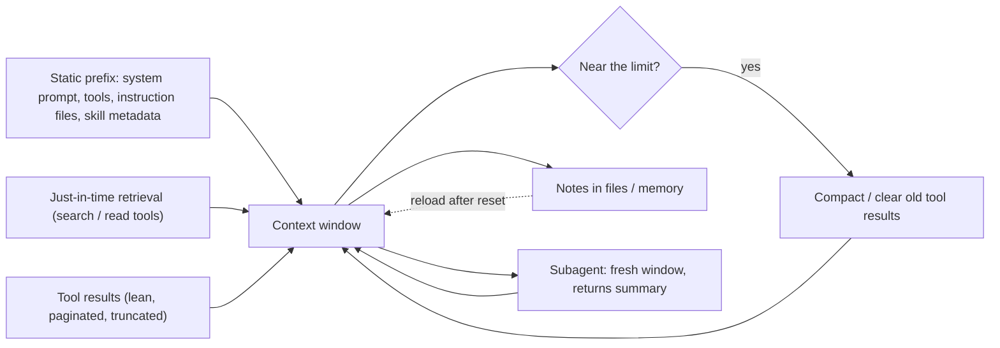

**Context engineering** is the practice of controlling what is in an agent's [context window](context-window.md) at each step: [system prompt](system-prompts.md), tool definitions, conversation history and tool results. The window is finite, and models [use information less well](long-context-degradation.md) as it fills. Anthropic frames context as an "attention budget" that every token spends, with diminishing returns ([Anthropic](../sources/anthropic-effective-context-engineering.md)). The anatomy post calls managing it arguably the most important skill in building agents ([anatomy](../sources/anatomy-of-a-modern-ai-agent.md)).

## Why it matters

- **Context rot.** Holding task difficulty fixed and varying only input length, all 18 models Chroma tested degraded. On LongMemEval every model scored much higher on a focused ~300-token prompt than on the full ~113k-token one. Distractors make it worse ([Chroma](../sources/chroma-context-rot.md)).
- **Position matters.** Accuracy follows a U-shape: information at the start or end is used far better than information in the middle ([Liu et al.](../sources/lost-in-the-middle.md)).
- **Mechanism.** Self-attention relates every token pair, so attention stretches thin as n grows, and training data has fewer long sequences than short ones ([Anthropic](../sources/anthropic-effective-context-engineering.md)).

The goal is the smallest set of high-signal tokens that gets the task done, not the largest window ([Anthropic](../sources/anthropic-effective-context-engineering.md)).

## Techniques

Synthesis: the levers below, by where they act in the [agent loop](agent-loop.md).

- **Load on demand.** Give the agent search and read [tools](tools.md) and lightweight references (paths, queries) rather than pre-loading documents ([Anthropic](../sources/anthropic-effective-context-engineering.md)). This is how [coding agents](coding-agents.md) work in codebases far larger than their window; [agentic RAG](agentic-rag.md) is the retrieval form of the same idea.
- **Keep tool output lean.** Summarise, paginate, filter and set default limits; offer concise vs detailed response formats. Claude Code caps tool responses at 25,000 tokens by default, and truncation messages should steer the agent towards narrower queries ([Anthropic](../sources/anthropic-writing-tools-for-agents.md)).
- **Compact long sessions.** Near the limit, replace older turns with a summary that keeps decisions and open threads ([context compaction](context-compaction.md)). Providers now do this server-side: Anthropic's compaction runs on demand or at a token threshold and recommends on-demand where available ([Anthropic](../sources/anthropic-compaction-docs.md)); OpenAI's Responses API compacts past a `compact_threshold` into an encrypted, non-readable item ([OpenAI](../sources/openai-compaction-guide.md)).
- **Clear stale tool results.** Context editing is the rule-based alternative to summarising. Anthropic's `clear_tool_uses_20250919` clears the oldest tool results first, by default once input passes 100,000 tokens, keeping the last 3 tool uses; `clear_thinking_20251015` does the same for thinking blocks ([Anthropic](../sources/anthropic-context-editing-docs.md)). LangChain's `ContextEditingMiddleware` uses the same defaults, and `SummarizationMiddleware` keeps the last 20 messages ([LangChain](../sources/langchain-agents-middleware-docs.md); see [agent hooks and middleware](agent-hooks-and-middleware.md)).
- **Write things down.** Notes in files (plans, progress logs, to-do lists) let an agent recover its state after a reset or compaction (see [agent memory](agent-memory.md)). Anthropic's context editing warns the model before clearing so it can save results to memory files first ([Anthropic](../sources/anthropic-context-editing-docs.md)). For multi-session builds, compaction alone was not enough; a [harness](harness-engineering.md) that kept state in a progress log, a JSON feature list and git was ([Anthropic](../sources/anthropic-effective-harnesses-long-running-agents.md)).
- **Delegate.** [Subagents](subagents.md) do context-heavy work in a fresh window and return only a summary ([Anthropic](../sources/anthropic-effective-context-engineering.md)). Cognition argues against parallel agents that cannot see each other's decisions; it prefers one linear agent, plus a model that compresses history into key decisions for very long tasks ([Cognition](../sources/cognition-dont-build-multi-agents.md)).

In multi-agent systems the same principles apply per agent: **isolate** each agent's context, **persist** what later steps need, and **compress** large data before passing it on ([Google Cloud](../sources/google-cloud-choose-agentic-design-pattern.md); see [agent handoffs](agent-handoffs.md)).

## Hidden costs in the window

- **Instruction files.** Claude Code loads CLAUDE.md files from ancestor directories at launch and from subdirectories lazily, concatenated root-down, and advises under 200 lines per file ([Claude Code](../sources/claude-code-memory-docs.md)). Codex stops adding AGENTS.md files at 32 KiB combined by default ([Codex](../sources/openai-codex-agents-md-docs.md)). One study found such files did not generally raise coding-agent success and added over 20% inference cost, because agents obeyed unnecessary requirements ([Gloaguen et al.](../sources/gloaguen-2026-evaluating-agents-md.md)). See [agent instruction files](agent-instruction-files.md).
- **Skills.** Progressive disclosure keeps the fixed cost small: about 100 tokens of metadata per skill always loaded, under 5k tokens of instructions when triggered, and bundled resources free until read ([Anthropic](../sources/anthropic-agent-skills-overview.md); see [agent skills](agent-skills.md)).
- **Thinking.** On keep-all Claude models (Opus 4.5+, Sonnet 4.6+, Haiku 5.5, Fable/Mythos), earlier turns' thinking stays in context and is billed as input ([Anthropic](../sources/anthropic-thinking-docs.md); see [extended thinking](extended-thinking.md)).
- **Screenshots.** For [computer-use agents](computer-use-agents.md) each screenshot costs about 1,000-1,800 input tokens. Anthropic suggests pruning old screenshots in batches (e.g. keep the last 3, prune every 25 turns) to preserve caching, but on Claude 5.5 and Fable/Mythos 5.1-5.2 pruning invalidates every later thinking block ([Anthropic](../sources/anthropic-computer-use-tool-docs.md)).

## Interaction with prompt caching

[Prompt caching](prompt-caching.md) needs a byte-identical prefix in the order tools → system → messages, so putting stable content first and appending, never editing, is also what makes context cacheable ([Anthropic](../sources/anthropic-prompt-caching-docs.md)). Context engineering and caching pull against each other: changing tool definitions invalidates the whole cache ([Anthropic](../sources/anthropic-prompt-caching-docs.md)), and clearing tool results invalidates the cached prefix, which is why `clear_at_least` exists to make each clear free enough tokens to justify the new cache write ([Anthropic](../sources/anthropic-context-editing-docs.md)).

## Related

[Agent loop](agent-loop.md) · [Context compaction](context-compaction.md) · [Harness engineering](harness-engineering.md) · [Agent hooks and middleware](agent-hooks-and-middleware.md) · [Agent handoffs](agent-handoffs.md)

## Going deeper

- [Context window](context-window.md): current window sizes per model and provider-side compaction / context editing.
- [Context compaction](context-compaction.md): server-side and client-side summarisation in detail.
- [Long-context degradation](long-context-degradation.md): the evidence (lost-in-the-middle, context rot) behind keeping context small.
- [Agent Memory](agent-memory.md): compaction, tool-result clearing and long-term memory stores.
- [Prompt Caching](prompt-caching.md): why stable-first context ordering is also what makes it cacheable.
- [Agentic RAG](agentic-rag.md): just-in-time retrieval as the 'load on demand' technique.
- [Agent Instruction Files](agent-instruction-files.md): how CLAUDE.md / AGENTS.md files are loaded into context.
- [Agent Skills](agent-skills.md): progressive disclosure: load instructions only when needed.
- [Harness engineering](harness-engineering.md): externalising state across sessions for long-running agents.
- [Prompt engineering](prompt-engineering.md): writing the static parts of the context well.

## Sources

- [The Anatomy of a Modern AI Agent](../sources/anatomy-of-a-modern-ai-agent.md)
- [Choose a design pattern for your agentic AI system (Google Cloud)](../sources/google-cloud-choose-agentic-design-pattern.md)
- [Effective context engineering for AI agents (Anthropic)](../sources/anthropic-effective-context-engineering.md)
- [Context Rot (Chroma)](../sources/chroma-context-rot.md)
- [Lost in the Middle (Liu et al.)](../sources/lost-in-the-middle.md)
- [Writing effective tools for agents (Anthropic)](../sources/anthropic-writing-tools-for-agents.md)
- [Compaction overview (Claude API docs)](../sources/anthropic-compaction-docs.md)
- [Context editing (Claude API docs)](../sources/anthropic-context-editing-docs.md)
- [Compaction (OpenAI guide)](../sources/openai-compaction-guide.md)
- [LangChain agents, middleware and structured output docs](../sources/langchain-agents-middleware-docs.md)
- [Prompt caching (Claude API docs)](../sources/anthropic-prompt-caching-docs.md)
- [Claude Code memory docs](../sources/claude-code-memory-docs.md)
- [Custom instructions with AGENTS.md (OpenAI Codex docs)](../sources/openai-codex-agents-md-docs.md)
- [Evaluating AGENTS.md (Gloaguen et al., 2026)](../sources/gloaguen-2026-evaluating-agents-md.md)
- [Agent Skills overview (Claude Platform docs)](../sources/anthropic-agent-skills-overview.md)
- [Thinking (Claude API docs)](../sources/anthropic-thinking-docs.md)
- [Computer use tool (Claude API docs)](../sources/anthropic-computer-use-tool-docs.md)
- [Effective harnesses for long-running agents (Anthropic)](../sources/anthropic-effective-harnesses-long-running-agents.md)
- [Don't Build Multi-Agents (Cognition)](../sources/cognition-dont-build-multi-agents.md)
