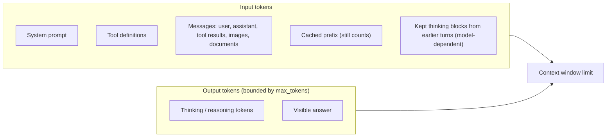

The **context window** is the total number of [tokens](tokenization.md) a model can reference in a single request, including the response it generates. It is the model's working memory, distinct from what it learned in training ([Anthropic](../sources/anthropic-context-windows-docs.md)). Everything the model uses for a turn ([system prompt](system-prompts.md), conversation, retrieved documents, [tool](tools.md) definitions and results, and the output) must fit inside it ([notebook](../sources/notebook-transformers.md)). Two numbers matter: the **advertised** limit, a hard API constraint, and the **effective** limit, the length up to which the model still uses information reliably, which is usually much smaller ([RULER](../sources/ruler-benchmark.md)).

## What counts against the window

Per Anthropic's docs: system prompt, every message (including tool results, images and documents), tool definitions, and the generated output including thinking all count. [Prompt caching](prompt-caching.md) changes the price of a prefix, not whether it occupies the window. Whether earlier turns' thinking blocks stay in context depends on the model; newer Claude models keep them ([Anthropic](../sources/anthropic-context-windows-docs.md)). OpenAI reasoning tokens are hidden but likewise occupy the window and are billed as output ([OpenAI](../sources/openai-reasoning-guide.md)). See [extended thinking](extended-thinking.md) and [reasoning models](reasoning-models.md).

## Limits by vendor (as of 2026-11-14)

| Vendor / family | Window | Output cap | Notes |
|---|---|---|---|
| Claude Opus 4.6+, Sonnet 4.6+, Haiku 5.5, Fable / Mythos (incl. Mythos Preview) | 1M tokens, default, no beta header | 128k per request | Standard pricing except Haiku 5.5 above 100k input ([Anthropic](../sources/anthropic-context-windows-docs.md)) |
| Older Claude (e.g. Opus 4.5, Haiku 4.5, Sonnet 4.5, deprecated) | 200k | model-specific | ([Anthropic](../sources/anthropic-context-windows-docs.md)) |
| Gemini 4 family | 1,048,576 shared by input, thinking and output | 65,536 default, more with long decode | If input + max output exceeds the window, output is capped to what's left ([Gemini](../sources/gemini-token-docs.md)) |
| Gemini 3 / 2.5 | 1,048,576 input | 65,536 output (separate budget) | ([Gemini](../sources/gemini-token-docs.md)) |

Tokens are not words: on Claude's tokenizer since Opus 4.7, 1M tokens is about 555k words, versus about 750k on earlier models ([Claude models overview](../sources/anthropic-models-overview.md)). Non-English text can need several times more tokens for the same content ([Petrov et al.](../sources/petrov-2023-tokenizer-unfairness.md)). Requests can also hit non-token limits first: Claude accepts up to 600 images or PDF pages per request (100 on 200k models) ([Anthropic](../sources/anthropic-context-windows-docs.md)).

## Overflow behaviour

| Situation | Claude | Gemini 4 | OpenAI reasoning models |
|---|---|---|---|
| Input alone too long | 400 `invalid_request_error`, "prompt is too long" | Synthesis: request rejected | Synthesis: request rejected |
| Input + max output > window | Claude 4.5+: accepted; generation stops with `stop_reason: model_context_window_exceeded`. Earlier models: validation error unless beta header | Output capped to remaining space | — |
| Output budget exhausted | `stop_reason: max_tokens` | Synthesis: truncated | `status: incomplete`, possibly with no visible text if reasoning used the whole budget |

Sources: [Anthropic context windows](../sources/anthropic-context-windows-docs.md), [Messages API](../sources/anthropic-messages-api-reference.md), [Gemini](../sources/gemini-token-docs.md), [OpenAI](../sources/openai-reasoning-guide.md). OpenAI suggests reserving at least 25,000 tokens for reasoning plus output when starting with reasoning models ([OpenAI](../sources/openai-reasoning-guide.md)).

**Always check the stop reason.** Synthesis: a response cut by `max_tokens` or the window looks like a normal answer that just ends; code that parses it (e.g. JSON) fails downstream.

## Advertised vs effective context

Evidence that models use long contexts unevenly:

- **Position effects.** Accuracy is highest when relevant information sits at the start or end of the input and drops significantly in the middle; GPT-3.5-Turbo's multi-document QA can fall below its no-documents score. Extended-context variants performed about the same as their shorter siblings on inputs both could fit ([Lost in the Middle](../sources/lost-in-the-middle.md)).
- **Needle tests flatter.** Models score near-perfectly on vanilla needle-in-a-haystack yet drop sharply on multi-needle, multi-hop and aggregation tasks; only about half of models claiming 32K+ held up at 32K ([RULER](../sources/ruler-benchmark.md)).
- **Literal matching hides weakness.** When the needle shares almost no words with the question, 11 of 13 128K-class models fell below half their short-context score at 32K; GPT-4o went from 99.3% to 69.7% ([NoLiMa](../sources/nolima-benchmark.md)).
- **Context rot.** Across 18 models, performance became increasingly unreliable as input grew, even on simple tasks; distractors compound it; focused ~300-token inputs beat full ~113k-token inputs on LongMemEval ([Chroma](../sources/chroma-context-rot.md)). Anthropic's own docs name this context rot ([Anthropic](../sources/anthropic-context-windows-docs.md)).

Why, mechanically: attention spreads a finite budget over n² token pairs, training data contains fewer long sequences, and position-encoding interpolation used to extend windows blurs positional precision, producing gradual decline rather than a cliff ([Anthropic engineering](../sources/anthropic-effective-context-engineering.md)). RoPE-based models do not generalise past their trained length without extension methods such as YaRN ([YaRN](../sources/peng-2023-yarn.md); [RoFormer](../sources/su-2021-roformer-rope.md)). Standard attention cost also grows quadratically with length, which IO-aware kernels like FlashAttention mitigate but do not remove ([FlashAttention](../sources/dao-2022-flashattention.md)). See [transformer architecture](transformer-architecture.md) and [long-context degradation](long-context-degradation.md).

## Managing the window

| Technique | What it does | Source |
|---|---|---|
| Count first | Use the vendor's token counter on the exact model | [Anthropic token counting](../sources/anthropic-token-counting-docs.md) |
| Server-side [compaction](context-compaction.md) | Summarises earlier turns so a conversation can continue past the limit (beta, Claude 4.6+ and Mythos Preview) | [Anthropic](../sources/anthropic-context-windows-docs.md) |
| Context editing | Clears old tool results or thinking blocks | [Anthropic](../sources/anthropic-context-windows-docs.md) |
| Just-in-time retrieval, notes, sub-agents | Keep only high-signal tokens in the window | [Anthropic engineering](../sources/anthropic-effective-context-engineering.md) |
| Put key material at the edges | Exploits primacy/recency | [Lost in the Middle](../sources/lost-in-the-middle.md) |

Some Claude models (Sonnet 4.5, 4.6 and 5, Haiku 4.5) receive injected tags telling them their remaining token budget ("context awareness"); Opus 4.7+, Sonnet 5.5, Haiku 5.5 and the Fable/Mythos 5.x models do not, and you can give them an explicit budget with task budgets (beta) instead ([Anthropic](../sources/anthropic-context-windows-docs.md)).

## When to use a big window, and when not

Synthesis, grounded in the evidence above:

- **Use long context** when the task needs the whole artefact at once (a contract, a codebase slice, a long transcript), when retrieval would fragment cross-references, or for prototyping before building a retrieval pipeline. Pair with [prompt caching](prompt-caching.md) if the same corpus is queried repeatedly.
- **Prefer [retrieval-augmented generation](retrieval-augmented-generation.md)** when the corpus exceeds the window, changes often, needs citations, or when cost and latency per query matter: every input token is paid for and processed on every call ([notebook](../sources/notebook-transformers.md)).
- **Agents**: long-running [agent loops](agent-loop.md) fill the window with tool output; budget it explicitly via [context engineering](context-engineering.md) and [subagents](subagents.md).
- **Evaluate at your real lengths.** Vendor needle-in-a-haystack results do not predict multi-hop or aggregation performance ([RULER](../sources/ruler-benchmark.md)). Build [evals](llm-evaluation.md) at the context sizes you will ship.

## Sources

- [Context windows (Claude API docs)](../sources/anthropic-context-windows-docs.md)
- [Token counting (Claude API docs)](../sources/anthropic-token-counting-docs.md)
- [Messages API reference (Claude API)](../sources/anthropic-messages-api-reference.md)
- [Models overview (Claude Docs)](../sources/anthropic-models-overview.md)
- [Understand and count tokens (Gemini API docs)](../sources/gemini-token-docs.md)
- [Reasoning models guide (OpenAI)](../sources/openai-reasoning-guide.md)
- [Lost in the Middle (Liu et al.)](../sources/lost-in-the-middle.md)
- [RULER (NVIDIA)](../sources/ruler-benchmark.md)
- [NoLiMa](../sources/nolima-benchmark.md)
- [Context Rot (Chroma)](../sources/chroma-context-rot.md)
- [Effective context engineering for AI agents (Anthropic)](../sources/anthropic-effective-context-engineering.md)
- [YaRN](../sources/peng-2023-yarn.md)
- [RoFormer](../sources/su-2021-roformer-rope.md)
- [FlashAttention](../sources/dao-2022-flashattention.md)
- [Language Model Tokenizers Introduce Unfairness Between Languages](../sources/petrov-2023-tokenizer-unfairness.md)
- [Notebook: How LLMs & transformers work](../sources/notebook-transformers.md)
