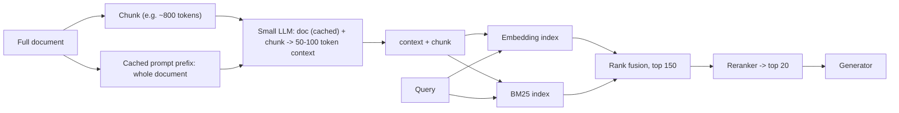

**Contextual retrieval** fixes a specific defect of [chunking](chunking.md): once a document is cut into pieces, a chunk like "revenue grew by 3% over the previous quarter" no longer says *which* company or quarter it is about, so neither its [embedding](embeddings.md) nor its keywords match the question that needs it. The fix runs at index time. Before indexing, prepend to each chunk a short piece of text that places it in its source document, then embed *and* BM25-index the combined text. Anthropic's version has a small LLM read the whole document and write a 50-100 token context for each chunk ([Anthropic](../sources/anthropic-contextual-retrieval.md)). A cheaper variant, **contextual chunk headers**, prepends templated document and section titles or summaries instead ([dsRAG](../sources/dsrag-github.md)). The owner's guide lists it as the fix for "chunks lose their document context", paired with [prompt caching](prompt-caching.md) ([Notebook](../sources/notebook-rag-cag.md)).

## Mechanics (Anthropic's recipe)

1. **Contextualize.** For each chunk, send the whole document in a `<document>` block and the chunk in a `<chunk>` block. Ask for a short, succinct context that situates the chunk for search, returned with nothing else ([cookbook](../sources/anthropic-contextual-embeddings-cookbook.md)). The blog used Claude 3 Haiku; the output is usually 50-100 tokens ([Anthropic](../sources/anthropic-contextual-retrieval.md)).
2. **Cache the document.** Mark the document block with `cache_control` and process chunks *document by document*, so every chunk after the first reads the document from cache (5-minute TTL). In the cookbook run, 61.83% of input tokens were cache reads, which cut the estimated cost from about $9.20 to $2.85 ([cookbook](../sources/anthropic-contextual-embeddings-cookbook.md)). See [prompt caching](prompt-caching.md). Synthesis: for a large one-off backfill where latency does not matter, [batch processing](batch-processing.md) is the other discount lever.
3. **Index both ways.** Embed `context + chunk` (contextual embeddings) and add the same text to a BM25 index (contextual BM25), then merge with rank fusion ([Anthropic](../sources/anthropic-contextual-retrieval.md)). The cookbook uses weighted reciprocal rank fusion over the top 150 from each side, 0.8 semantic / 0.2 BM25 ([cookbook](../sources/anthropic-contextual-embeddings-cookbook.md)). See [hybrid search](hybrid-search.md).
4. **Rerank.** Retrieve 150, rerank (Cohere in the blog), pass the top 20. Twenty chunks beat 10 and 5 in their tests ([Anthropic](../sources/anthropic-contextual-retrieval.md)). See [reranking](reranking.md).

**Cost (2024 pricing):** about $1.02 per million document tokens, one time. The assumptions are 800-token chunks, 8k-token documents, 50 tokens of instructions and 100 tokens of context per chunk, with caching ([Anthropic](../sources/anthropic-contextual-retrieval.md)). There is no per-query LLM cost. Synthesis: this is the key contrast with [query transformation](query-transformation.md), which pays an LLM call on every query.

## Measured gains

Anthropic, averaged over codebases, fiction, arXiv and science papers; metric = 1 - recall@20 ([Anthropic](../sources/anthropic-contextual-retrieval.md)):

| Pipeline | Top-20 failure rate | Reduction vs baseline |
|---|---|---|
| Embeddings only (baseline) | 5.7% | — |
| + contextual embeddings | 3.7% | 35% |
| + contextual BM25 | 2.9% | 49% |
| + reranking | 1.9% | 67% |

The cookbook reproduction (9 codebases, 737 chunks, 248 queries with one golden chunk each) measured Pass@10 at 87.15% baseline, 92.34% with contextual embeddings and 95.26% with the full reranked pipeline. Pass@20 went from 90.06% to 97.45% ([cookbook](../sources/anthropic-contextual-embeddings-cookbook.md)). Other findings: the gain held for every embedding model tested, with Gemini and Voyage best; and **generic document summaries prepended to chunks helped very little** compared with chunk-specific context ([Anthropic](../sources/anthropic-contextual-retrieval.md)).

Independent evidence is more modest. In an academic reproduction on NFCorpus with open models, contextualization moved nDCG@5 only from 0.303 to 0.312, and to 0.317 with rank fusion and reranking ([Merola & Singh](../sources/merola-2025-late-chunking-vs-contextual-retrieval.md)). Synthesis: gains depend heavily on how context-dependent your chunks are. Pronoun-heavy reports and code files benefit far more than self-contained abstracts.

## Variants and alternatives

| Approach | What is prepended or changed | Index-time cost | Evidence |
|---|---|---|---|
| LLM contextual blurb (Anthropic) | Chunk-specific 50-100 token context | One LLM call per chunk (cached doc) | -35% failures alone, -67% with BM25 + rerank ([Anthropic](../sources/anthropic-contextual-retrieval.md)) |
| Contextual chunk headers (dsRAG AutoContext) | Doc title + doc summary + section title(s), optionally section summary | One LLM call per document/section | KITE 4.72 to 6.04 alone, 8.42 with segment extraction ([dsRAG](../sources/dsrag-github.md)) |
| Plain metadata header | Filename, title, breadcrumb path | None | Synthesis: free baseline; always worth trying first |
| Generic doc summary per chunk | Same summary on every chunk | One call per doc | "Very limited" gains ([Anthropic](../sources/anthropic-contextual-retrieval.md)) |
| [Late chunking](chunking.md) | Nothing; embeds the whole doc, then pools token vectors per chunk | One long-context embedding pass | Needs token-level outputs from a long-context embedder ([Günther et al.](../sources/gunther-2024-late-chunking.md)); model-dependent, from neutral to strongly negative ([Merola & Singh](../sources/merola-2025-late-chunking-vs-contextual-retrieval.md)) |

dsRAG's reported results put contextual chunk headers *plus* Relevant Segment Extraction (stitching adjacent relevant chunks back into longer segments) at 96.6% on FinanceBench, against a 32% vanilla [RAG](retrieval-augmented-generation.md) baseline in their own run. These are vendor-reported numbers ([dsRAG](../sources/dsrag-github.md)). The academic comparison found contextual retrieval slightly more relevant than late chunking, while late chunking was cheaper to compute ([Merola & Singh](../sources/merola-2025-late-chunking-vs-contextual-retrieval.md)).

Synthesis: chunk headers and LLM blurbs differ in what they can carry. A header carries *where* the chunk sits (document, section). Only an LLM that read the whole document can add facts stated elsewhere, such as the prior quarter's revenue in Anthropic's example ([Anthropic](../sources/anthropic-contextual-retrieval.md)). Use headers first and add blurbs if evals show residual misses on context-dependent chunks.

## Limitations and failure modes

- **Long documents.** The contextualizer must see the whole document. Synthesis: documents larger than the model's [context window](context-window.md), or large enough to suffer [long-context degradation](long-context-degradation.md), need a section-level window instead. Locally, long documents needed about 20 GB VRAM in the academic reproduction ([Merola & Singh](../sources/merola-2025-late-chunking-vs-contextual-retrieval.md)).
- **Embedding input limits.** Context plus chunk can exceed the embedder's maximum input and be silently truncated ([cookbook](../sources/anthropic-contextual-embeddings-cookbook.md)). Budget chunk size with the context included.
- **Cache misses.** Shuffled or parallel-across-documents processing defeats prompt caching. Keep chunks of one document together ([cookbook](../sources/anthropic-contextual-embeddings-cookbook.md)).
- **Re-indexing cost.** A document edit invalidates every chunk's context in that document. Synthesis: re-contextualize at document granularity, keyed on a content hash.
- **Generated text is untrusted.** Synthesis: the blurb can contain an LLM error that now steers retrieval for that chunk. Keep the raw chunk separately, show the generator both parts clearly labelled, and spot-check contexts. Anthropic also suggests that generation may improve when the model can tell context from chunk ([Anthropic](../sources/anthropic-contextual-retrieval.md)).
- **Domain prompts.** A generic prompt may miss what matters. Anthropic suggests domain-tailored prompts, for example including a glossary ([Anthropic](../sources/anthropic-contextual-retrieval.md)).

## When to use, when not

- **Skip RAG entirely** if the knowledge base is under about 200k tokens: put it in the prompt and cache it ([Anthropic](../sources/anthropic-contextual-retrieval.md)).
- **Use** when chunks depend on their document: financial filings, contracts, manuals, long reports, code. Also use it when you already run hybrid search and a reranker and recall is still the bottleneck.
- **Cost-sensitive, high-volume:** contextual embeddings alone. **Maximum accuracy:** add contextual BM25 and reranking ([cookbook](../sources/anthropic-contextual-embeddings-cookbook.md)).
- **Probably skip** for self-contained short records (FAQs, tickets, product rows) where a metadata header already says everything (Synthesis).
- **Always** measure with a golden-chunk retrieval eval (recall@k or Pass@k) before and after ([cookbook](../sources/anthropic-contextual-embeddings-cookbook.md); see [LLM evaluation](llm-evaluation.md)).

Related: [query transformation](query-transformation.md) (fix the query side at query time), [late-interaction retrieval](late-interaction-retrieval.md) (keep token-level detail instead of one vector per chunk), [document processing](document-processing.md) (get clean sections and titles to build headers from).

## Sources

- [Anthropic: Introducing Contextual Retrieval](../sources/anthropic-contextual-retrieval.md)
- [Anthropic cookbook: Contextual Retrieval guide](../sources/anthropic-contextual-embeddings-cookbook.md)
- [dsRAG README](../sources/dsrag-github.md)
- [Günther et al. 2024: Late Chunking](../sources/gunther-2024-late-chunking.md)
- [Merola & Singh 2025: Late Chunking vs Contextual Retrieval](../sources/merola-2025-late-chunking-vs-contextual-retrieval.md)
- [Notebook: RAG vs CAG vs GraphRAG](../sources/notebook-rag-cag.md)
