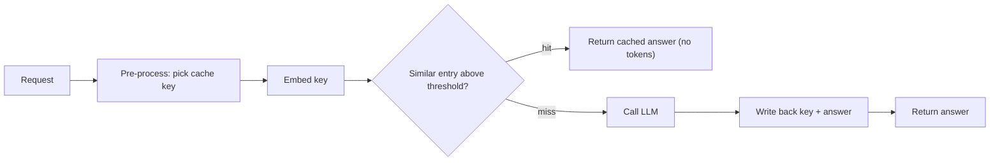

**Cost and latency optimization** is the engineering of an LLM application so that each completed task uses fewer, cheaper and faster tokens without losing the quality the task needs. API cost is roughly (input tokens x input price) + (output tokens x output price), discounted for cached input and batch traffic; latency is roughly time to first token plus time per output token times the number of output tokens ([Databricks](../sources/databricks-llm-inference-performance-engineering.md)). Almost every lever below acts on one of those terms. Optimize only after you can measure: per-request tokens, cost and TTFT come from [LLM observability](llm-observability.md), and quality must be re-checked with [evals](llm-evaluation.md) after every change. Anthropic's guidance is to first make the prompt work without constraints, then cut latency, because premature constraints hide what top quality looks like ([source](../sources/anthropic-reduce-latency-docs.md)).

## Where time and money go

- **Output tokens dominate latency.** Cutting output by 50% can cut latency by about 50%, while halving the prompt may gain only 1-5% ([OpenAI](../sources/openai-latency-optimization-guide.md)). On MPT models, 512 extra input tokens cost less latency than 8 extra output tokens ([Databricks](../sources/databricks-llm-inference-performance-engineering.md)).
- **Input tokens dominate cost** in RAG and agent workloads, where long system prompts, tool definitions and history are resent every turn. Synthesis: that is why caching gives the largest savings there.
- **Measure cost per completed task, not per token.** A pricier model at low effort can match a cheaper model at default for only about 7% more per solved task, and on one run two of 20 problems carried 43% of spend, so price the tail ([Anthropic](../sources/anthropic-optimizing-cost-and-intelligence.md)).

## The levers

| Lever | Saves | Typical effect (source, date) | Main cost / risk |
|---|---|---|---|
| [Prompt caching](prompt-caching.md) | input cost, TTFT | reads 0.1x input price (0.05x on some 2026 models); writes 1.25x (5 min) or 2x (1 h) on Anthropic | needs byte-identical prefix; any change upstream invalidates |
| Semantic (response) cache | whole call | 2-10x faster on hit, zero tokens (GPTCache, 2023); up to 68.8% fewer calls (Regmi 2024) | wrong answers on false hits |
| [Batch APIs](batch-processing.md) | 50% of cost | Anthropic and OpenAI batch are half price; most Anthropic batches done < 1 h, max 24 h | no streaming, async only |
| Flex / priority tiers | cost or latency | OpenAI Flex is half of Standard, Priority about double (2026-11) | Flex is slower; Priority costs more |
| Routing / cascades | cost | FrugalGPT: match GPT-4 at up to 98% lower cost (2023); RouteLLM: over 2x cheaper without quality loss | router errors, extra call on escalation |
| Smaller model / lower effort | cost and latency | model size is the main speed factor; effort is the main control on Haiku 5.5 | quality drop; needs evals |
| [Distillation](knowledge-distillation.md) / [fine-tuning](fine-tuning.md) | prompt length, model size | shorter prompts and a smaller task-specific model | training cost, maintenance |
| Token budgets | output cost and latency | `max_tokens`, concise instructions, short JSON keys | truncation (`finish_reason = length`) |
| [Streaming](streaming.md) | perceived latency | most effective way to make users wait less | no change to total time or cost |
| Fewer / parallel calls | latency | combine sequential steps; parallelise or speculate | larger prompts; wasted speculative calls |
| Self-hosting optimisations | $/token at scale | [quantization](quantization.md), [speculative decoding](speculative-decoding.md), batching in [serving engines](llm-inference-serving.md) | ops burden |

Sources: [Anthropic caching](../sources/anthropic-prompt-caching-docs.md), [Anthropic pricing](../sources/anthropic-pricing.md), [GPTCache](../sources/gptcache-2023.md), [Regmi](../sources/regmi-2024-gpt-semantic-cache.md), [Anthropic batches](../sources/anthropic-message-batches-docs.md), [OpenAI pricing](../sources/openai-api-pricing.md), [FrugalGPT](../sources/frugalgpt.md), [RouteLLM](../sources/routellm.md), [OpenAI latency](../sources/openai-latency-optimization-guide.md), [Anthropic latency](../sources/anthropic-reduce-latency-docs.md).

### 1. Prompt (prefix) caching

The provider stores the KV state of a prompt prefix and reuses it, so only the suffix is recomputed. Anthropic hashes `tools` → `system` → `messages` and needs a byte-identical prefix up to an explicit breakpoint (up to 4), with a 5-minute TTL refreshed on every hit or an optional 1-hour TTL; minimum cacheable length is 512 tokens on the 5.x models ([source](../sources/anthropic-prompt-caching-docs.md)). OpenAI caches automatically, from 1,024 tokens on GPT-5.6 and later (earlier models have model-dependent minimums); routing hashes the initial prefix plus `prompt_cache_key`, and above about 15 requests per minute for one prefix+key requests can spill to other machines and miss ([source](../sources/openai-prompt-caching-guide.md)).

Practical rules: put static content (tools, system prompt, documents) first and per-request content last ([OpenAI latency](../sources/openai-latency-optimization-guide.md)); never change tool definitions, model, effort or `tool_choice` mid-conversation, since that invalidates the cache ([Anthropic](../sources/anthropic-prompt-caching-docs.md), [Anthropic cost](../sources/anthropic-optimizing-cost-and-intelligence.md)); for parallel fan-out, wait until the first response starts streaming so the cache entry exists ([source](../sources/anthropic-prompt-caching-docs.md)). Track the hit rate from usage fields (`cache_read_input_tokens`, `cached_tokens`). Caching never changes the output.

### 2. Semantic (response) caching

A semantic cache embeds the incoming query, looks for a similar past query in a vector store, and returns the stored answer if similarity clears a threshold. GPTCache's pipeline is adapter → pre-processor → embedding → cache manager (scalar + vector store, LRU/FIFO eviction) → similarity evaluator → post-processor ([source](../sources/gptcache-2023.md)).

Its risk is correctness, not cost. At a 0.7 cosine threshold, 39 of 876 GPTCache hits were wrong (a small 2023 experiment with correctness judged by ChatGPT); search-tuned embeddings can score opposite-meaning sentences as similar, and the authors judged 99%-correct hits without losing hit rate unlikely. Keying on long shared prompt text makes nearly everything hit ([source](../sources/gptcache-2023.md)). Synthesis: use semantic caching for FAQ-like, non-personalised, low-stakes traffic; scope the cache by tenant and prompt version; prefer exact-match caching (hash of normalised request) where possible; and log hits so you can audit false hits.

### 3. Batch and off-peak tiers

Anthropic Message Batches and the OpenAI Batch API cost 50% of standard. Anthropic batches hold up to 100,000 requests / 256 MB and expire at 24 h; OpenAI batches hold 50,000 requests / 200 MB per file ([Anthropic](../sources/anthropic-message-batches-docs.md), [OpenAI](../sources/openai-batch-api-guide.md)). Caching discounts stack with batch, but hits are best-effort because requests run concurrently in any order. Use batch for evals, backfills, enrichment and nightly reports; never for interactive paths. See [batch processing](batch-processing.md).

### 4. Routing, cascades and model choice

- **Cascade:** try a cheap model, accept if a scorer says the answer is good, else escalate. FrugalGPT learns which models to try in which order per input ([source](../sources/frugalgpt.md)).
- **Router:** predict up front whether the weak model suffices; RouteLLM trains routers on preference data and saw them transfer to new model pairs ([source](../sources/routellm.md)).
- **Effort-first:** Anthropic's measurements favour sweeping effort on one model before adding a second. Advisor and orchestrator pairings gave mixed results, and when outcomes are checkable the cheapest strategy was run at low effort and re-run failures at high effort (about 97% solved at about $0.17 per task vs 95.3% at $0.29 all-high) ([source](../sources/anthropic-optimizing-cost-and-intelligence.md)).

See [model selection](model-selection.md). Synthesis: routing pays only when traffic is heterogeneous and there is a cheap, reliable quality signal (tests, schema validation, a judge); otherwise a single right-sized model is simpler and as cheap.

### 5. Token budgets

- Cap output with `max_tokens` (a hard cut that can stop mid-sentence) and ask for sentence or paragraph limits rather than word counts ([Anthropic](../sources/anthropic-reduce-latency-docs.md)).
- Shorten structured output: short field and function names cut tokens and latency ([OpenAI](../sources/openai-latency-optimization-guide.md)).
- Trim input: prune RAG results, clean HTML, replace long instructions by fine-tuning ([OpenAI](../sources/openai-latency-optimization-guide.md)). See [context engineering](context-engineering.md).
- Count before sending: Anthropic's token-counting endpoint is free but approximate, and newer Claude tokenizers produce about 30% more tokens for the same text, so recount after a model upgrade ([source](../sources/anthropic-token-counting-docs.md)).
- Watch price cliffs: OpenAI charges higher rates above 272K input tokens and Haiku 5.5 above 100K ([OpenAI pricing](../sources/openai-api-pricing.md), [Anthropic pricing](../sources/anthropic-pricing.md)).
- Reasoning tokens are billed output: lower effort or thinking budgets on [reasoning models](reasoning-models.md) when the task does not need them.

### 6. Latency techniques

OpenAI's seven principles: process tokens faster (smaller model, predicted outputs), generate fewer tokens, use fewer input tokens, make fewer requests, parallelise (including speculative execution of a likely next step), make users wait less (streaming, chunked processing, progress UI), and do not default to an LLM (hard-code, pre-compute, classic caches) ([source](../sources/openai-latency-optimization-guide.md)). Anthropic adds faster models (Haiku 5.5) and lower effort ([Anthropic latency](../sources/anthropic-reduce-latency-docs.md)), and sells a premium fast mode (up to 2.5x output speed) on some models ([pricing](../sources/anthropic-pricing.md)). Prompt caching also cuts TTFT on long prompts. If self-hosting, the trade-off moves to batching: on one A100, batch 64 vs batch 1 raised per-request latency about 4x but throughput about 14x ([Databricks](../sources/databricks-llm-inference-performance-engineering.md)).

## Failure modes

- **Quality regressions hidden by savings.** Smaller models, low effort and aggressive truncation fail on the tail; gate every change on evals. The Haiku 5.5 worker setup cut cost 32% but lost about 4 points of pass rate ([source](../sources/anthropic-optimizing-cost-and-intelligence.md)).
- **Silent cache misses.** A timestamp or random ID in the system prompt, reordered tools, or a changed parameter drops the hit rate to zero while everything still "works" ([source](../sources/anthropic-prompt-caching-docs.md)).
- **Stale or wrong semantic hits** ([source](../sources/gptcache-2023.md)).
- **Retries and agent loops.** Synthesis: a stuck agent or retry storm can cost more than all other optimizations save; cap steps and spend per task and alert on outliers.
- **Rate limits.** Cached tokens still count toward OpenAI TPM limits ([source](../sources/openai-prompt-caching-guide.md)).

## When to use what

Synthesis, in order of effort versus payoff: (1) instrument cost and latency per feature; (2) restructure prompts for caching and stream all user-facing output; (3) cap output and trim context; (4) move offline work to batch; (5) right-size the model and effort with evals; (6) add routing or a semantic cache only where traffic and a quality signal justify the complexity; (7) distill, fine-tune or self-host when volume is high and the task is stable.

## Sources

- [OpenAI latency optimization guide](../sources/openai-latency-optimization-guide.md)
- [Anthropic: reducing latency](../sources/anthropic-reduce-latency-docs.md)
- [Anthropic: optimizing for cost and intelligence](../sources/anthropic-optimizing-cost-and-intelligence.md)
- [Anthropic prompt caching docs](../sources/anthropic-prompt-caching-docs.md)
- [OpenAI prompt caching guide](../sources/openai-prompt-caching-guide.md)
- [Anthropic Message Batches docs](../sources/anthropic-message-batches-docs.md)
- [OpenAI Batch API guide](../sources/openai-batch-api-guide.md)
- [Anthropic pricing](../sources/anthropic-pricing.md)
- [OpenAI API pricing](../sources/openai-api-pricing.md)
- [FrugalGPT](../sources/frugalgpt.md)
- [RouteLLM](../sources/routellm.md)
- [GPTCache (2023)](../sources/gptcache-2023.md)
- [GPT Semantic Cache (2024)](../sources/regmi-2024-gpt-semantic-cache.md)
- [Databricks inference performance engineering](../sources/databricks-llm-inference-performance-engineering.md)
- [Anthropic token counting docs](../sources/anthropic-token-counting-docs.md)
