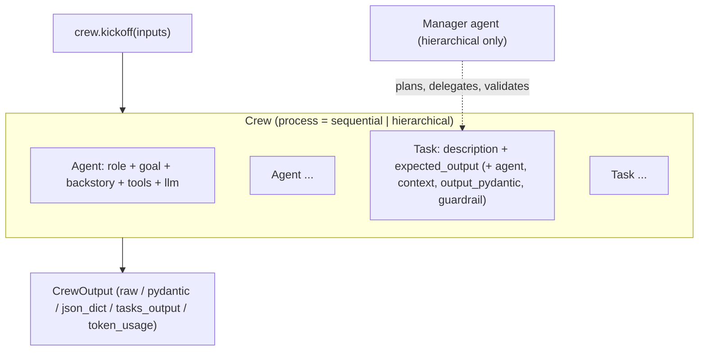

**CrewAI** is an open-source (MIT), standalone Python framework for multi-agent automation. It has its own primitives for agents, tasks, crews and flows and doesn't depend on other agent frameworks. It needs Python 3.10–3.13 and uses uv for packaging ([README](../sources/crewai-github-readme.md)). It has two layers. **Crews** are teams of role-playing agents that collaborate autonomously on tasks. **Flows** are event-driven Python classes that own state, ordering and branching. CrewAI's recommended architecture is a Flow for the application, with Crews embedded in the steps that need autonomous collaboration ([intro](../sources/crewai-docs-introduction.md)). The defining instinct is declarative: you name the roles, the tasks and the expected outputs up front ([Notebook](../sources/notebook-autogen-crewai.md)). A commercial suite, CrewAI AMP, adds managed deployment, [tracing](llm-observability.md) and a control plane ([README](../sources/crewai-github-readme.md)).

## Crews: agents, tasks, process

**Agent.** `role`, `goal` and `backstory` are required and make up the persona prompt. Other options include `llm`, `tools`, `max_iter` (default 20), `max_rpm`, `max_execution_time`, `allow_delegation` (default False), `reasoning` (plan before executing), `respect_context_window` (default True, which summarises history to fit) and `function_calling_llm`. The built-in code execution flags are deprecated in favour of [external sandboxes](code-execution-sandboxes.md) such as E2B or Modal. `Agent.kickoff()` runs an agent on its own, with optional Pydantic `response_format` ([agents](../sources/crewai-agents-docs.md)).

**Task.** `description` and `expected_output` are required. A task can set an `agent`, `context` (which upstream task outputs to include), `async_execution`, `output_pydantic`/`output_json` ([structured outputs](structured-outputs.md)), `output_file`, `human_input`, and **[guardrails](agent-guardrails.md)**. A guardrail is either a function returning `(ok, value_or_error)` or a natural-language criterion checked by the agent's LLM. A failure goes back to the agent for up to `guardrail_max_retries` attempts (default 3), and a list of guardrails runs in order ([tasks](../sources/crewai-tasks-docs.md)).

**Process.** Only two are implemented ([processes](../sources/crewai-processes-docs.md)):

| Process | Assignment | Data flow | Cost/predictability |
|---|---|---|---|
| `sequential` (default) | Fixed: each task names its agent | Each output is context for the next; `context=` for explicit wiring | Cheapest, deterministic order |
| `hierarchical` | A manager (`manager_llm` or a custom `manager_agent`) allocates tasks by capability and validates results | Mediated by the manager | Extra LLM calls; the manager can mis-delegate |

**Crew-level knobs** ([crews](../sources/crewai-crews-docs.md)): `memory`, `cache` (tool results, default on), `max_rpm`, `planning` (a planner rewrites task descriptions with a plan before each iteration), `step_callback`/`task_callback`, and `stream`. Execution methods are `kickoff`, `kickoff_for_each`, native-async `akickoff` (recommended for concurrency), and thread-based `kickoff_async`. `crewai replay -t <task_id>` re-runs from a given task with earlier context kept.

## Flows: the deterministic layer

A Flow is a class whose methods are wired by decorators ([flows](../sources/crewai-flows-docs.md)):

- `@start()` marks entry points. Several can run, often in parallel.
- `@listen(x)` runs when `x` finishes and receives its output. `or_()` fires on any upstream method, and `and_()` waits for all of them.
- `@router(x)` returns a label, and downstream `@listen("label")` methods form the branches. Declare the labels (via a `Literal` return type or `emit=`) so `plot()` can draw them.
- State is an unstructured dict or a Pydantic model (`Flow[MyState]`), and every state has an auto-generated `id` UUID.
- `@persist` snapshots state (SQLite by default). `kickoff(inputs={"id": ...})` resumes a run, and `restore_from_state_id` forks one.
- `@human_feedback` (CrewAI 1.8.0+) pauses for [human input](human-in-the-loop.md), and it can use an LLM to map free text to routed outcomes.
- `flow.usage_metrics` aggregates tokens across every crew, agent and LLM call in the run.

Synthesis: Flows are CrewAI's answer to graph runtimes like [LangGraph](langgraph.md). The control flow is plain Python decorated into an event graph, with crews as coarse-grained "autonomous" nodes.

## Memory

A unified `Memory` class replaces the older short-term, long-term, entity and external memory types. Memories go in LanceDB (by default `./.crewai/memory`) as a path-like scope tree. On save, an LLM infers scope and importance. Recall is either `shallow` (pure vector search) or `deep` (the default: an LLM-driven multi-step flow, skipped for queries under 200 characters). Ranking blends semantic similarity, recency (30-day half-life) and importance, weighted 0.5/0.3/0.2. The default embedder is OpenAI `text-embedding-3-large` ([memory](../sources/crewai-memory-docs.md)). See [agent memory](agent-memory.md), [embeddings](embeddings.md) and [vector databases](vector-databases.md).

## Comparison

| Dimension | CrewAI | [AutoGen](autogen.md) (AgentChat) | [Google ADK](google-adk.md) | [OpenAI Agents SDK](openai-agents-sdk.md) |
|---|---|---|---|---|
| Mental model | Team with roles and tasks | Agents in a conversation | Agents + workflow graph | Agents + handoffs |
| Unit of work | `Task` with `expected_output` | Message/turn | Node / agent invocation | Run turn |
| Deterministic layer | Flows | GraphFlow (now Agent Framework workflows) | Workflow agents / 2.0 graphs | None built in |
| Signature feature | Role/task scaffolding, guardrails per task | Code-executing agents | Multi-language, [A2A](agent2agent-protocol.md), eval | Guardrails, tracing |

Row sources: [Notebook](../sources/notebook-autogen-crewai.md) for CrewAI vs AutoGen; ADK and OpenAI columns are Synthesis from their pages.

## Limitations and failure modes

- **Persona prompts aren't control.** Role and backstory steer style. They don't guarantee behaviour, so put correctness in `expected_output`, structured outputs and guardrails. (Synthesis.)
- **Hierarchical overhead.** The manager adds LLM calls and can mis-delegate. Its validation criteria aren't documented beyond "the manager reviews outputs" ([processes](../sources/crewai-processes-docs.md)).
- **Silent failures.** Background memory saves emit events instead of raising errors. An unknown Flow state ID silently starts fresh instead of erroring ([memory](../sources/crewai-memory-docs.md), [flows](../sources/crewai-flows-docs.md)).
- **Memory privacy and lock-in.** Saves and deep recall send content to the configured LLM, and changing the embedding model can break existing stores ([memory](../sources/crewai-memory-docs.md)).
- **OpenAI-flavoured defaults.** The default LLM is `OPENAI_MODEL_NAME` or `gpt-6-luna` (as of 2026-11), and the default embedder is OpenAI. Override both explicitly in regulated or non-OpenAI deployments ([agents](../sources/crewai-agents-docs.md), [memory](../sources/crewai-memory-docs.md)).
- **General multi-agent cost.** Multiple agents add latency, tokens and loops that may never terminate. A single agent or a plain workflow is often better ([Notebook](../sources/notebook-autogen-crewai.md)).

## When to use it, and when not

Use it when the work naturally decomposes into named roles and ordered steps with checkable outputs: content pipelines, research-then-write, business back-office automation. It is also good when you want a readable prototype fast and a path to deterministic control via Flows ([Notebook](../sources/notebook-autogen-crewai.md)).

Avoid it when you need fine-grained control of every model call and state transition ([LangGraph](langgraph.md)), when the path is open-ended and conversational or code-execution-centric ([AutoGen / Agent Framework](autogen.md)), or when one agent with good [tools](tools.md) would do.

## Sources

- [CrewAI introduction](../sources/crewai-docs-introduction.md)
- [crewAI GitHub README](../sources/crewai-github-readme.md)
- [Agents](../sources/crewai-agents-docs.md)
- [Tasks](../sources/crewai-tasks-docs.md)
- [Crews](../sources/crewai-crews-docs.md)
- [Processes](../sources/crewai-processes-docs.md)
- [Flows](../sources/crewai-flows-docs.md)
- [Memory](../sources/crewai-memory-docs.md)
- [AutoGen vs CrewAI (Notebook)](../sources/notebook-autogen-crewai.md)
