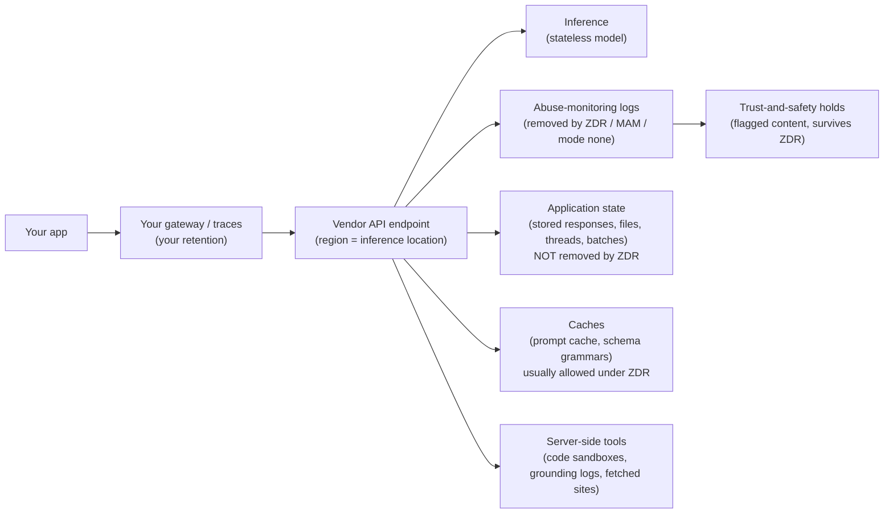

**Zero data retention (ZDR)** is a vendor commitment that your prompts and outputs are not written to storage after the response is returned. Usually it is a contract amendment or an approved account setting, not an API parameter. **Data residency** is a commitment about *where* your data is, and it covers two different things: where data is **stored at rest** and where **inference runs** (the GPUs that process your prompt). Each one bounds only a few of the places where a request's data can persist. A request touches abuse-monitoring logs, application state (stored responses, files, threads), caches, tool sandboxes, third-party websites, trust-and-safety holds and your own observability stack. ZDR removes some of these, residency pins some of them to a region, and neither covers them all. This page explains, per vendor (as of 2026-11), what each control actually covers, what it leaves out, and how to build a deployment that a privacy reviewer can verify. For the wider enterprise rollout see [Enterprise LLM deployment](enterprise-llm-deployment.md); for redaction and GDPR mechanics see [PII and data privacy](pii-and-data-privacy.md).

## Three separate questions

Customers often treat "Is it ZDR?", "Is it EU-hosted?" and "Do we have a BAA?" as one question. They are three:

| Question | Control | What it bounds |
|---|---|---|
| How long does the vendor keep my data? | Default retention, ZDR / modified abuse monitoring, retention modes | Abuse logs, application state, caches |
| Where is my data stored, and where is it processed? | Regional endpoints, deployment types, inference profiles, `inference_geo` | Storage location, inference location (separately) |
| What legal terms govern the processing? | DPA (processor terms), BAA (HIPAA), ZDR addendum | Liability, permitted use, sub-processing, PHI handling |

Synthesis: a design can satisfy one of these and fail another. An Azure Global deployment keeps data at rest in your geography but may run inference anywhere ([Azure](../sources/azure-foundry-data-privacy.md)). An Anthropic ZDR organization still keeps Batch inputs for 29 days if it calls the Batch API ([Anthropic](../sources/anthropic-api-and-data-retention.md)). A BAA on Anthropic's API comes with HIPAA safeguards rather than deletion, so it does not imply ZDR ([Anthropic](../sources/anthropic-api-and-data-retention.md)).

## Where request data can persist

Synthesis: the stores below are drawn from the vendor pages cited in each row. The diagram shows which control applies to each one.

| Store | Typical default | Under ZDR |
|---|---|---|
| Abuse-monitoring logs | OpenAI up to 30 days ([OpenAI](../sources/openai-your-data-controls.md)); Gemini API 55 days ([Gemini](../sources/gemini-api-abuse-monitoring-policy.md)); Anthropic has no separate figure, and its API data is deleted within 30 days by default ([Anthropic](../sources/anthropic-api-and-data-retention.md)) | Removed (OpenAI ZDR/MAM, Anthropic ZDR, Azure modified abuse monitoring, Bedrock mode `none`) |
| Application state | Kept until deleted or for a feature-specific window | Not removed: you must avoid the feature, or OpenAI forces `store=false` |
| Prompt / KV caches | Hours (OpenAI up to 24 h; Vertex and Gemini implicit cache 24 h) | Generally treated as compatible with ZDR (details below) |
| Grounding / search logs | Vertex Search grounding 3 days; Gemini API and Maps grounding 30 days | Cannot be disabled; avoid the feature |
| Trust-and-safety holds | Flagged content kept for review | Survive ZDR: Anthropic up to 2 years; OpenAI keeps flagged content even under ZDR/MAM |
| Your own logs and traces | Whatever you configure | Out of the vendor's scope entirely |

## Per-vendor mechanics

### Anthropic (Claude API)

- **Default:** API inputs and outputs are deleted on the backend within 30 days, with exceptions for longer-lived features, agreements, usage-policy enforcement and legal requirements ([source](../sources/anthropic-api-and-data-retention.md)).
- **ZDR:** prompts and responses are not stored at rest once the response is returned. The account team enables it per organization, and each new organization needs it enabled separately. It covers the Messages and Token Counting endpoints for eligible features, and Claude Code used with Commercial-org API keys. It does not cover the Console, Managed Agents (except self-hosted), consumer plans or the Teams/Enterprise chat products. ZDR organizations cannot call the API from a browser, because CORS requests are rejected ([source](../sources/anthropic-api-and-data-retention.md)).
- **Ineligible features are not blocked.** Batch (29-day retention), the Files API, code execution and programmatic tool calling (container data up to 30 days), Agent Skills, the MCP connector and message threads are marked ineligible. Calling one under ZDR takes that data outside ZDR rather than returning an error. Under HIPAA readiness, ineligible features return a 400 ([source](../sources/anthropic-api-and-data-retention.md)).
- **"Qualified" features keep a small artifact.** Structured outputs and strict tool use cache the compiled JSON schema for up to 24 hours after last use. Cache diagnostics keep a brief fingerprint of hashes and token counts. Prompt caching holds KV representations in memory for the cache TTL only. Web search and web fetch are eligible, but their dynamic filtering is not, and the websites you fetch can log the request under their own policies ([source](../sources/anthropic-api-and-data-retention.md)).
- **Covered Models:** Claude Fable 5, 5.1 and 5.2 and Mythos 5, 5.1 and 5.2 require 30-day retention and are unavailable under ZDR unless Anthropic authorizes it. A ZDR organization can turn on retention for one non-default workspace to reach them ([source](../sources/anthropic-api-and-data-retention.md)).
- **Residency:** `inference_geo` is `"global"` (default) or `"us"`, set per request or as a workspace default and enforced by `allowed_inference_geos`. US-only inference costs 1.1x on Claude 4.6 and later, and earlier models return 400 if the parameter is sent. The response's `usage.inference_geo` reports where inference actually ran. **Workspace geo** (storage at rest and endpoint-side processing such as code execution) is fixed at workspace creation and is only `"us"` today ([source](../sources/anthropic-data-residency-docs.md)).
- **Processor:** Anthropic is the data processor for its first-party API, Claude Platform on AWS, Anthropic-managed Claude on Google Cloud and Claude in Microsoft Foundry. The cloud provider is the processor for Bedrock and Google-managed Vertex, so those platforms' controls apply instead ([source](../sources/anthropic-api-and-data-retention.md)).

### OpenAI API

- **Default:** no training on API data since 2023-03-01 unless you opt in. Abuse-monitoring logs are kept up to 30 days. Responses whose `store` is omitted or true are kept at least 30 days ([source](../sources/openai-your-data-controls.md)).
- **Two tiers, both by approval:** **Modified Abuse Monitoring (MAM)** removes customer content from abuse logs (with rare exceptions for image and file inputs) and keeps every feature. **ZDR** does the same and also forces `store=false` on `/v1/responses` and `/v1/chat/completions`, even when the request sets `true`. Both are set per organization, and each project can override the setting ([source](../sources/openai-your-data-controls.md)).
- **Eligible endpoints:** chat completions, responses, decisions, image generation, embeddings, audio, moderations, completions and realtime. **Not eligible:** conversations, assistants, threads, vector stores (so hosted file search), agents, files, fine-tuning, evals, batches and audio voices ([source](../sources/openai-your-data-controls.md)).
- **Edge cases:** background mode writes response data to disk for about 10 minutes for polling. Prompt-cache tensors can stay in GPU-local storage up to 24 hours. Flagged content may be kept even under ZDR or MAM, and image and file inputs are scanned for CSAM ([source](../sources/openai-your-data-controls.md)).
- **BAA:** the same page ties PHI use to an executed Business Associate agreement. Live-internet [web search](web-search-apis.md) is not covered by the BAA. Offline web search can be covered, but only in a ZDR-enabled project inside a ZDR-enabled organization ([source](../sources/openai-your-data-controls.md)).
- **Residency:** regional domains such as `eu.api.openai.com`. US, Europe and UAE store and process in-region. Australia, Japan and India process in-region only for a narrow model and feature set. Canada, Singapore, South Korea and the UK are storage-only, so inference may run elsewhere. The region is fixed per project at creation. Models released on or after 2026-03-05 cost 10% more on residency endpoints. `store=true` on chat completions is not allowed outside the US, and in storage-only regions extended prompt caching may process and store data out of region ([source](../sources/openai-data-residency-guide.md)).

### Google: Gemini Developer API versus Vertex AI

Google runs two surfaces with very different data terms. Choosing between them is the most important privacy decision on Google.

- **Gemini Developer API (AI Studio keys).** On Unpaid Services, inputs and outputs may be used to improve Google products and read by human reviewers. On Paid Services they are not, and processing falls under Google's processor DPA. Apps offered to users in the EEA, Switzerland or the UK may use only Paid Services ([terms](../sources/gemini-api-additional-terms.md)). The abuse-monitoring policy keeps prompts, context and outputs for 55 days and lists no exemption ([policy](../sources/gemini-api-abuse-monitoring-policy.md)). Google's ZDR page lists features to avoid instead of offering a switch: Search and Maps grounding (30 days, cannot be disabled), Interactions API `store` (default on), Live API session resumption (24 h), Files and explicit caches. For guaranteed ZDR it points to Vertex AI ([ZDR page](../sources/gemini-api-zero-data-retention-docs.md)). AI Studio project logs are a further store: on by default for Interactions API calls and for projects created on or after 2026-10-26, kept 7 to 55 days ([logging](../sources/gemini-api-data-logging-and-sharing.md)).
- **Vertex AI (Gemini Enterprise Agent Platform).** No training without permission. For ZDR you take specific actions. Abuse-monitoring prompt logging applies to customers on the Google Cloud Platform Terms of Service. Request-response logging to BigQuery is off by default and must stay off. Set Interactions `store=false` explicitly, because it defaults to `true`. Avoid Search grounding (logs kept 3 days, cannot be disabled) in favour of Web Grounding for Enterprise. Maps grounding keeps data 30 days. Implicit caches are deleted within 24 hours and can be disabled per project with `disableCache`. Models under the Advanced AI Safety Addendum carry extra logging, and ZDR may not be possible for them. Partner OpenAI models are logged up to 30 days in the `us` multi-region until a project is approved for ZDR, and `store: false` alone does not enable ZDR for them ([source](../sources/vertex-ai-data-governance.md)).
- **Residency on Vertex:** regional endpoints, multi-region `us`/`eu` endpoints, or `global`. Google states that endpoints alone do not guarantee residency. Multi-region endpoints are the option for keeping ML processing in the US or EU. `global` does not support residency for partner models ([locations](../sources/vertex-ai-locations-endpoints.md)). VPC Service Controls add exfiltration protection, but inside a perimeter they disable request/response logging and URL-context fetching ([VPC-SC](../sources/vertex-ai-vpc-service-controls.md)).
- **Inconsistency to flag:** Google's Gemini API ZDR page describes paid abuse logging only as "a limited period", while the usage-policy page says 55 days ([ZDR page](../sources/gemini-api-zero-data-retention-docs.md), [policy](../sources/gemini-api-abuse-monitoring-policy.md)). Synthesis: plan for 55 days.

### Azure (Foundry Models sold by Azure, including Azure OpenAI)

- **Isolation:** prompts and outputs are not available to OpenAI or other model providers, and are not used to train foundation models without permission. The models run in Azure and do not call OpenAI's services. Processing is governed by the Microsoft Products and Services DPA ([source](../sources/azure-foundry-data-privacy.md)).
- **No product called ZDR.** The equivalent is **modified abuse monitoring**. Customers who meet extra Limited Access criteria apply by form, and some advanced models have stricter criteria. Once approved, storage of flagged traffic and human review stop, but automated (LLM) review continues. You can verify this on the resource: the `ContentLogging` capability shows `false`, and the property is absent otherwise ([data privacy](../sources/azure-foundry-data-privacy.md), [abuse monitoring](../sources/azure-foundry-abuse-monitoring.md)).
- **Stateful features** (Responses API storage, Assistants threads, stored completions, files, batch, fine-tuning) store data in your resource's geography. It is AES-256 encrypted, optionally with customer-managed keys, and you can delete it ([source](../sources/azure-foundry-data-privacy.md)). Synthesis: Azure keeps state in your tenant, under your encryption and deletion controls, rather than banning it under a retention mode.
- **Residency by deployment type:** *Standard* processes within your geography. *DataZone* processes anywhere in the zone (the US, or any EU member state). *Global* processes wherever the model is deployed. Data at rest, including the abuse-monitoring store, stays in your geography in all three cases. Batch is a Global deployment type. Human reviewers for EEA deployments are located in the EEA. Preview features may not honour these commitments ([source](../sources/azure-foundry-data-privacy.md)).

### Amazon Bedrock

- **Isolation:** each Region has an AWS-operated model deployment account per provider, and providers cannot see prompts, completions or logs ([source](../sources/aws-bedrock-data-protection.md)).
- **Retention is an ordered mode,** set per Region at account or project level: `none` (zero retention) < `default` (the model's own policy) < `aws_review` (AWS may keep data and have humans review it inside AWS) < legacy `provider_data_share`. The effective mode is the first non-`inherit` value among project, account and model default. Settings do not propagate across Regions ([source](../sources/bedrock-data-retention-docs.md)).
- **The mode decides which models you can call.** If a model's minimum mode is above your effective mode, the model is unavailable or the call fails with `ValidationException`. Claude Fable 5, 5.1 and 5.2 require `aws_review`, which keeps data up to 30 days inside AWS. ZDR for them is limited to accounts eligible for the Enterprise Frontier Safeguards program, evaluated per account and model. `store=false` alone does not mean zero retention; only mode `none` does. SCPs on `DataRetentionMode` can enforce `none` across an organization ([source](../sources/bedrock-data-retention-docs.md)).
- **Residency:** cross-Region inference profiles let Bedrock pick the destination Region per request: geographic profiles (US, EU, APAC) stay inside the geography, while global profiles go to any commercial Region at roughly 10% lower price. CloudTrail's `inferenceRegion` field records where each request ran. Data retained under a non-`none` mode is stored in the destination Region ([CRIS](../sources/aws-bedrock-cross-region-inference.md), [retention](../sources/bedrock-data-retention-docs.md)).

## Comparison (as of 2026-11)

| | Anthropic API | OpenAI API | Gemini Developer API | Vertex AI | Azure Foundry | Bedrock |
|---|---|---|---|---|---|---|
| ZDR mechanism | Org-level, via account team | ZDR or MAM, by approval, org + project | None; avoid features, paid tier only | Configuration plus account team for some models | Modified abuse monitoring (Limited Access form) | Retention mode `none` (self-serve, SCP-enforceable) |
| Stateful features under ZDR | Allowed but leave ZDR (400 under HIPAA) | `store` forced false; ineligible endpoints listed | Must be avoided | Must be off (`store=false`, no BigQuery logging) | Allowed, stored in your resource | `store=true` rejected under `none` |
| Frontier models gated by retention | Covered Models need 30 days | Not stated | Not stated | Advanced AI Safety Addendum models | "More stringent criteria" for some | Models needing `aws_review` |
| Inference residency | `inference_geo: "us"` (+10%) | Regional domains; some regions storage-only | None documented; paid-tier data may be stored transiently in any country with Google facilities | Regional / `us`/`eu` multi-region | Standard / DataZone | Region or geographic profile |
| HIPAA path | BAA + HIPAA readiness (irreversible) | BAA, eligible endpoints | Not covered by the Google Cloud HIPAA page | Google Cloud BAA | Not covered by the sources used here; check Microsoft's HIPAA offering | AWS BAA; Bedrock eligible |

Sources: each vendor section above; HIPAA rows from [AWS](../sources/aws-hipaa-eligible-services.md), [Google Cloud](../sources/google-cloud-hipaa-compliance.md), [Anthropic](../sources/anthropic-api-and-data-retention.md), [OpenAI](../sources/openai-your-data-controls.md).

## Contracts: DPA, BAA and the ZDR addendum

- **DPA (data processing addendum).** It makes the vendor a processor acting on your instructions. Google's Paid Services and Azure's models sold by Azure are explicitly processed under processor DPAs. Google's Unpaid Services are not, which is why the Gemini terms forbid them for EEA/UK/Swiss end users ([Gemini terms](../sources/gemini-api-additional-terms.md), [Azure](../sources/azure-foundry-data-privacy.md)). Synthesis: a DPA governs how data is handled, not how long it is kept. Retention is still whatever the product does.
- **BAA (business associate agreement).** Required before PHI. Anthropic's HIPAA readiness needs a signed BAA, applies safeguards (encryption, access control, audit logging) rather than deletion, cannot be turned off once enabled, and forbids PHI in JSON schemas because compiled grammars are cached outside PHI protections ([Anthropic](../sources/anthropic-api-and-data-retention.md)). On AWS, Bedrock and Bedrock AgentCore are HIPAA-eligible under the AWS BAA with no feature exclusions ([AWS](../sources/aws-hipaa-eligible-services.md)). Google Cloud's BAA covers Gemini Enterprise Agent Platform and Generative AI on Agent Platform but excludes pre-GA offerings, and the HIPAA page does not mention the Gemini Developer API ([Google Cloud](../sources/google-cloud-hipaa-compliance.md)).
- **ZDR addendum or approval.** On Anthropic and OpenAI, ZDR is granted per organization by the vendor. On Bedrock it is a setting you control (except for gated models). On Azure it is an application. Synthesis: ask for written confirmation of the scope (which org IDs, projects and endpoints), because a new org or project created later may not inherit it.

## Failure modes

- **Silent exit from ZDR.** Under Anthropic ZDR a Batch, Files or code-execution call works normally while its data follows standard retention. Synthesis: block those endpoints at your gateway rather than relying on the vendor to refuse them ([Anthropic](../sources/anthropic-api-and-data-retention.md)).
- **"`store=false` means ZDR".** It does not on Bedrock (only mode `none`) or on Vertex partner OpenAI models ([Bedrock](../sources/bedrock-data-retention-docs.md), [Vertex](../sources/vertex-ai-data-governance.md)).
- **Defaults that flip on.** The Vertex and Gemini Interactions API `store` defaults to true. AI Studio logging is on by default for projects created on or after 2026-10-26 ([Vertex](../sources/vertex-ai-data-governance.md), [Gemini logging](../sources/gemini-api-data-logging-and-sharing.md)).
- **Grounding is a retention leak.** Search and Maps grounding logs cannot be disabled on either Google surface ([Gemini ZDR](../sources/gemini-api-zero-data-retention-docs.md), [Vertex](../sources/vertex-ai-data-governance.md)). Third-party sites you fetch keep their own logs ([Anthropic](../sources/anthropic-api-and-data-retention.md)).
- **Storage-only residency.** OpenAI's Canada, Singapore, South Korea and UK regions, and Azure Global and Batch, keep data at rest locally while inference may run abroad ([OpenAI](../sources/openai-data-residency-guide.md), [Azure](../sources/azure-foundry-data-privacy.md)).
- **Global routing for capacity.** Bedrock global profiles and Vertex `global` are cheaper or more available but break residency ([CRIS](../sources/aws-bedrock-cross-region-inference.md), [locations](../sources/vertex-ai-locations-endpoints.md)). Synthesis: a [fallback](model-routing-and-fallbacks.md) or [gateway](llm-gateways.md) rule that retries in another region on a 429 can quietly do the same.
- **Frontier lockout.** Strict ZDR can make the newest Claude tiers unavailable on both Anthropic and Bedrock ([Anthropic](../sources/anthropic-api-and-data-retention.md), [Bedrock](../sources/bedrock-data-retention-docs.md)). Synthesis: settle this during [model selection](model-selection.md), not after legal sign-off.
- **Trust-and-safety holds outlive ZDR.** Anthropic keeps flagged content up to 2 years, and OpenAI keeps flagged content even under ZDR ([Anthropic](../sources/anthropic-api-and-data-retention.md), [OpenAI](../sources/openai-your-data-controls.md)).
- **Your own stack.** Vendor ZDR says nothing about your traces, [observability](llm-observability.md) exports, [OpenTelemetry](opentelemetry-genai.md) spans, vector stores or [agent memory](agent-memory.md). Synthesis: these are often the largest copy of the prompts.

## Practical guidance

Synthesis, drawn from the failure modes above:

1. **Write the data-flow inventory first.** List every store in the table above for each feature you plan to use. Then pick controls. Note that [batch](batch-processing.md), hosted file search, [code execution](code-execution-sandboxes.md), stateful [Responses](openai-responses-api.md) and grounding each need an explicit decision.
2. **Pick the surface by data class.** Regulated or EU personal data: use Vertex rather than the Gemini Developer API, Bedrock or Azure in a pinned region, or Anthropic or OpenAI with ZDR plus regional processing. Paid tiers only, never free tiers.
3. **Enforce at the organization level, not in code.** Use Bedrock SCPs on `DataRetentionMode`, Anthropic `allowed_inference_geos`, OpenAI per-project retention settings, and Vertex `disableCache` or VPC-SC. Block ineligible endpoints at the gateway.
4. **Verify, don't assume.** Check Azure's `ContentLogging=false`, Anthropic's `usage.inference_geo`, Bedrock's CloudTrail `inferenceRegion`, and the Vertex Model Garden "Zero Data Retention active" banner for partner models ([Azure](../sources/azure-foundry-data-privacy.md), [Anthropic](../sources/anthropic-data-residency-docs.md), [CRIS](../sources/aws-bedrock-cross-region-inference.md), [Vertex](../sources/vertex-ai-data-governance.md)). Synthesis: put these checks in a deployment test.
5. **Budget for residency.** Expect about 10% more for US-only inference on Anthropic and on newer OpenAI models on regional endpoints, and to give up global-profile discounts and availability on Bedrock and Vertex.
6. **Keep ZDR, BAA and DPA separate in the security review.** State which applies to which surface, org and project, and record the date, because the vendors change these terms often (every number on this page is as of 2026-11).

Related: [AI governance and compliance](ai-governance-and-compliance.md) · [Amazon Bedrock](amazon-bedrock.md) · [Google Vertex AI](google-vertex-ai.md) · [Azure AI Foundry](azure-ai-foundry.md) · [Gemini API](gemini-api.md) · [Anthropic Messages API](anthropic-messages-api.md) · [Prompt caching](prompt-caching.md) · [Forward deployed engineering](forward-deployed-engineering.md)

## Sources

- [Anthropic API and data retention](../sources/anthropic-api-and-data-retention.md) · [Anthropic data residency](../sources/anthropic-data-residency-docs.md)
- [OpenAI data controls](../sources/openai-your-data-controls.md) · [OpenAI data residency](../sources/openai-data-residency-guide.md)
- [Gemini API zero data retention](../sources/gemini-api-zero-data-retention-docs.md) · [Gemini API abuse monitoring](../sources/gemini-api-abuse-monitoring-policy.md) · [Gemini API additional terms](../sources/gemini-api-additional-terms.md) · [Gemini API data logging](../sources/gemini-api-data-logging-and-sharing.md)
- [Vertex AI data governance](../sources/vertex-ai-data-governance.md) · [Vertex AI locations](../sources/vertex-ai-locations-endpoints.md) · [Vertex AI VPC Service Controls](../sources/vertex-ai-vpc-service-controls.md) · [Google Cloud HIPAA](../sources/google-cloud-hipaa-compliance.md)
- [Azure Foundry data privacy](../sources/azure-foundry-data-privacy.md) · [Azure Foundry abuse monitoring](../sources/azure-foundry-abuse-monitoring.md)
- [Bedrock data retention](../sources/bedrock-data-retention-docs.md) · [Bedrock data protection](../sources/aws-bedrock-data-protection.md) · [Bedrock cross-Region inference](../sources/aws-bedrock-cross-region-inference.md) · [AWS HIPAA eligible services](../sources/aws-hipaa-eligible-services.md)
