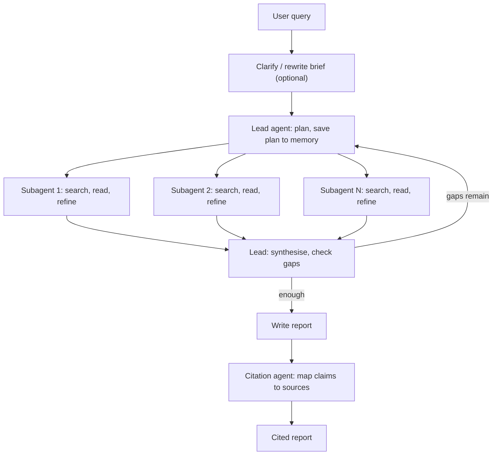

**Deep research agents** are LLM agents that take an open-ended question and spend minutes to tens of minutes on it. They plan, run many rounds of web (and private-data) search, read and cross-check sources, and produce a structured report with citations. A survey defines them by five capabilities: dynamic reasoning, long-horizon planning, multi-hop retrieval, iterative tool use and structured report generation ([Huang et al.](../sources/huang-2025-deep-research-agents-survey.md)). They are the high-effort end of [agentic RAG](agentic-rag.md). The retrieval path is not fixed in advance; the agent chooses its next query based on what it has read so far, unlike static [RAG](retrieval-augmented-generation.md), which retrieves similar chunks once ([Anthropic](../sources/anthropic-multi-agent-research-system.md)).

## Reference architecture

Anthropic's published design is the clearest public blueprint. It is an [orchestrator-worker](agent-design-patterns.md) system ([Anthropic](../sources/anthropic-multi-agent-research-system.md)):

1. **Lead agent (planner).** It analyses the query, writes a plan and saves it to external memory, because context beyond 200k tokens is truncated.
2. **Parallel search subagents.** Each gets a specific brief, runs its own search-evaluate-refine loop in a fresh [context window](context-window.md), and returns condensed findings. See [subagents](subagents.md).
3. **Synthesis loop.** The lead merges the findings and decides whether to spawn more subagents or change strategy.
4. **Citation agent.** It takes the finished report plus the source documents and attaches a citation to each claim.

The clarify step comes from OpenAI's cookbook ([cookbook](../sources/openai-deep-research-cookbook.md)) and Gemini's collaborative planning ([Gemini](../sources/gemini-deep-research-agent-docs.md)). The rest follows Anthropic's description.

Design rules from the Anthropic write-up:

- **Delegate precisely.** Each subagent brief needs an objective, an output format, tool guidance and boundaries. Vague briefs led to duplicated searches.
- **Scale effort to the query.** Roughly 1 agent and 3-10 [tool](tools.md) calls for a simple fact; 10+ subagents for complex research. Embed these rules in the prompt, because agents misjudge effort.
- **Search broad, then narrow.** Start with short queries and refine them.
- **Parallelise at two levels.** The lead runs 3-5 subagents at once, and each subagent issues 3+ tool calls in parallel. This cut research time by up to 90% on complex queries.
- **Think between tool calls.** The lead plans with [extended thinking](extended-thinking.md); subagents use interleaved thinking to judge results and pick the next query.
- **Pass references, not blobs.** Subagents can write outputs to external storage and return pointers, which avoids a lossy relay through the lead. See [agent memory](agent-memory.md).

Older academic systems such as STORM use a fixed pipeline instead of a dynamic loop. STORM finds perspectives, simulates writers questioning a grounded "expert", builds an outline, then writes. Against an outline-driven RAG baseline, its articles were judged more organised (+25% absolute) and broader (+10%) ([STORM](../sources/shao-2024-storm.md)). The survey classifies systems by static versus dynamic workflow, single versus multi-agent, planning strategy, and API versus browser-based retrieval ([survey](../sources/huang-2025-deep-research-agents-survey.md)).

## Why it works: tokens and trained persistence

- On BrowseComp, a [benchmark](benchmarks.md), token usage alone explained about 80% of performance variance in Anthropic's analysis; tool-call count and model choice explained most of the rest. Multi-agent designs work largely because they let the system spend more tokens in parallel, separate context windows ([Anthropic](../sources/anthropic-multi-agent-research-system.md)). This is [test-time compute](test-time-compute.md) applied to retrieval.
- An Opus 4 lead with Sonnet 4 subagents beat a single Opus 4 agent by 90.2% on Anthropic's internal eval, with the biggest gains on breadth-first questions ([Anthropic](../sources/anthropic-multi-agent-research-system.md)).
- BrowseComp (1,266 hard-to-find, easy-to-check questions): GPT-4o with browsing scored 1.9%, o1 9.9%, and OpenAI Deep Research 51.5%. Accuracy rose smoothly with browsing effort, and aggregating 64 sampled answers (majority vote, confidence-weighted vote, best-of-N) added roughly 15-25%, with best-of-N by the model's own confidence doing best ([BrowseComp](../sources/wei-2025-browsecomp.md)). Synthesis: giving a chat model a search tool is not enough; the gain comes from a model trained to search persistently.
- OpenAI trained its deep research model, an early o3 variant, with [reinforcement learning](reinforcement-fine-tuning.md) on browsing tasks: searching, clicking, scrolling, reading files and using Python. Tasks were graded against ground truth or rubrics by a [chain-of-thought](chain-of-thought.md) grader ([system card](../sources/openai-deep-research-system-card.md)).

## Vendor implementations (as of 2026-11)

| | OpenAI | Google Gemini | Anthropic | Perplexity |
|---|---|---|---|---|
| Form | [Responses API](openai-responses-api.md): [reasoning model](reasoning-models.md) + hosted `web_search`, `background: true` | Managed agent via Interactions API | Claude Research product; in the API you build it from `web_search`/`web_fetch` + subagents | Agent API effort presets |
| Current IDs | dedicated `o3-/o4-mini-deep-research` shut down 2026-07-23 (replacement `gpt-5.6-sol`); guide now recommends `gpt-6-astra` at high/xhigh reasoning | `deep-research-preview-04-2026`, `deep-research-max-preview-04-2026` | orchestrator-worker design (Opus lead, Sonnet workers in the 2025 write-up) | `high` (40 steps), `xhigh` (300 steps, Claude Opus 5.5 by default), `ultra` |
| Data sources | web search, [MCP](model-context-protocol.md), file search, code interpreter | `google_search`, `url_context`, `code_execution`, `file_search`, `mcp_server` | any tools, incl. MCP | `web_search`, `fetch_url`, sandbox, finance search |
| Async / steering | background mode + polling; `max_tool_calls` cap | `background=True`, polling or [streaming](streaming.md) with thought summaries, resume with `last_event_id`; `collaborative_planning` | lead waits synchronously per subagent batch | preset step budget |
| Citations | `url_citation` annotations with char spans | cited report | dedicated citation agent | grounded citations |

Sources: [OpenAI cookbook](../sources/openai-deep-research-cookbook.md), [deprecations](../sources/openai-deprecations-deep-research.md), [OpenAI web search guide](../sources/openai-web-search-tool-docs.md), [Gemini](../sources/gemini-deep-research-agent-docs.md), [Anthropic](../sources/anthropic-multi-agent-research-system.md), [Perplexity](../sources/perplexity-api-docs.md).

Synthesis: the market has moved from dedicated "deep research models" to two forms. One is a general reasoning model at high effort with hosted search in background mode (OpenAI, Perplexity presets). The other is a managed research agent behind an async API (Gemini). Building your own on [web search APIs](web-search-apis.md) remains the way to control sources, cost and private data.

## Building one yourself

- **Front-load clarification.** OpenAI's deep research API never asks questions, so its cookbook puts a cheap model first to ask a few scoping questions and rewrite the answers into a detailed brief ([cookbook](../sources/openai-deep-research-cookbook.md)). Gemini offers a plan-review loop instead ([Gemini](../sources/gemini-deep-research-agent-docs.md)). This is a natural [human-in-the-loop](human-in-the-loop.md) checkpoint.
- **Run it as a job, not a request.** Runs take minutes. Use background mode or polling and checkpointing; Anthropic resumes from checkpoints because errors compound in long runs ([Anthropic](../sources/anthropic-multi-agent-research-system.md)). See [durable agent execution](durable-agent-execution.md).
- **Cap the budget.** Use `max_uses` per search tool ([Claude](../sources/anthropic-web-search-tool-docs.md)), `max_tool_calls` (OpenAI cookbook) and step budgets (Perplexity presets). Expect about 15x chat-level tokens for multi-agent research ([Anthropic](../sources/anthropic-multi-agent-research-system.md)).
- **Keep worker context lean.** Use pre-chunked results or dynamic filtering so subagents return conclusions, not page dumps ([Claude search](../sources/anthropic-web-search-tool-docs.md)). See [context engineering](context-engineering.md).
- **Verify citations separately.** A final pass checks that each claim is supported by the cited span. Anthropic uses a dedicated agent for this ([Anthropic](../sources/anthropic-multi-agent-research-system.md)); see [verification and evals](verification-and-evals.md).
- **Trace everything.** Paths are [non-deterministic](llm-non-determinism.md), so full production tracing is the only way to debug ([Anthropic](../sources/anthropic-multi-agent-research-system.md)). See [LLM observability](llm-observability.md).

## Evaluation

Grade outcomes, not trajectories: different valid paths reach the same answer. Anthropic started with about 20 real queries and used one [LLM-as-judge](llm-as-judge.md) rubric covering factual accuracy, citation accuracy, completeness, source quality and tool efficiency, scored 0-1 with pass/fail. Human testers still caught a preference for SEO content farms ([Anthropic](../sources/anthropic-multi-agent-research-system.md)). For short-answer browsing ability, BrowseComp is the standard benchmark ([BrowseComp](../sources/wei-2025-browsecomp.md)). The survey argues that current benchmarks fit the practical goals of deep research poorly ([survey](../sources/huang-2025-deep-research-agents-survey.md)). See [agent evaluation](agent-evaluation.md).

## Failure modes

- **Prompt injection and exfiltration.** Browsed pages can steer the agent to wrong answers or try to leak context such as API keys through URLs. OpenAI trained against injections and blocked the agent from navigating to or constructing arbitrary URLs ([system card](../sources/openai-deep-research-system-card.md)). Claude's fetch tool similarly fetches only URLs already in context ([web fetch](../sources/anthropic-web-fetch-tool-docs.md)). Keep public search and private MCP calls in separate requests ([OpenAI guide](../sources/openai-web-search-tool-docs.md)). See [prompt injection](prompt-injection.md).
- **Source bias and bad sources.** STORM found that bias in sources transfers into the article and that unrelated facts get over-associated ([STORM](../sources/shao-2024-storm.md)). Agents also prefer SEO farms unless told otherwise ([Anthropic](../sources/anthropic-multi-agent-research-system.md)).
- **Overconfidence.** Deep Research's BrowseComp calibration error was 91% ([BrowseComp](../sources/wei-2025-browsecomp.md)). Do not trust stated confidence.
- **Duplicated or runaway work.** Vague briefs make subagents overlap; without effort rules agents over-search simple questions ([Anthropic](../sources/anthropic-multi-agent-research-system.md)).
- **Synchronous bottleneck.** A lead waiting on its slowest subagent cannot steer mid-flight. Async execution adds coordination and error-propagation problems ([Anthropic](../sources/anthropic-multi-agent-research-system.md)).
- **Model churn.** Dedicated deep research models were retired within about a year ([deprecations](../sources/openai-deprecations-deep-research.md)). Wrap the vendor call behind your own interface (see [model routing and fallbacks](model-routing-and-fallbacks.md)).

## When to use / when not

- **Use** for high-value, breadth-first questions whose sub-questions can run in parallel: market and competitor scans, literature reviews, due diligence, multi-entity comparisons ([Anthropic](../sources/anthropic-multi-agent-research-system.md)).
- **Don't use** for single-fact lookups (one search call is enough), latency-sensitive UX, or tightly coupled work like most coding, where sub-tasks share too much context to parallelise ([Anthropic](../sources/anthropic-multi-agent-research-system.md)). Synthesis: if the answer lives in your own documents, try [agentic RAG](agentic-rag.md) over internal data first; web-scale research costs much more.

## Sources

- [How we built our multi-agent research system (Anthropic)](../sources/anthropic-multi-agent-research-system.md)
- [OpenAI Deep Research System Card](../sources/openai-deep-research-system-card.md)
- [Introduction to the Deep Research API (OpenAI Cookbook)](../sources/openai-deep-research-cookbook.md)
- [OpenAI deprecations (search and deep research models)](../sources/openai-deprecations-deep-research.md)
- [OpenAI web search tool guide](../sources/openai-web-search-tool-docs.md)
- [Gemini Deep Research agent docs](../sources/gemini-deep-research-agent-docs.md)
- [Perplexity API docs](../sources/perplexity-api-docs.md)
- [Claude web search tool docs](../sources/anthropic-web-search-tool-docs.md)
- [Claude web fetch tool docs](../sources/anthropic-web-fetch-tool-docs.md)
- [Wei et al. 2025: BrowseComp](../sources/wei-2025-browsecomp.md)
- [Shao et al. 2024: STORM](../sources/shao-2024-storm.md)
- [Huang et al. 2025: Deep Research Agents survey](../sources/huang-2025-deep-research-agents-survey.md)
