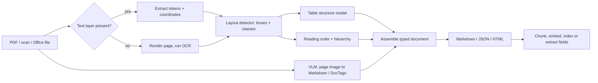

**Document processing** (document AI, document parsing) converts files designed for human eyes, such as PDFs, scans, slide decks and spreadsheets, into machine-usable structure: text in correct reading order, typed elements (titles, paragraphs, lists, tables, figures, formulas) with page coordinates, and tables as real grids. It is the first stage of most enterprise [RAG](retrieval-augmented-generation.md) and extraction systems. Errors made here (a merged two-column page, a flattened table, a missed scan) carry through every later stage, because [chunking](chunking.md), [embeddings](embeddings.md) and the generator only ever see what the parser produced (Synthesis).

## Why PDFs are hard

A PDF stores glyphs at coordinates, not paragraphs or tables. A parser must recover structure the format never recorded. Docling's authors built their own PDF backend because existing Python libraries had licensing, speed or quality problems such as merged text cells ([Docling report](../sources/docling-technical-report.md)). Scanned pages have no text layer at all and need OCR. Tables are worse: the logical grid (spans, multi-row headers, cells without borders) must be inferred from lines and whitespace ([TableFormer](../sources/tableformer-nassar-2022.md)).

## Two architectures

Synthesis: the diagram combines the Docling pipeline ([Docling report](../sources/docling-technical-report.md)) with the single-model VLM route ([Granite-Docling](../sources/granite-docling-announcement.md), [olmOCR](../sources/olmocr-2025.md)).

### 1. Modular pipelines (layout + OCR + table models)

Docling is the clearest open example ([Docling report](../sources/docling-technical-report.md)):

- **Backend:** `docling-parse` (default, built on qpdf) or `pypdfium`. Each extracts text tokens with coordinates and renders page images. pypdfium uses about 2.5 GB instead of 6.2 GB of memory and is faster, but table quality drops.
- **Layout analysis:** an RT-DETR-derived object detector trained on DocLayNet, run on 72 dpi page images. Its boxes are intersected with the PDF's own text tokens, so digital text is never re-OCR'd.
- **Table structure:** TableFormer predicts the row/column grid and cell boxes, then copies cell text from the PDF layer. It costs about 2-6 s per table on CPU.
- **OCR (optional):** EasyOCR at 216 dpi; over 30 s per page on CPU.
- **Assembly:** reading-order correction, caption linking, language detection; export to JSON or Markdown.
- **Throughput (2024, OCR off, 225 pages):** about 1.3 pages/s on an M3 Max and 0.6-0.9 pages/s on a Xeon E5-2690 (4 vs 16 threads) with the native backend.

The current Docling docs add many input formats (DOCX, PPTX, XLSX, HTML, images, audio, XBRL), chart-to-table conversion, pluggable OCR engines (Tesseract, RapidOCR and others), structure-aware chunkers, framework integrations and an MCP server ([Docling docs](../sources/docling-docs.md)).

**Unstructured** has the same shape but exposes it as a `strategy` switch ([Unstructured partitioning](../sources/unstructured-partitioning-docs.md)):

| Strategy | Mechanism | Use when |
|---|---|---|
| `fast` | Rule-based text extraction, roughly 100x faster than image models | Digital PDFs where element classes do not matter; never on scans |
| `hi_res` | Layout model + OCR where needed. The open-source library defaults to `yolox` (`detectron2_onnx` is also available); the hosted Unstructured API defaults to its proprietary `layout_v1.1.0` (as of 2026-11) | Tables, headings and element types matter |
| `ocr_only` | OCR over page images | Image-only files where layout is simple |
| `auto` | Picks based on the document and arguments | Default |

Output is a flat list of typed elements (Title, NarrativeText, ListItem, Table, Image, Header, Footer, Formula, FigureCaption and others). Metadata includes `page_number`, `coordinates`, `parent_id`, `detection_class_prob`, and `text_as_html` for tables ([Unstructured partitioning](../sources/unstructured-partitioning-docs.md)). Chunking then packs whole elements up to `max_characters` (default 500) with a soft `new_after_n_chars`. `by_title` starts a new chunk at every Title and never merges tables with prose ([Unstructured chunking](../sources/unstructured-chunking-docs.md)).

### 2. Vision-language-model parsing

Instead of chaining detectors, a VLM reads the page image and writes the structure directly:

- **Small specialist models:** Granite-Docling-258M (Apache 2.0, September 2025) emits DocTags, a compact markup of element type, position and relationships, in one pass. It also fixed SmolDocling's habit of looping on repeated tokens ([Granite-Docling](../sources/granite-docling-announcement.md)). olmOCR fine-tunes a 7B VLM on 260k real PDF pages and costs about $176 per million pages versus over $6,240 with GPT-4o (2025 prices) ([olmOCR](../sources/olmocr-2025.md)).
- **Hosted OCR APIs:** Mistral OCR (March 2025, since superseded) returned ordered Markdown plus images, at up to 2,000 pages/min per node and about 1,000 pages per dollar ([Mistral OCR](../sources/mistral-ocr-announcement.md)).
- **Hosted parsing services with tiers:** LlamaParse v2 sells the trade-off directly (as of 2026-11): Fast (no model, 1 credit/page), Cost-effective (3), Agentic (10, for scans, multi-column pages, charts) and Agentic Plus (25, a separate pipeline for dense financial tables). Credits cost $1.25-1.50 per 1,000. Pin a dated `version` in production so output does not drift ([LlamaParse](../sources/llamaparse-tiers-and-pricing.md)).
- **General frontier models:** Claude takes a PDF as a `document` block and receives each page as both extracted text and an image. That costs about 1,500-3,000 text tokens per page plus image tokens, with up to 600 pages per request, or 100 when the request's context window is under 1M tokens (as of 2026-11). Dense PDFs can fill the context window before the page limit ([Anthropic PDF](../sources/anthropic-pdf-support-docs.md)). Vision limits carry over: rotated, low-quality or tiny images degrade results ([Anthropic vision](../sources/anthropic-vision-docs.md)).

### Where the field stands

On OmniDocBench (CVPR 2025; leaderboard read 2026-11-14), specialized document VLMs lead with Overall scores around 96-97 (OXR-1.0 97.03). General VLMs come next (Gemini 3 Pro 92.91), and classic pipeline tools trail (MinerU-Pipeline 86.47, Marker 78.44). Overall combines text edit distance, table TEDS and formula CDM; reading order is scored separately ([OmniDocBench](../sources/omnidocbench.md)). TEDS (tree-edit-distance similarity over the table's HTML tree) is also the standard table metric. TableFormer raised it to 98.5% on simple and 95% on complex tables in 2022 ([TableFormer](../sources/tableformer-nassar-2022.md)).

### Skipping parsing: retrieve page images

ColPali embeds each page image as about 1,030 patch vectors and retrieves with late interaction. On ViDoRe it scored nDCG@5 81.3 versus 67.0 for an Unstructured + captioning + BGE-M3 text pipeline. It indexed pages in 0.39 s versus 7.22 s on an L4 GPU, but stores about 257 KB per page ([ColPali](../sources/colpali-2024.md)). It solves retrieval only; you still need a [multimodal model](multimodal-models.md) to read the retrieved page, or text extracted from it.

## Comparison

| Approach | Strengths | Weaknesses | Typical cost/speed |
|---|---|---|---|
| Text-layer extraction (`fast`, Fast tier) | Cheap, exact characters, deterministic | Breaks on scans, multi-column pages, tables | Very fast |
| Modular pipeline (Docling, Unstructured `hi_res`) | Local/air-gapped, coordinates and element types, inspectable stages, copies exact PDF text | Each stage can fail; tables are slow on CPU; OCR slow | About 1 page/s on CPU (Docling 2024) |
| Small document VLM (Granite-Docling, olmOCR) | One model, handles messy layouts, cheap at scale on GPU | Can loop or hallucinate text; needs a GPU | About $176/M pages (olmOCR) |
| Hosted parser (LlamaParse, Mistral OCR) | No infra; tiered quality | Data leaves your boundary; per-page cost; output changes across versions | 1-25 credits/page (LlamaParse) |
| Frontier LLM on the PDF | Reasons over charts and layout; can extract to a schema directly | Most expensive per page; context limits; vision limits | Thousands of tokens/page |
| Page-image retrieval (ColPali) | No parsing; strong on visual documents | Large index; no text for keyword search or citations | 0.39 s/page indexing |

Sources: rows draw on the sources cited in the sections above; the cell judgements are Synthesis.

## Failure modes

- **Reading order:** multi-column pages, sidebars and footnotes interleave into nonsense. Docling has an explicit reading-order correction step ([Docling report](../sources/docling-technical-report.md)).
- **Tables:** flattened to whitespace text, headers detached from cells, or spans lost. Keep tables as HTML (`text_as_html`) or Markdown, and keep them as their own chunks ([Unstructured chunking](../sources/unstructured-chunking-docs.md)).
- **OCR noise:** misread characters in IDs, amounts and dates. The owner's licence lab validates every field with regex and rejects bad reads rather than passing them on ([Notebook](../sources/notebook-license-ml-lab.md)).
- **VLM hallucination and repetition:** generative parsers can produce fluent text that is not on the page, or loop on tokens ([Granite-Docling](../sources/granite-docling-announcement.md); see [hallucination](hallucination.md)).
- **Headers, footers and page numbers** repeated on every page pollute chunks; drop them using element types (Synthesis).
- **Version drift:** hosted parsers change output between releases, so pin versions ([LlamaParse](../sources/llamaparse-tiers-and-pricing.md)).
- **Privacy:** IDs and contracts are sensitive. Prefer local parsing (Docling runs air-gapped), minimize fields and encrypt at rest ([Docling docs](../sources/docling-docs.md), [Notebook](../sources/notebook-license-ml-lab.md)).

## Field extraction (IDP)

When the goal is fields (invoice totals, licence numbers) rather than searchable text, the pipeline changes. The licence lab uses a detector that locates the card and each field, crops the regions, runs OCR on the crops, parses and validates, and returns JSON. Its "improve" list adds perspective correction, active learning on low-confidence reads, and layout models such as LayoutLMv3 or Donut that read fields end to end ([Notebook](../sources/notebook-license-ml-lab.md)). With LLMs, a common pattern is to parse to Markdown, then extract into a schema with [structured outputs](structured-outputs.md) and validate in code (Synthesis).

## Practical guidance

Synthesis, from the sources above:

1. **Profile the corpus first.** Sample 50-100 pages and sort them into born-digital vs scanned, single vs multi-column, and table/chart density. One tool rarely fits all; route by page, the way LlamaParse's Cost Optimizer does.
2. **Default for digital text-heavy documents:** a text-layer or `fast` pass. Escalate to layout models only for pages with tables, columns or scans.
3. **Table-heavy finance, legal or science documents:** a pipeline with a table-structure model, or a top-tier VLM parser. Score TEDS on your own tables.
4. **Sensitive or air-gapped data:** Docling or a self-hosted document VLM.
5. **Visual documents (slides, infographics) where retrieval is the goal:** consider ColPali-style page retrieval plus a VLM reader.
6. **Evaluate on your documents.** Public leaderboards like OmniDocBench show family-level trends, not your corpus. Build a small gold set with text edit distance, table TEDS and downstream answer accuracy (see [benchmarks](benchmarks.md)).
7. **Keep provenance:** keep page numbers and bounding boxes on every chunk so answers can cite and highlight the source region. Unstructured's `orig_elements` keeps this information for each chunk ([Unstructured chunking](../sources/unstructured-chunking-docs.md)).

Related: [chunking](chunking.md), [multimodal models](multimodal-models.md), [LlamaIndex](llamaindex.md), [cost and latency optimization](cost-and-latency-optimization.md), [text-to-SQL](text-to-sql.md) for the structured-data side of enterprise retrieval.

## Sources

- [Docling Technical Report](../sources/docling-technical-report.md)
- [Docling Documentation](../sources/docling-docs.md)
- [IBM Granite-Docling Announcement](../sources/granite-docling-announcement.md)
- [TableFormer and OTSL](../sources/tableformer-nassar-2022.md)
- [Unstructured: Partitioning, Elements and Hi-Res Models](../sources/unstructured-partitioning-docs.md)
- [Unstructured: Chunking](../sources/unstructured-chunking-docs.md)
- [LlamaParse Tiers and Pricing](../sources/llamaparse-tiers-and-pricing.md)
- [OmniDocBench](../sources/omnidocbench.md)
- [olmOCR](../sources/olmocr-2025.md)
- [Mistral OCR Announcement](../sources/mistral-ocr-announcement.md)
- [ColPali](../sources/colpali-2024.md)
- [Anthropic PDF Support Docs](../sources/anthropic-pdf-support-docs.md)
- [Anthropic Vision Docs](../sources/anthropic-vision-docs.md)
- [Notebook: Driver-Licence Recognizer Lab](../sources/notebook-license-ml-lab.md)
