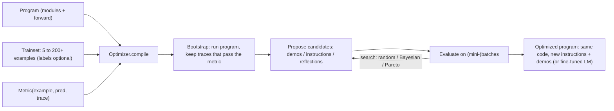

**DSPy** is a Python framework, from Stanford NLP, that treats an LLM pipeline as a program rather than a set of prompt strings. You declare **what** each LM call does as a typed **signature**. You pick a **module** that implements a prompting strategy for it. An **optimizer** (formerly "teleprompter") then searches for the instructions, few-shot demonstrations, or even fine-tuned weights that maximize a **metric** you define on a small training set. The original paper calls this compiling declarative LM calls into self-improving pipelines ([Khattab et al. 2023](../sources/khattab-2023-dspy.md), [DSPy docs](../sources/dspy-docs.md)). Current version as of 2026-11-14: **DSPy 3.5** (released 2026-11-10) ([release notes](../sources/dspy-3-5-release.md)).

## Mental model: PyTorch for prompts

| Deep-learning analogy | DSPy | Notes |
|---|---|---|
| Layer type | Module (`Predict`, `ChainOfThought`, `ReAct`...) | Every built-in module is built on `Predict` |
| Layer shape | Signature | Typed inputs → outputs; field names carry meaning |
| Parameters | Instructions + demos per predictor (or LM weights) | What optimizers change |
| `forward()` | Plain Python control flow composing modules | Loops, ifs, retrieval calls |
| Loss | Metric `(example, prediction, trace) -> score` | Higher is better; can be an LM judge |
| Optimizer | `BootstrapFewShot`, `MIPROv2`, `GEPA`, `BootstrapFinetune`... | `optimizer.compile(program, trainset=...)` |

Source: [DSPy docs](../sources/dspy-docs.md).

## Signatures

A signature declares input/output behaviour, not prompt wording ([docs](../sources/dspy-docs.md)):

- **Inline:** `"question -> answer"` (default type `str`), `"context: list[str], question: str -> answer: str"`, `"sentence -> sentiment: bool"`, with an optional `instructions=` string.
- **Class-based:** a `dspy.Signature` subclass whose docstring states the task, with `InputField(desc=...)` and `OutputField(desc=...)`. Types include `Literal[...]` for closed label sets, lists, dicts and Pydantic models.

The docs advise against hand-tuning field names or wording, because optimizers do that better and their results transfer better across LMs.

## Modules

| Module | What it adds |
|---|---|
| `dspy.Predict` | Base predictor; holds instructions, demos and LM; does not modify the signature |
| `dspy.ChainOfThought` | Injects a `reasoning` output field before the declared outputs ([chain-of-thought](chain-of-thought.md)) |
| `dspy.ReAct` | Tool-using agent loop over the signature (since 3.5 this is the former ReActV2, with structured History and a typed `submit` tool) |
| `dspy.MultiChainComparison` | Compares several CoT outputs to produce a final answer |
| `dspy.RLM` | Recursive LM: explores contexts too large for the prompt through a sandboxed Python REPL with recursive sub-LM calls |
| `dspy.majority`, `BestOfN`, `Refine`, `Parallel` | Voting, sampling and refinement helpers |

Modules accept generation config (e.g. `temperature`, `max_tokens`). `dspy.configure(track_usage=True)` exposes per-LM token usage, and cached responses do not count as billed usage ([docs](../sources/dspy-docs.md), [3.5 notes](../sources/dspy-3-5-release.md)).

## Adapters: where the prompt actually comes from

An adapter turns a signature, the inputs and the demos into chat messages (`Adapter.format()`), then parses the LM reply back into typed fields (`Adapter.parse()`) ([docs](../sources/dspy-docs.md)):

| Adapter | Format | Notes |
|---|---|---|
| `XMLAdapter(use_native_function_calling=True)` | `<field>...</field>` tags | **Default since 3.5**; DSPy validates the result, the provider does not enforce it |
| `ChatAdapter` | `[[ ## field ## ]]` markers; JSON schema shown for complex types | Was the default before 3.5; falls back to `JSONAdapter` on parse failure |
| `JSONAdapter` | Provider `response_format` [structured outputs](structured-outputs.md) | Avoid for models without native structured output |

`dspy.inspect_history()` shows the exact rendered prompt. Since 3.5, LiteLLM is optional: DSPy calls providers through the lightweight lm15 engine. The release reports install size falling from 206.7 MiB to 30.9 MiB and import time from 1.01 s to 0.49 s ([3.5 notes](../sources/dspy-3-5-release.md)).

## Optimizers

| Family | Optimizer | How it works | When |
|---|---|---|---|
| Few-shot | `LabeledFewShot` | Random `k` labelled demos | Baseline |
| | `BootstrapFewShot` | A teacher (by default the program itself) generates full traces; keeps those passing the metric (`max_bootstrapped_demos`, `max_labeled_demos`) | About 10 examples |
| | `BootstrapFewShotWithRandomSearch` | Repeats bootstrap with random demo sets; `num_candidate_programs` | 50+ examples |
| | `KNNFewShot` | Nearest-neighbour demos per input | Heterogeneous inputs |
| Instructions | `COPRO` | Coordinate-ascent instruction refinement | Legacy |
| | `MIPROv2` | Bootstrap traces → program- and data-aware instruction proposals → Bayesian search over instruction+demo combinations on mini-batches (`auto="light"/"medium"/"heavy"`) | 200+ examples, 40+ trials; also zero-shot mode |
| | `SIMBA` | Mines high-variance hard examples; writes self-reflective rules or adds demos | |
| | `GEPA` | LM reflects on full trajectories plus **textual feedback** from the metric; evolves prompts and keeps a Pareto frontier | Few rollouts, rich feedback available |
| Weights | `BootstrapFinetune` | Distils a prompted program into fine-tuned weights for each step | Move to a small, cheap LM |
| Meta | `BetterTogether`, `Ensemble` | Alternate prompt and weight optimization; ensemble top candidates | |

Sources: [docs](../sources/dspy-docs.md), [MIPRO](../sources/opsahl-ong-2024-mipro.md), [GEPA](../sources/agrawal-2025-gepa.md).

**Reported gains** (vendor or author figures, not independent benchmarks):

- The original paper reports compiled pipelines beating standard few-shot prompting by generally over 25% (GPT-3.5) and 65% (llama2-13b-chat) ([Khattab et al.](../sources/khattab-2023-dspy.md)).
- MIPRO beat baselines on five of seven programs, by up to 13% with Llama-3-8B ([MIPRO](../sources/opsahl-ong-2024-mipro.md)).
- GEPA beat GRPO by 6% on average across six tasks (up to 20%) with up to 35x fewer rollouts, and beat MIPROv2 by over 10%. These are the February 2026 v2 figures; the July 2025 v1 reported a 10% average over four tasks, so check which version a citation uses ([GEPA](../sources/agrawal-2025-gepa.md)).
- The docs cite a ReAct agent on HotPotQA going from 24% to 51% with MIPROv2 "light" (an informal run on DSPy 2.5.29).

A typical simple optimization run costs on the order of $2 and ten minutes, ranging from cents to tens of dollars ([docs](../sources/dspy-docs.md)).

## Limitations and failure modes

- **The metric is the spec.** Optimizers maximize whatever you score. A lax metric (substring match, a lenient [LLM judge](llm-as-judge.md)) gets gamed, and a small trainset invites overfitting. The docs tie heavy MIPROv2 runs to about 200 examples for that reason ([docs](../sources/dspy-docs.md)).
- **Optimized prompts are tied to the model and the adapter.** 3.5 changed the default adapter and tells users to **re-evaluate optimized programs**, because prompts and the output contract changed even where signatures did not ([3.5 notes](../sources/dspy-3-5-release.md)). Synthesis: treat a compiled program like a trained model artifact. Version it with the LM ID and DSPy version, and re-run the optimizer when either changes.
- **XML/Chat adapters are not constrained decoding.** Parsing can fail on weak models. Use `JSONAdapter` where the provider supports structured outputs.
- **GEPA attribution bug:** predictors sharing the same signature can receive each other's reflective examples ([docs](../sources/dspy-docs.md)).
- **Opacity:** the final prompt is machine-written. That is the abstraction cost Anthropic warns about, so inspect it with `inspect_history()` ([Anthropic](../sources/anthropic-building-effective-agents.md)).
- **Optimization spends tokens upfront.** Budget it like a training run, separately from inference [cost](cost-and-latency-optimization.md).

## When to use / when not

| Situation | Choice |
|---|---|
| Multi-stage pipeline (retrieve → reason → extract) with a measurable metric and a few dozen labelled examples | DSPy |
| Porting a pipeline to a cheaper or open model without re-prompting by hand | DSPy optimizer, then `BootstrapFinetune` ([knowledge distillation](knowledge-distillation.md)) |
| Classification or extraction where [few-shot](few-shot-prompting.md) demo choice matters | `BootstrapFewShot` / `KNNFewShot` |
| One-off prompt, no eval set | Hand-written [prompt engineering](prompt-engineering.md) with the raw SDK ([Anthropic](../sources/anthropic-building-effective-agents.md)) |
| Product agent needing streaming UI, typed deps, durable runs | [Pydantic AI](pydantic-ai.md), [LangGraph](langgraph.md) or [Vercel AI SDK](vercel-ai-sdk.md); DSPy can still optimize individual prompts offline |
| RAG ingestion and indexing | [LlamaIndex](llamaindex.md) for data; a DSPy module for the answer step |

Synthesis: DSPy pays off when you already have an [evaluation](llm-evaluation.md) harness. Without one, its optimizers have nothing to climb. For an FDE, the pitch to a customer is "give us 50 to 200 graded examples and we'll systematically tune and port the pipeline", not "DSPy writes better prompts".

## Sources

- [DSPy documentation](../sources/dspy-docs.md)
- [DSPy 3.5 release notes](../sources/dspy-3-5-release.md)
- [Khattab et al. 2023, DSPy](../sources/khattab-2023-dspy.md)
- [Opsahl-Ong et al. 2024, MIPRO](../sources/opsahl-ong-2024-mipro.md)
- [Agrawal et al. 2025, GEPA](../sources/agrawal-2025-gepa.md)
- [Building effective agents (Anthropic)](../sources/anthropic-building-effective-agents.md)
