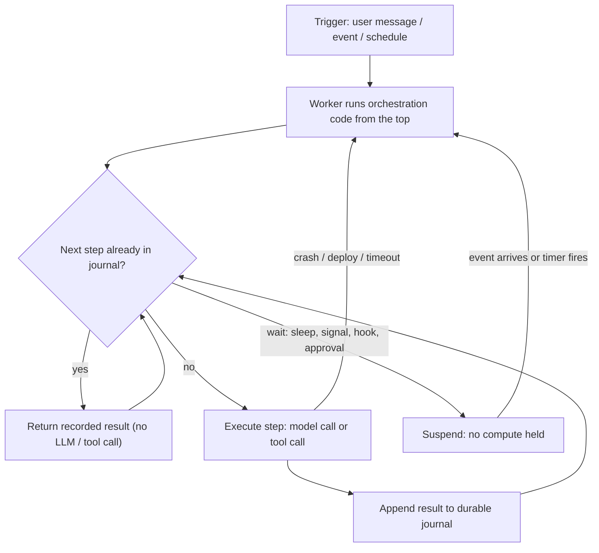

**Durable execution** means an agent run's progress is recorded outside the process running it, so the run can pick up where it stopped after a crash, a deploy, a timeout or a wait of several days. Every completed step is saved: each model call, each tool call, and each received signal. A fresh worker then **replays** the run. It returns saved results instead of repeating the work and executes only what has not finished. This matters more for agents than for ordinary request handlers for three reasons. Runs are long: [Claude Code](coding-agents.md)'s 99.9th-percentile turn passed 45 minutes in early 2026 ([Anthropic](../sources/anthropic-2026-measuring-agent-autonomy.md)). Every model call costs money. And many tool calls have real-world side effects. The [agent loop](agent-loop.md) is the same either way. Durability changes only *where state lives* and *what is safe to repeat*.

## The core mechanism: journal and replay

Engines differ in naming but converge on one model ([Temporal](../sources/temporal-workflows-and-event-history-docs.md), [Inngest](../sources/inngest-durable-execution-docs.md), [Workflow SDK](../sources/vercel-workflow-sdk-docs.md), [Restate](../sources/restate-durable-execution-docs.md)):

1. **Orchestration code** (Temporal *Workflow*, Vercel `"use workflow"`, Inngest handler, Restate handler) decides what to do next. It must be **deterministic**, because it is re-run from the top on every resume.
2. **Steps** (Temporal *Activity*, `"use step"`, `step.run`, `ctx.run`) do the non-deterministic work: LLM calls, HTTP, DB writes. The engine records each result in an append-only log.
3. On resume, the orchestration code runs again. Each step call is matched against the log. Recorded steps return their saved result instantly, and the first unrecorded step actually executes.

Synthesis: generalised from the replay descriptions in the Temporal, Inngest, Workflow SDK and Restate docs.

**Mapping an agent onto this.** In the Temporal integration for the [OpenAI Agents SDK](openai-agents-sdk.md), the agent loop, tool selection and [handoffs](agent-handoffs.md) run as Workflow code, and **each model call is an Activity** (default `start_to_close_timeout` 60 s). A worker restart therefore never re-pays for a completed LLM call ([Temporal integration](../sources/temporal-openai-agents-sdk-integration.md)). Vercel's guide makes the same point: give model calls and external tools their own step boundaries. Wrapping the whole loop in a single step saves nothing until the loop finishes ([Vercel guide](../sources/vercel-durable-ai-agents-guide.md)).

**Two meanings of "checkpoint."** Step-journal engines record *every side-effecting call*. LangGraph instead snapshots *graph state at each super-step boundary* (never mid-node). On resume it re-runs the interrupted node from its first line, and it keeps "pending writes" so sibling nodes that already finished are not re-run ([LangGraph persistence](../sources/langgraph-persistence-docs.md)). Pydantic AI draws a similar line between **persistence** (saving and resuming a run, no engine needed) and **durable execution** (journaling model and tool calls through Temporal, DBOS, Restate, Prefect and five other engines) ([Pydantic AI](../sources/pydantic-ai-docs.md)). [LlamaIndex](llamaindex.md) Workflows are ephemeral by default. You snapshot the `Context` yourself, and restore is at-least-once ([LlamaIndex](../sources/llamaindex-workflows-docs.md)).

## Engine comparison

| | Temporal | LangGraph checkpointer | Inngest | Vercel Workflow SDK | Restate |
|---|---|---|---|---|---|
| Unit of durability | Activity result in Event History | State snapshot per super-step | Memoized `step.run` result | `"use step"` result in event log | `ctx.run` entry in journal |
| Infra | Temporal Service (self-host or Cloud) + your workers | Postgres/SQLite/Mongo saver in your process | Inngest platform calls your HTTP endpoint | Vercel-hosted workflow runtime | Single Rust server in front of your services |
| Wait primitive | Signals, Updates, durable timers | `interrupt()` + `Command(resume=)` | `step.waitForEvent`, `step.sleep` | `createHook`, `createWebhook`, `sleep` | Awakeables, durable sleep |
| Default retries | Activities: unlimited, 1 s → ×2 → 100 s cap; workflows none | `invoke(None)` to retry from last checkpoint | 4 retries per `step.run` (own counter per step) | Up to 3 retry attempts per step | Exponential backoff, unlimited unless you set max attempts (per invocation or per `ctx.run`) |
| Published limits | 51,200 events or 50 MB / 10,000 signals / 2,000 Updates per history | Checkpoints accumulate, prune them | 1,000 steps, 32 MiB state, 4 MiB/step, run ≤ 366 days (plan-dependent) | Serializable step I/O | Majority quorum in clusters |
| Agent integration | OpenAI Agents SDK plugin, Pydantic AI | Native (`create_agent` is a graph) | AgentKit | AI SDK `WorkflowAgent` | AI SDK, OpenAI Agents, ADK, Pydantic AI, [LangChain](langchain.md) |

Sources: [Temporal](../sources/temporal-workflows-and-event-history-docs.md), [LangGraph](../sources/langgraph-persistence-docs.md), [Inngest](../sources/inngest-durable-execution-docs.md) (limits accessed 2026-11-14), [Workflow SDK](../sources/vercel-workflow-sdk-docs.md), [AI SDK 7](../sources/vercel-ai-sdk-7-changelog.md), [Restate](../sources/restate-durable-execution-docs.md), [Pydantic AI](../sources/pydantic-ai-docs.md). The Inngest "AgentKit" entry is Synthesis: it is not covered by the cited pages.

## Determinism: the main constraint

Orchestration code is replayed, so anything that can differ between runs must be either recorded or moved into a step.

- **Forbidden inline:** wall-clock reads, random numbers, direct network/DB/LLM calls. Temporal fails the run with a *non-determinism error* when replayed Commands don't match recorded Events ([Temporal](../sources/temporal-workflows-and-event-history-docs.md)). The Workflow SDK pins `Math.random` and `Date` to replay-stable values. As a result, a token generated inline is predictable, and secrets must be minted inside a step ([Workflow SDK](../sources/vercel-workflow-sdk-docs.md)).
- **Tools that run inside orchestration code.** In the Temporal plugin, `@function_tool` executes in the Workflow and must not do I/O. Use `activity_as_tool()` for anything that touches the network. [MCP](model-context-protocol.md) calls become Activities, but the MCP server itself is outside Temporal's durability ([Temporal integration](../sources/temporal-openai-agents-sdk-integration.md)).
- **Code changes while runs are in flight.** Reordering, adding or removing step calls breaks replay of existing runs. The fixes are Temporal Worker Versioning or patching ([Temporal](../sources/temporal-workflows-and-event-history-docs.md)) and Vercel deployment pinning, under which a bug fix for in-flight runs means cancelling and restarting them ([Vercel guide](../sources/vercel-durable-ai-agents-guide.md)). OpenAI recommends storing a code-version marker with serialized `RunState` ([OpenAI HITL](../sources/openai-agents-sdk-human-in-the-loop-docs.md)).
- **Code outside steps re-runs.** Inngest replays the handler, so un-stepped DB calls run again on every request ([Inngest](../sources/inngest-durable-execution-docs.md)). LangGraph and LlamaIndex re-run the whole interrupted node or step, so code before an `interrupt()` or `wait_for_event()` must be idempotent ([LangGraph](../sources/langgraph-persistence-docs.md), [LlamaIndex](../sources/llamaindex-workflows-docs.md)).

## Idempotent tool calls

Durable execution gives **at-least-once** steps, not exactly-once. Take a step that charges a card and then crashes before its result is journaled. It will run again. Inngest's docs use a refund as exactly this example ([Inngest](../sources/inngest-durable-execution-docs.md)), Temporal tells you to make Activities idempotent ([Temporal](../sources/temporal-workflows-and-event-history-docs.md)), and OpenAI notes that approval does not imply exactly-once ([OpenAI HITL](../sources/openai-agents-sdk-human-in-the-loop-docs.md)).

- **Idempotency keys.** The client sends a unique key, and the server stores the first outcome and replays it on repeats. Stripe's reference design: keys up to 255 chars, pruned after ≥24 h, an error if the key is reused with different parameters ([Stripe](../sources/stripe-idempotent-requests.md)).
- **Where the key comes from.** Derive it from the durable step ID, which is stable across retries of that step but differs between runs, e.g. from `getStepMetadata()`. For cross-run deduplication, use a business key or a DB uniqueness constraint ([Vercel guide](../sources/vercel-durable-ai-agents-guide.md)). Put a key on the run trigger too, so a retried webhook does not start two expensive agent runs ([notebook](../sources/notebook-concurrency-design.md)).
- **Prefer naturally idempotent operations.** Overwriting a file retries more safely than appending to it ([Vercel guide](../sources/vercel-durable-ai-agents-guide.md)). Synthesis: design tools as upserts ("set status = refunded for order X") rather than increments, and have the tool check current state before acting.
- **Retry discipline.** Retry only transient errors (see [rate limits and retries](rate-limits-and-retries.md)), with backoff, jitter and a cap ([notebook](../sources/notebook-concurrency-design.md)). Temporal's default of unlimited Activity attempts is dangerous for paid LLM calls, so Synthesis: set `maximum_attempts` and mark validation errors non-retryable. Swallowing exceptions breaks things too: [ADK](google-adk.md) 2.0 warns that broad exception handlers hide failures from automatic retries and break HITL pauses ([ADK 2.0](../sources/google-adk-2-0-release-notes.md)), and LangGraph warns against wrapping `interrupt()` in bare `try/except` ([LangGraph](../sources/langgraph-persistence-docs.md)).

## Background and async agents

Long agents should run on queue workers, not request threads. The caller gets a run ID and subscribes to progress ([notebook](../sources/notebook-concurrency-design.md)). Platform data points:

- **AgentCore Runtime** ([Amazon Bedrock](amazon-bedrock.md)): per-session microVMs, async background work up to 8 h, sessions end after 15 min idle or 8 h total, state ephemeral ([AgentCore](../sources/aws-agentcore-runtime.md)).
- **[Claude Agent SDK](claude-agent-sdk.md):** sessions persist the *conversation* as JSONL, not the filesystem. `SessionStore` mirrors transcripts only, the SDK has no top-level session timeout, and container restarts lose local artifacts unless you persist them ([sessions](../sources/claude-agent-sdk-sessions-docs.md), [hosting](../sources/claude-agent-sdk-hosting-docs.md)).
- **OpenAI Agents SDK:** a paused run serializes to `RunState` JSON and resumes on any host ([running agents](../sources/openai-agents-sdk-running-agents-docs.md)).
- **Multi-session work beyond one [context window](context-window.md):** Anthropic's [harness](harness-engineering.md) persists progress in files and git commits so each fresh session can resume. That is durability at the task level rather than the call level ([Anthropic harness](../sources/anthropic-effective-harnesses-long-running-agents.md)). See [agent memory](agent-memory.md).

Long-lived conversations accumulate history. Temporal warns at 10,240 events (or 10 MB) and terminates above 51,200 events (or 50 MB). The fix is **Continue-As-New**: carry the summarized state into a fresh execution ([Temporal](../sources/temporal-workflows-and-event-history-docs.md)). Tool outputs and prompts are stored in the history unless a payload codec encrypts them, which is a PII concern ([Temporal integration](../sources/temporal-openai-agents-sdk-integration.md); see [PII](pii-and-data-privacy.md)).

## Failure modes checklist

| Failure | Symptom | Mitigation |
|---|---|---|
| Non-deterministic orchestration | Non-determinism error on replay; wrong branch taken | Move clock/random/I/O into steps; version workflows |
| Non-idempotent tool retried | Double email, double refund | Idempotency key from step ID; upsert semantics |
| Unbounded retries on LLM 4xx | Cost blowup, stuck run | Max attempts; non-retryable error types |
| History/state growth | Temporal termination at 51,200 events / 50 MB; 32 MiB Inngest state | Continue-As-New; store blobs externally, pass IDs |
| Deploy changes in-flight code | Replay mismatch | Worker versioning / deployment pinning |
| Losing parallel wait | Run stays "Running" until timeout (Inngest) | Explicit cancellation, short timeouts |
| Exceptions swallowed | Retries and pauses silently disabled | Never catch-all around step or interrupt calls |
| Secrets in history | Credentials replayable from logs | Payload codec; never pass secrets as step args |

Sources: as cited in the sections above.

## When to use what

Synthesis, from the sources above:

- **Already on LangGraph, runs are minutes-long, approvals are in-app:** a Postgres checkpointer with `durability="sync"` for side-effecting graphs is enough. Add an engine only if you need cross-service orchestration or week-long timers. See [LangGraph](langgraph.md).
- **Mission-critical, multi-service, polyglot, long-lived (days to months), strong audit needs:** Temporal. Budget for the operational and determinism learning curve.
- **TypeScript/serverless team on Vercel using the [AI SDK](vercel-ai-sdk.md):** Workflow SDK with `WorkflowAgent`.
- **Event-driven serverless functions, any host:** Inngest (watch the step and state limits) or Restate (journal + keyed state, low ops: one binary).
- **Python agent framework with a choice of backends:** Pydantic AI's durable integrations ([Pydantic AI](pydantic-ai.md)).
- **Don't bother** for sub-minute, read-only, cheaply retryable agents. Retrying the whole request is simpler. Durability pays off when runs are long, expensive, side-effecting, or wait on humans. For the waiting part, see [human-in-the-loop](human-in-the-loop.md). For moving a prototype to this architecture, see [PoC to production](poc-to-production.md).

## Sources

- [Temporal: workflows, event history, activities, retries](../sources/temporal-workflows-and-event-history-docs.md)
- [Temporal OpenAI Agents SDK integration](../sources/temporal-openai-agents-sdk-integration.md)
- [LangGraph persistence, checkpointers and interrupts](../sources/langgraph-persistence-docs.md)
- [Inngest execution model, waitForEvent and limits](../sources/inngest-durable-execution-docs.md)
- [Vercel Workflow SDK docs](../sources/vercel-workflow-sdk-docs.md)
- [Vercel: building durable AI agents](../sources/vercel-durable-ai-agents-guide.md)
- [AI SDK 7 changelog](../sources/vercel-ai-sdk-7-changelog.md)
- [Restate durable execution and HITL pattern](../sources/restate-durable-execution-docs.md)
- [Pydantic AI docs](../sources/pydantic-ai-docs.md)
- [LlamaIndex Workflows docs](../sources/llamaindex-workflows-docs.md)
- [OpenAI Agents SDK human-in-the-loop](../sources/openai-agents-sdk-human-in-the-loop-docs.md)
- [OpenAI Agents SDK running agents](../sources/openai-agents-sdk-running-agents-docs.md)
- [Claude Agent SDK sessions](../sources/claude-agent-sdk-sessions-docs.md)
- [Claude Agent SDK hosting](../sources/claude-agent-sdk-hosting-docs.md)
- [Google ADK 2.0 release notes](../sources/google-adk-2-0-release-notes.md)
- [AgentCore Runtime](../sources/aws-agentcore-runtime.md)
- [Anthropic: effective harnesses for long-running agents](../sources/anthropic-effective-harnesses-long-running-agents.md)
- [Anthropic: measuring agent autonomy](../sources/anthropic-2026-measuring-agent-autonomy.md)
- [Stripe idempotent requests](../sources/stripe-idempotent-requests.md)
- [Notebook: concurrency design](../sources/notebook-concurrency-design.md)
