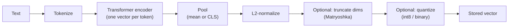

An **embedding** is a fixed-length vector of numbers (typically 256 to 3072 floats) that an encoder model produces for a piece of content, arranged so that inputs with similar meaning land close together. "How do I get a refund?" and "What is your return policy?" share almost no words but embed to nearby points; that is what makes semantic search, [retrieval-augmented generation](retrieval-augmented-generation.md), clustering, deduplication and recommendations work. An embedding model generates no text: it is used to find context that a chat model then reads ([notebook](../sources/notebook-embeddings.md)).

## How a text becomes a vector

Modern embedders are [transformer](transformer-architecture.md) encoders. One call runs: [tokenize](tokenization.md), produce a context-aware vector per token, **pool** them into one vector (mean pooling or a special `[CLS]` token), then **L2-normalize** so only direction matters ([notebook](../sources/notebook-embeddings.md)). Because the whole input is collapsed into one vector, text beyond the model's max length is silently truncated, and a long chunk blurs into an average of its topics.

The space is learned by **contrastive training**: pull known-similar pairs together and push others apart, with losses such as InfoNCE ([notebook](../sources/notebook-embeddings.md)). E5 showed that a large, filtered corpus of naturally occurring pairs (CCPairs) is enough for contrastive pre-training that beats [BM25](bm25.md) zero-shot on BEIR, before [fine-tuning](fine-tuning.md) on labelled data ([E5](../sources/e5-text-embeddings.md)). BAAI's BGE family followed the same pattern with an integrated pipeline and open data ([C-Pack](../sources/c-pack-bge.md)).

## Similarity metrics

| Metric | Measures | Notes |
|---|---|---|
| Cosine similarity | Angle between vectors | Default for text; ignores magnitude |
| Dot product (inner product) | Angle times magnitudes | Equals cosine on normalized vectors, and is the cheapest to compute |
| Euclidean (L2) | Straight-line distance | Same ranking as cosine on normalized vectors |
| Hamming | Differing bits | For binary-quantized vectors |

OpenAI returns unit-length embeddings, so cosine, dot product and L2 give identical rankings ([OpenAI](../sources/openai-embeddings-guide.md)). The metric configured in the [vector database](vector-databases.md) must match what the model was trained for ([notebook](../sources/notebook-vector-databases.md)). Synthesis: if a model does not normalize, normalize both stored and query vectors yourself, then use dot product.

## Asymmetric retrieval: queries are not documents

Search matches a short question against long passages, so retrieval-tuned models embed the two roles differently. The mechanism is a role-specific instruction:

- **Voyage:** `input_type="query"` or `"document"` prepends a retrieval prompt; embeddings with and without it remain compatible ([Voyage](../sources/voyage-embeddings-docs.md)).
- **Cohere:** `input_type` is `search_query`, `search_document`, `classification` or `clustering` ([Cohere](../sources/cohere-embeddings-docs.md)).
- **Open models (E5, BGE):** text prefixes such as `query:` / `passage:` ([notebook](../sources/notebook-embeddings.md)).

Forgetting the role parameter, or using a plain sentence-similarity model for question-to-passage search, is a common silent quality loss ([notebook](../sources/notebook-embeddings.md)). MMTEB found instruction-tuned embedders clearly beat their non-instruction counterparts ([MMTEB](../sources/mmteb-benchmark.md)).

## Model landscape (as of November 2026)

| Model | Default / options (dims) | Max input | Notes |
|---|---|---|---|
| OpenAI `text-embedding-3-small` | 1536, shortenable | 8,192 tokens | $0.02 / 1M tokens; MTEB 62.3 |
| OpenAI `text-embedding-3-large` | 3072, shortenable | 8,192 tokens | $0.13 / 1M tokens; MTEB 64.6 |
| Voyage `voyage-4-large` / `-4` / `-4-lite` | 1024; 256 / 512 / 2048 | 32K tokens | Mutually compatible family; int8 and binary outputs; `voyage-4-nano` open weights |
| Voyage `voyage-code-4` | 1024; 256 / 512 / 2048 | 32K tokens | Code retrieval; not listed among the mutually compatible 4-series models |
| Voyage `voyage-finance-2`, `voyage-law-2` | 1024 only | 32K (law 16K) | Domain-tuned |
| Cohere `embed-v5.0-pro` | 256 to 2048 | n/a in docs | Multilingual, text+image in one vector, int8/binary outputs |
| E5 / multilingual-e5, BGE | 384 to 1024 | typically 512 tokens | Open weights, self-hostable, need prefixes |

Sources: [OpenAI](../sources/openai-embeddings-guide.md), [Voyage](../sources/voyage-embeddings-docs.md), [Cohere](../sources/cohere-embeddings-docs.md), [notebook](../sources/notebook-embeddings.md). OpenAI's guide still lists only the 2024-era `-3` models ([OpenAI](../sources/openai-embeddings-guide.md)). The 512-token limit for open encoders is general knowledge, not from these sources; check each model card.

## Shrinking vectors: Matryoshka and quantization

Storage and search cost scale with dimensions times bytes per dimension. Two orthogonal levers reduce both:

- **Matryoshka Representation Learning (MRL)** trains the model so every prefix of the vector is itself a usable embedding, coarse-to-fine. Truncating costs nothing at inference and gave up to 14x smaller vectors at equal accuracy in the paper's vision experiments ([MRL](../sources/matryoshka-representation-learning.md)). APIs expose it as `dimensions` (OpenAI) or `output_dimension` (Voyage, Cohere). OpenAI reports `-3-large` at 256 dims still beats ada-002 at 1536 dims on MTEB. If you truncate manually, re-normalize ([OpenAI](../sources/openai-embeddings-guide.md)).
- **[Quantization](quantization.md)** stores each dimension in fewer bits. int8 is 4x smaller and keeps about 97% of retrieval quality (about 99% with rescoring); binary is 32x smaller and keeps about 92.5% (about 96% with rescoring) on mxbai-embed-large-v1. Robustness is model-specific: e5-base-v2 fell to about 75% under binary ([HF](../sources/hf-embedding-quantization.md)). Voyage and Cohere can return int8 or bit-packed binary directly ([Voyage](../sources/voyage-embeddings-docs.md), [Cohere](../sources/cohere-embeddings-docs.md)).

The standard pattern is **oversample and rescore**: retrieve `k × multiplier` candidates with compressed vectors, then re-score them with full-precision query and vectors ([HF](../sources/hf-embedding-quantization.md)). See [ANN indexes](ann-indexes.md) for index-level quantization (PQ, SQ, RQ).

Synthesis, back-of-envelope: 10M chunks at 1536 float32 dims is about 61 GB of raw vectors before index overhead; 512 dims in int8 is about 5 GB.

## Choosing a model with MTEB

MTEB scores embedders across task types (retrieval, reranking, clustering, classification, STS and more); its core finding is that no model wins every task, so read the column for your task, usually retrieval ([MTEB](../sources/mteb-benchmark.md)). MMTEB expanded it to 500+ tasks and 250+ languages and introduced the leaner MTEB(eng, v2). Its best public model at the time was the 560M-parameter multilingual-e5-large-instruct, and small multilingual models often beat 7B LLM-based embedders on low-resource languages ([MMTEB](../sources/mmteb-benchmark.md)). Synthesis: treat the leaderboard as a shortlist, then run a small retrieval eval on your own queries and documents ([LLM evaluation](llm-evaluation.md)), since domain, language and chunking change rankings.

Selection criteria: retrieval quality on your data, max input length versus your [chunk](chunking.md) size, dimensions and supported compression, languages and modalities, hosted versus self-hosted ([data residency](data-retention-and-residency.md)), price and throughput ([notebook](../sources/notebook-embeddings.md)).

## Failure modes and limits

- **Mixing models.** Vectors from different models live in different spaces and cannot be compared. Changing model means re-embedding the corpus ([notebook](../sources/notebook-embeddings.md)). Voyage's 4 series (`-4-large`, `-4`, `-4-lite`, `-4-nano`) is an explicit exception, documented as mutually compatible; the docs do not say the same of `voyage-code-4` ([Voyage](../sources/voyage-embeddings-docs.md)).
- **Silent truncation and blurry chunks.** Oversized inputs are cut off, and long inputs average away specifics ([notebook](../sources/notebook-embeddings.md)).
- **Exact tokens.** Embeddings capture meaning, not identifiers. Part numbers, error codes and rare names need keyword or [hybrid search](hybrid-search.md) ([notebook](../sources/notebook-embeddings.md)).
- **A theoretical ceiling.** The number of distinct top-k result sets a single-vector retriever can express is bounded by its dimension, even with vectors optimized on the test set; state-of-the-art models fail the simple LIMIT benchmark ([Weller et al.](../sources/limits-of-embedding-retrieval.md)). Synthesis: for queries that combine many constraints, add [reranking](reranking.md), sparse or hybrid retrieval, or structured filters instead of hoping a bigger embedder fixes it.
- **Stale knowledge.** OpenAI's `-3` models know nothing after September 2021, which can matter for new terminology ([OpenAI](../sources/openai-embeddings-guide.md)).

## When to use / when not

- **Use** for semantic search over paraphrased natural language, RAG retrieval, clustering, dedup and recommendation.
- **Combine** with BM25 ([hybrid search](hybrid-search.md)) and a cross-encoder [reranker](reranking.md) when precision matters.
- **Avoid as the only mechanism** for exact lookup, numeric or structured constraints ([text-to-SQL](text-to-sql.md) or metadata filters do it better), or tiny corpora that fit in the [context window](context-window.md).

## Sources

- [How Embedding Models Work (Notebook)](../sources/notebook-embeddings.md)
- [Vector Databases Compared (Notebook)](../sources/notebook-vector-databases.md)
- [OpenAI embeddings guide](../sources/openai-embeddings-guide.md)
- [Voyage AI embeddings docs](../sources/voyage-embeddings-docs.md)
- [Cohere embeddings docs](../sources/cohere-embeddings-docs.md)
- [E5 paper](../sources/e5-text-embeddings.md)
- [C-Pack / BGE paper](../sources/c-pack-bge.md)
- [Matryoshka Representation Learning](../sources/matryoshka-representation-learning.md)
- [Binary and scalar embedding quantization](../sources/hf-embedding-quantization.md)
- [MTEB](../sources/mteb-benchmark.md)
- [MMTEB](../sources/mmteb-benchmark.md)
- [Theoretical limitations of embedding-based retrieval](../sources/limits-of-embedding-retrieval.md)
