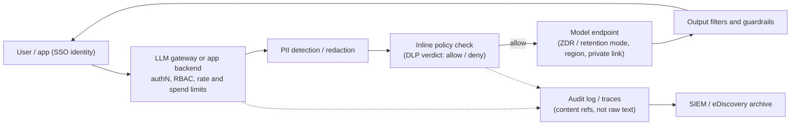

**Enterprise LLM deployment** is the work of putting a model-backed application into an organization so that security, legal and procurement will approve it and staff will actually use it. Inference itself is the easy part. The hard questions are about data and control: where prompts go and how long they stay, who may call which model, what is logged for audit, how personal data is kept out of places it should not be, and how the rollout is staged and measured. The vendors' answers have become concrete, configurable controls such as zero-data-retention (ZDR) agreements, retention modes, regional deployment types, RBAC roles, compliance APIs and inline DLP hooks. Most of an FDE's enterprise work is choosing and wiring these. For the regulatory and standards side (EU AI Act, NIST AI RMF, ISO 42001, SOC 2, model risk), see [AI governance and compliance](ai-governance-and-compliance.md).

## 1. Data retention: what the provider keeps

Every major API keeps something by default. The first job is to list each store, how long it lasts and how to switch it off. There are usually two separate stores. **Abuse-monitoring logs** exist for trust and safety. **Application state** exists so that stateful features work: stored responses, files, batches, vector stores, agent sessions ([OpenAI](../sources/openai-your-data-controls.md), [Anthropic](../sources/anthropic-api-and-data-retention.md)).

| Provider (as of 2026-11) | Default | Strictest control | Main exceptions |
|---|---|---|---|
| OpenAI API | No training on API data since 2023-03; abuse logs up to 30 days | ZDR (forces `store=false` on Responses and Chat Completions) or Modified Abuse Monitoring; both need approval, set per org with per-project override | Conversations, agents, assistants, threads, files, vector stores, batches, fine-tuning and evals are not ZDR-eligible; flagged content can be kept ([source](../sources/openai-your-data-controls.md)) |
| Anthropic Claude API | Standard commercial policy deletes API inputs and outputs within 30 days; Covered Models *require* 30-day retention | ZDR per organization via sales; HIPAA readiness with a BAA | Batch, Files and code execution are stateful. ZDR doesn't block them; HIPAA mode rejects them with a 400. Covered Models (Fable/Mythos 5, 5.1, 5.2) are unavailable under ZDR unless Anthropic authorizes it, though a ZDR org can enable retention for one non-default workspace; flagged data kept up to 2 years ([source](../sources/anthropic-api-and-data-retention.md)) |
| Amazon Bedrock | Mode `default`: the model's own policy; AWS may keep data for abuse detection | Mode `none`, enforceable org-wide with SCPs on `DataRetentionMode` | Models that require `aws_review` (Claude Fable 5, 5.1, 5.2) keep data inside AWS up to 30 days and may be human-reviewed by AWS (not the provider). They are unavailable under `none` or `default`; ZDR for them needs per-account approval ([source](../sources/bedrock-data-retention-docs.md)) |
| Azure (Foundry models sold by Azure) | Abuse monitoring may store flagged samples for human review | Modified abuse monitoring by application; the resource then shows `ContentLogging: false` | Automated review still runs; preview features may differ ([source](../sources/azure-foundry-data-privacy.md)) |

Mechanics that commonly catch teams out:

- **ZDR is a contract, not an API flag.** On Anthropic it is enabled per organization, and a new org needs it enabled again. ZDR orgs also cannot call the API from a browser, so traffic must go through your backend ([Anthropic](../sources/anthropic-api-and-data-retention.md)).
- **Using a stateful feature quietly leaves ZDR.** Under Anthropic ZDR, a Batch or Files call is not blocked. The data then follows that feature's own retention policy ([Anthropic](../sources/anthropic-api-and-data-retention.md)). On Bedrock, `store=false` alone does not guarantee zero retention; only mode `none` does ([Bedrock](../sources/bedrock-data-retention-docs.md)).
- **Model choice and retention policy are linked.** The newest frontier tiers can require retention for safety review. A strict ZDR posture can lock you out of them, or force a separate workspace or project with retention turned on ([Anthropic](../sources/anthropic-api-and-data-retention.md), [Bedrock](../sources/bedrock-data-retention-docs.md)). Synthesis: put this in [model selection](model-selection.md) early, not after legal has signed off.
- **PHI has special constraints.** Anthropic's HIPAA mode is permanent once enabled. PHI must not appear in JSON schemas for strict tools or [structured outputs](structured-outputs.md), because compiled grammars are cached outside the PHI protections ([Anthropic](../sources/anthropic-api-and-data-retention.md)).
- **Caches are a store too.** OpenAI keeps prompt-cache tensors in GPU-local storage for up to 24 hours ([OpenAI](../sources/openai-your-data-controls.md)); see [prompt caching](prompt-caching.md).

## 2. Residency, processor and network path

- **Who processes the data.** On Bedrock and Google-managed Vertex the cloud provider is the data processor, not the model lab. Anthropic remains the processor for its first-party API and for the offerings it operates on partner clouds (Claude Platform on AWS, Anthropic-managed Claude on Google Cloud, Claude in Microsoft Foundry), so check which variant you are buying ([Anthropic](../sources/anthropic-api-and-data-retention.md)). Bedrock runs each provider's model in an AWS-owned deployment account that the provider cannot access ([AWS](../sources/aws-bedrock-data-protection.md)). Azure-sold models run in Azure and do not call OpenAI's services ([Azure](../sources/azure-foundry-data-privacy.md)). This is why regulated customers often prefer the hyperscaler route ([Amazon Bedrock](amazon-bedrock.md), [Azure AI Foundry](azure-ai-foundry.md), [Google Vertex AI](google-vertex-ai.md)).
- **Where processing happens and where data is stored are different questions.** Azure "Global" deployments may process data in any geography and "DataZone" deployments anywhere in the zone (e.g. the EU), while data at rest stays in the chosen geography ([Azure](../sources/azure-foundry-data-privacy.md)). Bedrock geographic inference profiles keep processing within US, EU or APAC; global profiles route anywhere and cost about 10% less. CloudTrail records the Region where inference actually ran ([AWS](../sources/aws-bedrock-cross-region-inference.md)). Retained data is stored in that destination Region ([Bedrock](../sources/bedrock-data-retention-docs.md)).
- **Residency costs money.** On Anthropic's API, US-only inference (`inference_geo: "us"`) applies a 1.1x multiplier on 4.6-and-later models, and regional endpoints on partner clouds carry about a 10% premium ([pricing](../sources/anthropic-pricing.md)).
- **Network isolation.** Use PrivateLink or VPC endpoints for Bedrock ([AWS](../sources/aws-bedrock-data-protection.md)), and private endpoints plus VNet injection for Foundry agents. Some Foundry tools (Bing and web grounding) still go over public endpoints, others (computer use, browser automation) are unsupported when isolated, and outbound networking can't be changed after creation ([Foundry](../sources/microsoft-foundry-network-isolation.md)).

## 3. Identity, SSO and RBAC

Synthesis: aim for keyless, identity-based access to the model and least-privilege roles that split *calling* from *deploying* from *administering*. Long-lived API keys bypass RBAC and make audit trails anonymous.

- On Azure, **Cognitive Services OpenAI User** can run inference with Entra ID but cannot see keys, deploy or fine-tune. **OpenAI Contributor** adds deployments, fine-tuning and stored completions. **Cognitive Services Contributor** can regenerate keys and create guardrails, but cannot make Entra ID inference calls. Inherited subscription-level Owner and Contributor roles take priority over narrower assignments, and the page warns that using API keys bypasses Azure RBAC ([Azure RBAC](../sources/azure-openai-rbac-docs.md)). That page is written for the Foundry (classic) portal.
- On AWS, set up IAM Identity Center users with least privilege and MFA, and log API activity with CloudTrail ([AWS](../sources/aws-bedrock-data-protection.md)). SCPs can enforce retention and Region policy across the whole organization ([Bedrock](../sources/bedrock-data-retention-docs.md)).
- Agents that act for users need delegated, scoped credentials rather than a shared service key. For tool servers, the MCP authorization spec profiles OAuth 2.1 with audience-bound tokens ([MCP spec](../sources/mcp-authorization-spec.md); [MCP in practice](mcp-in-practice.md)). The defensive rule is least-privilege tools with scoped, short-lived credentials and a human gate on anything irreversible ([Notebook](../sources/notebook-web-ai-security.md); [agent guardrails](agent-guardrails.md)).
- RAG must enforce the *user's* document permissions at retrieval time. OWASP lists over-broad data access as a main cause of disclosure ([OWASP LLM02](../sources/owasp-llm02-sensitive-information-disclosure.md)), and the Notebook advises scoping retrieval to each user ([Notebook](../sources/notebook-web-ai-security.md)). See [retrieval-augmented generation](retrieval-augmented-generation.md).

## 4. Audit logging and inline enforcement

Two patterns work together: **after-the-fact audit**, where you pull per-event records into a SIEM or archive, and **inline enforcement**, where a policy point allows or denies a request before inference.

Synthesis: a reference control path assembled from the sources in this section.

- **Audit APIs.** Anthropic's Compliance API returns activity events with actor email, IP and user agent. With a Compliance Access Key it can also retrieve or delete chats, files and agent session transcripts, rate-limited to 600 requests per minute ([Compliance API](../sources/anthropic-compliance-api-docs.md)). Its Activity Feed is kept for 6 years ([retention](../sources/anthropic-api-and-data-retention.md)). AWS records API calls in CloudTrail ([AWS](../sources/aws-bedrock-data-protection.md)).
- **Inline hooks.** Available only to Claude Enterprise organizations (not API-platform orgs, and not on Bedrock or Google Cloud), Anthropic's inference hooks POST each governed prompt (and optionally tool calls) to your security server. The default verdict timeout is 5 seconds, and you choose whether failures block or allow. Shadow mode and percentage rollout let you start without blocking anyone. Verdicts are allow or deny only, with no redaction, and raw image bytes are never sent, so screenshots go uninspected ([inference hooks](../sources/anthropic-inference-hooks-docs.md)).
- **Your own telemetry.** The OpenTelemetry GenAI conventions say instrumentations should not capture prompt or response content by default. In production they recommend storing content externally and recording only reference URIs on spans, so that content gets its own access control ([OTel](../sources/opentelemetry-genai-semantic-conventions.md)). See [LLM observability](llm-observability.md). Synthesis: otherwise your trace store quietly becomes the largest unaudited PII store you have.

## 5. PII handling

The main options, from least to most intrusive:

| Technique | Mechanism | Trade-off |
|---|---|---|
| Minimize context | Only send fields the task needs; scope retrieval per user | Cheapest and most effective; needs design discipline ([Notebook](../sources/notebook-web-ai-security.md)) |
| Detect and block | DLP verdict on the prompt ([hooks](../sources/anthropic-inference-hooks-docs.md)) or a gateway filter | Simple; false positives frustrate users |
| Mask or redact | Presidio `replace`/`redact`/`mask`, Bedrock Guardrails sensitive-info filters (block or mask, custom regex) | The model loses information it may need ([Presidio](../sources/presidio-docs.md), [Bedrock Guardrails](../sources/aws-bedrock-guardrails.md)) |
| Pseudonymize reversibly | Presidio `encrypt` → LLM → `decrypt` with the same key; or salted `hash` for stable joins | Keeps referential consistency; the key becomes a secret to manage ([Presidio](../sources/presidio-docs.md)) |
| Privacy-preserving training | Sanitize before fine-tuning; differential privacy, federated learning | Only relevant if you train ([OWASP LLM02](../sources/owasp-llm02-sensitive-information-disclosure.md)) |

Failure modes. Presidio's own docs warn that automated detection cannot find everything ([Presidio](../sources/presidio-docs.md)). System-prompt instructions like "never reveal X" can be bypassed by [prompt injection](prompt-injection.md) ([OWASP LLM02](../sources/owasp-llm02-sensitive-information-disclosure.md)). Text-only filters miss PII in images. Synthesis: treat redaction as one layer in defense in depth, not a guarantee, and log only redacted text. See [guardrail tooling](guardrail-tooling.md) and [LLM security risks](llm-security-risks.md).

## 6. Rollout and adoption

OpenAI's enterprise guide draws seven lessons from customers. Its figures are vendor-reported ([OpenAI](../sources/openai-ai-in-the-enterprise.md)):

1. **Start with evals.** Morgan Stanley went to production only after translation, summarization and expert-comparison evals. See [LLM evaluation](llm-evaluation.md).
2. **Embed AI in products** (Indeed: +20% applications started).
3. **Start early**, because learning compounds (Klarna).
4. **Customize** where evals show a gap (Lowe's fine-tuning: +20% tagging accuracy).
5. **Put AI in experts' hands.** BBVA rolled out with Legal, Compliance and IT Security, and staff built more than 2,900 custom GPTs in five months.
6. **Unblock developers** with a platform that has guardrails and routing built in (Mercado Libre's Verdi).
7. **Set bold automation goals.**

Measure, don't assume. In METR's randomized trial, experienced developers using early-2025 AI tools were 19% *slower*, yet believed they were about 20% faster ([METR](../sources/metr-2025-developer-productivity.md)). Synthesis: adoption dashboards (active users, custom GPT counts) are not outcome metrics. Pair them with task-level measures and a control group where you can.

Synthesis: a staged rollout that works in practice:

- **Discovery:** pick high-value, low-risk use cases ([AI use-case discovery](ai-use-case-discovery.md)).
- **Security review:** complete the data-flow diagram, retention settings, residency, and the vendor's SOC 2 and ISO 42001 evidence ([governance](ai-governance-and-compliance.md)).
- **Pilot:** an expert group, shadow-mode DLP, an eval set built from real tasks.
- **Expansion:** SSO groups, RBAC tiers, spend limits, enablement and training.
- **Steady state:** monitoring, incident process, periodic re-evaluation when models change.

See [PoC to production](poc-to-production.md) and [forward-deployed engineering](forward-deployed-engineering.md).

## When to use which posture

- **Public or low-sensitivity data, internal productivity:** default retention is usually acceptable. Spend the effort on SSO, RBAC and audit.
- **Confidential business data:** ZDR or retention mode `none`, private networking, a gateway with audit logging, and per-user retrieval permissions.
- **Regulated data (PHI, financial, EU personal data):** use a BAA (HIPAA mode) or hyperscaler-processed deployment, pin residency (avoid Global and global-profile routing), add inline DLP and redaction, and give legal a documented DPIA. Accept that some frontier models may be unavailable under those settings.
- **When not to over-engineer:** reversible pseudonymization and custom gateways add latency and key-management burden. Synthesis: if contracts plus ZDR already satisfy the data owner, minimize data first and add tooling only when there is a specific residual risk.

## Sources

- [Anthropic: API and data retention](../sources/anthropic-api-and-data-retention.md)
- [OpenAI: Data controls](../sources/openai-your-data-controls.md)
- [Azure: Data, privacy, and security for Foundry Models](../sources/azure-foundry-data-privacy.md)
- [Amazon Bedrock data retention](../sources/bedrock-data-retention-docs.md)
- [Amazon Bedrock data protection](../sources/aws-bedrock-data-protection.md)
- [Amazon Bedrock cross-Region inference](../sources/aws-bedrock-cross-region-inference.md)
- [Amazon Bedrock Guardrails](../sources/aws-bedrock-guardrails.md)
- [Microsoft Foundry network isolation](../sources/microsoft-foundry-network-isolation.md)
- [Azure OpenAI RBAC](../sources/azure-openai-rbac-docs.md)
- [Anthropic Compliance API](../sources/anthropic-compliance-api-docs.md)
- [Anthropic inference hooks](../sources/anthropic-inference-hooks-docs.md)
- [Anthropic pricing](../sources/anthropic-pricing.md)
- [OpenTelemetry GenAI semantic conventions](../sources/opentelemetry-genai-semantic-conventions.md)
- [MCP authorization spec](../sources/mcp-authorization-spec.md)
- [Presidio](../sources/presidio-docs.md)
- [OWASP LLM02:2025](../sources/owasp-llm02-sensitive-information-disclosure.md)
- [Notebook: Web, API & AI Security](../sources/notebook-web-ai-security.md)
- [OpenAI: AI in the Enterprise](../sources/openai-ai-in-the-enterprise.md)
- [METR developer productivity RCT](../sources/metr-2025-developer-productivity.md)
