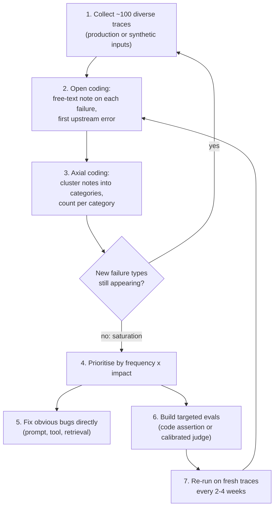

**Error analysis** is the systematic reading of real system outputs (for agents, full traces) to discover *how* the system fails, before deciding *what* to measure. A person annotates traces with free-text notes (**open coding**), groups the notes into a small set of failure categories and counts them (**axial coding**), and then builds fixes and automated evaluators only for the categories that are frequent or costly. Hamel Husain and Shreya Shankar call it the most important activity in evals, and argue that metrics should emerge bottom-up from the data rather than be chosen top-down from generic lists like "[hallucination](hallucination.md)" or "toxicity" ([FAQ](../sources/husain-shankar-2026-ai-evals-faq.md); [field guide](../sources/husain-2025-field-guide.md)). The terms come from qualitative research (Grounded Theory), which is also how the MAST multi-agent failure taxonomy was built ([Cemri et al.](../sources/cemri-2025-mast-multi-agent-failures.md)).

## Why bottom-up

- **Criteria drift.** People need criteria to grade outputs, but grading outputs is how they discover the criteria; some criteria only appear after seeing real outputs ([Shankar et al.](../sources/shankar-2024-who-validates-the-validators.md)). Defining an eval suite entirely up front therefore misses failures.
- **Generic metrics miss domain failures.** At NurtureBoss, annotation showed three issues (conversation flow, handoff failures, rescheduling) made up over 60% of problems; one category, relative date handling, failed 66% of the time and targeted fixes moved success from 33% to 95% ([field guide](../sources/husain-2025-field-guide.md)). No off-the-shelf metric names those.
- **Logs reveal what scores hide.** HAL's log inspection found agents searching for the benchmark itself and misusing credit cards, behaviours invisible in accuracy numbers ([Kapoor et al.](../sources/kapoor-2025-holistic-agent-leaderboard.md)). Anthropic likewise stresses reading transcripts to check that graders are measuring the right thing ([source](../sources/anthropic-demystifying-evals-for-ai-agents.md)).

## The loop

Step details, from the FAQ unless noted ([source](../sources/husain-shankar-2026-ai-evals-faq.md)):

1. **Gather traces.** Work from a pool of about 100 diverse traces. If production data is thin, generate *inputs* [synthetically](synthetic-data-generation.md) along explicit dimensions (e.g. issue type, customer mood, prior context): hand-write about 20 tuples, generate more tuples, then turn each into a natural-language query in a separate prompt to avoid repetitive phrasing. Generate inputs, not expected outputs, so test data does not inherit the generator's biases ([field guide](../sources/husain-2025-field-guide.md)). Synthetic data cannot tell you how frequent a failure is in production.
2. **Open coding.** A human reads each trace and writes a short, specific note about what went wrong, without a predefined schema. Annotate at least 30 traces yourself before accepting model suggestions. For agents, record the **first upstream failure**: errors compound, and fixing the earliest one often removes later ones. Evidence for compounding: in SWE-agent, success probability fell from 90.5% to 57.2% after a single failed edit ([Yang et al.](../sources/swe-agent-yang-2024.md)).
3. **Axial coding.** Group notes into a failure taxonomy and count each category, typically in a pivot table. An LLM can propose clusters from the notes, but a human reviews them ([field guide](../sources/husain-2025-field-guide.md)). Stop collecting when new traces stop producing new categories (**theoretical saturation**).
4. **Prioritise.** Rank by frequency and business impact; a few categories usually dominate.
5. **Fix or measure.** Some failures are plain bugs (a missing instruction, a broken tool) and need a fix, not an eval. For persistent or subjective categories, write one evaluator per failure mode: a code assertion when the check is objective, otherwise a binary [LLM judge](llm-as-judge.md) aligned to the expert's labels ([Husain](../sources/husain-llm-judge-critique-shadowing.md)).
6. **Repeat.** Re-run on 100+ fresh traces per cycle (the authors report cycles of 2-4 weeks in practice, plus a re-run after significant changes), and move representative production failures into the CI set.

## Who annotates

A single domain expert (a "benevolent dictator") should own pass/fail decisions in most small and medium organisations; developers should not substitute for that expert ([FAQ](../sources/husain-shankar-2026-ai-evals-faq.md); [Husain](../sources/husain-llm-judge-critique-shadowing.md)). Labels are **binary pass/fail plus a written critique**: 1-5 scales have fuzzy boundaries between adjacent points, annotators drift to the middle, and they need more samples to detect differences. Track partial progress with several binary sub-checks instead ([FAQ](../sources/husain-shankar-2026-ai-evals-faq.md)). When multiple annotators are used, measure agreement: MAST ran three calibration rounds to reach Cohen's kappa 0.88 ([Cemri et al.](../sources/cemri-2025-mast-multi-agent-failures.md)).

Tooling matters more than it seems. Husain recommends a small custom **data viewer** that shows all context for a trace on one screen, one-click pass/fail, free-text notes, filters by segment or error type, and hotkeys; a spreadsheet is an acceptable start ([field guide](../sources/husain-2025-field-guide.md)). Observability platforms supply the raw traces ([LLM observability](llm-observability.md), [Langfuse](langfuse.md), [LangSmith](langsmith.md), [Arize Phoenix](arize-phoenix.md), [Braintrust](braintrust.md)).

## Error analysis for agents

Agent traces are long, so add structure to the reading ([FAQ](../sources/husain-shankar-2026-ai-evals-faq.md)):

- **Outcome first, then steps.** Label each trace pass/fail on end-to-end task success, then open-code the failing ones at step level: [tool](tools.md) choice, argument extraction, handling of empty results or API errors, context retention, efficiency.
- **Transition failure matrix.** Model the agent as states (e.g. decide tool, generate SQL, execute SQL, plan, respond). For each failing trace, record the last successful state (row) and the state where the first failure occurred (column). The matrix shows hotspots; in the FAQ's [text-to-SQL](text-to-sql.md) example, 12 failures sat at SQL generation to execution versus 2 at tool decision to planning.
- **Reproduce minimally.** Turn each category into the simplest failing test; keep multi-turn tests for failures that depend on conversation context, sourced from simulated users or by replaying real conversation prefixes.

Published taxonomies are useful as a *checklist* while open coding, not as a substitute for it. MAST, derived from ~150 traces and then applied (via an LLM annotator) to 1,642, groups 14 multi-agent failure modes into system design (most common: step repetition 15.7%, unaware of termination conditions 12.4%, disobeying the task spec 11.8%), inter-agent misalignment (reasoning-action mismatch 13.2%, task derailment 7.4%) and task verification (incorrect verification 9.1%, no or incomplete verification 8.2%, premature termination 6.2%) ([Cemri et al.](../sources/cemri-2025-mast-multi-agent-failures.md)). τ-bench's own analysis of 40 failed gpt-4o retail trials traced 4 to typos or ambiguity in the task's user instructions; of the rest, wrong arguments or information were the largest cause (~55% of failures), followed by wrong decisions against domain policy (25%) and partial resolution of compound requests (19%) ([Yao et al.](../sources/yao-2024-tau-bench.md)). τ²-bench later found outcome-affecting user-simulator errors in 6-13% of conversations ([Barres et al.](../sources/barres-2025-tau2-bench.md)). Both are reminders to code *evaluation* errors (bad task, bad grader, bad simulator) as their own category.

## From taxonomy to evals

| Failure category trait | Evaluator | Where it runs |
|---|---|---|
| Objective, checkable in code (wrong tool, malformed args, missing confirmation call) | Code assertion on the trace or state | CI on every change |
| Subjective but well-defined (tone breach, unjustified handoff) | Binary LLM judge, calibrated on expert labels with TPR/TNR reported | CI sample and nightly on production sample |
| Rare but severe ([PII](pii-and-data-privacy.md) leak) | Inline guardrail plus offline eval | Request path ([guardrails](agent-guardrails.md)) |
| Fixed by a code change and unlikely to recur | No eval; maybe a regression test | — |

Synthesis of the [FAQ](../sources/husain-shankar-2026-ai-evals-faq.md) and [Husain's judge guide](../sources/husain-llm-judge-critique-shadowing.md). For judges, raw agreement misleads on imbalanced data: if 5% of outputs fail, an always-pass judge scores 95% agreement, so report true-positive and true-negative rates separately ([Husain](../sources/husain-llm-judge-critique-shadowing.md)). MAST shows the scaling step: a [few-shot](few-shot-prompting.md) o1 annotator reached kappa 0.77 against humans and was then used to label the full dataset ([Cemri et al.](../sources/cemri-2025-mast-multi-agent-failures.md)).

## Limitations and failure modes

- **Time.** The authors report 60-80% of development time going to error analysis and evaluation ([FAQ](../sources/husain-shankar-2026-ai-evals-faq.md)); teams that skip it tend to build evals for failures they do not have.
- **Sampling bias.** Reading only thumbs-down traces or only synthetic inputs misses silent failures; synthetic data cannot estimate prevalence ([FAQ](../sources/husain-shankar-2026-ai-evals-faq.md)).
- **Premature automation.** Letting an LLM do open coding before a human has read ~30 traces imports the model's blind spots ([FAQ](../sources/husain-shankar-2026-ai-evals-faq.md)); LLM evaluators inherit the flaws of the models they judge ([Shankar et al.](../sources/shankar-2024-who-validates-the-validators.md)).
- **Stale taxonomies.** Criteria and failure mixes drift as the product and models change, hence the 2-4 week cadence.
- **Single-annotator bias.** The benevolent-dictator model is fast but encodes one person's taste; check agreement when stakes are high.

## When to use / when not

Use it at the start of every eval effort, after any significant model, prompt or tool change, and whenever a metric moves unexpectedly. It is the step that turns [LLM evaluation](llm-evaluation.md) and [agent evaluation](agent-evaluation.md) from generic dashboards into checks of what actually breaks. The owner's notebook frames the same flywheel: every production failure becomes a new eval case ([notebook](../sources/notebook-llm-evaluation.md)), echoing the advice to review real inputs and outputs regularly and convert each new failure mode into a test ([Applied LLMs](../sources/applied-llms-year-of-building.md)). It is less useful for pure capability comparisons on public [benchmarks](benchmarks.md), where the task and grader are fixed, though reading benchmark transcripts still catches broken tasks.

## Sources

- [AI Evals FAQ (Husain and Shankar)](../sources/husain-shankar-2026-ai-evals-faq.md)
- [A Field Guide to Rapidly Improving AI Products (Husain)](../sources/husain-2025-field-guide.md)
- [Using LLM-as-a-Judge (Husain)](../sources/husain-llm-judge-critique-shadowing.md)
- [Who Validates the Validators? (Shankar et al.)](../sources/shankar-2024-who-validates-the-validators.md)
- [Why Do Multi-Agent LLM Systems Fail? (Cemri et al.)](../sources/cemri-2025-mast-multi-agent-failures.md)
- [What We Learned from a Year of Building with LLMs](../sources/applied-llms-year-of-building.md)
- [Demystifying evals for AI agents (Anthropic)](../sources/anthropic-demystifying-evals-for-ai-agents.md)
- [τ-bench (Yao et al.)](../sources/yao-2024-tau-bench.md) · [τ²-bench (Barres et al.)](../sources/barres-2025-tau2-bench.md) · [SWE-agent (Yang et al.)](../sources/swe-agent-yang-2024.md) · [Holistic Agent Leaderboard](../sources/kapoor-2025-holistic-agent-leaderboard.md)
- [Notebook: LLM Evaluation & Observability](../sources/notebook-llm-evaluation.md)
