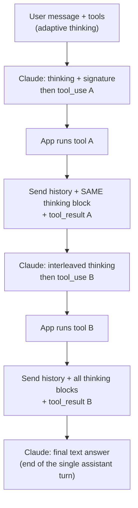

**Extended thinking** is Anthropic's name for Claude's reasoning mode. The model writes `thinking` content blocks before (and, with tools, between) its answer blocks. It launched with Claude 3.7 Sonnet in February 2025 as "the same model given more time", controlled by a token budget ([Anthropic](../sources/anthropic-visible-extended-thinking.md)). By November 2026 it has two API forms. **Adaptive thinking** (`thinking: {type: "adaptive"}` plus `output_config.effort`) is the only thinking mode on Claude 4.7 and later. It is on by default on Claude 5-generation models and Claude Mythos Preview, but Opus 4.7 and 4.8 still default to thinking off until you set it. **Manual extended thinking** (`type: "enabled"` with `budget_tokens`) is legacy: deprecated on Opus/Sonnet 4.6, still the only mode on Opus 4.5, Sonnet 4.5 and Haiku 4.5, and rejected with a 400 on 4.7+ (Claude Mythos Preview is an exception and still accepts it) ([extended thinking docs](../sources/anthropic-extended-thinking-docs.md), [thinking docs](../sources/anthropic-thinking-docs.md)). This page covers the mechanics. For training and the general trade-offs, see [reasoning models](reasoning-models.md) and [test-time compute](test-time-compute.md).

## Modes and controls

| | Adaptive (current) | Manual / extended (legacy) |
|---|---|---|
| Request | `thinking: {type: "adaptive"}` (on by default on Claude 5-gen) | `thinking: {type: "enabled", budget_tokens: N}` |
| Depth control | `output_config.effort`: `low`, `medium`, `high`, `xhigh`, `max` (soft) | `budget_tokens`: min 1,024, < `max_tokens` (a target, not a cap) |
| Thinks every request? | No. The model decides per request, and may skip on easy input | Yes |
| Interleaving with tools | Automatic | Beta header `interleaved-thinking-2025-05-14` on Claude 4/4.5; none on Opus 4.6 manual; not on Haiku 4.5 |
| Forced `tool_choice` (`any`/`tool`) | Supported on most models (no thinking block before the call); rejected with a 400 on Opus 5.5, Sonnet 5.5, Fable/Mythos 5.1 and 5.2 | Error. Only `auto` / `none` |
| Turn must start with thinking block | No | Yes (final assistant turn) |

Sources: [thinking docs](../sources/anthropic-thinking-docs.md), [extended thinking docs](../sources/anthropic-extended-thinking-docs.md), [steering docs](../sources/anthropic-steering-thinking-docs.md).

Default effort is `high` on most models and `medium` on Claude Opus 5.5 and Haiku 5.5. Some models refuse `thinking: {type: "disabled"}` (Opus 5.5, all Fable/Mythos models); Opus 5 and Haiku 5.5 accept it only at effort `high` or below. On Sonnet 5.5 the lowest setting is `between_tools`, which turns off up-front thinking only and is also accepted only at `high` or below ([thinking docs](../sources/anthropic-thinking-docs.md), [steering docs](../sources/anthropic-steering-thinking-docs.md)). Even at `max`, follow-up requests that only process tool results may skip thinking. No level guarantees a thinking block ([steering docs](../sources/anthropic-steering-thinking-docs.md)).

**Cost control:** `max_tokens` is the only hard ceiling, and it includes thinking. Effort is soft guidance. In a tool loop each request has its own `max_tokens`, so nothing caps the whole turn. If you hit `stop_reason: "max_tokens"`, raise the cap when the reasoning was needed, or lower effort when it was overthought ([steering docs](../sources/anthropic-steering-thinking-docs.md)). On the legacy mode, budgets above 32K should go through [batch processing](batch-processing.md) to avoid timeouts. SDKs require [streaming](streaming.md) once `max_tokens` exceeds 21,333 ([extended thinking docs](../sources/anthropic-extended-thinking-docs.md), [thinking docs](../sources/anthropic-thinking-docs.md)).

## What comes back: blocks, summaries, signatures

- A `thinking` block has a `thinking` text field and a `signature`, which is the **encrypted full reasoning**. The visible text is never the raw [chain of thought](chain-of-thought.md). `display: "summarized"` returns a summary written by a separate model. `display: "omitted"` (default on Claude 5-gen, Opus 4.7/4.8) returns an empty field and streams faster, because the server skips the thinking deltas ([thinking docs](../sources/anthropic-thinking-docs.md)).
- **Billing is for the full thinking, whatever you see.** Read `usage.output_tokens_details.thinking_tokens`; it appears only on the final `message_delta` when streaming. Summaries are free ([steering docs](../sources/anthropic-steering-thinking-docs.md)).
- `redacted_thinking` blocks hold safety-redacted reasoning in an opaque `data` field. Code that filters on `type == "thinking"` silently drops them and breaks tool-use round trips ([thinking docs](../sources/anthropic-thinking-docs.md)).
- On recent models, prompting Claude to write its reasoning into the answer text may be refused (`reasoning_extraction`). Read the thinking blocks instead ([thinking docs](../sources/anthropic-thinking-docs.md)).

## Thinking with tools and interleaving

A tool-use loop is **one assistant turn**. When you send `tool_result`s back, you must include that turn's thinking blocks **complete, unmodified and in their original order**. Edited blocks get a 400. Toggling thinking mid-turn doesn't error; the API silently disables thinking for that request ([thinking docs](../sources/anthropic-thinking-docs.md)). See [function calling](function-calling.md) and the [agent loop](agent-loop.md).

**Interleaved thinking** lets Claude reason after each tool result before choosing its next action. With it, the thinking allocation spans the whole turn rather than one response ([thinking docs](../sources/anthropic-thinking-docs.md)). This used to be the gap filled by the "think" tool, a no-op tool that only logs a thought. On [τ-Bench](benchmarks.md) airline it took pass^1 from 0.370 to 0.570 with an optimized prompt. In December 2025 Anthropic updated that post to recommend extended thinking over the think tool in most cases ([think tool](../sources/anthropic-think-tool.md)).

*Diagram: one assistant turn with interleaved thinking, per the Claude thinking docs.*

**Across turns:** keep-all models (Opus 4.5+, Sonnet 4.6+, Haiku 5.5, Fable/Mythos) keep earlier turns' thinking in context, billed as input. Older models strip it once a non-tool-result user message arrives. Pass everything back either way and let the API filter it. On keep-all models, long agent sessions accumulate thinking in the [context window](context-window.md). Thinking-block clearing ([context editing](context-engineering.md)) reclaims that space ([thinking docs](../sources/anthropic-thinking-docs.md)). Thinking blocks are readable only by their own model and certain others, so switching models mid-conversation can silently drop prior reasoning ([thinking docs](../sources/anthropic-thinking-docs.md)).

## Interactions and gotchas

- **[Prompt caching](prompt-caching.md):** the thinking configuration, the effort level and `budget_tokens` are rendered into the prompt. Changing any of them invalidates message-level cache breakpoints, and sometimes system and tool breakpoints too. Pick one configuration per conversation. A beta per-message effort change avoids the invalidation. Long thinking tasks may outlive the 5-minute TTL, so consider the 1-hour cache ([thinking docs](../sources/anthropic-thinking-docs.md), [steering docs](../sources/anthropic-steering-thinking-docs.md)).
- **[Sampling parameters](sampling-parameters.md):** Claude 4.7+ and Claude 5-gen reject non-default `temperature`/`top_p`/`top_k`, and from API version `2026-10-21` any `temperature`, `top_p` or `top_k` returns a 400 on every model. Claude 4.6+ rejects assistant prefill. Manual thinking never allowed prefill ([thinking docs](../sources/anthropic-thinking-docs.md)).
- **Prompt steering is model-dependent.** "Think carefully" and "answer directly" can shift how often Claude thinks. On Sonnet 5.5, Haiku 5.5 and Fable 5.2 the discouraging wording doesn't reliably work, so lower effort instead ([steering docs](../sources/anthropic-steering-thinking-docs.md)).
- **Don't trust the summary as an audit log.** Claude 3.7 Sonnet's reasoning mentioned a hint it had used only about 25% of the time ([Anthropic](../sources/anthropic-reasoning-models-dont-say-think.md)). Anthropic itself flagged faithfulness as a caveat at launch ([Anthropic](../sources/anthropic-visible-extended-thinking.md)).

## Cross-vendor equivalents (Nov 2026)

| Concept | [Claude](anthropic-messages-api.md) | [OpenAI](openai-responses-api.md) | [Gemini](gemini-api.md) | DeepSeek |
|---|---|---|---|---|
| Depth knob | `output_config.effort` | `reasoning.effort` (+ `mode`) | `thinking_level` | `reasoning_effort` |
| Visible reasoning | Summary / omitted | Summary opt-in | Summary opt-in | Full `reasoning_content` |
| Continuity token | `signature` | reasoning item / `encrypted_content` | thought signature | raw `reasoning_content` |
| Must round-trip in tool loops | Yes | Yes | Yes (stateless) | Yes, whenever `tools` is set |
| Usage field | `thinking_tokens` | `reasoning_tokens` | `total_thought_tokens` | n/a |

Sources: [thinking docs](../sources/anthropic-thinking-docs.md), [OpenAI guide](../sources/openai-reasoning-guide.md), [Gemini](../sources/gemini-thinking-docs.md), [DeepSeek](../sources/deepseek-thinking-mode-docs.md).

## When to use / when not

Synthesis, from the sources above:

- **Leave adaptive thinking on at default effort** (on Opus 4.7/4.8, turn it on explicitly) for agents, coding and multi-step analysis. Interleaving is where it pays most in tool-heavy work, because the model reconsiders after each result.
- **Lower effort (or disable thinking where allowed)** for classification, extraction, short chat turns and high-QPS endpoints. Measure first, because lowering effort can cut quality on the hard tail ([steering docs](../sources/anthropic-steering-thinking-docs.md)).
- **Use `display: "omitted"`** when users never see the reasoning. It reduces time to first text token, though not cost ([thinking docs](../sources/anthropic-thinking-docs.md)).
- **Stay on a legacy `budget_tokens` model only** if you need a predictable per-request thinking spend and can accept older models ([extended thinking docs](../sources/anthropic-extended-thinking-docs.md)).
- **Integration checklist:** round-trip all thinking and redacted blocks unmodified; size `max_tokens` for thinking plus answer; keep thinking config and effort stable within a cached conversation; log thinking-token usage per request for [cost tracking](cost-and-latency-optimization.md).

## Sources

- [Claude API docs: Thinking](../sources/anthropic-thinking-docs.md)
- [Claude API docs: Extended thinking](../sources/anthropic-extended-thinking-docs.md)
- [Claude API docs: Steering thinking](../sources/anthropic-steering-thinking-docs.md)
- [Claude's extended thinking (Anthropic, 2025)](../sources/anthropic-visible-extended-thinking.md)
- [The "think" tool (Anthropic Engineering)](../sources/anthropic-think-tool.md)
- [OpenAI reasoning models guide](../sources/openai-reasoning-guide.md)
- [Gemini API docs: Thinking](../sources/gemini-thinking-docs.md)
- [DeepSeek API docs: Thinking mode](../sources/deepseek-thinking-mode-docs.md)
- [Reasoning models don't always say what they think](../sources/anthropic-reasoning-models-dont-say-think.md)
