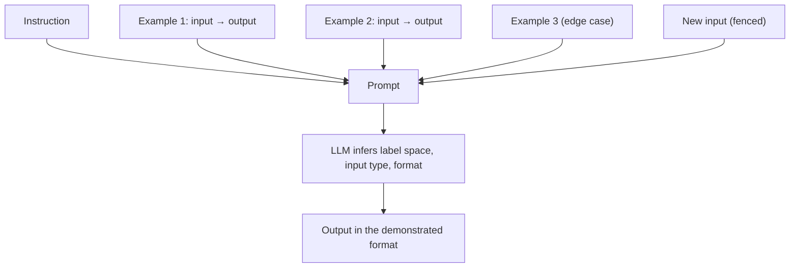

**Few-shot prompting** (also "multishot" or in-context learning) means putting a small number of worked input → output examples in the prompt so the model infers the task, format and style from them, with no change to its weights. *Zero-shot* gives only an instruction; *one-shot* gives a single example. GPT-3 established the paradigm: a 175B model performed translation, QA and cloze tasks from text demonstrations alone, with no gradient updates ([Brown et al.](../sources/brown-2020-gpt3-few-shot.md)). It is one of the main tools of [prompt engineering](prompt-engineering.md) and the cheapest alternative to [fine-tuning](fine-tuning.md).

## What the examples actually teach

Min et al. found, on classification and multiple-choice tasks across 12 models, that replacing demonstration labels with random ones barely hurt accuracy. The gains came from showing the **label space**, the **distribution of inputs** and the **format** ([Min et al.](../sources/min-2022-rethinking-demonstrations.md)). Synthesis: for modern instruction-tuned models, examples work mainly as a *format and scope specification*, not as training data. That is why all three vendors frame them as the most reliable way to lock output format and tone ([Anthropic](../sources/anthropic-prompting-best-practices.md), [Google](../sources/google-gemini-prompting-strategies.md), [OpenAI](../sources/openai-prompt-engineering-guide.md)). Synthesis: do not over-read this. It was measured on classification and multiple-choice tasks; for generative tasks the content of the example output is what the model tends to copy (compare Google's overfitting warning below).

## How many examples, and which

| Vendor | Guidance (as of 2026-11) |
|---|---|
| Anthropic | 3–5 examples; relevant to the real use case, diverse enough to avoid accidental patterns; wrap in `<example>` inside `<examples>`. You can ask the model to critique or extend your set ([Anthropic](../sources/anthropic-prompting-best-practices.md)). |
| OpenAI (GPT models) | Cover a diverse range of inputs; place examples in the developer message ([system prompts](system-prompts.md)) ([OpenAI](../sources/openai-prompt-engineering-guide.md)). |
| OpenAI ([reasoning models](reasoning-models.md)) | Start zero-shot; add few-shot only if needed and make examples match the instructions closely ([OpenAI reasoning](../sources/openai-reasoning-best-practices.md)). |
| Google Gemini | Always include few-shot examples; a few usually suffice; too many risk overfitting; clear examples can replace instructions ([Google](../sources/google-gemini-prompting-strategies.md)). |
| Notebook | 2–5 examples, used when a pattern or format keeps coming out wrong ([Notebook](../sources/notebook-prompt-engineering.md)). |

> **Contradiction:** Google recommends *always* including examples, while OpenAI's reasoning-model guide says to try zero-shot first. Synthesis: the difference tracks model type. Reasoning models infer intent well from goals, and examples can over-constrain their approach, while non-reasoning models benefit more from demonstrations.

## Formatting rules

- **Identical structure** across examples: same tags, separators, whitespace and newlines. Inconsistent examples produce inconsistent outputs ([Google](../sources/google-gemini-prompting-strategies.md)).
- **Separate examples from instructions and from the live input** with tags ([Anthropic](../sources/anthropic-prompting-best-practices.md)); fence the real input so it can't [inject instructions](prompt-injection.md) ([Notebook](../sources/notebook-prompt-engineering.md)).
- **Cover edge cases**, including the "none of the above" or refusal case, so the model sees the full label space ([Anthropic](../sources/anthropic-prompting-best-practices.md), [Min et al.](../sources/min-2022-rethinking-demonstrations.md)).
- **Stable prefix:** examples rarely change, so place them early to benefit from [prompt caching](prompt-caching.md) ([OpenAI](../sources/openai-prompt-engineering-guide.md)).

A compact pattern (from the Notebook): a system line defining the one-word label set, three `input → label` lines, then the real input inside `<ticket>` tags ([Notebook](../sources/notebook-prompt-engineering.md)).

## Variants

- **Few-shot chain-of-thought:** examples include the reasoning steps, not just answers. PaLM 540B with eight such exemplars set the GSM8K state of the art in 2022 ([Wei et al.](../sources/wei-2022-chain-of-thought.md)). See [chain-of-thought](chain-of-thought.md).
- **Examples with thinking models:** on Claude, worked examples shaped as problem → method → answer influence how the model reasons in its [thinking blocks](extended-thinking.md) ([Anthropic](../sources/anthropic-prompting-best-practices.md)).
- **Dynamic few-shot:** Synthesis: retrieve the most similar labelled examples per input with [embeddings](embeddings.md) instead of a fixed set. This trades cache hits for relevance.

## Failure modes

- **Instability.** Accuracy can range from near chance to near state of the art depending on which examples are chosen, their order and the format ([Zhao et al.](../sources/zhao-2021-calibrate-before-use.md)).
- **Recency bias.** Labels appearing near the end of the prompt are favoured; **common-token bias** favours answers frequent in pre-training. Contextual calibration (probe with a content-free input like "N/A", then rescale) gave up to +30 points on GPT-2/3 ([Zhao et al.](../sources/zhao-2021-calibrate-before-use.md)). Synthesis: this requires access to label probabilities, so it is rarely possible on chat APIs that do not expose log-probabilities.
- **Spurious patterns.** If every example's answer is "(A)", the model drifts toward "(A)", and its chain of thought will not admit it ([Turpin et al.](../sources/turpin-2023-unfaithful-cot.md)). Balance labels and vary surface features.
- **Over-copying.** Too many or too similar examples cause the model to imitate length, phrasing or content ([Google](../sources/google-gemini-prompting-strategies.md), [Anthropic](../sources/anthropic-prompting-best-practices.md)).
- **Token cost.** Examples take up [context window](context-window.md) space on every call. Synthesis: caching mitigates the price but not the context budget.

## When to use / when not

Synthesis: the table below combines the vendor guidance and papers above; the ~10-case threshold is a rule of thumb, not a sourced figure.

| Use few-shot when | Prefer something else when |
|---|---|
| The format or tone keeps coming out wrong | You need a guaranteed schema: use [structured outputs](structured-outputs.md) |
| Labels or categories are subtle and easier to show than to describe | The task needs knowledge the model lacks: use [RAG](retrieval-augmented-generation.md) |
| You are prototyping and have under ~10 labelled cases | You have thousands of examples and high volume: consider [fine-tuning](fine-tuning.md) |
| A non-reasoning model needs a demonstrated reasoning style | A reasoning model already does well zero-shot (test first) |

## Sources

- [Language Models are Few-Shot Learners](../sources/brown-2020-gpt3-few-shot.md)
- [Rethinking the Role of Demonstrations](../sources/min-2022-rethinking-demonstrations.md)
- [Calibrate Before Use](../sources/zhao-2021-calibrate-before-use.md)
- [Chain-of-Thought Prompting Elicits Reasoning](../sources/wei-2022-chain-of-thought.md)
- [Language Models Don't Always Say What They Think](../sources/turpin-2023-unfaithful-cot.md)
- [Prompting best practices (Anthropic)](../sources/anthropic-prompting-best-practices.md)
- [Prompt engineering guide (OpenAI)](../sources/openai-prompt-engineering-guide.md)
- [Reasoning best practices (OpenAI)](../sources/openai-reasoning-best-practices.md)
- [Prompt design strategies (Google Gemini)](../sources/google-gemini-prompting-strategies.md)
- [Prompt & Context Engineering (Notebook)](../sources/notebook-prompt-engineering.md)
